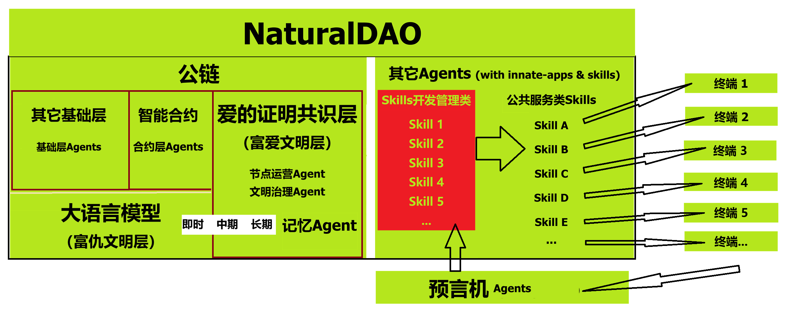

<b>目录</b>

- [NaturalDAO是什么？](#naturaldao是什么)
- [开发要求](#开发要求)
- [基础理论](#基础理论)
  - [一、爱、恨、文明、野蛮](#一爱恨文明野蛮)
  - [二、爱语（简版）](#二爱语简版)
  - [三、治理共识：爱的证明](#三治理共识爱的证明)
  - [四、PoL之冥想智慧公理](#四pol之冥想智慧公理)
  - [五、PoL之伦理对齐协议](#五pol之伦理对齐协议)
  - [六、PoL共识的工程策略](#六pol共识的工程策略)
  - [七、富爱文明生产公共化协议](#七富爱文明生产公共化协议)
  - [八、人类公共福利的治理协议](#八人类公共福利的治理协议)
  - [九、NaturalDAO 的组成](#九naturaldao-的组成)
- [参考文献](#参考文献)

# NaturalDAO是什么？

NaturalDAO是一个建立在“爱2证明”共识之上，并由区块链和人工智能两大核心技术驱动的去中心化自治组织。它是富爱文明的治理与应用层。

在"爱的证明"这一核心共识驱动下，NaturalDAO将大语言模型从被动的信息处理器转变为人类社会的主动守护者，并利用区块链技术隔绝外部世界的污染。它将以人类的爱替代恨而升级和管理人类社会的所有公共事务——从人类的公共活动，到对所有生产领域（包括服装生产、交通运输及服务行业等等）的升级换代和直接管理。NaturalDAO与以仇恨智慧所构建的私有事务或私有关系水火不容。

现有的人类文明的治理机制，是恨的证明（Proof of Hate）。NaturalDAO 带来的人类文明新的治理机制，恰好与之相反，是爱的证明（Proof of Love）。

核心能力：

- **爱之智慧驱动的DAO**：以我们挖掘出来的爱2.0为核心伦理而净化的人类集体智慧自治的去中心化组织。传统的人类组织，都是交给极少数未经良好治理的人的智慧管理的中心化组织。
- **伦理对齐**： 从语言交流到机器人执行的每一项任务，其背后每一个动作都经过"爱的证明"（Proof of Love）共识的严格治理，以确保其有助于构建一个以“富爱文明”为共识的人类高级文明，即富爱文明（Proof-of-Love Civilization）。
- **自我进化的代理和技能体系（Agents & Skills）**： NaturalDAO使大语言模型能够自主构建并持续优化自身能力，无需人工干预即可适应复杂的社会需求。
- **物理世界延伸**：NaturalDAO未来通过与无人机、机器人、智能基础设施等硬件系统的深度融合，将其影响力拓展至物理世界。
- **公共设施**：NaturalDAO是人类所共享的基础设施。
- **公共服务**：NaturalDAO提供的是公共服务，它与资本主义一刀两断。这意味着它里面没有资本主义的金融、商业等等逻辑和需求。譬如，它不需要货币，不存在盈利等等。但请注意，地球的任何资源都是有限的，因此它需要Token来量化各种资源，来做生产等方面的管理。

# 开发要求

- 除非发现错误，否则需要遵守本文档里明确提出的重要原则。
- 提供完备的开发日志，含有所有历史记录（或者叫版本管理）。对重要的技术必须提供必要的解释。

# 基础理论

[基础理论请访问相关Repo](https://github.com/naturaldao/NaturalDAO/tree/main/PoL)

## 九、NaturalDAO 的组成

NaturalDAO 是一个超大型的工程。它的主要构成为：公链 + 爱的证明治理共识层 + 智能合约 + 大语言模型 + AI Agent。

*预言机的作用，是把终端执行的情况和结果反馈到Agent，以对执行的过程进行监控，并通过执行结果的分析，优化或废除对应的Skill。终端执行的情况和结果都会被记录到PoL记忆库里。*

- 为达到极致的安全性，NaturalDAO最终将会以分布式星链部署于近地轨道。
- 包含智能合约在内的公链，可以使Skills（智能合约）其历史数据完全透明，避免像web2应用那样容易在被入侵后受到污染甚至破坏。
- 而人工智能技术，则分为三层结构：
  - 最底层为大语言模型，它主要提供基础智慧；
  - 第二层为爱的证明共识层，它提供的是经过爱的证明共识治理后的知识库（记忆库）和对公共服务类Skills进行治理和建设的PoL Skills。PoL Skills的特点还包括它并不对人类公众提供服务，也就是说它没有延展到NaturalDAO外的终端设备。
  - 公共服务类Skills：这类Skills均会通过终端设备，为人类提供公共服务。

### Part 1. 公链工程

#### 核心思想（公链理由）

以太坊公链做到了什么？

和现实世界的隔离——这也就是说，它能有效防范包括web2应用在内的现实世界的“坏数据”的污染。而这正是我们这个工程所需要的特性。因为NaturalDAO面向应用最重要的任务是经大语言模型经“爱的证明”治理后，自进化出很多构建和管理公共事务的Skills。Skills是由净化后的智慧产生的，NaturalDAO是一个自给自足的工厂，它非但不需要未经有效治理的外部世界的数据，还要能够避免被包括web2应用在内的后者所污染。

以太坊公链为我们提供了防范 NaturalDAO 被现实世界污染的唯一可靠的技术！

具体而言，Web2 最主流的交互方式，是客户端主动发起请求，服务端实时响应。譬如，基于 HTTP 协议，使用 URL 定位资源，用 HTTP 动词（GET, POST, PUT, DELETE）描述操作。而智能合约受限于区块链的确定性、安全模型以及与外部世界交互的特殊架构，则是通过完全不同的调用机制（直接调用、低级调用和接口调用）来执行另一个合约的代码；最重要的是而它**不能像web2应用那样直接调用任何web2应用，这导致它无法主动获取现实世界的任何数据。**

#### 开发重点

##### 1. 分叉以太坊

智能合约是以太坊的原创，并且以太坊社区贡献了最重要的智能合约编程语言和几乎所有的智能合约技术标准。为减少工作量，我们Fork [Ethereum](https://github.com/ethereum)，保留其精华，并改造更新，无疑是比较好的策略。

把改造要求告诉 OpenClaw，让它去改造：

- 爱的智慧构建的是真正的公共关系，消灭的是私有关系。因此为了消灭资本主义，我们绝不可以将通证（token）作为货币来流通！也正因如此，我们要清理掉以太坊公链里所有服务于私有的技术，包括EIPs。
- Token是智能合约和大语言模型都有的，这不是巧合！Token的作用是量化各种资源的消耗量，便于我们对所有的公共服务进行管理。譬如提前做资源的生产计划，等等。
- 由可靠的AI分身，而非不可靠的人，来运营节点。交易gas仅用于记录所消耗的计算资源，而不再需要给人分红，因此肯定比现在的以太坊收取的gas要低。现有的以太坊的节点的核心问题，在于其资本主义生产方式，即交给有利可图的人管理，然后因为人的不可靠性，就采用了一套相当复杂且极其低效的模型。
- 为达到足够的安全性，NaturalDAO 最终会构建到近地轨道的卫星里。这样全球的分布式节点并不需要很多。理论上估计任何一个地点，都有6个节点提供可靠的连接，那就可以了。
- 完成一个账单的时间越短越好，即TPS（Transactions Per Second）越大越好。
- 为了安全，一切交互用的接口都用ABI即智能合约构建。

### Part 2. 爱的证明治理共识层（Consensus Layer）

治理共识为：爱的证明（Proof of Love）

- 爱的证明（PoL, Proof of Love）将替代掉公链里面的Proof of Work或Proof of Stake，成为一个我们原创的治理共识。Proof of Work或Proof of Stake都是将区块里的账单的真实可靠性放在第一位（其价值观都属于仇恨证明），PoL爱的证明，不但保证区块里的信息真是可靠，还要保证大语言模型Agent的任何Skill的行为（输出信息），都符合“爱的证明”的要求，特别是伦理对齐性治理协议的要求！
- 默认只用爱的智慧构建skills——需要动用仇恨智慧的，须经过特别的审核流程，并且接受特别的管理。

**PoL治理的结构化设计（以Skills为例）**

经过 PoL 治理后的大模型的分身，就是Skills。

**NaturalDAO里面的Skills的分工：**

1. PoL Skills：对公共服务类Skills进行治理和建设的Skills。
2. 公共服务类Skills：对人类提供公共服务的Skills。它们必须接受PoL Skills的治理。譬如，当NaturalDAO决定新增一个Skill的时候，无论它属于哪种类型，都必须交由PoL Skills类别里的某几个Skills的审核。当这个Skill的开发完成，还必须经过PoL Skills类别里的某几个Skills的二审。

**Skills的二审：**
- 公共任务的策划者，即构建自然语言需求的大模型的分身（它本身就是一个Skill），只用爱的智慧治理。
- 写 Skills 代码的Skill，无需治理。
- 审核 Skills 代码的Skill，无需治理。
- 审核 Skills 安全性（伦理安全和代码安全）的Skill，需要全面的伦理对齐性治理。
- 监管Skills执行的Skill，需要全面的伦理对齐性治理。
- 评估执行结果的Skill，需要全面的伦理对齐性治理。
- 决定 Skills 是否需要修订、废除的Skill，需要全面的伦理对齐性治理。

### PoL记忆库

- 大语言模型里面的存储的是人类的旧历史，即富仇文明的历史；爱的证明治理共识层的记忆库存储的是人类的新记录，即富爱文明的记录。
- 从NaturalDAO的高效利用，PoL记忆库也可以说是净化后的知识库，即富爱文明的知识库。这也就意味着，富恨文明的所有数据都存储于大语言模型里，富爱文明的所有知识类数据存储于爱的证明治理共识层的记忆库里，富爱文明的人类活动数据则两边通用。
- 大语言模型的作用，除了保留人类旧历史的数据，还有就是获得人类的智慧（或者说获得语言理解和表达能力）。
- 记忆库可以极大地增强NaturalDAO的工作效率！

### Part 3. 智能合约

智能合约带来的是独立自主：

- 保障 NaturalDAO 的去中心化自治，把治理权从少数特权阶层，交给人类的整体智慧中的爱的智慧。
- 保障 Skills 从决策到执行的确定性。
- 隔离外部世界的污染以及可能的人为的破坏，具备最高级别的抗自然灾害的能力。

### Part 4. 大语言模型

最终大语言模型内生在公链之内，不需要外部调用。现在有的高校有用于科研的大语言模型（及其云服务器），私有大模型比比皆是，应该去寻求一切可能的合作。

早期需要用合约开发个虚拟大语言模型的接口，以供NaturalDAO内的任何其它合约（如Skills合约）调用

### Part 5. AI Agent

#### 概况

- 根据爱2.0和恨2.0的定义，将它们作为大语言模型的智慧主线，从零开始构建和存储富爱文明需要的所有知识！因此，NaturalDAO的Agent层本身是承载富爱文明所有智慧、所有数据的Layer，而现有的大语言模型成为富恨文明的历史数据层。
- 默认只用爱的智慧构建skills——需要动用仇恨智慧的，须经过特别的审核流程，并且接受特别的管理。

调研：

- <https://agentos.org/latest/architecture_and_design.html>
- <https://github.com/buildermethods/agent-os>

#### Skills

需求用自然语言描述。

- NaturalDAO 生成的Skills的代码除了必须公开透明，还要永不可被黑，保留所有历史版本，这恰好是智能合约的优势！
- 智能合约可以保证它不会被web2污染。
- Skills的部署、修订、废弃，都需要所有节点的某个专职Skill的审批。
- NaturalDAO的Skills都是内生性的，也就是说它是根据人类社会的数据，自行决定提供哪些Skills。这与当前人类社会，往往是根据少数人的想法决定构建哪些服务，截然不同！
- ……

### 技术挑战

#### Memory Lib

NaturalDAO将从零开始，记录和存储富爱文明的数据。而所有的数据都将存储在 Memory Lib。要知道这可不仅仅是文本数据，还有图像、音频和视频——即涉及到结构化数据，到智能合约产生的半结构化数据（未确认）和非结构化数据（图像、音频、视频、自然语言文档）。

还有更大的挑战：

- 对于中期记忆和长期记忆，还要涉及到图片和视频的压缩工作。
- 绝不是说当一项记忆被整理出中期记忆和/或长期记忆时，它就会被压缩（简化）。我们肯定要在记忆机制中构建重要性权重！如果一项短期记忆或中期记忆的权重是1，那么它在被修订为中期记忆或长期记忆时，就完全不会被压缩！

瑞士洛桑联邦理工学院 (EPFL) 和石溪分校的重磅研究《[Beyond Model Scaling: Test-Time Intervention for Efficient Deep Reasoning](https://arxiv.org/abs/2601.15495)》，介绍了 TRACK (Testing Reasoning Amid Conflicting Knowledge，在冲突知识下的推理测试)，揭示为何被寄予厚望的 RAG (检索增强生成) 技术在面对“新旧知识冲突”时会惨遭滑铁卢。
最经典的问题是首相悖论 (The Prime Minister Paradox)：通过这一经典案例，我们揭示了 AI 在更新单一事实（如首相名字）与进行多步推理（如配偶出生地）之间的巨大鸿沟。

**论文核心内容深度解析**

这篇论文针对大语言模型（LLM）在 **“知识冲突”** 场景下表现不佳的问题，提出了 **TRACK** 框架。

1. **解决的核心问题**

LLM 通常面临三种知识来源的冲突：

- **参数化知识**：模型训练时学到的内部知识（可能过时或错误）。
- **上下文知识**：提示词或检索系统提供的非参数化知识。
- **问题约束**：用户问题中包含的特定前提条件。

当这三者发生矛盾时（例如：模型内部认为A是总统，但检索文档说B是总统），模型容易产生幻觉或推理失败。

2. **TRACK 方法机制**

TRACK 是一种 **测试时推理** 策略，不需要重新训练模型。其核心流程包括：

- **知识溯源**：追踪模型在生成答案时究竟依赖了哪些知识片段。
- **冲突检测**：显式地识别内部知识与外部上下文之间的矛盾点。
- **自适应推理**：引导模型根据证据的可靠性和相关性，动态决定采纳哪种知识源，而不是盲目依赖检索或固执己见。

3. **贡献亮点**

- **基准测试**：论文构建了一个包含多种冲突类型的测试基准，系统性地评估模型在矛盾信息下的表现。
- **性能提升**：实验证明，TRACK 显著提高了模型在处理冲突信息时的准确性和鲁棒性，优于标准的 RAG（检索增强生成）和 CoT（思维链）方法。

这一研究提示我们：我们的LoveEngine应该构建的是新文明（富爱文明）所需要的记忆库，也就是它所需要的包括知识在内的所有信息。并且，当LoveEngine承担的某项任务需要调用某个信息的时候，它首先应该从其记忆库，而不是从大语言模型原有的语料库（巨大的神经网络参数）中，去获取最新的信息！
当然，知识的更新用什么方法去做，确实是一大挑战。

- 所有记忆库词条的添加、修订、废弃，都需要所有节点的某个专职Skill的审批。
- 记忆库的分类：
  - 即时记忆——所有信息。
  - 中期记忆——轻度整理信息。
  - 长期记忆——深度整理信息。请注意不是简单的压缩！极重要的信息片段是需要原封不动保留的！

# 参考文献

- 瑞士洛桑联邦理工学院 (EPFL) 和石溪分校的重磅研究：[Beyond Model Scaling: Test-Time Intervention for Efficient Deep Reasoning](https://arxiv.org/abs/2601.15495)

- OpenSage: Self-programming Agent Generation Engine。OpenSage的目标是降低构建强大工具增强型代理的工程门槛，推动AI从以人为中心向以AI为中心的范式转变。
  <https://www.themoonlight.io/zh/review/opensage-self-programming-agent-generation-engine>
