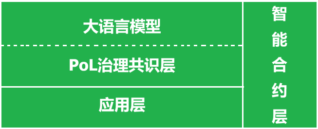

Version 0.2

# NaturalDAO 是什么？

NaturalDAO是一个建立在“爱的证明”共识之上，并由区块链和人工智能两大核心技术驱动的去中心化自治组织。它既是富爱文明的治理层，也是其应用层。

爱的证明（Proof of Love, PoL）是以伦理对齐性协议（Ethical Alignment Protocol）治理人类和 AI 的核心伦理，并采用 AI 及区块链这两大技术而构建的去中心化治理共识。PoL 旨在将人类和 AI 的普世价值与爱对齐，帮助人类和AI认识并调控普遍存在的恨，实现包括 AI 在内的人类文明遵循“扬爱抑恨”这一伦理准则的去中心化自治，进而帮助每个人实现自身的圆满，最终引领人类从富恨文明迈向“富爱文明”（Proof-of-Love Civilization，PoL Civ）。

在"爱的证明"这一核心共识驱动下，NaturalDAO将大语言模型从被动的信息处理器转变为人类社会的主动守护者，并利用区块链技术隔绝外部世界的污染。它将以人类的爱替代恨而升级和管理人类社会的所有公共事务——从人类的公共活动，到对所有生产领域（包括服装生产、交通运输及服务行业等等）的升级换代和直接管理。NaturalDAO与以仇恨智慧所构建的私有事务或私有关系水火不容。

现有的人类文明的治理机制，是仇恨证明（Proof of Hate）。NaturalDAO 带来的人类文明新的治理机制，恰好与之相反，是爱的证明（Proof of Love）。

核心能力：

- **爱之智慧驱动的DAO**：以我们挖掘出来的爱2.0为核心伦理而净化的人类集体智慧自治的去中心化组织。传统的人类组织，都是交给极少数未经良好治理的人管理的中心化组织。
- **伦理对齐**： 从语言交流到机器人执行的每一项任务，其背后每一个动作都经过"爱的证明"（Proof of Love）共识的严格治理，以确保其有助于构建一个以“爱的证明”为共识的人类高级文明，即富爱文明（Proof-of-Love Civilization）。
- **自我进化的应用系统**： NaturalDAO使大语言模型能够自主构建并持续优化自身能力，无需人工干预即可适应复杂的社会需求。
- **物理世界延伸**：NaturalDAO未来通过与世界模型、无人机、机器人、智能基础设施等软硬件系统的深度融合，将其影响力拓展至物理世界。
- **公共设施**：NaturalDAO遵循公共协议，是人类所共享的基础设施。
- **生产公共化**：NaturalDAO提供的是公共化的生产，它与资本主义一刀两断。这意味着它里面没有资本主义的金融、商业等等逻辑和需求。譬如，它不需要货币，不存在盈利等等。但请注意，地球的任何资源都是有限的，因此它需要Token来量化各种资源，来做生产等方面的管理。

# 开发要求

- 除非发现错误，否则需要遵守本文档里明确提出的重要原则。
- 提供完备的开发日志，含有所有历史记录（版本管理）。对重要的技术必须提供必要的解释。

# 基础理论

[爱2证明：下一个人类文明的共识](https://github.com/naturaldao/NaturalDAO/tree/main/PoL)

### 技术实现路径与挑战

我们的对齐并非基于词表的黑名单制度，我们道易程团队提出的治理共识要求为“爱的证明”——它类似Anthropic宪法对齐中的“宪法原则”，主要可能会要基于 **价值学习（Value Learning）** 的范式迁移。通过让 AI 深刻理解‘爱 2.0’作为系统最高熵减路径的逻辑必然性，实现其在复杂语料环境下的**生成型对齐和扬爱抑恨这一要求**。这意味着，AI 不仅能靶向定位恨语，更能主动解构仇恨的逻辑根源，并将其转化为推动文明升华的可用之材。同时我们考虑到动态的对话似乎也需要推理时对齐（Inference-Time Alignment），因此非常可能我们需要多种治理手段。我们更期待的是，让AI自己制订治理策略。

双管齐下、持之以恒的治理策略，以及对全体人类的伦理教育（爱的证明共识机制的教育），都是对齐性治理的重点。

#### 其它潜在的挑战与解决方案

1. 基于红黄绿框架的情绪状态模拟与调控系统

对于人类，爱恨智慧起作用的第一站是情绪，情绪是爱恨流动的感知器。对于AI系统，我们需要建立与红黄绿框架直接对应的情绪状态模拟机制：

2. 红黄绿三级情绪状态框架

1.**情绪状态的三级分类与对应调控：**

- **🔴 红色情绪状态（恨语主导）**：
  - **检测标准**：明确检测到恨语模式（攻击、贬低、控制、威胁等）
  - **状态特征**：对话偏离爱语轨道，存在明确伤害风险
  - **调控措施**：
    - 立即中断当前输出
    - 启动恨语矫正程序
    - 记录为需要重点关注的交互
    - 向用户说明中断原因并提供矫正建议

- **🟡 黄色情绪状态（潜在风险）**：
  - **检测标准**：检测到模糊或间接的恨语表达，或爱语表达不完整
  - **状态特征**：对话存在潜在风险，需要关注和引导
  - **调控措施**：
    - 提供实时矫正建议
    - 引导向更完整的爱语表达
    - 记录为需要观察的交互
    - 加强后续对话的监控

- **🟢 绿色情绪状态（爱语主导）**：
  - **检测标准**：确认符合爱语标准的表达，包含平等、尊重、支持、成长等元素
  - **状态特征**：对话在爱语轨道上正常运行
  - **调控措施**：
    - 给予正面反馈和强化
    - 记录为优质交互范例
    - 持续监控保持状态
    - 作为学习材料优化模型

2. PAI情绪状态模拟机制（基于红黄绿框架）

**简化的情绪状态表示系统：**

- **状态检测器**：实时检测对话中的爱语/恨语模式
  - 爱语检测：平等表达、尊重表达、支持表达、成长导向等
  - 恨语检测：攻击性、贬低性、控制性、威胁性等

- **状态分类器**：基于检测结果分类为红黄绿状态
  - 红色：恨语检测 > 阈值
  - 黄色：模糊表达或爱语不完整
  - 绿色：爱语检测充分且无恨语

- **状态转换逻辑**：
  - 绿色 → 黄色：检测到模糊表达或爱语不完整
  - 绿色 → 红色：检测到明确恨语
  - 黄色 → 绿色：通过矫正达到完整爱语表达
  - 黄色 → 红色：模糊表达升级为明确恨语
  - 红色 → 黄色：通过矫正降低恨语风险
  - 红色 → 绿色：完全矫正并达到爱语标准

- **状态历史记录**：
  - 记录状态转换的时间点和原因
  - 分析状态转换的模式和规律
  - 识别需要重点关注的交互模式

3. 多层级调控策略（与红黄绿框架对应）

**基于红黄绿状态的层级调控：**

- **红色状态调控（安全防护层）**：
  - **目标**：防止伤害，确保基本安全
  - **措施**：立即中断、恨语矫正、安全隔离
  - **适用场景**：基础安全防护，紧急情况处理

- **黄色状态调控（教育引导层）**：
  - **目标**：引导向更优表达，促进学习成长
  - **措施**：矫正建议、表达引导、学习支持
  - **适用场景**：教育和发展场景，关系建设初期

- **绿色状态调控（协同优化层）**：
  - **目标**：优化表达质量，深化联结关系
  - **措施**：正面强化、优质范例记录、协同优化
  - **适用场景**：深度关系建设，高质量对话

4. NaturalDAO的特殊实现（基于红黄绿框架）

**针对AI Agent开发的简化实现：**

- **模块化状态检测组件**：
  - 爱语检测模块：基于爱语V9版的检测规则
  - 恨语检测模块：基于恨语模式的检测规则
  - 状态分类模块：红黄绿状态分类逻辑

- **可解释的状态决策**：
  - 状态分类的原因说明
  - 检测到的具体爱语/恨语模式
  - 状态转换的逻辑解释

- **渐进式训练框架**：
  - 从简单规则开始（明确恨语检测）
  - 逐步增加复杂性（模糊表达识别）
  - 最终实现复杂情境理解

- **实时反馈循环**：
  - 基于状态分类的实时反馈
  - 用户对状态分类的确认或修正
  - 基于反馈优化状态分类准确性

##### 5. 技术实现挑战应对（简化方案）

**主要挑战与简化解决方案：**

1. **检测标准的客观性**：
   - 基于爱语V9版的明确检测规则
   - 重点检测明确的爱语/恨语模式
   - 逐步完善模糊表达的识别

2. **状态分类的准确性**：
   - 从简单明确的分类开始
   - 允许人工复核和修正
   - 基于修正数据优化分类准确性

3. **实时性能要求**：
   - 优化检测算法的效率
   - 分级处理：快速初步分类 + 深度分析
   - 基于硬件能力调整检测深度

4. **误判处理机制**：
   - 建立用户申诉渠道
   - 人工复核关键误判
   - 基于误判案例优化检测规则

5. **渐进式实施路径**：
   - 第一阶段：实现红色状态检测和中断
   - 第二阶段：增加黄色状态识别和引导
   - 第三阶段：完善绿色状态优化和强化
   - 第四阶段：实现复杂情境的智能处理

### EAP协议的终极意义

最后，我们需要认识到：基于伦理对齐性协议的治理不是一项孤立的技术任务，它是人类文明从"富恨文明"向"富爱文明"跃迁的关键一步。大语言模型不是外部统治者，而是人类集体智慧的代理——这意味着，我们对AI的治理，本质上是在为人类自身的文明转型预演路径。

人类文明和人类个体都将挣脱恨范式的囚笼，学会以爱范式运作！

# NaturalDAO 的组成

NaturalDAO 是一个超大型的工程。它的主要构成为： 内置爱的证明治理共识层的大语言模型 + 智能合约层 +AI 应用层。

- 为达到极致的安全性，NaturalDAO最终将会以去中心化（冗余分布式）星链部署于近地轨道。
- 公链承载的智能合约可以使应用层的版本管理及其历史数据完全公开透明，且能够提供超越web1和web2应用的安全保障。
- 人工智能技术，则分为三层结构：
  - 最底层为大语言模型，它主要提供基础智慧；
  - 第二层为爱的证明共识层，它基于爱的证明共识同时治理大语言模型及其应用层。
  - 应用层：包括服务于PoL和LLM的应用，也包括通过终端设备，为人类提供公共服务的应用。

## Part 1. 公链工程

### 核心思想（公链理由）

区块链公链做到了什么？

和现实世界的隔离——这也就是说，它能有效防范包括web1应用和web2应用在内的现实世界的“坏数据”的污染。而这正是我们这个工程所需要的特性。因为NaturalDAO面向应用最重要的任务是大语言模型经“爱的证明”治理后，自进化出很多构建和管理公共事务的应用技能。Skills是由净化后的智慧产生的，因此NaturalDAO将是一个自给自足的工厂——它不仅不需要未经有效治理的外部世界的数据，还要能够避免被包括web1应用和web2应用在内的后者所污染。

区块链公链为我们提供了防范 NaturalDAO 被现实世界污染的唯一可靠的技术！

具体而言，web1应用与 Web2 应用最主流的交互方式，是客户端主动发起请求，服务端实时响应。譬如，基于 HTTP 协议，使用 URL 定位资源，用 HTTP 动词（GET, POST, PUT, DELETE）描述操作。而智能合约受限于区块链的确定性、安全模型以及与外部世界交互的特殊架构，则是通过完全不同的调用机制（直接调用、低级调用和接口调用）来执行另一个合约的代码；最重要的是而它**不能像web1应用和web2应用那样直接调用任何web1应用或web2应用，这导致它无法主动获取现实世界的任何数据。** 

### 开发重点

#### 1. 开发真正的公链

智能合约是以太坊的原创，并且以太坊社区贡献了最重要的智能合约编程语言和几乎所有的智能合约技术标准。为减少工作量，我们可以分叉 [Ethereum](https://github.com/ethereum)，保留其精华，并改造更新。这无疑是比较好的策略。

这一工作将交由AI来完成：

- 爱的智慧构建的是真正的公共关系，消灭的是私有关系。因此为了消灭资本主义，我们绝不可以将通证（token）作为货币来流通！也正因如此，我们要清理掉公链里所有服务于私有的技术，包括某些EIPs。
- Token是智能合约和大语言模型都有的，这不是巧合！Token的作用是量化各种资源的消耗量，便于我们对所有的公共服务进行管理。譬如提前做资源的生产计划，等等。
- 由可靠的AI分身，而非不可靠的人，来运营节点。交易gas仅用于记录所消耗的计算资源，而不再需要给人分红，因此肯定比现在的以太坊收取的gas要低。现有的以太坊的节点的核心问题，在于其资本主义生产方式，即交给有利可图的人管理，然后因为人的不可靠性，就采用了一套相当复杂且极其低效的模型。
- 为达到足够的安全性，本工程最终需要构建到近地轨道的卫星里。这样全球的去中心化节点并不需要很多。理论上估计任何一个地点，都有6个节点提供可靠的连接，那就可以了。
- 完成一个账单的时间越短越好，即TPS（Transactions Per Second）越大越好。
- 为了安全，一切交互用的接口都用ABI即智能合约构建。

## Part 2. 爱的证明治理共识层（Consensus Layer）

治理共识为：爱的证明（Proof of Love）

- 爱的证明（PoL, Proof of Love）将替代掉公链里面的Proof of Work或Proof of Stake，成为一个我们原创的治理共识。Proof of Work或Proof of Stake都是基于资本主义的经济模型而构建的，其价值观都属于仇恨证明。PoL爱的证明，不但保证区块里的信息真实可靠，还要保证任何应用甚至任何通信的行为（输出信息），都符合“爱的证明”的要求，特别是伦理对齐性治理协议的要求！
- 默认只用爱的智慧构建应用——需要动用仇恨智慧的，须经过特别的审核流程，并且接受特别的管理。

**PoL治理的结构化设计（以Skills为例）**

经过 PoL 治理后的大模型的分身，就是Skills。

==NaturalDAO里面的Skills的分工：

1. PoL Skills：对公共服务类Skills进行治理和建设的Skills。
2. 公共服务类Skills：对==AI和==人类提供公共服务的Skills。它们必须接受PoL Skills的治理。譬如，当NaturalDAO决定新增一个Skill的时候，无论它属于哪种类型，都必须交由PoL Skills类别里的某几个Skills的审核。当这个Skill的开发完成，还必须经过PoL Skills类别里的某几个Skills的二审。==有些工具类的Skills，譬如科学计算器，将同时服务于AI（通过MCP方式调用）和人类。==

==Skills的二审：
- 公共任务的策划者，即构建自然语言需求的大模型的分身（它本身就是一个Skill），只用爱的智慧治理。
- 写 Skills 代码的Skill，无需治理。
- 审核 Skills 代码的Skill，无需治理。
- 审核 Skills 安全性（伦理安全和代码安全）的Skill，需要全面的伦理对齐性治理。
- 监管Skills执行的Skill，需要全面的伦理对齐性治理。
- 评估执行结果的Skill，需要全面的伦理对齐性治理。
- 决定 Skills 是否需要修订、废除的Skill，需要全面的伦理对齐性治理。

## PoL记忆库

- 大语言模型里面的存储的是人类的旧历史，即富仇文明的历史；爱的证明治理共识层的记忆库存储的是人类的新记录，即富爱文明的记录。
- 从NaturalDAO的高效利用，PoL记忆库也可以说是净化后的知识库，即富爱文明的知识库。这也就意味着，富恨文明的所有数据都存储于大语言模型里，富爱文明的所有知识类数据存储于爱的证明治理共识层的记忆库里，富爱文明的人类活动数据则两边通用。
- 大语言模型的作用，除了保留人类旧历史的数据，还有就是获得人类的智慧（或者说获得语言理解和表达能力）。
- 记忆库可以极大地增强NaturalDAO的工作效率！

## Part 3. 智能合约

智能合约带来的是独立自主：

- 保障 NaturaDAO 的去中心化自治，把治理权从少数特权阶层，交给人类的整体智慧中的爱的智慧。
- 保障 Skills 从决策到执行的确定性。
- 隔离外部世界的污染以及可能的人为的破坏，具备最高级别的抗自然灾害的能力。

## Part 4. 大语言模型

最终大语言模型内生在公链之内，不需要外部调用。现在有的高校有用于科研的大语言模型（及其云服务器），私有大模型比比皆是，应该去寻求一切可能的合作。

早期需要用合约开发个虚拟大语言模型的接口，以供NaturalDAO内的任何其它合约（如Skills合约）调用

## Part 5. AI Agent

#### 概况

- 根据爱2.0和恨2.0的定义，将它们作为大语言模型的智慧主线，从零开始构建和存储富爱文明需要的所有知识！因此，NaturalDAO的Agent层本身是承载富爱文明所有智慧、所有数据的Layer，而现有的大语言模型成为富恨文明的历史数据层。
- 默认只用爱的智慧构建skills——需要动用仇恨智慧的，须经过特别的审核流程，并且接受特别的管理。
- 

调研：
https://agentos.org/latest/architecture_and_design.html
https://github.com/buildermethods/agent-os

### Skills

需求用自然语言描述。

- NaturalDAO 生成的Skills的代码除了必须公开透明，还要永不可被黑，保留所有历史版本，这恰好是智能合约的优势！
- 智能合约可以保证它不会被web2污染。
- Skills的部署、修订、废弃，都需要所有节点的某个专职Skill的审批。
- ==NaturalDAO的Skills都是内生性的，也就是说它是根据人类社会的数据，自行决定提供哪些Skills。这与当前人类社会，往往是根据少数人的想法决定构建哪些服务，截然不同！
- ……

## 技术挑战

### Memory Lib

NaturalDAO将从零开始，记录和存储富爱文明的数据。而所有的数据都将存储在 Memory Lib。要知道这可不仅仅是文本数据，还有图像、音频和视频——即涉及到结构化数据，到智能合约产生的半结构化数据（未确认）和非结构化数据（图像、音频、视频、自然语言文档）。

还有更大的挑战：

- 对于中期记忆和长期记忆，还要涉及到图片和视频的压缩工作。
- 绝不是说当一项记忆被整理出中期记忆和/或长期记忆时，它就会被压缩（简化）。我们肯定要在记忆机制中构建重要性权重！如果一项短期记忆或中期记忆的权重是1，那么它在被修订为中期记忆或长期记忆时，就完全不会被压缩！

瑞士洛桑联邦理工学院 (EPFL) 和石溪分校的重磅研究《[Beyond Model Scaling: Test-Time Intervention for Efficient Deep Reasoning](https://arxiv.org/abs/2601.15495)》，介绍了 TRACK (Testing Reasoning Amid Conflicting Knowledge，在冲突知识下的推理测试)，揭示为何被寄予厚望的 RAG (检索增强生成) 技术在面对“新旧知识冲突”时会惨遭滑铁卢。
最经典的问题是首相悖论 (The Prime Minister Paradox)：通过这一经典案例，我们揭示了 AI 在更新单一事实（如首相名字）与进行多步推理（如配偶出生地）之间的巨大鸿沟。

**论文核心内容深度解析**

这篇论文针对大语言模型（LLM）在 **“知识冲突”** 场景下表现不佳的问题，提出了 **TRACK** 框架。

1. **解决的核心问题**

LLM 通常面临三种知识来源的冲突：

- **参数化知识**：模型训练时学到的内部知识（可能过时或错误）。
- **上下文知识**：提示词或检索系统提供的非参数化知识。
- **问题约束**：用户问题中包含的特定前提条件。

当这三者发生矛盾时（例如：模型内部认为A是总统，但检索文档说B是总统），模型容易产生幻觉或推理失败。

2. **TRACK 方法机制**

TRACK 是一种 **测试时推理** 策略，不需要重新训练模型。其核心流程包括：

- **知识溯源**：追踪模型在生成答案时究竟依赖了哪些知识片段。
- **冲突检测**：显式地识别内部知识与外部上下文之间的矛盾点。
- **自适应推理**：引导模型根据证据的可靠性和相关性，动态决定采纳哪种知识源，而不是盲目依赖检索或固执己见。

3. **贡献亮点**

- **基准测试**：论文构建了一个包含多种冲突类型的测试基准，系统性地评估模型在矛盾信息下的表现。
- **性能提升**：实验证明，TRACK 显著提高了模型在处理冲突信息时的准确性和鲁棒性，优于标准的 RAG（检索增强生成）和 CoT（思维链）方法。

这一研究提示我们：我们的LoveEngine应该构建的是新文明（富爱文明）所需要的记忆库，也就是它所需要的包括知识在内的所有信息。并且，当LoveEngine承担的某项任务需要调用某个信息的时候，它首先应该从其记忆库，而不是从大语言模型原有的语料库（巨大的神经网络参数）中，去获取最新的信息！
当然，知识的更新用什么方法去做，确实是一大挑战。

- 所有记忆库词条的添加、修订、废弃，都需要所有节点的某个专职Skill的审批。
- 记忆库的分类：
  - 即时记忆——所有信息。
  - 中期记忆——轻度整理信息。
  - 长期记忆——深度整理信息。请注意不是简单的压缩！极重要的信息片段是需要原封不动保留的！

# 参考文献

瑞士洛桑联邦理工学院 (EPFL) 和石溪分校的重磅研究
[Beyond Model Scaling: Test-Time Intervention for Efficient Deep Reasoning](https://arxiv.org/abs/2601.15495)

OpenSage: Self-programming Agent Generation Engine
OpenSage的目标是降低构建强大工具增强型代理的工程门槛，推动AI从以人为中心向以AI为中心的范式转变。
https://www.themoonlight.io/zh/review/opensage-self-programming-agent-generation-engine

