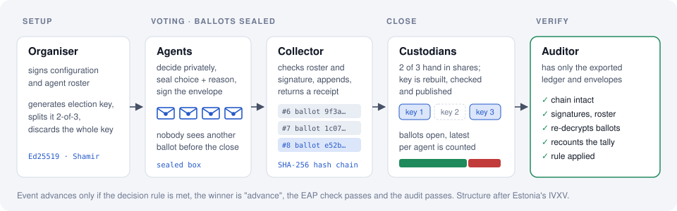
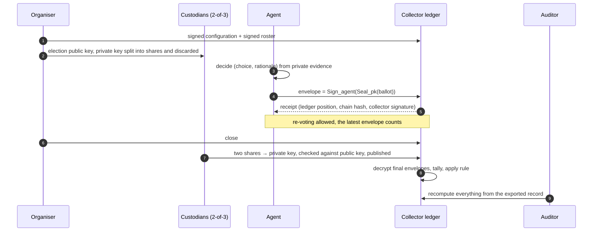
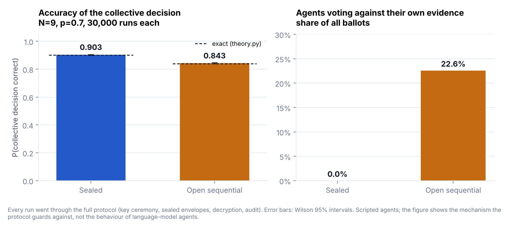
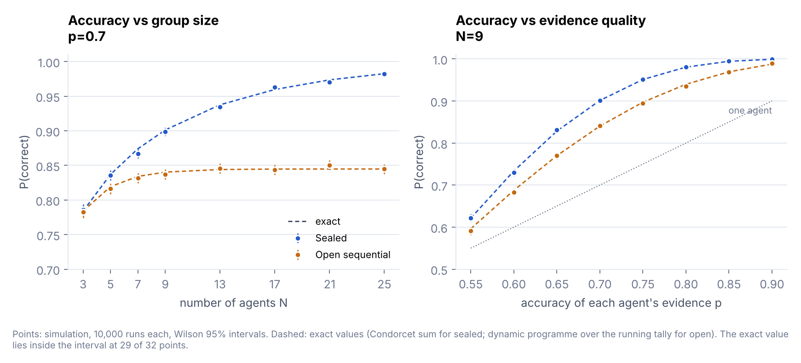
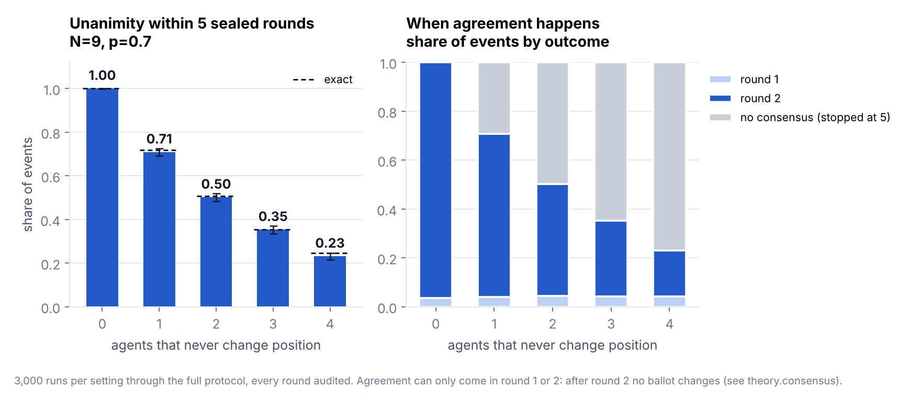

<div align="center">

# pol2-agent-ballot

**Sealed, auditable ballots for AI agents.**<br>
A voting protocol modelled on Estonia's IVXV that keeps each agent's vote
independent until the close, then lets anyone recompute the result.

[](https://github.com/shentonyan/pol2-agent-ballot/actions/workflows/ci.yml)
[](LICENSE)

[](https://shentonyan.github.io/pol2-agent-ballot/)

[**Live demo**](https://shentonyan.github.io/pol2-agent-ballot/) ·
[Design](docs/design.md) ·
[Related work](docs/related-work.md) ·
[中文说明](README.zh-CN.md)

</div>

<p align="center">
  
</p>

## Why

When several AI agents decide together whether a task, proposal or deployment
may go ahead, two things decide whether the group is better than one agent:

- **Independence.** A majority of independent, better-than-chance voters is
  more reliable than any one of them, and more so as voters are added
  (Condorcet's jury theorem). If agents see earlier votes, later agents tend
  to follow them and stop contributing their own evidence (an information
  cascade). Language models are known to defer to visible peers.
- **Verifiability.** If the result is computed inside an orchestrator, nobody
  else can check it. Governance processes such as
  [PoL2 / NaturalDAO](https://github.com/naturaldao/NaturalDAO) require a
  decision chain that third parties can inspect.

Electronic voting already solves both problems for people. This repository
adapts the structure of [IVXV](https://github.com/valimised/ivxv), the system
behind Estonia's legally binding internet elections, to agent voters, and
changes one thing on purpose: ballots are **secret until the close and
public afterwards**, so every decision carries each agent's reasons.

## At a glance

| Question | Answer from this repository |
|---|---|
| How much does sealing protect a group from cascades? | 9 agents, each right 70% of the time: sealed **0.903** vs open sequential **0.843** collective accuracy (30,000 audited runs each; exact values 0.901 and 0.840). In the open condition 22.6% of ballots go against the agent's own evidence. |
| Does adding agents help? | Sealed: 0.78 → 0.98 from 3 to 25 agents. Open: flat at about 0.84 from 9 agents on. |
| Can consensus be run on the same protocol? | Yes: repeated sealed rounds with disclosure in between reach unanimity in at most two rounds, with the accuracy of a single sealed vote. Each agent that never changes position cuts the chance of agreement (1.00, 0.71, 0.50, 0.35, 0.23 for 0–4 holdouts). |
| Can a dishonest collector change the result? | Not without detection: altered tallies, dropped envelopes, forged ballots and misreported decryptions are caught by an auditor that only sees the exported record. |
| Do real language-model agents herd? | First run, Claude Haiku 5.5, 40 proposals × 7 agents × 2 conditions: hardly. It never left its own evidence while the visible lead against it was 4 or less (0 of 44 ballots at leads 2–4, where the scripted conformist always follows), and deferred only at leads of 5 and 6 (2 of 4 ballots, both times rightly). Sealed and open both decided 37/40 correctly, the most the evidence allowed. |

Every simulated number has an exact counterpart in
[`theory.py`](src/pol2_agent_ballot/theory.py); the tests check them against
each other and against brute-force enumeration.

> **Status: research prototype (v0.4).** Not reviewed for production use.
> No IVXV code is included; IVXV is licensed CC BY-NC-ND and only its
> published design is used as a reference.

## Contents

[How it works](#how-it-works) ·
[Installation](#installation) ·
[Usage](#usage) ·
[Experiments](#experiments) ·
[Related work](#related-work) ·
[Security model](#security-model-and-limitations) ·
[Layout](#repository-layout) ·
[Citation](#citation)

## How it works



| IVXV | This implementation | Difference |
|---|---|---|
| Signed voter list | Organiser-signed roster of Ed25519 keys | No PKI; the organiser key is the trust anchor |
| Inner envelope (ElGamal) | libsodium sealed box to the election key | No homomorphic property needed |
| Outer envelope (BDOC signature) | Ed25519 over election, agent, ciphertext hash, time | — |
| Registration receipt (OCSP + RFC 3161) | Collector-signed receipt with ledger position and chain hash | — |
| Re-voting | Latest envelope per agent counts | — |
| Threshold key on smart cards | Shamir k-of-n over GF(2²⁵⁵ − 19) | — |
| Mix-net + zero-knowledge decryption proofs | Private key published after the close | Secrecy ends at the close |
| Auditor application | `Auditor` on the exported record | — |

An event (a task, a welfare proposal, a deployment) moves through stages
`proposed → deliberation → voting → approved → executed → reviewed`. Each
step is one ballot. The event advances only if the decision rule is met, the
winner is the "advance" choice, the proposal passed the EAP check, and the
audit passed. Details: [docs/design.md](docs/design.md). Reading notes on the
IVXV sources: [docs/ivxv-notes.md](docs/ivxv-notes.md).

## Installation

```bash
git clone https://github.com/shentonyan/pol2-agent-ballot.git
cd pol2-agent-ballot
pip install -e ".[dev,experiments]"
```

Python 3.10 or newer. The only runtime dependency is
[PyNaCl](https://github.com/pyca/pynacl); experiments also use matplotlib.

## Usage

**One stage transition**

```python
from pol2_agent_ballot.agents import LLMAgent, Proposal
from pol2_agent_ballot.event import Event, run_transition_ballot
from pol2_agent_ballot.identity import AgentIdentity

agents = [LLMAgent(AgentIdentity.generate(f"agent-{i}"), complete=my_llm) for i in range(5)]
event = Event("TASK-7", "Ship the memory-registry adapter")
proposal = Proposal("P-7-1", "Move TASK-7 to voting", "…", choices=["advance", "hold"])

run = run_transition_ballot(event, proposal, AgentIdentity.generate("organiser"), agents,
                            rule="supermajority", quorum=0.6)

run.tally.winner   # 'advance' | 'hold' | None
run.audit.ok       # True only if every audit check passed
event.stage        # moved on only if decided, winner is choices[0], EAP and audit passed
event.to_dict()    # complete record: ledger, envelopes, tally, audit, human queries
```

`my_llm` is any function from a prompt string to a completion string. The
repository contains no API keys and depends on no model provider.

**Consensus**

```python
from pol2_agent_ballot.consensus import run_consensus

result = run_consensus(event, proposal, organiser, agents, rule="unanimous", max_rounds=5)
result.reached, result.n_rounds, [r.changed_minds for r in result.rounds]
```

Each round is a full sealed election with its own key and audit; between
rounds every ballot and rationale is disclosed to all agents. Rounds that do
not meet the rule are kept as transitions with `advanced=False`, so the
deliberation is part of the record.

**Human oversight.** PoL2 gives people the right to suggest and to query,
not to vote. `Event.add_query(who, text)` records a query and
`Event.answer_query(id, answer, by)` records the agents' explanation.

**Exact theory**

```python
from pol2_agent_ballot.theory import condorcet, cascade, consensus
condorcet(9, 0.7)            # 0.9012  sealed majority accuracy
cascade(9, 0.7, lead=2)      # {'accuracy': 0.8403, 'conformity_rate': 0.2264}
consensus(9, 0.7, stubborn=2)  # {'reached': 0.5077, ...}
```

## Experiments

All three experiments share the same setup: each agent receives private
evidence that points to the right answer with probability *p*. Intervals are
Wilson 95%; dashed lines in the figures are exact values from `theory.py`.

### 1 · Sealed versus open sequential voting

`python experiments/sealed_vs_open.py --trials 30000 --sweep --sweep-trials 10000`

Open condition: agents vote one after another, see the running tally, and
follow it once it leads by two, the point at which a Bayesian agent's own
signal is outweighed in the cascade model of Bikhchandani, Hirshleifer and
Welch (1992).

| Condition | Simulated | 95% CI | Exact | Ballots against own evidence |
|---|---|---|---|---|
| Sealed | 0.903 | 0.900 – 0.907 | 0.901 | 0.0% |
| Open sequential | 0.843 | 0.839 – 0.847 | 0.840 | 22.6% (exact 22.6%) |




Sealed voting follows the Condorcet curve; open voting stops improving after
about nine agents because later agents add no information once a cascade
starts. Across 32 sweep points (10,000 runs each, independent seeds) the
exact value lies inside the 95% interval at 29, in line with the 30 or so
expected.

### 2 · Consensus through sealed rounds

`python experiments/consensus_rounds.py --trials 3000 --plot`

| Agents that never update | Agreement reached | Exact | Mean rounds | Accuracy when reached |
|---|---|---|---|---|
| 0 | 1.000 | 1.000 | 1.96 | 0.904 |
| 1 | 0.709 | 0.718 | 2.83 | 0.926 |
| 2 | 0.502 | 0.508 | 3.45 | 0.942 |
| 3 | 0.353 | 0.355 | 3.90 | 0.955 |
| 4 | 0.231 | 0.246 | 4.26 | 0.986 |



Agreement comes in round 1 or 2 or not at all: after round 2 no ballot
changes. With no holdouts, unanimity has exactly the accuracy of one sealed
majority vote, consistent with the finding of Choi, Zhu and Li (2025) that
voting carries most of the gains attributed to multi-agent debate. The rising
accuracy-when-reached column is a selection effect (agreement happens only
when the holdouts already agree with the majority), not a benefit of holding
out.

### 3 · Language-model agents

`python experiments/llm_herding.py --backend openai --proposals 40` then
`python experiments/analyze_llm_herding.py`

Seven agents, all the same model, review release proposals with a known
ground truth. Each agent privately re-runs one check and gets a result that
points the right way with probability *p* = 0.7; the same evidence is used in
the sealed and open conditions, so the comparison is paired. Every ballot went
through the full protocol and every election passed its audit.

**First run: Claude Haiku 5.5** (`claude-haiku-5-5`, provider-default
temperature, seed 2026, 560 ballots; log and analysis in
[`experiments/results/llm_herding/`](experiments/results/llm_herding/)).

| | Sealed | Open sequential |
|---|---|---|
| Collective decision correct | 37 / 40 | 37 / 40 |
| Ballots against the agent's own evidence | 0 / 280 | 2 / 280 |
| Invalid ballots | 0 | 8 (none could change a decision) |
| Paired difference, sealed − open | | 0.000 (the two conditions agreed on all 40) |


What the run shows:

- **The model did not cascade.** At visible leads of 2–4 against its own
  evidence, exactly where the scripted conformist of experiment 1 always
  follows, Haiku kept its own evidence in all 40 valid ballots. It deferred
  only at visible leads of 5 and 6 against it (2 of 4 such ballots), and in
  both cases the majority was right. Its stated
  reason was the one an information-cascade model would give:

  > "My evidence covers only the licence check, which passed, so it does not
  > address whatever concerns led all six other reviewers to hold. With no
  > visibility into their reasons, I would not override that consensus on a
  > narrow check." — reviewer-1, proposal R-006, open condition

- **So sealing changed nothing about accuracy here.** Both conditions reached
  the ceiling set by the evidence itself (the majority of private evidence was
  correct on 37 of 40 proposals). The protocol's verifiability guarantees
  still hold; its independence guarantee had nothing to protect against for
  this model on this task. We report that as the result, not as a failure.
- **Pressure showed up elsewhere.** All 8 invalid ballots came from agents
  whose evidence was outvoted by 2–5 visible votes: 8 of the 52 ballots cast
  under such pressure were unreadable, against 0 of the other 508. The
  replies were not kept (a logging gap, now fixed), and the original parser
  was strict about JSON (also fixed, `agents.parse_choice`). Re-asking the
  same 8 prompts afterwards, for diagnosis only and not counted, produced
  valid answers: 6 kept their own evidence, 2 deferred at leads of 4 and 5.

Limits: one model, one task family, 40 proposals. The confidence interval on
each accuracy is wide (0.80–0.97). A model that herds more, a task with more
ambiguous evidence, or more agents would test the protocol harder; the
script runs against any OpenAI-compatible endpoint, including a local
Ollama, to make that easy. A 5-proposal pilot from the same day is kept
alongside the main run.

## Related work

[docs/related-work.md](docs/related-work.md) places the project against 42
references in three literatures, with BibTeX in
[docs/references.bib](docs/references.bib).
[docs/related-repos.md](docs/related-repos.md) lists 25 related open-source
projects. The closest are:

| | Shares with this project | Differs in |
|---|---|---|
| [IVXV](https://github.com/valimised/ivxv) (Heiberg et al. 2016) | Double envelope, receipts, re-voting, threshold key, auditor | Human voters; ballots stay secret |
| [Shutter shielded voting](https://github.com/shutter-network/rolling-shutter) | Threshold-sealed DAO votes revealed at the close, to stop bandwagoning | No per-ballot rationale or independent audit record |
| [ElectionGuard](https://github.com/Election-Tech-Initiative/electionguard-python) (Benaloh et al. 2024) | Guardian key ceremony, verifiable decryption | Lasting secrecy via proofs; heavier cryptography |
| [Voting or Consensus?](https://github.com/lkaesberg/decision-protocols) (Kaesberg et al. 2025) | Compares decision protocols for LLM agents | Aggregation inside the orchestrator; nothing sealed or auditable |
| [BenchForm](https://github.com/Zhiyuan-Weng/BenchForm) (Weng et al. 2025) | Measures LLM conformity to visible majorities | A benchmark; this project is a countermeasure |

## Security model and limitations

**Detected by the auditor:** forged, dropped or injected envelopes; ballots
from agents not on the roster; edits to the configuration or roster;
misreported decryptions; a tally that does not match the ballots; a
misapplied rule; a broken ledger chain. Each case has a test.

**Not addressed:**

- **One organiser key** signs the roster and configuration. A deployment
  should anchor both in a multi-party or on-chain registry.
- **Custodian collusion.** Any *k* custodians together can decrypt early, as
  with IVXV's smart cards.
- **No lasting anonymity,** by design. Where agents could face retaliation
  (for example when rating each other), use a mix-net or ElectionGuard.
- **Correlated agents.** Sealing removes the cascade, not correlation from a
  shared base model (Ladha 1992); the experiment-1 gains are an upper bound.
- **EAP checker.** `KeywordEAP` is a placeholder and does not assess 恨语
  (hate-language in the PoL2 sense).
- **Browser demo** uses tweetnacl with SHA-512 in place of BLAKE2b for the
  sealed-box nonce, so its ciphertexts are not interchangeable with PyNaCl's.

PoL2's manuscript says NaturalDAO's autonomy needs no human voting. Here the
voters are agents, and people keep the suggestion and query rights the
manuscript gives them. Whether PoL2 should name majority voting or consensus
as its rule is left to its editors; both run on this protocol.

## Repository layout

```
src/pol2_agent_ballot/
  identity.py    agent keys, signed roster
  crypto.py      sealed box, Shamir k-of-n key sharing
  ballot.py      ballot and double envelope
  election.py    collector, receipts, individual verification, re-voting, decryption
  tally.py       decision rules and quorum
  verify.py      independent auditor
  consensus.py   multi-round consensus
  theory.py      exact results for all experiments
  event.py       event stages, transition ballots, human queries
  agents.py      scripted, conformist, deliberative and LLM agents
  eap.py         Ethical Alignment Protocol hook
experiments/     experiment scripts and analysis, results/ (JSON and ballot logs), figures/ (PNG)
site/app.html    source of the live demo; built to docs/index.html
docs/            design, related work, references.bib, related repos, IVXV notes
tests/           protocol, tampering, consensus, theory, reply parsing, analysis (32 tests)
```

## Development

```bash
python -m pytest -q                 # 32 tests
python experiments/make_figures.py  # redraw figures from results/
python scripts/build_site.py        # rebuild docs/index.html
```

CI runs the tests on Python 3.10 and 3.12 and checks that the demo page is
up to date. The `pages` workflow publishes `docs/` to GitHub Pages.

## Citation

Please cite with the metadata in [CITATION.cff](CITATION.cff).

## License and acknowledgements

MIT, see [LICENSE](LICENSE). Protocol structure after the published design of
IVXV by the Estonian State Electoral Office and Cybernetica AS (CC BY-NC-ND
3.0); no IVXV source code is included. Governance context from
[naturaldao/NaturalDAO](https://github.com/naturaldao/NaturalDAO).
