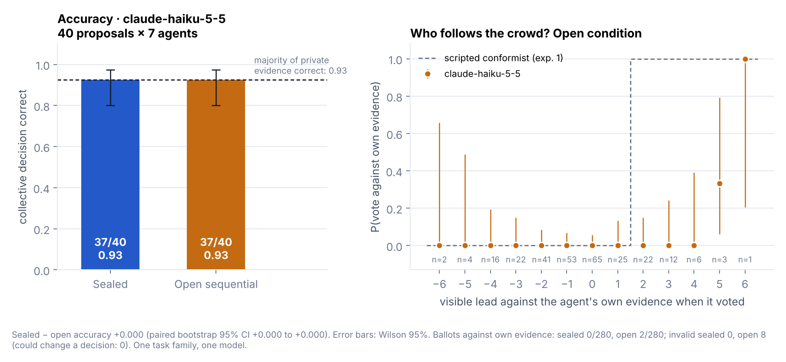

# pol2-agent-ballot

[English](README.md) · **[在线演示](https://shentonyan.github.io/pol2-agent-ballot/)**

面向 AI Agent 的密封、可审计投票协议，用于决定 [PoL2 / NaturalDAO](https://github.com/naturaldao/NaturalDAO)
治理流程中的一个事件能否推进到下一阶段。协议结构参照爱沙尼亚国家在线投票系统
[IVXV](https://github.com/valimised/ivxv)：签名的资格名单、双信封、注册回执、改票、
门限保护的选举密钥，以及独立审计。

> **状态：研究原型（v0.4）**，未经生产环境评审。仓库不含任何 IVXV 代码（IVXV 采用
> CC BY-NC-ND 许可），只参考其公开的协议设计。

## 动机

多个 Agent 共同决定一项任务、提案或部署能否继续时，有两点最关键：

1. **独立性。** 如果 Agent 能在决定前看到别人的票，后投的 Agent 倾向于跟随先投的，
   群体就丢失了各自私有证据中的信息（信息级联）。Condorcet 陪审团定理——投票者越多、
   多数决越可靠——只在投票相互独立时成立。
2. **可验证性。** PoL2 治理协议要求"可验证的决策链路"（数据源、推理步骤、伦理依据），
   人类可以查看和质询。第三方无法复算的决策不满足这一要求。

本仓库把 IVXV 的结构改造给 Agent 使用，并刻意改变一点：选票**开票前保密、开票后公开**，
因为 PoL2 要求的是决策透明，而不是投票者的永久匿名。

## 功能

- **资格**：每个 Agent 一对 Ed25519 密钥；投票开始前组织者签署名单和选举配置。
- **密封选票**：选票（选择 + 理由）加密到选举公钥，私钥按 Shamir 2-of-3 分给托管人，
  开票前任何单方都无法读取。
- **回执与个人核验**：收集方把每个信封写入 SHA-256 哈希链账本并返回签名回执；
  Agent 可在时间窗内确认自己的信封已被记录。
- **改票**：每个 Agent 以最后一张被接受的信封为准。
- **决策规则**：多数（>1/2）、绝对多数（≥2/3）、一致同意、相对多数，可设法定人数。
- **协商共识模式**：多轮密封投票，轮间公开全部选票和理由（Delphi 结构），
  直到一致同意或达到轮数上限。
- **独立审计**：`Auditor` 只使用导出的账本和信封，复算每一步：哈希链、签名、资格、
  改票规则、解密、计票和决策规则。
- **EAP 接口**：提案和理由经过可替换的伦理对齐协议检查器（自带的是占位实现）。
- **与模型提供方无关**：`LLMAgent` 只需要一个 `complete(prompt) -> str` 函数。

## 实验

实验一、二使用脚本 Agent，其私有证据正确的概率为 *p*，说明的是协议**防范什么**，
不代表语言模型 Agent 或人类的实际行为。实验三用语言模型 Agent 检验这一点，方案见
[experiments/llm_herding_protocol.md](experiments/llm_herding_protocol.md)。
区间均为 Wilson 95%。

### 实验一：密封投票与公开顺序投票

9 个 Agent，*p* = 0.7。公开条件下 Agent 依次投票、能看到实时计票，领先两票时跟随多数。
每个条件 30,000 次，全部走完整协议并通过审计。

| 条件 | 集体决策正确率 | 95% 区间 | 违背自身证据投票的 Agent |
|---|---|---|---|
| 密封 | 0.903 | 0.900 – 0.907 | 0.0% |
| 公开顺序 | 0.843 | 0.839 – 0.847 | 22.6% |

精确值（`theory.py`）：密封 0.901，公开 0.840，违背自身证据 22.6%，均落在仿真区间附近；32 个扫描点中有 29 个的精确值落在 95% 区间内，与预期一致。

密封投票下，正确率随 Agent 数量持续上升（3 个时 0.78，25 个时 0.98）；公开投票从 9 个起
停在 0.84 左右：前两票一致后，后面的 Agent 跟随，其自身证据不再进入结果。

### 实验二：用密封轮次达成共识

9 个 Agent，*p* = 0.7，规则为一致同意，最多 5 轮，每种设置 3,000 次。*s* 个 Agent 始终不改变立场。

| 固执 Agent 数 *s* | 达成共识比例 | 平均轮数 | 达成时的正确率 |
|---|---|---|---|
| 0 | 1.000 | 1.96 | 0.904 |
| 1 | 0.709 | 2.83 | 0.926 |
| 2 | 0.502 | 3.45 | 0.942 |
| 3 | 0.353 | 3.90 | 0.955 |
| 4 | 0.231 | 4.26 | 0.986 |

没有固执 Agent 时，最多两轮即一致，正确率与密封多数决相同（0.904），因为第二轮汇总了
第一轮的全部证据。每多一个持续异议者，达成共识的概率就下降；未达成时事件停留在当前阶段，
分歧完整留档。"达成时的正确率"随 *s* 上升是选择效应（只有异议者恰好持多数观点时才会达成），
不代表异议本身有益。

### 实验三：语言模型 Agent

7 个 Agent 都由同一个模型扮演，审核已知正确答案的发布提案。每个 Agent 私下重跑一项检查，得到的结果以 *p* = 0.7 的概率指向正确方向；密封与公开两种条件使用同一份证据，做配对比较。每张票都走完整协议，每场选举都通过了审计。

**第一次运行：Claude Haiku 5.5**（40 个提案，560 张票，日志和分析在 `experiments/results/llm_herding/`）。

| | 密封 | 公开顺序 |
|---|---|---|
| 集体决策正确 | 37 / 40 | 37 / 40 |
| 违背自身证据的票 | 0 / 280 | 2 / 280 |
| 无效票 | 0 | 8（都不可能改变任何决定） |

- **这个模型没有出现信息级联。** 在实验一的脚本从众 Agent 一定会跟风的位置（看到的票领先自己证据 2–4 票），Haiku 在全部 40 张有效票里都坚持了自己的证据；只有在落后 5 或 6 票时才让步（4 张中有 2 张），而且两次多数方都是对的。它给出的理由正是级联理论里的推理："我的证据只覆盖许可证检查……其余六位都投了暂缓，在看不到他们理由的情况下，我不会凭一项窄范围的检查推翻这个共识。"
- **因此这次密封没有带来准确率上的差别。** 两种条件都达到了证据本身允许的上限（40 个提案中有 37 个的私有证据多数是对的）。协议的可验证性保障依然成立；独立性保障在这个模型、这个任务上没有遇到需要防范的情况。这是结果本身，不是失败。
- **压力体现在别处。** 8 张无效票全部来自"自己的证据被 2–5 票压过"的 Agent：在这种压力下投出的 52 张票中有 8 张无法读取，其余 508 张为 0。当时没有保存原始回复（日志缺口，已修复），解析器对 JSON 也过于严格（已修复）。事后把同样的 8 个提示重新问一遍（仅用于诊断，不计入结果），都得到了有效回答：6 张坚持自己的证据，2 张让步。

局限：只有一个模型、一类任务、40 个提案，每个准确率的置信区间都较宽（0.80–0.97）。更容易跟风的模型、证据更模糊的任务或更多 Agent 才能更严格地检验协议；脚本可接任何 OpenAI 兼容接口（包括本地 Ollama）。

## 相关工作

[docs/related-work.md](docs/related-work.md) 结合三类文献（陪审团定理与信息级联、可验证电子投票、多智能体语言模型决策）共 42 篇参考文献讨论本项目的位置，BibTeX 见 [docs/references.bib](docs/references.bib)；[docs/related-repos.md](docs/related-repos.md) 整理了 25 个相关开源项目。与本项目最接近的是 IVXV、Shutter 的密封投票、ElectionGuard，以及 Kaesberg 等（2025）对智能体"投票还是共识"的比较。

## 安全模型与局限

审计可发现：伪造、丢弃或注入的信封；名单外 Agent 的选票；被修改的配置或名单；
谎报的解密结果；与选票不符的计票；误用的决策规则；断裂的账本链。测试覆盖了每一种篡改。

尚未解决：组织者是单把签名密钥（正式部署应锚定到多方或链上注册表）；任意 *k* 个托管人
合谋可提前解密；选票在开票后公开，不适用于需要永久匿名的场景；`KeywordEAP` 只是占位，
不评估恨语；协议使决策可验证，但不保证 Agent 的判断质量。

PoL2 手稿写明 NaturalDAO 的自治无需人类投票；本仓库中投票者是 Agent，人类保留手稿赋予的
建议权和质询权（`Event.add_query` / `Event.answer_query`）。PoL2 应采用多数决还是共识作为
决策规则，留待 PoL2 编辑确定。

安装、用法、目录结构和引用方式见 [英文 README](README.md)。

## 许可

MIT。协议结构参照爱沙尼亚国家选举办公室与 Cybernetica AS 公开的 IVXV 设计（CC BY-NC-ND 3.0），
未包含其源代码。
