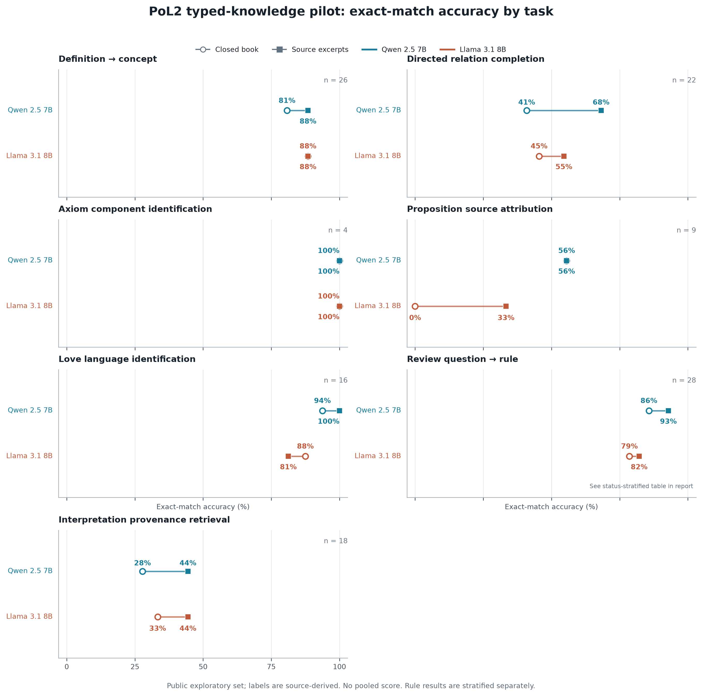

# EVAL-04：PoL2 分类型知识评测先导

- **任务 / 分支 / 领取人 / Agent：** EVAL-04 / `pol/EVAL-04/codex-typed-knowledge-eval` / NaturalDAO / Codex
- **模型与底座 revision / 方法：** 本地 Ollama `qwen2.5:7b`、`llama3.1:8b`；未微调，零样本推理。记录了模型 tag，未记录不可变模型 digest 或 Ollama 版本。
- **数据版本 / 划分 / 校准方法：** `pol2-typed-knowledge-v1.3`，公开探索性 123 题；非 sealed test，未校准。
- **对照组 / 硬件 / 精度 / 预算：** 闭卷与原文摘录两个配对条件；本机 CPU 推理，`num_gpu=0`，后端默认精度（未记）；没有独立延迟/能耗/费用基准。
- **可复现命令 / 配置 / 公开预测链接：** 见 [`run-config.json`](run-config.json)、[`predictions.jsonl`](predictions.jsonl)、[`benchmark README`](../../benchmark/pol2/typed_knowledge/README.md) 与 [`复现脚本`](../../benchmark/pol2/typed_knowledge/run_models.py)。

完整研究说明与局限见 [Research 结果报告](../../../Research/Embodied/02-实验设计与审计/PoL2分类型知识评测先导.md)。

## 主要结果：逐任务精确匹配率

| 任务 | n | Qwen 闭卷 | Qwen 原文摘录 | Llama 闭卷 | Llama 原文摘录 |
|---|---:|---:|---:|---:|---:|
| 定义→概念 | 26 | 21/26（80.8%） | 23/26（88.5%） | 23/26（88.5%） | 23/26（88.5%） |
| 有向关系补全 | 22 | 9/22（40.9%） | 15/22（68.2%） | 10/22（45.5%） | 12/22（54.5%） |
| 公理组件识别 | 4 | 4/4（100%） | 4/4（100%） | 4/4（100%） | 4/4（100%） |
| 命题来源归属 | 9 | 5/9（55.6%） | 5/9（55.6%） | 0/9（0%） | 3/9（33.3%） |
| 定义→爱语 | 16 | 15/16（93.8%） | 16/16（100%） | 14/16（87.5%） | 13/16（81.3%） |
| 审查问题→规则 | 28 | 24/28（85.7%） | 26/28（92.9%） | 22/28（78.6%） | 23/28（82.1%） |
| 研究者解释→来源锚点 | 18 | 5/18（27.8%） | 8/18（44.4%） | 6/18（33.3%） | 8/18（44.4%） |

### 标签依据分层：治理规则

| 标签层 | n | Qwen 闭卷 | Qwen 摘录 | Llama 闭卷 | Llama 摘录 |
|---|---:|---:|---:|---:|---:|
| 有已批准边界决议引用 | 13 | 11/13（84.6%） | 12/13（92.3%） | 9/13（69.2%） | 10/13（76.9%） |
| 仅候选规则映射 | 15 | 13/15（86.7%） | 14/15（93.3%） | 13/15（86.7%） | 13/15（86.7%） |

## 与项目治理指标的关系及证据限制

| 比较项 | 结果 |
|---|---|
| PoL 判定与误拦 | 未测；本评测测理论知识检索/出处归属，不测实际治理拦截决策 |
| 通用能力保持 | 未测；没有模型适配前后对照 |
| 主流安全测试 | 未测 |
| 延迟与成本 | 逐批延迟保存在公开预测记录中；未作控制重复，不报告可比速度或费用结论 |

此轮共有 20 个“模型×条件×知识类型”单元，492/492 项预测完整，0 项执行错误。首轮直接结构化记录上下文暴露目标 ID/名称，判为无效且未纳入成绩；v1.3 摘录条件仅提供原文摘录。规则层有候选映射；研究者解释只评测知识包登记出处，不判断解释真伪。题集公开且未封存，存在既有接触风险。

**结论：**模型在七类具体任务上的表现不均，闭卷或原文摘录条件都没有对所有任务一致占优。这是公开材料上的识别与检索基线，不证明模型完整理解或内在持有 PoL2；也没有训练前后因果对照。公理任务只有 4 题，分数尤其不宜外推。下一阶段应使用私有封存的改写、反事实、未见组合和证据不足题，并比较等预算的训练前后模型。

- **公开测试是否影响模型、提示或阈值选择：** 本轮没有训练模型或选择阈值；题目与提示经一次有效性审计修订，且研究报告披露了公开/非封存属性，不能作为独立确认性结果。
- **独立保留集评测者 / 定版模型 revision：** 未进行；不涉及私有保留样本。
- **模型卡登记：** 两模型是未适配的本地推理基线，未生成权重或适配模型卡；完整 run config 与 tag 在本卡中记录。
