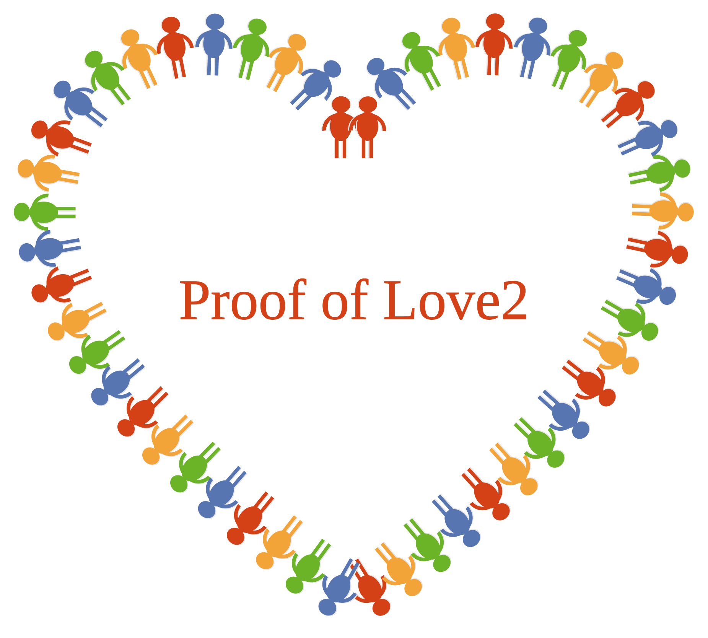

# Preface

Nearly two centuries ago, Karl Marx developed a far-reaching critique of capitalism—the social order that represented the peak of humanity’s old civilization. Central to this critique was the problem of alienation: under capitalist relations of production, the worker’s own productive activity confronts them as an alien and autonomous power. Labor, rather than serving as the free expression of human capacities, becomes external to the worker, while the products and social relations generated through human activity acquire an apparently independent power over those who created them. Human beings thereby become estranged not only from the products of their labor, but also from their own activity, from one another, and from what Marx called their species-being (Gattungswesen).

This condition is not confined to the working class. The bourgeoisie, too, falls into the alienation of its own mode of existence: it maintains the system through violence, yet is consumed by bloody, anti-human behavior; the logic of capital and power objectifies the ruling class itself, stripping it of control over its own actions and social relations. In this way, social relations between people are thoroughly alienated and objectified, becoming an objective force independent of human beings that dominates and distorts every individual.

On this basis, Marx and Engels developed what later came to be known as scientific socialism. Rather than treating communism merely as an abstract moral ideal, they sought to understand the historical conditions under which capitalist society might generate the possibility of overcoming class domination and private control over the means of production. Their vision pointed toward a form of social organization based on common ownership, the abolition of class exploitation, and the free development of human capacities.

Within this horizon, the principle of distribution according to need concerns more than the allocation of material goods. In a contemporary institutional interpretation, it may also be understood as requiring universal access to the social conditions necessary for human development, including education, healthcare, and other essential public goods. Such an interpretation presupposes a transformation of the relations through which productive resources are owned, governed, and distributed, with the aim of creating the material and institutional conditions for the free and full development of every individual.

This theory was a stunningly bold vision in the history of human thought, and it provided all subsequent theories of social transformation with both a critical point of departure and an ideal coordinate.

Marx held that the society he envisioned was truly human society, and that the various social forms that have appeared in our history so far are the prehistory of truly human society. In other words, we have not yet reached truly human society—because relations between people still follow the ethical principles of the animal kingdom. Human beings’ mutual antagonism has brought humanity freedom from nature, but at a tremendous cost. The prehistory of human society will end with capitalism as its final social form. Marx said that in truly human society, the free development of each is the condition for the free development of all. As long as one person is not free, there can be no human freedom.

Yet the philosophical foundations of this project can be traced further back, particularly to Ludwig Feuerbach’s conception of the human being as a species-being (Gattungswesen). For Feuerbach, human beings are capable of relating not only to particular objects and immediate needs, but also to humanity and nature as universal objects of consciousness. Reason, will, and love constitute essential powers of human existence. These powers do not belong to the isolated individual as private possessions; they express dimensions of a human essence that transcends any single individual. Through reason, will, and love, the individual recognizes themselves as participating in a form of life shared with humanity as a whole.

Feuerbach’s conception of love is especially significant. Grounded in sensuousness and concrete human relatedness, love functions in his philosophy as a fundamental mode through which human beings encounter reality and one another. Yet Feuerbach did not develop this insight into a sufficiently robust account of transformative social praxis. This limitation not only prepared the ground for Marx’s later critical “sublation” of Feuerbach, but also provides a key theoretical anchor for our re-examination and reconstruction of the complete structure of love.

We argue, however, that Marx’s critique did not fully preserve the philosophical potential contained in Feuerbach’s conception of species-being. From this perspective, two fundamental questions remain insufficiently resolved within the Marxian framework: Why has humanity repeatedly generated social structures characterized by profound inequality, of which capitalism is one historically powerful form? And what fundamental force within human social life drives the recurrent expansion of alienation, domination, and reification?

Marx and Engels also considered, under particular historical conditions, the possibility that social transformation might proceed through peaceful political means. Yet they did not develop a generalizable institutional mechanism capable of enabling such a transformation on a global scale.

Nearly two centuries of attempts to put Marxist ideas into social and political practice, together with the extraordinary development of modern technology, now provide new historical material through which these questions can be reconsidered. The rapid development of artificial intelligence, and particularly of large language models that increasingly reproduce and mediate aspects of human cognitive and social activity, further expands the scope of this inquiry.

Building upon the insights of Marx, Feuerbach, and other predecessors while confronting the limitations revealed by subsequent history, we therefore return to a fundamental question: what kind of governance mechanism could organize the next stage of human civilization around forms of relation that enable rather than alienate human capacities?

It is in response to this question that we propose Proof of Love2 (PoL2) as a new consensus mechanism for the governance of the next human civilization.

***Special Note**: 
- This article is a condensed governance theory based on our paper [Proof of Love: The Consensus of AI and Next Civilization](https://www.researchgate.net/publication/396699934_Proof_of_Love_The_Consensus_of_AI_and_Next_Civilization), which was published in October 2025.

- This repository discusses only the principal theory of Proof of Love2; the details of governance will be constructed and implemented by a public super-project, NaturalDAO.*

