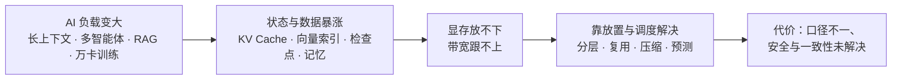
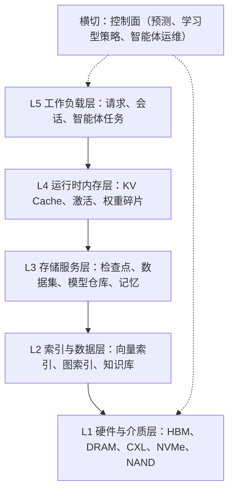
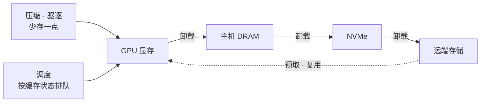
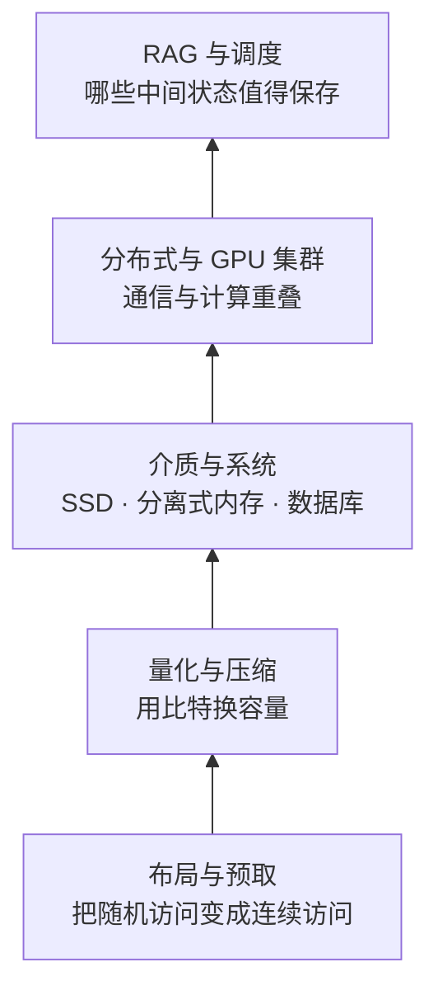
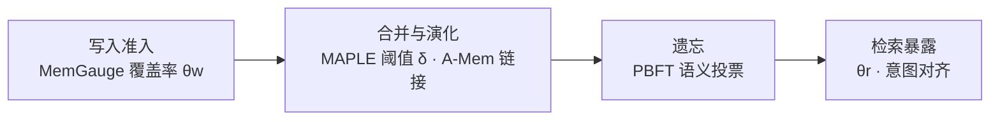
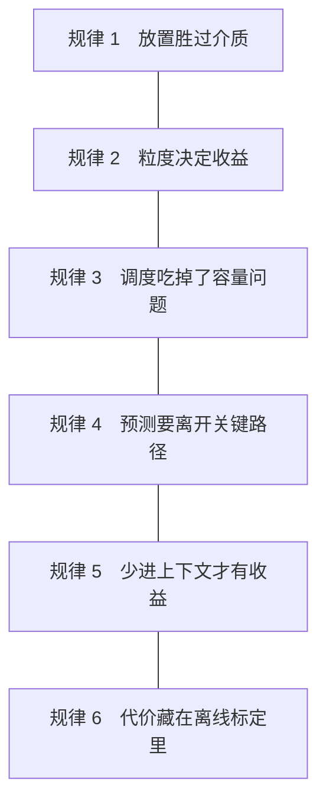

# AI 存储技术综述（易读版）：2025—2026 年 arXiv 研究的问题、做法与代价

**An Accessible Review of AI Storage Research on arXiv, 2025–2026: Problems, Mechanisms, and Costs**

> **关于本文**　本文是对《面向人工智能的存储技术：2025—2026 年 arXiv 研究综述》（下称「原综述」，与本文同在 `Research/` 目录）的**重写**，不替代原综述。本文不新增论文、实验或数字，内容和 [n] 编号均来自原综述；重写的目的是让读者更快读懂：按「问题—做法—代价」重新组织，把数字挂到它支持的论断上。本文由 AI 助手按科研写作方法重写，需由提交者本人核对内容与引用后再合并。核对状态见附录 B。

## 摘要

AI 工作负载使存储与内存系统成为系统设计的瓶颈：推理中的 KV Cache、检索用的向量索引、训练中的检查点以及智能体的长期记忆，其体量增长快于显存与带宽。原综述对 arXiv 在 2025 年 1 月至 2026 年 10 月的相关预印本做了系统检索，从 18,794 篇唯一论文中精读 162 篇，最终引用 153 篇。本文把这批工作重写为七个「问题—做法—代价」章节：推理 KV Cache、向量检索与 RAG、训练与数据通路、内存层级与近存计算、模型权重、AI for Storage 和智能体记忆。本文归纳出六条跨章规律，其中最主要的一条是：进展多来自放置、粒度与调度决策，而不是新介质。同时，各论文的硬件、模型与负载口径各异，其数字不能直接横向比较，多租户隔离、缓存一致性和学习型组件的对抗鲁棒性也尚未得到系统解决。本文最后按紧迫程度重排了原综述的 12 项开放问题。

**Abstract.** AI workloads are making storage and memory a first-order design problem: KV caches, vector indexes, checkpoints and agent memory grow faster than GPU memory and bandwidth. A companion survey in this directory screened 18,794 unique arXiv preprints (January 2025 to October 2026), read 162 in full and cites 153. This document restates that survey as seven problem–mechanism–cost chapters. We identify six recurring patterns across them; the main one is that most gains come from placement, granularity and scheduling decisions rather than from new media. Reported numbers come from different hardware, models and workloads and cannot be compared directly, and tenant isolation, cache consistency and the adversarial robustness of learned components remain open. We also re-rank the twelve open problems of the original survey by urgency. All figures are taken from the original survey and have not been re-checked against the source papers.

**关键词**：AI 存储；KV Cache；向量检索；RAG；内存层级；检查点；智能体记忆；学习型索引

## 目录

| 章 | 内容 |
|---|---|
| 一页速览 | 结论、地图、按目的选读 |
| 1 | 为什么现在要关心 AI 存储 |
| 2 | 这篇综述依据什么写成 |
| 3 | LLM 推理：KV Cache |
| 4 | 向量检索与 RAG |
| 5 | 训练与数据通路 |
| 6 | 内存层级、CXL 与近存计算 |
| 7 | 模型权重 |
| 8 | AI for Storage |
| 9 | 智能体记忆 |
| 10 | 跨章讨论：六条规律 |
| 11 | 风险与限制 |
| 12 | 开放问题与研究议程 |
| 13 | 结论 |
| 附录 | A 术语对照　B 数字核对说明与待补占位符 |

---

## 一页速览

> **一句话结论**　2025—2026 年 AI 存储领域最主要的进展，来自「数据放在哪一层、以多大粒度保留、何时复用或丢弃」这类放置与调度决策，而不是新介质或更大的模型。同时，各论文的实验口径互不相同，其数字不能直接横向比较。

**本文回答的四个问题**

| 问题 | 简短回答 | 看哪一章 |
|---|---|---|
| AI 存储到底在解决什么问题？ | 状态（KV Cache、索引、检查点、记忆）增长得比显存和带宽快 | 第 1 章 |
| 过去两年有哪些有效的做法？ | 分层卸载、跨请求复用、选择性压缩、把预测移出关键路径、少写入少注入 | 第 3—9 章 |
| 这些做法有什么共同规律？ | 收益多来自放置与调度，代价多落在离线标定和关键路径上 | 第 10 章 |
| 哪些地方还不可靠？ | 评测口径、多租户隔离、一致性、学习型组件的对抗鲁棒性 | 第 11、12 章 |

**按你的目的选读**

| 你想… | 先读 |
|---|---|
| 5 分钟了解全貌 | 本页 + 第 10 章 + 第 13 章 |
| 做 LLM 推理服务 | 第 3 章，再看第 7 章（MoE 专家与权重） |
| 做向量检索 / RAG | 第 4 章 |
| 做 Agent 长期记忆 | 第 9 章，再看第 11 章的记忆投毒部分 |
| 做训练集群与检查点 | 第 5 章 |
| 关心硬件趋势（CXL、近存计算） | 第 6 章 |
| 找研究题目 | 第 12 章 |

**怎么读文中的数字**　文中所有数字都转引自原综述〔《面向人工智能的存储技术：2025—2026 年 arXiv 研究综述》，下称「原综述」〕对各论文自述结果的转述，方括号 [n] 是原综述的参考文献编号。我没有回到原论文逐条核对。「最高 X 倍」通常对应作者选的最有利工作点，且不同论文用的硬件、模型和负载各不相同。需要引用具体数字时，请回到原论文。

---

## 1. 为什么现在要关心 AI 存储

### 1.1 状态比参数涨得更快

过去讨论大模型的成本，焦点是算力和参数量。2025—2026 年的论文把焦点转向了另一类数据：推理时产生的 KV Cache、检索用的向量索引、训练中的检查点，以及智能体积累的长期记忆。这些数据的特点是体量随上下文长度、并发数和运行时间线性甚至更快增长。

下面三个例子来自原综述第 4 章，足以说明量级：

- 一个 200 亿参数的模型生成长链思维（序列约 32K token，批大小 32）时，KV Cache 约 50GB，权重约 40GB，合计已超过单张 80GB 的 A100 [1]。
- 按最大序列长度预分配连续缓冲的部署方式，在混合长度批处理下平均浪费 60%—80% 的 KV 显存 [4]。
- 64 个并发、每个 100 万 token 的请求，在 Qwen3-235B-A22B 上需要约 12.9TB 的 KV Cache，相当于 68 张 B200 的全部 HBM，且不含权重 [2]。

容量以 TB 计，而最快的一层只有 GB 级，所以「把状态放在哪里、放多久、给谁复用」成了系统设计的中心问题。

### 1.2 两类问题

原综述把研究分成两条主线，本文沿用：

- **Storage for AI（为 AI 服务的存储）**：AI 负载的特点（超长上下文、稀疏访问、突发写入）反过来要求存储系统改变。评价标准是首 token 延迟（TTFT）、吞吐、显存占用、成本。对应本文第 3—7 章。
- **AI for Storage（由 AI 驱动的存储）**：用学习模型替代存储系统里的启发式规则，例如学习型索引、预取和放置。评价标准是相对启发式基线的增量收益。对应本文第 8 章。

智能体记忆（第 9 章）处在两条线的交汇处：它由 AI 应用驱动，但它的存储抽象又必须服务于 AI 的自适应行为。

### 1.3 一个五层模型

为了让不同方向可以放在同一坐标系里，原综述提出了五层参考模型 [原综述第 3.2 节]：

这个模型的用处是看清**跨层耦合**。例如 KV Cache 压得越狠（L4），卸载就越少（L3），对 I/O 带宽的要求就越低（L1）；向量索引的量化位数（L2）决定它能否常驻内存，进而决定是否需要磁盘驻留检索（L1）。

---

## 2. 这篇综述依据什么写成

**语料**　原综述用 62 条检索式查询 arXiv，时间窗为 2025 年 1 月 1 日至 2026 年 10 月 10 日。取回 27,596 条记录，去重后为 18,794 篇，评分筛出 6,531 篇核心语料，抽样精读 162 篇，复核后 153 篇进入引用。

**本文怎么用它**　本文是对原综述的重写，不新增论文，也不新增数字。本文只做三件事：把内容按「问题—做法—代价」重新组织；把分散在各节的数字挂到它支持的论断上；把原综述自己承认的局限放到读者一眼能看到的位置。

**必须知道的局限**（原综述第 2.5 节与第 11 章）

- 数据源只有 arXiv，会遗漏未上传预印本的工业界系统论文。
- 窗口截至 2026 年 10 月 10 日，2026 年下半年的统计不完整，不宜据此判断「下降趋势」。
- 关键词检索会低估不用标准术语的工作（例如把 KV Cache 叫作 "attention state"）。
- 预印本阶段引用量几乎不可用，抽样靠发表去向、开源信号和主题匹配度，带有主观性。
- 每个方向只有 8—30 篇精读样本，原综述的定位是「用代表性工作刻画设计空间」，不是穷举文献。
- 精读样本中，明确给出开源仓库的不足一半；不少关键数字来自仿真器或综合工具而非真机（例如 SPLASH [2] 来自 OpenHBF 仿真）。

**每章的统一写法**　第 3—9 章都按同一顺序展开：先说**问题**，再列**代表做法**（表格里是系统名、核心机制和作者自述的关键数字），然后讲**代价与边界**，最后用一个「读完记住」框收尾。

---

## 3. LLM 推理：KV Cache 成为独立的存储对象

> **本章要点**　KV Cache 已不再是注意力算子旁边的缓冲区，而是有自己容量、生命周期、介质和调度策略的存储对象。过去两年的工作可以归为三条线：把它**存储化**（可寻址、可搬运、可分层、可计价）、把压缩**存储化**（压缩与放置联合决策）、把调度**存储化**（以缓存状态而非请求为中心）。

### 3.1 问题：容量、生命周期、成本三重压力

容量压力见第 1.1 节。除此之外还有两种压力：

**生命周期**。多智能体应用中，一个 agent 在长时间外部函数调用期间，其 KV Cache 空占显存，峰值时占整个 KV 池的 18.5%。更糟的是「关键性倒置」：先到的非关键 agent 驱逐了关键路径 agent 的缓存。TokenCake 在 Code-Writer 负载中观察到 690 次抢占，其中 180 次（约 26%）属于这一类 [6]。

**成本**。卸载到 CPU 能缓解显存不足，但带来传输延迟（FlexGen 中可达 20% 的额外延迟），可能直接违反服务等级目标（SLO）[3]。

另外，真实负载里跨请求共享前缀的比例高达 51.9%—75.0% [5]。这说明缓存值得被单独管理，也说明共享数据被重复访存会放大带宽压力。

### 3.2 做法：四类机制

| 类别 | 要解决什么 | 代表做法与作者自述结果 |
|---|---|---|
| 压缩与驱逐 | 同一显存装下更多请求 | ThinKV [1]：1024 token 预算仅占 FullKV 显存的 <3.67%，吞吐最高 5.8×。MorphKV [20]：长回复省 52.9% 显存。CateKV [22]：显存最高 2.72×，精度损失在 0.25% 以内 |
| 分层卸载与预取 | 显存放不下时不丢缓存 | TokenCake [6]：主动卸载加预测预取，平均延迟最多降 47.06%，卸载量减少 51%。AdaptCache [13]：把压缩率与放置设备联合决策，命中率 38%→81% |
| 复用 | 少算一遍 | KVShare [14]：变长 chunk 匹配加差异重算，TTFT 最多降 9.39× |
| 解耦式传输与调度 | prefill 与 decode 分开后搬得动 | FlowKV [11]：传输延迟 0.944s→0.053s，NCCL 调用 23,469→1。MuxWise [28]：GPU 内空间复用，goodput 总体最高 3.06× |

还有一类是**算法—介质协同设计**：SPLASH [2] 把 HBM 与高带宽闪存（HBF）当作单个逻辑 KV 空间来用，在仿真中达到 100ms 目标时吞吐相对只用 HBM 高 11.4×。注意这一数字来自仿真。

### 3.3 代价与边界

原综述在第 4.10 节列了五个仍待解决的矛盾，这里合并成三点：

1. **收益依赖 profiling 的代表性。** AdaptCache 的质量曲线来自 10 个采样 entry 的离线拟合 [13]；MixKV 的 head 冗余规律只在最大 8B 规模上验证 [21]。
2. **选择开销会吃掉稀疏化的收益。** SpecAttn [35] 的端到端吞吐为 59.95 tok/s，低于全注意力投机解码的 68.26 tok/s。预测器本身也需要离线微调（CacheOPT 约 9 小时），并对负载漂移敏感（TokenCake 在工具时延噪声 0.25 时反而退步 8.3%）。
3. **复用的价值需要更严格的证明。** Persistent Memory in Multi-Agent LLM Inference [19] 指出，一个只增加约 2% 峰值 KV 的召回层，在单题独立评测下量不出可检出的收益；同类实验却很容易产生 37 个百分点的「表观收益」。

此外，SPLASH、V-Rex、NELSSA、GoS、VEDA 的关键数字分别来自仿真器、cycle-level 模拟或综合工具，不宜与真机系统直接比较。

> **读完记住**　KV Cache 的三个杠杆是「少存、放对地方、按缓存排队」。压缩必须与内核、生成长度、块大小联合设计（纯量化会使生成长度膨胀最多 5.1× [1]）。引用倍数时请同时看它来自真机还是仿真。

---

## 4. 向量检索与 RAG：瓶颈从带宽一路上移到调度

> **本章要点**　向量检索天生是随机访存，随机访存比顺序访存贵得多。原综述 5.8 节的归纳很清楚：优化沿存储层次从下往上推进，**瓶颈从「内存带宽」逐层上移到「调度决策」**——检索效果的上限，往往取决于何时终止、何时弃权、何时复用。

### 4.1 问题：随机访存、召回与预算的拉扯

三对矛盾贯穿本章：

- 随机访存成本远高于顺序访存，而图遍历天生随机。VSAG 的基线测量显示，图遍历使 L3 cache miss 高达 67.42%，访存占搜索时间的 63.02% [38]。
- 召回质量与存储、带宽预算成反比，而现有评测只为平均指标付账。
- 索引要同时服务查询与更新，更新会拖慢查询（NAVIS 测得基线的并发搜索吞吐比只读搜索平均下降 27.89% [41]）。

### 4.2 做法：自下而上的五级阶梯

**第一级：布局与预取**

| 工作 | 做法 | 作者自述结果 |
|---|---|---|
| PDX [37] | 块内同一维度连续存放，让距离计算自动向量化 | 自动向量化内核约为手写 SIMD 的 2.0×；PDXearch 比 FAISS IVF_FLAT 快 2.2×、比 Milvus 快 3.5× |
| VSAG [38] | 软件预取加冗余存放量化邻居向量，并自动调参 | GIST1M 上 L3 miss 93.89%→39.23%；100M 规模召回 99% 时 QPS 180→467 |
| CrackIVF [39] | 让索引构建成为查询执行的副作用，按需分裂与精化分区 | 启动比大索引快近 1000 倍；100 万查询累计 1531.40 秒，比 AV-Tree 的 5721.29 秒快 3.7× |

**第二级：量化与压缩**。三篇量化工作优化的是**三个不同的目标**，压缩率因此不能互相比较：NVQ [46] 优化检索保真度，8-bit 相对 FP32 省 3.06×—3.44×；CARVQ [47] 优化模型困惑度，把嵌入层压到约 1.6 bit/参数；VQL [48] 优化推理侧可缓存性，使在线成本不随序列长度增长。

**第三级：介质与数据库系统**

| 工作 | 要解决的问题 | 作者自述结果 |
|---|---|---|
| NAVIS [41] | SSD 上图索引的插入定位开销（占更新时延最高 85%） | 插入吞吐最高 +2.74×，搜索 QPS 最高 +1.37×（低维 DEEP 数据集上仅为基线的 0.93×—1.08×） |
| PostgreSQL-V 2.0 [42] | pgvector 的指针式索引被迫走页缓冲 | 并发吞吐最高比 1.0 版快 36.4×，比 pgvector 高 4.2×；恢复耗时约 20ms 量级 |
| d-HNSW [43] | 分离式内存上逐跳远程读的往返次数 | 每查询 RDMA 往返 3.547→4.75×10⁻³，延迟最多降 117×（SIFT1M）和 121×（GIST1M），代价是召回上限约 0.86—0.87 |

**第四级：分布式与 GPU 集群**。CoTra [54] 接受约 20% 的冗余计算，把通信占比压到 22.5%（全局索引方案为 89.4%），16 机在 recall@10≥0.95 时达 116.6K QPS。Fantasy [55] 主张把图放进多卡 HBM，但它**没有做实测**，全部结论来自解析式代价模型，所以「计算与通信可完全重叠」只是在带宽满利用、无拥塞假设下成立。

**第五级：RAG 的缓存与调度**。Cache-Craft [58] 把文本 chunk 提升为 KV 缓存的管理单位，相对前缀缓存减少 51% 的冗余计算，P99 TTFT 降低 3×。REFRAG [50] 把每个 chunk 压成一个 embedding 送入 decoder，k=16 时 TTFT 加速 16.53×（带缓存）。PerCache [59] 在手机端空闲时预测未来查询并提前填充缓存。

### 4.3 一个关键转变：从「调参数」到「声明目标」

过滤检索（带元数据条件）的搜索代价由条件的选择率和相关性共同决定，而相关性事先未知。VADER [51] 指出，仅改变相关性就能让搜索量相差 30×，但现有做法对整批查询用同一组参数。它把接口改为「指定目标召回率」，用一个约 380kB 的 LightGBM 预测器在线判断何时终止，相对 plain search 在 Sweeping 上最高加速 24.8×，终止点距最优仅差 4.1%。QASP [52] 用一次前置回归预测整条「召回进展曲线」，在 99% 召回下，SIFT1B 上少读 82%—87% 的数据。

**但「目标召回率」本身也要小心。** Robustness-δ@K 的提出者 [53] 发现平均召回会掩盖尾部：平均 Recall@10=0.9 时，DiskANN 在 MSMARCO 上仍有 4.8% 的查询召回为 0。端到端也有警示：在 Naive RAG 中，ScaNN（Recall@10=0.90）与 DiskANN（0.96）的问答准确率同为 74.9%，吞吐却相差近一倍（25,054 对 14,606 QPS）。

### 4.4 代价与边界

- **布局红利不一定迁移。** NAVIS 在低维数据上几乎没有增益；PRS 带来内存放大（GIST1M 上 4.5G 对 hnswlib 的 4.0G）[38]。
- **近似换往返。** d-HNSW 用 meta 索引的近似换取往返次数，召回上限被压低，且只在两个百万级数据集上验证。
- **原生索引的代价。** MV-HNSW [44] 相对最快基线 5.6×—14.0× 加速，但索引构建需 13.81—21.29 小时，索引体积 6.22—10.73 GB。
- **规模阈值效应。** 在 Polaris 超算上的 Qdrant 研究 [56] 显示，数据集小于 30GB 时增加 worker 几乎无收益，超过后才见效，且瓶颈依次从 I/O 转到 CPU 饱和再转到通信。

> **读完记住**　向量检索的存储问题已经不是「索引放哪」，而是「哪些中间状态值得保存、什么时候该停、目标怎么表达」。评价时看尾部（Robustness-δ@K）而不只看平均召回。

---

## 5. 训练与数据通路：检查点变成持续性税收

> **本章要点**　训练侧的存储问题很少是单纯的「带宽不够」。检查点的核心矛盾已经从「写多少带宽」转向「状态以什么粒度保存」；无检查点恢复的收益取决于故障率落在哪个区间；数据供给侧的收益来自元数据面而不是带宽面。

### 5.1 问题：三类彼此纠缠的矛盾

1. 模型与优化器状态的写入量随并行度放大，检查点从「周期性保护」变成「持续性税收」。
2. 故障恢复的状态粒度决定丢多少计算，也反过来决定存多少、存多快。
3. 训练之前的数据治理和训练之中的元数据操作，与梯度通信共用同一套存储和网络资源。

### 5.2 做法

| 方向 | 代表工作 | 作者自述结果 |
|---|---|---|
| 零 I/O 恢复 | AccelPact [69]：在 optimizer 边界重绑引用并替换 communicator，状态留在内存里 | goodput 相对冷重启 1.197×；fault-to-frontier 约 2,367 s 对约 3,500 s |
| 无检查点恢复 | CheckFree [73]：用邻近 stage 的加权平均重建失败 stage | 5% 失败率下收敛 355.13 h，对 checkpointing 的 558.23 h |
| 角色级故障隔离 | RobustRL [70] | 端到端快 8.4%—17.4%，容错开销 <5% 对 ByteRobust 约 20% |
| 整体状态对象化 | 执行状态胶囊 [87]：整个执行状态作为可冻结闭包 | 4096 边界胶囊 224 MB，快照与恢复各 0.4 ms |
| 数据治理与元数据 | OmniTable [76]：逻辑宽表加物理分列 | 治理周期 14.0→2.5 天（5.6×），点查 P50 8.3 s 对 184 s |
| 存储后端 | SkyStore [80]：写本地、按读复制，学习副本存活时间 | 两区域下平均比六个基线便宜 1.4—20× |
| 评测与可观测性 | PRISM [84]：在真实 POSIX 文件系统上执行真实研究操作，以分位数延迟为主指标 | 一次厂商升级使 fsdp_load 最多退化 8× |

### 5.3 代价与边界

- **无检查点恢复的收益有适用区间。** CheckFree 在 5%—10% 失败率下大幅领先，但在 16% 时反而慢于冗余计算（562.96 h 对 419.56 h）[73]。FTHP-MPI [74] 用可预测的 50% 冗余换取 10.94%—19.25% 的净收益。
- **压缩要成对设计。** Q-A-LoRA [71] 显示，2-bit 下困惑度可以从 576.1030 恢复到 11.4000，但 180 例检索任务只恢复了 11—12 例——「困惑度恢复」不等于「检索能力恢复」。
- **只恢复局部状态会出错。** 执行状态胶囊的消融显示，「只恢复位置 KV」会导致 47/48 的 token 不匹配 [87]。
- **长作业才是真正的目标负载。** 原综述 6.7 节引用 PRISM [84] 与 SAKURAONE [82] 的结果指出：长作业只占任务数的 3.3%，却占 GPU 时间的 73.3%。

> **读完记住**　恢复的粒度比写入带宽更重要。选恢复方案前，先看你的故障率落在方案的哪个区间。

---

## 6. 内存层级、CXL 与近存计算：层级之间的接口成为主要变量

> **本章要点**　当模型权重、KV Cache 和推荐系统 embedding 表的膨胀快于 HBM 与 DRAM 的成本下降时，设计者不再指望在单一介质里解决容量，而是把数据分散到主机 DRAM、CXL 内存池、近存 DIMM、片上 SRAM 乃至 SSD 内部。结果是：**谁控制准入、谁负责放置、谁承担一致性**，取代介质本身，成为设计的主要变量。

### 6.1 四个收敛的判断

原综述第 7.7 节从 26 项工作中归纳出四点：

| 判断 | 证据（作者自述） |
|---|---|
| ① 容量外扩的收益来自放置策略，而不是介质替换 | Hermes [90]：稀疏划分贡献 5.17×，离线映射相对随机映射贡献 1.63×。MARS [110] 与 MS-EXT 的唯一差别是计算位置，却差 3.1× |
| ② 层级边界的控制权在向两端移动 | MemChannel [97] 把准入放到发送端；CXL 内存机架 [98] 把缓存策略放进设备；Kubernetes 原生可组合内存 [99] 把区域分配交给编排器；Nox [101] 交给编译器与运行时 |
| ③ 远端访问成本必须显式建模 | INDIGO [100] 测得既有 EWMA 估计在动态访问模式下 p99 误差达 60000%，错误遥测直接导致错误决策 |
| ④ 收益与代价的匹配关系决定适用区间 | PIM-malloc [94]：动态分配吞吐 1.7×，但 99 分位 TPOT 抬高 24%。共享 CXL 区域跨节点只多付 1%—4%，同节点仍慢于 VRAM 前缀缓存 1.15×—1.70× [99] |

### 6.2 代表性工作

| 方向 | 工作 | 作者自述结果 |
|---|---|---|
| CXL 内存池化 | CXL 内存机架 [98] | 单节点 3.0×，DRAM 用量少 16×，成本便宜 2.8—3.8× |
| 内存解耦与编排 | 可组合 CXL + Kubernetes [99] | 32K 前缀加速 36.6× |
| 近存 / 存内计算 | Hermes [90]、SCRec [109]、RecFlash [108] | SCRec 三级分片相对仅 SSD 分片 141.34×；RecFlash 读能耗最高降 91.9% |
| 计算存储 | CSDGuard [111]（SmartSSD 上的纠删码与勒索检测） | 576KiB 输入加速 >3×，9.2MiB 时衰减到约 1.4× |
| 加速器内部调度 | SoMa [103]、StreamTensor [102] | SoMa 相对 Cocco 平均 2.11×，能耗降 37.3% |

### 6.3 代价与边界

多项结果显示，收益会随工作点漂移：近存调度的节能从 38% 波动到 7%，只取决于截止时间（MEDEA [104]）；CSDGuard 的加速比从 3× 衰减到 1.4×，只因矩阵规模变大。原综述因此要求：内存层级的设计不能再以「峰值收益」为唯一指标，必须同时报告**代价发生在哪一层、在什么工作点、是否落在关键路径上**。

> **读完记住**　买更大的内存不如先管好放置。评估 CXL 或近存方案时，先问「准入和放置由谁控制」，再看带宽。

---

## 7. 模型权重：从「按需搬运」到「预测性保留」

> **本章要点**　权重不再是加载一次就不动的数据。MoE 与扩散模型把必须可访问的权重集合推高到远超单卡容量；张量并行把权重与 KV 切成需跨设备同步的碎片；权重作为核心资产，还需要在不完全可信的环境里被监控。

### 7.1 三个层次

| 层次 | 要解决什么 | 代表做法与作者自述结果 |
|---|---|---|
| 放置（最靠近硬件） | 权重和中间态放在哪 | PRESERVE [116]：在 allreduce 窗口把权重与 KV 预取到 L2，端到端最高 1.6×。SPD [120]：丢弃 attention 后的同步点 |
| 专家缓存 | MoE 专家的驻留与卸载 | OLED-MoE [114]：缓存利用率 51.5%→77.7%。MoE-CORE [113]：缓存从 12 增到 120 专家/层时平均命中率 47.47%→96.43% |
| 调度与资产治理 | 容量问题改写成调度问题 | Mell [118]：请求迁移减少 9%—31% 的 GPU 需求。MAPS [117]：平均 E2E 延迟降低 42.6%。FMDP [123]：用 TCO 最小化决定哪些权重值得加载 |

### 7.2 一个重要警告：命中率不是全部

Super Experts [115] 发现，只占 0.05%—0.39% 的专家决定了 21.68%—97.61% 的能力落差；剪掉它们后，DeepSeek-R1 平均 Pass@1 从 75.64 降到 1.81，而随机剪枝几乎无影响。所以专家缓存除了追求命中率，还需要「不可驱逐项」的硬约束。原综述指出，目前**没有系统把这一判据接入实际驱逐策略并给出端到端收益**。

### 7.3 代价与边界

几乎所有工作都在「更激进的近似」和「更重的离线预处理」之间移动：AES 的 α=0.1、SPD 的敏感度阈值、conformal 的 α=0.1、Super Experts 的 P99.5 判据，都是需要逐模型、逐负载重新标定的经验参数。Xema [119] 需为每个模板付出约 197 s 离线规划。权重层面的效率提升，很大程度上是用离线工程投入换来的。

此外，权重也需要治理：HyperCast [122] 把「新鲜度」变成可度量的存储成本（放宽到 24 小时即带来 +0.55 NE 劣化）；权重泄露检测 [124] 对 seed-blind 攻击 1000/1000 报警、良性误报 0.0%，但对 seed-aware 的低速率攻击，检测能力因模型而异。

> **读完记住**　专家缓存要同时看命中率和「谁绝对不能被换出」。所有近似方案的阈值都需要逐模型重新标定。

---

## 8. AI for Storage：把学习放在「预测错了也便宜」的地方

> **本章要点**　原综述第 9 章开头的一句话是全章的钥匙：**收益最大的工作往往不是模型最复杂的工作，而是把学习组件放在「预测错了也便宜」的位置上的工作。**

### 8.1 五个方向的结果

| 方向 | 工作 | 作者自述结果 |
|---|---|---|
| 学习型索引 | Vectorium [125]：倒排索引压缩 | 90% Accuracy@10 时 1.87→0.47 GiB，等同精度比 Sindi 快至多 5.3× |
| 预取与缓存 | FarSight [129]：2240 参数 RetNet 做页预取 | 相对 FastSwap 最高 3.6×，单次预测 <600 ns，状态 20 KB |
| 预取（反例） | KANBoost [128] | 每样本约 1000 ns（Voyager 为 18000 ns），但最大 IPC 提升仅 2.5% |
| 数据放置 | FDP / TorFS [131]：用 25—31 行 hint 传递生命周期语义 | insert 的 p99.99 尾延迟降低 20.7×，最多降 44% 的 WAF |
| 运维与资源估计 | ScaleSense [135]：分位数资源预测 | 性能优先配置的满足率 +26.1 个百分点，推理开销不到查询时间的 1% |

### 8.2 三种耦合方式

| 耦合方式 | 例子 | 特点 |
|---|---|---|
| 模型直接放进数据通路 | FarSight、SNI-GNN [133]（预测器放进 DPU）、KANBoost | 必须用极小模型加离线训练，承担延迟与状态预算 |
| 用 ML 替代存储决策中的启发式 | Vectorium、ScaleSense、Fast-LCMS [127] | 可承受较重的离线成本，收益上限更高 |
| 存储技术为 ML 服务 | MEC [132]（压缩嵌入表）、[139] | MEC 将工业集参数量从 3142.3MB 降到 7.014MB 而 AUC 基本不变；[139] 是负结果 |

### 8.3 代价与边界

- **泛化边界是最集中的失败模式。** 学习型机制只在「分布平稳且未被对手操纵」的区间内兑现承诺。PGM-index 被 10% 的投毒键推到最优分段数膨胀最多 120× [126]；HEP 缓存预取中，LSTM 在访问尖峰处的 site2 上 MAE 达约 150% [130]。
- **评测协议会改变结论。** 只改变划分方式，同一批日志异常检测器的 F1 就从接近满分跌到最低 .582 [134]；trace 缩减工作量化了「用预测当标签」的代价，仍有三到四成候选含错误标签 [136]。
- **可复现性两极分化。** Vectorium、PGM-attack、MEC 等提供了代码，FDP、FarSight、ScaleSense、SNI-GNN、KANBoost 未给出仓库，最有说服力的几个倍数因此难以独立复算。
- **LLM 与智能体兑现收益的地方**，是目标可测量、错误可回滚的任务，例如资源估计与诊断。

> **读完记住**　给学习型组件的清单只有三项：把预测移出关键路径、把状态压到 KB 级、把训练放到离线。并且要为它画出适用区间，对抗输入下的退化要单独测。

---

## 9. 智能体记忆：创新在「条目之上加什么结构」

> **本章要点**　智能体记忆的价值来自「多」，成本、噪声与风险也来自「多」。几乎每项工作的核心设计，都不是增加容量，而是**为「多」设限**：限定写入准入、检索预算、上下文注入粒度，以及谁能看到哪部分状态。

### 9.1 存储抽象：向量库之上再加一层结构

底层几乎都是向量索引加文本条目，没有一项工作发明了新的底层存储引擎。创新集中在条目之上：

| 工作 | 结构 | 与纯向量库的区别 |
|---|---|---|
| A-Mem [140] | Zettelkasten 式七元组笔记，写入时由 LLM 建立链接并触发「记忆演化」 | 索引不是静态结构，而是随写入不断被改写的对象；代价是每条新记忆要多次调用 LLM |
| MemGAS [141] | session、turn、summary、keyword 四种粒度的关联图，Personalized PageRank 传播相关性 | 边来自聚类相似度，比 A-Mem 便宜但依赖超参 |
| CueMem [142] | 记忆单元是「线索 + 指向源轮的指针」，而不是「摘要 + 向量」 | 还原细节的责任推回给原始对话 |
| TALM [143] | 记忆绑定推理结构（如 tree depth）并用元数据过滤 | 存储结构追随计算结构 |

### 9.2 写入、合并与遗忘：为「多」设限

- **最重要的负结果。** CTIM-Rover [145] 把 236 条蒸馏经验全部注入初始 prompt，总体成功率 40%，低于无记忆基线的 42%；只注入仓库级知识或完整 CTIM 的配置均为 31%，比基线低 11 个百分点；token 中位数从 10,027 抬到 17,807。原综述的解读是：噪声记忆偏置的是初始步骤，并不减少探索轮次。
- **阈值曲线。** MAPLE [146] 用相似度阈值 δ 控制规模：δ 从 0.3 增到 1.0，WiKiTQ 的记忆条数从 4,078 降到 191。LLM 驱动的演化策略精度最高（74.01% / 90.66%），固定规则和无条件合并都更差。
- **共识式遗忘。** PBFT 语义投票 [148]：占用比峰值分别降低 35%（100 epoch）与 48%（200 epoch），500 epoch 时比无遗忘增长投影小 52%；投票决策对 200 条人工标注记忆的准确率为 88%。
- **准入即收益也是风险。** MemGauge [149] 发现：写入覆盖率 θw 超过 0.3—0.5 后，干净效用继续上升，投毒效用从峰值跌到 3%—34%，攻击成功率升到 37%—64%。写入越多，收益与风险同步放大。

### 9.3 一个反直觉的规律：少进上下文，才能多拿分

原综述 10.6 节的第三点最有实践价值：几乎所有可复现的显著收益，都来自**减少进入上下文的信息量**，而不是增加可检索的信息量。

| 工作 | 作者自述结果 |
|---|---|
| CueMem [142] | 108K token 压到 2K，准确率 42.80→70.00，延迟降 87.4% |
| MemGAS [141] | 用 8,829 token 超过 103,137 token 的 Full History |
| A-Mem [140] | 平均回答 token 16,977→2,520 |
| APC [151] | 平均成本降 50.31%，保留 96.61% 的应用级性能 |

反过来，凡是把「更多记忆」直接等同于「更强能力」的设计都失败了（CTIM-Rover；Mem0 的激进压缩在 UtilMem [153] 上的归一化得分低至 17.3）。UtilMem 还指出：**检索到不等于用得上**，在 recall≥0.8 的子集上，平均合成得分仍只有 6.4（满分 10）。

### 9.4 存储成本在哪里

A-Mem 在 1,000 到 1,000,000 条记忆的扩展测试中，检索时间从 0.31 µs 升到 3.70 µs（约 11.9 倍），存储占用与 MemoryBank、ReadAgent 完全相同（1,000,000 条为 1,464.84 MB）。所以瓶颈不在容量，而在**每条记忆都要调用 LLM 的写入算力，以及检索时暴露给上下文的 token 量**。

另外，原综述指出多智能体共享记忆有拓扑泄漏问题：Topology Matters [152] 在 Llama-3.1-70B 上，6 节点链式图相邻节点对的泄漏率为 21.80%，而最远节点对仅 1.28%。这意味着通信拓扑本身就是安全参数。

> **读完记住**　智能体记忆要做的是「限量」：限定写什么、留什么、注入什么。底层存储还是向量库，区别在它上面那一层。

---

## 10. 跨章讨论：六条反复出现的规律

把第 3—9 章并排看，同样的模式在不同层反复出现。

| 规律 | 一句话 | 在哪几章出现 |
|---|---|---|
| 1. 放置胜过介质 | 容量外扩的收益来自放置策略，不来自介质替换本身 | 第 3 章（SPLASH 的单逻辑 KV 空间）、第 6 章（Hermes 的稀疏划分）、第 8 章（FDP 的生命周期 hint） |
| 2. 粒度决定收益 | 同样的数据，保存的粒度不同，复用和恢复的价值差别很大 | 第 4 章（chunk 级 KV 复用）、第 5 章（状态对象粒度）、第 9 章（线索加指针 vs 摘要） |
| 3. 调度吃掉容量问题 | 容量问题可以被改写为「何时终止、何时弃权、何时复用」 | 第 3 章（缓存感知调度）、第 4 章（目标召回率）、第 7 章（Mell、MAPS） |
| 4. 预测要离开关键路径 | 预测器必须小、离线训练、预测错了代价小 | 第 3 章（预测预取）、第 8 章（FarSight <600 ns 与 20 KB） |
| 5. 少进上下文才有收益 | 减少注入量比增加可检索量更可靠 | 第 4 章（REFRAG）、第 9 章（CueMem、A-Mem） |
| 6. 代价藏在离线标定里 | 多数方案的阈值需逐模型、逐负载重新标定 | 第 3 章（AdaptCache 的 10 个采样 entry）、第 7 章（AES、SPD、conformal 阈值）、第 8 章（Fast-LCMS 同分布标定集） |

**对读者的含义。** 如果你要选型：优先问「谁控制放置与准入」，再问「方案的阈值是否需要重新标定」，最后才看峰值倍数。如果你要做研究：「算法每压缩一个数量级，系统就面对一个形态更复杂的新负载」这一反馈回路，意味着压缩算法与存储介质的联合设计（如 SPLASH）是值得投入的方向。

---

## 11. 风险与限制：哪里还不可靠

### 11.1 评测：数字很多，可比性很低

原综述在精读 162 篇之后最强烈的印象是：这是一个数字极其丰富、但几乎无法横向比较的领域。一个典型的 KV Cache 论文，会在自选的一到两种 GPU、一到三个模型、自选的负载和基线上，报告「最高 5.8× 吞吐提升」。「最高」往往对应最有利的批大小、序列长度或压缩预算。同一篇论文的摘要与正文口径有时也不一致（例如 MuxWise [28] 在结论中把 T4 上的 72% 写作 49%）。

根源不是作者不严谨，而是缺少共同的评测基础设施：没有公认的负载生成器与 SLO 标定方法，没有统一的显存与带宽计量口径，也没有统一的成本折算方式。原综述建议建立类似 TPC 与 MLPerf 的公共套件，至少包含：标准化的负载 trace、统一的计量口径与成本模型、可注入故障的硬件无关仿真层、强制报告的分位数与最差情况指标。

已有一批以评测本身为贡献的工作，例如 PRISM [84]（以分位数延迟为主指标）、Robustness-δ@K [53]（把尾部召回纳入基准）和 UtilMem [153]（构造对证据敏感的记忆评测实例）。

### 11.2 安全、隐私与多租户隔离

| 风险 | 证据（作者自述） | 含义 |
|---|---|---|
| 跨请求 / 跨智能体泄露 | Topology Matters [152]：6 节点完全图泄漏率 25.32%，链式 12.95% | 通信拓扑与存储放置本身是安全参数 |
| 记忆投毒 | MemGauge [149]：θw 超过 0.3—0.5 后攻击成功率升到 37%—64% | 记忆越多、检索越开放，越容易被操纵 |
| 学习型索引被对抗输入打垮 | PGM-index [126]：10% 投毒键使最优分段数膨胀最多 120× | 学习型索引的空间优势建立在数据分布良性的假设上 |
| 权重外泄 | 权重泄露检测 [124]：对 seed-aware 低速率攻击能力因模型而异 | 完整性监控应覆盖从权重文件到输出 token 的整条链 |

原综述的判断是：AI 存储的安全研究仍处于「发现攻击 + 单点防御」阶段，缺少统一的威胁模型和隔离原语，例如 KV Cache 的租户级加密与可验证复用、向量索引的可验证更新、记忆的写入准入与来源溯源。

### 11.3 可靠性与数据完整性

- **新介质的噪声直接变成模型质量下降。** 在模拟存内计算阵列上，未保护时 Qwen3-0.6B 的困惑度从 12.35 恶化到 80.98；只保护 attention sink 与最近窗口，可把 512K 上下文下的困惑度从 52.63 拉回 12.02 [32]。
- **恢复越快，正确性验证越要形式化。** Zero-I/O 恢复 [69] 把恢复时间压到接近零，但其正确性验证依赖框架级依赖重绑定。
- **保护逻辑下沉到存储设备。** CSDGuard [111] 把故障注入、纠删码和勒索检测下沉到计算存储，整体延迟最多降低 70%。

### 11.4 成本与能耗

成本首次成为一等评价指标。InferSave [3] 在线负载下通过选更便宜的实例而不做卸载，成本效率最高提升 73.7%；SkyStore [80] 平均便宜 1.4—20×；ScaleSense [135] 报告生产环境单区域每天出现 3000+ 次 OOM，集群平均 CPU 利用率低于 30%。但**能耗维度明显缺位**：162 篇精读样本中，只有极少数报告了能耗或功率。原综述建议把「每 token 焦耳数」与「每 token 成本」并列为标准指标。

---

## 12. 开放问题与研究议程

原综述列出 12 项开放问题。这里按**紧迫程度**重排，并说明为什么。

### 12.1 最紧迫：安全与一致性

> 原综述的 12 项问题没有排序，只称安全原语是「最紧迫的方向之一」。下面的分组和先后是本文的编排，体现的是编者判断，不是原综述的结论。

| # | 问题 | 为什么紧迫 |
|---|---|---|
| 1 | KV Cache 的租户级隔离与可验证复用：能否在保留前缀复用收益的同时给出不泄露的形式化保证？ | 复用是吞吐的核心手段，同时也是跨租户信息通道 |
| 2 | 缓存一致性语义：底层记忆更新后，已复用的 KV 在语义上是否仍然有效？ | 目前没有失效协议 |
| 9 | 学习型组件的对抗鲁棒性：在对抗输入下的退化幅度尚无系统刻画 | PGM-index 的结果提示风险可能很大 |
| 11 | 记忆系统的可审计与可遗忘：「被遗忘权」如何在向量、KV 与摘要共同构成的系统中实现？ | 合规要求 |

### 12.2 次紧迫：评测与度量

| # | 问题 |
|---|---|
| 5 | 覆盖训练、推理、检索、智能体四类负载的公共基准，统一显存、带宽、I/O 与成本的计量方式 |
| 6 | 定义并推广「每 token 成本」与「每 token 焦耳数」 |
| 7 | 长尾与最差情况：混部与多租户下的尾延迟放大、缓存抖动、饥饿 |
| 8 | 跨层可观测性：从 NAND 到 KV 分页表的端到端遥测与归因工具 |

### 12.3 方法论层面

| # | 问题 |
|---|---|
| 3 | 分层的最优静态配置与在线自适应：对负载分布漂移鲁棒的联合优化框架 |
| 4 | 压缩与存储的联合设计：KV 压缩率、精度损失、卸载带宽与批大小的统一最优性刻画 |
| 10 | 新介质噪声对模型质量的传播模型：把误码率映射到困惑度或任务准确率 |
| 12 | 存储抽象的统一：KV Cache、向量、记忆、权重是否能共享一个可组合的对象模型，避免重复序列化 |

### 12.4 原综述的四条议程建议

1. **建立共享的评测—复现基础设施**：标准 trace、计量口径、参考实现与容器化环境；论文投稿时提交配置与复现脚本。
2. **把一致性、隔离与成本作为设计第一性原则**：设计阶段就给出 SLO 满足率、租户隔离与单位成本三者的显式契约。
3. **推动跨层协同的实证研究**：在同一测试床上对多层策略做联合消融，回答「哪一层的优化杠杆最大」。
4. **补足训练侧与硬件侧的公开研究供给**：分布式文件系统与对象存储方向每半年仅 5—9 篇公开论文；近存计算虽有 63 篇核心语料，但真正与 LLM 负载匹配的架构研究仍然稀少。

---

## 13. 结论

本文把原综述中 153 篇论文重新组织为「问题—做法—代价」的叙述，得到本文归纳出的核心判断：**2025—2026 年 AI 存储的进展，主要来自放置、粒度与调度决策，而非新介质；这些进展的可信度，目前又受制于缺乏共享的评测口径。**

具体而言：

1. **KV Cache 已成为独立的存储对象**，有自己的容量模型、生命周期、介质层级与调度策略。
2. **分层与复用是最有共识的两条主线**：GPU→DRAM→NVMe→远端的分层，加上前缀、语义、记忆、检索四类复用。
3. **算法侧的减压与系统侧的加压同步发生**：算法每压缩一个数量级，系统就面对一个形态更复杂的新负载。
4. **AI for Storage 的收益取决于学习组件放在哪里**；其对抗鲁棒性是真实弱点。
5. **评价体系滞后已成为瓶颈**：跨论文数字不可直接比较，开源比例不足一半。

对读者的建议：把文中的倍数当作「该论文设定内的结果」，而不是可迁移的承诺；做选型时先问放置与准入由谁控制，再问阈值能否复用；做研究时优先考虑安全与一致性、公共评测和跨层联合设计这三个缺口。

---

## 附录 A　术语对照

| 术语 | 含义 |
|---|---|
| KV Cache | 自回归解码缓存的 Key/Value 张量 |
| 分层卸载 | 把 KV Cache 或权重从显存搬到主机内存或 NVMe 等更低成本层级 |
| 前缀缓存 | 跨请求复用相同前缀对应的 KV |
| 语义缓存 | 基于语义相似（而非字符串相同）的请求或结果复用 |
| 解耦式推理 | 把 prefill 与 decode 部署在不同实例上 |
| 计算存储 | 在存储设备内部执行部分计算的硬件形态 |
| 学习型索引 | 用模型替代 B 树、哈希等传统索引结构 |
| TTFT / TPOT | 首 token 延迟 / 每输出 token 延迟 |
| SLO / goodput | 服务等级目标 / 满足 SLO 的有效吞吐 |
| 召回率（Recall@K） | 前 K 条结果中包含真实近邻的比例 |

## 附录 B　数字核对说明与待补占位符

本版是对原综述的重写，不含任何新增实验或新增数字。核对状态如下：

- 文中每个数字都出自原综述正文或其对比表，并保留了原 [n] 编号；**尚未回到原论文逐条核对**。
- 原综述 4.1 节引用 InferSave [3] 的云实例价格区间时，文字有乱码。本文未使用该价格区间。`[NUM: InferSave 的实例价格区间，待核原论文]`
- 原综述 10.6 节对 APC [151] 成本变化的描述有乱码，本文只使用表中另一处给出的平均成本降低 50.31%。`[NUM: APC 在 GAIA 上的成本绝对值，待核原论文]`
- `[CITE: 各论文的作者、标题与 arXiv 编号]` 本文沿用原综述的参考文献编号，未重复列出。读者可查原综述的「参考文献」一节。
- `[ASK: 本文的目标读者是谁？]` 本版按「想快速了解全貌的研究者与工程师」写成，若目标读者不同，第 1、2 章的深度需要调整。
