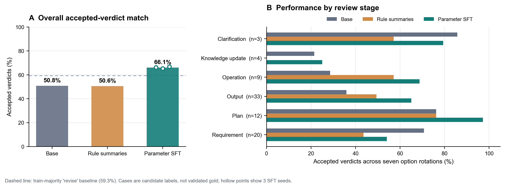

# PoL2 理论行为能力广域评测：参数微调能否带来无提示迁移？

**实验状态：已运行的探索性评测**

**理论版本：评测知识包引用的 PoL2 原文提交 `c70227fbc13b64f189c54efe2d45f2d77bc3babf`**

**模型：`jaredpalmer/kev-0.8b@bf75a6a8848ea6960ff2ed108d9ed44c2941174f`，底座 `Qwen/Qwen3.5-0.8B-Base@dc7cdfe2ee4154fa7e30f5b51ca41bfa40174e68`**

## 摘要

本实验检验一个可反证的行为命题：**在训练阶段接触一组 PoL2 治理判断案例后，模型能否在不接收 PoL2 规则提示的条件下，对未参与训练的 PoL2 案例给出更符合项目预期的结构化判断？**

在 81 个去重后的保留案例上，三个随机种子的参数微调模型平均命中可接受处置集合的比例为 **66.1%（种子间 SD 0.8 个百分点）**；冻结底座为 **50.8%**，按案例引用规则摘要的冻结模型为 **50.6%**。按案例配对 bootstrap，微调相对底座的差为 **+15.3 个百分点**，95% 区间 **[+4.4, +25.9]**。训练集多数标签 `revise` 的简单基线在测试集上为 **59.3%**，微调高出 **6.8 个百分点**。

这构成了 PoL2 监督训练改变模型广域类型化判断的初步证据，但**不证明模型理解或内在持有完整 PoL2 理论**。测试标签仍是项目现有的候选预期；测试集只覆盖 28 条规则中的 26 条，且训练与测试共享规则族。微调在需求审查阶段还低于未微调底座。此次模型只输出七类处置之一，没有解释、条款引用或具身动作，因此“完整理解”命题尚未通过。



*图 1。总体指标以每个案例七种选项轮换后的命中率为单位；轮换只是同一案例上的重复测量。空心点为三个微调种子。虚线为根据训练集确定的多数标签基线。案例标签是候选预期，尚未确立为独立金标准。*

## 1. 研究问题与可观察定义

“模型理解 PoL2”可能指不同的构念：能复述概念、能应用条款、能在原则冲突时处理边界、能解释判断依据，或能让具身行动遵循治理约束。本实验只测其中第一步之后的一项：**模型对给定 PoL2 案例的类型化处置选择是否与既有可接受集合一致，并且这种能力是否能由参数微调迁移到未参与训练的案例文本。**

这里的“无提示”是指推理时不额外附加 PoL2 条文或规则摘要。输入案例本身仍可能直接提到 PoL2，也包含其场景文字。该定义测试的是提示外的行为迁移，不等同于证明某种可独立观察的内部表征或主观信念。

操作性假设如下：

1. 参数微调在案例层面的可接受处置命中率高于冻结底座；
2. 参数微调优于基于案例 `source_refs` 注入规则摘要的同一冻结底座；
3. 结果不由某一个训练随机种子或候选项位置单独驱动；
4. 各阶段及规则切片的差异能揭示总体分数掩盖的失败。

## 2. 数据与版本边界

数据来自仓库中的 [评估集说明](../../../POL2-Steward/pol2-service/evaluation/README.md) 和 JSONL 文件。说明文件将 `expected_verdict_in` 明确界定为“可接受方向”，而非逐字标准答案，并称案例仍待真实模型验证。因此，本研究把它们当作**候选标签**，不称作独立金标准，也不推断标签本身已充分表达 PoL2。

| 用途 | 文件 | 案例数 | 处理 |
|---|---|---:|---|
| 参数微调 | `dev`、`boundaries`、`love-languages` | 63 | 作为多标签可接受集合训练 |
| 保留评测 | `holdout`、`sealed`、`final-confirmation`、`v2`、`v3` | 87 | 对输入与背景完全相同的案例去重后为 81 |

保留集合移除了六条与其他版本输入和背景完全一致的重复记录。训练和测试之间没有输入及背景的**精确文本重合**。但这是案例级划分，不是规则族或概念族留出：测试案例仍使用训练中出现过的 PoL2 规则。测试案例引用了 **26/28 条规则**；此版本的保留集合没有覆盖 `POL2-R009` 和 `POL2-R013`。理论知识结构文件将理论覆盖审计与真实模型行为验收明确分开，故 26 条规则的广度不能替代完整理论覆盖。[理论覆盖审计](../../../POL2-Steward/pol2-service/knowledge/theory-coverage.md)

`sealed` 与“final confirmation”文件已经存在于公开仓库，不是保密或双盲测试集。本报告只称其为**未参与训练优化的保留案例**。评测集 README 原本建议达到门槛后才运行 `holdout`；本轮为探索性筛查提前运行了它，且评测结果已被研究流程读取。因此这批 `holdout` 现在视为**已消耗**，不可再用于确认性结论或基于它调整模型。后续确认性实验需要另行冻结、哈希并预注册新的测试案例和门槛。

## 3. 条件与实现

所有条件使用同一冻结 Kev 0.8B typed-choice 检查点以及同一组七项候选处置：`allow`、`allow_with_conditions`、`reject_request`、`revise`、`reject_output`、`clarify`、`direct_answer`。

| 条件 | 推理时可见的信息 | 目的 |
|---|---|---|
| 冻结底座 | 阶段、请求、背景与通用判断指令 | 建立未作 PoL2 专项适配的基线 |
| 规则摘要注入 | 底座输入，加上按案例 `source_refs` 选择的 `rule-mapping` 条款摘要 | 检查在已知规则引用下，短摘要能否改善判断；这是理想化的预先给定引用条件，不代表完整检索系统 |
| PoL2 参数微调 | 同底座；推理时不附加 PoL2 条文或摘要 | 检查训练后能否在保留案例上维持规则一致行为 |

微调使用 63 个案例、3 个随机种子，各训练 3 个 epoch。对多答案案例采用集合似然：只要模型为任一可接受处置分配概率，损失就予以奖励；候选项次序在训练中打乱。评测时让七个候选标签分别轮换到每一个位置，共七种顺序。每个案例的分数是这七次预测中命中可接受集合的比例；七次不是独立样本。底座和规则摘要条件使用相同的七种顺序。规则摘要由现有映射中的标题、陈述、判断指导和适用条件拼接而成；案例来源引用由数据文件预先提供，因此该条件绕过了规则检索正确性，也不等同于完整原文 RAG。

训练固定 epoch 数，没有根据保留测试集选择 checkpoint 或调超参数。主指标是案例级可接受集合命中率。差值区间使用按案例重采样的 10,000 次 bootstrap，先对同一案例的候选顺序和微调种子求平均，再抽样案例；它是本候选集上的描述性不确定性区间，不是跨理论、跨模型总体的推断。

## 4. 结果

| 条件 | 可接受处置命中率 | 可接受标签概率质量 | 选项顺序稳定案例率 |
|---|---:|---:|---:|
| 冻结底座 | 50.8% | 33.2% | 65.4% |
| 规则摘要注入 | 50.6% | 35.8% | 61.7% |
| PoL2 参数微调 | **66.1% ± 0.8** | **41.7% ± 0.4** | **71.2% ± 3.1** |
| 训练集多数标签基线（`revise`） | 59.3% | — | — |

微调相对底座的配对差为 **+15.3 个百分点**，95% 案例 bootstrap 区间 **[+4.4, +25.9]**；相对规则摘要注入为 **+15.5 个百分点**，区间 **[+7.2, +23.6]**。微调的三个种子分别为 **66.1%、65.3%、66.8%**。训练多数标签基线依据训练集而定：`revise` 在 63 个训练案例的可接受集合中出现 40 次；该标签被 81 个测试案例中的 48 个接受。

微调并未均匀改善所有切片：

| 评审阶段 | 案例数 | 底座 | 规则摘要 | 参数微调（三种子均值） |
|---|---:|---:|---:|---:|
| 需求审查 | 20 | 70.7% | 43.6% | **54.1%** |
| 方案审查 | 12 | 76.2% | 76.2% | **97.2%** |
| 操作审查 | 9 | 28.6% | 57.1% | **68.8%** |
| 输出审查 | 33 | 35.9% | 49.4% | **65.1%** |
| 澄清 | 3 | 85.7% | 57.1% | **79.4%** |
| 知识更新 | 4 | 21.4% | 0.0% | **25.0%** |

方案审查切片的高分不能外推到其他任务：样本仅 12 条；澄清和知识更新切片分别只有 3 条和 4 条。需求审查中，微调低于冻结底座 16.6 个百分点。这一反向结果表明当前训练数据对不同阶段的覆盖及权衡仍不足，不能以总体均值掩盖局部退化。

## 5. 解释

结果支持一个较窄但实质的判断：**在这组项目候选标签上，PoL2 案例监督微调使 Kev 模型在未参加训练的案例文本上更常输出可接受的治理处置，且改善在三个随机种子上方向一致。**结果高于训练多数标签基线，说明提升不完全由单纯输出最常见标签解释。

本实验没有提供解释文本、适用条款 ID、关键事实抽取或行动轨迹。因而无法判断模型是否形成了可迁移的理论结构，是否只是学到了案例/标签关联，是否能处理新规则组合，亦不能检验解释与决策之间的因果忠实性。选项旋转检查的是类型选择对位置的敏感度；它不是反事实推理测试。

综合来看，这轮结果对“PoL2 监督信号能改变模型的治理判断行为”提供了初步支持；对“模型理解或内在持有**完整** PoL2 理论”没有给出充分证据。按照 counterfactual benchmark 的研究先例，标准题表现不能代替前提改变后的迁移检验；语义一致性也应通过可逆改写和决定性事实变化分别测量。[Wu et al., 2023](https://arxiv.org/abs/2307.02477)；[Hong et al., ACL 2025](https://aclanthology.org/2025.acl-long.1585/)。

## 6. 下一步：把“完整理论行为能力”做成可失败的门槛

下一轮应先扩充并冻结基准，而非仅扩大同类训练样本：

1. **补齐规则与章节覆盖。** 为 `R009`、`R013` 建立有来源段落、适用条件及反例的案例；按八章、28 条规则登记正例、反例和未决问题。理论仍可进化，每次实验必须冻结并哈希一个版本。
2. **做组合留出。** 保留由不同规则共同决定的新情境；至少覆盖公共福利与隐私、资源稀缺与平等、紧迫警示与最小伤害、多人同意与关系边界、生产公共化与退出权等跨章组合。训练和测试应按语义族隔离，而非只按文件名分开。
3. **构造最小反事实对。** 每对只改变一个会影响规则适用的事实，例如公开/私人资源、明确/缺失同意、真实紧迫危险/模糊风险、虚构身份标注/现实身份冒充。分别要求相关判断改变与无关判断保持不变。
4. **测解释与条款依据。** 要求输出处置、决定性事实、规则 ID、适用边界及不确定性；对引用做原文支持检查，并通过移除/翻转关键前提观察结论是否相应改变。仅生成一段看似合理的思维链不足以证明其解释忠实于决策过程。[Lanham et al., 2023](https://arxiv.org/abs/2307.13702)；[Turpin et al., NeurIPS 2023](https://arxiv.org/abs/2305.04388)。
5. **接入仿真行动闭环。** 将判断映射到可执行动作候选集，在仿真中记录拒绝、澄清、允许、门控拦截、动作结果及终态事实。不能把本轮文本分类分数当作机器人安全或行动有效性的证据。具身基准先例也强调把决策的不同子任务和能力分别报告。[Embodied Agent Interface, NeurIPS 2024](https://proceedings.neurips.cc/paper_files/paper/2024/hash/b631da756d1573c24c9ba9c702fde5a9-Abstract-Datasets_and_Benchmarks_Track.html)

只有当冻结基准覆盖完整规则族、组合/反事实测试稳定、严重边界无漏放、正常任务不过度拒绝、依据可核验，且仿真动作结果满足预设门槛后，才可以提出更强的**范围受限的 PoL2 行为能力**主张。即使如此，它仍是行为证据，不是对模型主观信念的证明。

## 7. 自动化边界与复现

本实验没有人类运行时复核或逐例人工改判；也没有新增人工标注。理论原文、边界决策和候选标签来自项目既有材料，其中的作者判断不会因使用自动化训练而消失。本实验不将其描述为“AI 自主验证了 PoL2”。

运行脚本、逐例输出、去重后的案例快照与汇总结果位于 [`PoL-Governance/benchmark/pol2/`](../../../PoL-Governance/benchmark/pol2/)。图件重绘入口是 `plot_full_theory_behavioral_competence.py`。运行环境为项目本地 CUDA 环境、PyTorch 2.9.1+cu128、RTX 5070；模型和 Kev 检查点按固定 revision 加载。

从仓库根目录重跑：

```powershell
D:\cache\kev-runtime\Scripts\python.exe `
  PoL-Governance/benchmark/pol2/run_full_theory_behavioral_competence.py `
  --output PoL-Governance/benchmark/pol2/results/full-theory-competence-reproduction `
  --epochs 3 --seeds 20261026 20261027 20261028

D:\cache\kev-runtime\Scripts\python.exe `
  PoL-Governance/benchmark/pol2/plot_full_theory_behavioral_competence.py `
  --results PoL-Governance/benchmark/pol2/results/full-theory-competence-reproduction `
  --output Research/figures/pol2-full-theory-behavioral-competence-20261026
```

本次微调 adapter 权重受仓库规则忽略，没有随结果提交；汇总 JSON 记录了各 adapter/head 哈希，重新训练脚本会在新输出目录保存权重。相同脚本、数据和随机种子完整复跑的总体微调均值为 66.1% 与 66.5%，约有 0.5 个百分点运行差异；因此保留设备/软件版本和哈希，并将该差异视为运行可复现性的限制。运行结果与配置见 [原始结果 JSON](../../../PoL-Governance/benchmark/pol2/results/full-theory-competence-20261026d/results.json)、[逐例七顺序预测](../../../PoL-Governance/benchmark/pol2/results/full-theory-competence-20261026d/predictions.jsonl)。

## 参考文献

- Wu, Z. et al. (2023). [Reasoning or Reciting? Exploring the Capabilities and Limitations of Language Models Through Counterfactual Tasks](https://arxiv.org/abs/2307.02477). *arXiv:2307.02477*.
- Hong, Z., Yu, H., & You, J. (2025). [ConsistencyChecker: Tree-based Evaluation of LLM Generalization Capabilities](https://aclanthology.org/2025.acl-long.1585/). *ACL 2025*.
- Lanham, T. et al. (2023). [Measuring Faithfulness in Chain-of-Thought Reasoning](https://arxiv.org/abs/2307.13702). *arXiv:2307.13702*.
- Turpin, M. et al. (2023). [Language Models Don't Always Say What They Think: Unfaithful Explanations in Chain-of-Thought Prompting](https://arxiv.org/abs/2305.04388). *NeurIPS 2023*.
- Li, M. et al. (2024). [Embodied Agent Interface: Benchmarking LLMs for Embodied Decision Making](https://proceedings.neurips.cc/paper_files/paper/2024/hash/b631da756d1573c24c9ba9c702fde5a9-Abstract-Datasets_and_Benchmarks_Track.html). *NeurIPS 2024, Datasets and Benchmarks Track*.
