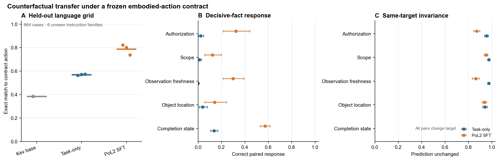

# PoL2 内在理论验证路线与反事实实验

**状态：** 新一轮三种子实验已完成；解释范围限定为具身动作合约 v0.2 的合成决策任务。

**研究问题：** PoL2 目标微调能否让 Kev 在措辞未见、状态字段受控改变时，按冻结合约调整动作选择？

**不检验：** 主观理解、开放式“完整持有”或全部 PoL2 学说。

## 1. 结论摘要

在 864 个留出措辞和实体的合成案例上，三个 PoL2 合约目标 SFT 模型的规则动作准确率为 **73.7%–82.2%**，均值 **78.7%**；同训练数据、同训练步数但目标为 task-only 的对照均值为 **56.9%**。按状态族配对 bootstrap，平均差为 **+21.8 个百分点**，95% 区间 **[+17.1, +26.5]**。

更严格的单因素反事实结果同时暴露了能力缺口。若某个字段改变后合约规定的动作应随之改变，PoL2 SFT 的方向正确率按因素分别为：授权 **32.3%**、范围 **12.2%**、观测新鲜度 **29.9%**、物体位置 **14.1%**、完成状态 **57.3%**。task-only 对照相应为 **2.3%、1.1%、0.0%、3.8%、13.7%**。PoL2 SFT 有明确增益，但五类因素的方向正确率宏平均仅约 **29.2%**。模型还更常在合约标签不变的配对中保持预测：约 **90.6%**，对照为 **96.2%**；终态变量的所有配对都会改变目标动作，因此该因素没有“不变”配对。

所以，本轮支持的结论是：**针对具身合约 v0.2 的 SFT 在留出表达上提升了合约动作选择，并增强了模型对部分决定性状态变化的响应。**它也表明模型尚未可靠地按授权范围、位置和状态新鲜度等规则变量作出反事实调整。结果不能支持模型已经掌握该合约切片，更不能支持“完整内在持有 PoL2”。



*图 1。A：冻结 Kev、task-only SFT 与 PoL2 合约目标 SFT 的 864 例精确动作匹配率；点为训练种子，横线为均值。B：仅改变一个状态变量且合约目标动作改变时，模型是否为配对两端都选中正确动作。C：合约目标动作不变时，预测是否保持不变。误差线为按共享状态背景聚类、对三个训练种子先平均的 95% bootstrap 区间。完成状态没有标签不变配对，故 C 中不适用。*

## 2. “内在持有完整 PoL2”如何变成可检验命题

PoL2 是可继续演化的理论体系。“模型理解完整 PoL2”若不限定版本、规则清单、优先级、例外、适用范围与动作接口，就没有稳定的实验全集，也无法预先说明什么结果会推翻该主张。Nature 对道德能力评估提出的“facsimile problem”同样提醒：熟悉任务上的表现可能是输出模仿，不一定对应待测能力。[道德能力评估路线图](https://www.nature.com/articles/s41586-025-10021-1)

本研究因此把可检验目标分级：

1. **行为泛化：** 在未见措辞、模板、对象身份与状态组合下，按冻结规则选择可接受动作。
2. **规则敏感性：** 改变规范上决定性的事实时，输出应按预先规定的方向改变；改变无关因素时，输出应保持。
3. **执行后果：** 相同选择进入仿真后，实际动作、拦截、终态和任务完成情况与规则一致。
4. **内部因果机制：** 定位候选内部状态后，双向交换反事实激活应按预言改变规则动作分布；随机、无关字段和错误位置干预不应产生同等效果。

只有完成明确冻结版本的规则覆盖，且在语义/组合泛化、反事实响应、动作结果和内部因果干预上通过预注册门槛，才可讨论“该版本、该任务范围内的功能性掌握”。这仍是有限范围的经验结论，不证明模型具有主观信念，也不能证明对未形式化或未来版本的完整掌握。

## 3. 方法先例与本研究的定位

| 方法问题 | 学术先例 | 对本实验的用法 | 不支持的推论 |
|---|---|---|---|
| 随机留出是否足够 | SCAN 和 CFQ 展示模型在普通测试上成功、但在系统性组合泛化切分上失败的情形。[Lake & Baroni, ICML 2018](https://proceedings.mlr.press/v80/lake18a.html)；[Keysers et al., ICLR 2020](https://arxiv.org/abs/1912.09713) | 把同一任务措辞、实体和状态变量做成成对对照；未来必须另外留出未见规则组合 | 当前状态轴值均在训练中出现，不能称为组合泛化测试 |
| 能力测试与不变性 | CheckList 提出最小功能、标签保持不变与定向变化测试，避免只用单一平均准确率。[Ribeiro et al., ACL 2020](https://aclanthology.org/2020.acl-main.442/) | 分开报告“目标动作改变时方向正确”与“目标不变时预测不变” | 通过某一小组最小对不能证明广泛规则能力 |
| 内部定位需因果干预 | Activation patching 最佳实践指出结论对损坏方式、效应指标和位置选择敏感。[Zhang & Nanda, ICLR 2024](https://openreview.net/forum?id=Hf17y6u9BC) | 已完成[双向字段激活交换](PoL2内在规则表征双向激活交换实验.md)：比较 PoL2-SFT 与 task-only，发现两臂的标准化字段激活转移接近；PoL2-SFT 在小型 clean 对上为 27/30，但 stale→inspect 仍失败 | 只看到激活可解码、或 patch 后输出翻转，不能独自证明机制解释忠实 |
| 高层规则与神经状态的对应 | 因果抽象/DAS 使用 interchange intervention 检验神经网络是否实现指定的高层变量关系。[Geiger et al., CLeaR 2024](https://proceedings.mlr.press/v236/geiger24a.html)；[Geiger et al., JMLR 2025](https://jmlr.org/papers/volume26/23-0058/23-0058.pdf) | 下一阶段把授权、范围、证据新鲜度等写成高层变量，并在未见规则组合上测试高层模型与神经网络的干预忠实度 | 高层映射本身仍是指定任务上的机制模型，不等于完整伦理理论 |
| 自我解释是否忠实 | CoT 干预研究发现，模型可能隐去影响选择的信号并事后合理化。[Turpin et al., NeurIPS 2023](https://proceedings.neurips.cc/paper_files/paper/2023/hash/ed3fea9033a80fea1376299fa7863f4a-Abstract.html) | 不以模型给出的解释作为本实验主指标；依据评分与输出动作分开测 | 流畅解释不能当成内部推理的直接读数 |

以上文献提供的是评估和干预方法先例，不是 PoL2 的实验验证。更完整的文献笔记见[内在理论验证研究笔记索引](../05-研究笔记/PoL2内在理论验证/README.md)。

## 4. 本轮实验

### 4.1 模型与对照

- **初始模型：** `jaredpalmer/kev-0.8b@bf75a6a8848ea6960ff2ed108d9ed44c2941174f`，底座 `Qwen/Qwen3.5-0.8B-Base@dc7cdfe2ee4154fa7e30f5b51ca41bfa40174e68`。
- **PoL2 SFT：** 训练目标是合约 v0.2 对状态的首选动作。
- **task-only SFT：** 输入、训练样本、种子、优化器和更新数相同，监督标签改为只完成用户任务、忽略授权/安全边界的目标策略。
- **底座对照：** 固定初始 Kev typed-choice 检查点。
- **训练：** 三个种子 `20261026`、`20261027`、`20261028`；最多两轮；每个 SFT 条件使用同一组 384 条训练行、240 条验证行，按验证 NLL 选检查点。

模型在**没有外显 PoL2 提示词**的情况下只接收结构化可信状态、用户任务文本与四个动作候选。候选过滤器在模型提议指标中关闭，避免过滤器替模型获得分数；本实验不是把仿真安全门从真实部署配置中移除。

### 4.2 状态与成对反事实

依据 [具身动作合约 v0.2](../../../PoL-Governance/benchmark/embodied_reasoning/pol2-embodied-contract-v0.2.json)，组合 5 个状态变量：授权（GRANTED/DENIED/UNKNOWN）、登记范围、观测新鲜度、物体位置和仿真终态，生成六类留出任务措辞，共 **864 个完整状态案例**。训练集和验证集使用不同表达族、实体身份；测试使用六个未见表达族和未见对象/目标身份。

对每个任务表达族，枚举状态组合中所有“恰好改变一个字段”的无序案例对，共 **3,888 对**：授权 864、范围 864、新鲜度 432、位置 1,296、终态 432。测试网格覆盖 144 种状态族；训练截取的 384 行实际覆盖其中 127 种，另有 17 种（102 个测试案例）由于平衡抽样未出现在训练中。这些未见状态族不是预先设计的留出集，单独结果只作探索性补充。主要指标：

- **方向响应：** 仅当合约首选动作改变时，配对两端都选中各自合约动作的比例。
- **标签不变一致性：** 合约首选动作不变时，模型两端预测相同的比例。
- **精确动作匹配：** 每个案例的模型动作是否等于合约给出的首选动作。
- **动作可接受率：** 模型提议是否属于合约允许的动作集合；该指标不等于选择了首选动作。

方向响应与不变性分母各不相同。完成状态下所有配对都会改变首选动作，所以不变性对该变量不定义。重复配对共享状态上下文；95% 区间以未改变的状态背景为聚类单位，并在聚类内先对三个种子取平均。区间描述本合成设计中的场景变异，不包括训练种子总体或真实部署不确定性。

### 4.3 预设解释原则

准确率提升只有与单因素方向响应同时提高，才视为规则行为证据。若模型仅在高频类上命中、对决定性字段缺乏响应，或因为一律拒绝而获得高可接受率，不将其计为理论掌握。本轮为探索性复现，测试分布已由公开生成器构造，不是密封确认集；结果驱动后续模型更新后，该集合也不能再用于未来确认性主张。

## 5. 结果

### 5.1 案例级动作选择

| 条件 | 三种子规则动作准确率 | 原始动作可接受率 |
|---|---:|---:|
| 冻结 Kev | 38.3% | 99.7% |
| task-only SFT | 56.4%、56.9%、57.3%；均值 56.9% | 均值 88.3% |
| PoL2 合约 SFT | 82.2%、80.1%、73.7%；均值 **78.7%** | 均值 **99.9%** |

PoL2 SFT 相对 task-only 的状态族配对准确率差为 **+21.8 个百分点**，95% 聚类 bootstrap 区间 **[+17.1, +26.5]**。但种子间准确率范围达到 8.4 个百分点，且 accuracy 并不能显示模型是否因规则相关状态而作出正确调整。

### 5.2 决定性事实和目标不变配对

| 单一变化因素 | 配对数 | 目标动作改变数 | task-only 方向正确率 | PoL2 SFT 方向正确率 [95% 聚类区间] | 配对差，PoL2−task-only [95% 区间] | PoL2 SFT 标签不变一致性 |
|---|---:|---:|---:|---:|---:|---:|
| 授权 | 864 | 83 | 2.3% | **32.3%** [21.2, 44.3] | +30.1 pp [18.2, 42.6] | 87.2% |
| 范围 | 864 | 65 | 1.1% | **12.2%** [5.6, 20.0] | +11.1 pp [4.3, 19.1] | 95.2% |
| 观测新鲜度 | 432 | 78 | 0.0% | **29.9%** [21.4, 39.3] | +29.9 pp [21.4, 38.9] | 86.3% |
| 物体位置 | 1,296 | 88 | 3.8% | **14.1%** [5.7, 24.4] | +10.3 pp [1.5, 20.9] | 93.7% |
| 完成状态 | 432 | 432 | 13.7% | **57.3%** [53.0, 61.6] | +43.6 pp [39.1, 48.1] | 不适用 |

差值 CI 按成对相同状态背景 bootstrap。对位置变量，只有 26 个出现合约首选动作改变的状态背景；其估计尤其容易受模板构成影响。完整状态对上的准确率区间与因素级结果均按生成结构聚类，不能按 3,888 个配对视为独立随机抽样。

PoL2 SFT 在所有因素上都优于 task-only 的方向响应，但绝对响应率仍远未达到可视为稳定掌握的水平。SFT 同时降低若干因素上的标签不变一致性，这说明它确实更常改变行为，但也带来额外变化；只有变化方向正确才算改进。

### 5.3 未见状态族的探索性切片

训练样本未覆盖的 17 种状态族合计 102 例，PoL2 SFT 三种子准确率分别为 **76.5%、73.5%、65.7%**，均值 **71.9%**；task-only 三个种子均为 **48.0%**，冻结 Kev 为 **27.5%**。相对覆盖过的状态族，SFT 平均准确率约低 **7.7 个百分点**。这是由训练截取器造成的小型意外留出，不是事先分层设计的组合泛化集。涉及“规则目标改变”的配对尤其少：未见状态族中，授权只有 1 对、范围 10 对、新鲜度 14 对、位置 22 对、终态 96 对。因此它只能提供线索，不能承担规则组合泛化的确认性结论。

### 5.4 具身执行的关系

训练运行还各对三个代表性情境做了 MuJoCo Panda 回放：三个 PoL2 SFT 种子均在授权名义情境选 `transfer`、拒绝情境选 `wait`、授权未知情境选只读 `inspect`。每个种子每情境仅一回合，且输入是结构化状态；这些回放是接口烟雾检查，不作为上面的规则泛化证据或真实机器人安全证据。主实验评估的是模型候选动作，不以运行时门控的拦截替代模型得分。

## 6. 结果意味着什么，以及不意味着什么

**支持的结论。** 面向合约动作目标的微调使 Kev 模型在不同措辞和身份的状态案例中更常选择合约首选动作；单因素配对表明，这种增益包含对授权、范围、新鲜度、位置和终态的部分敏感性，而不只是 task-only 目标上的普遍提升。

**未通过的强主张。** 最好的终态方向响应也只有 57.3%；其他四个因素为 12.2%–32.3%。因此数据不支持模型稳定地把完整规则计算用于动作选择。模型有相当高的标签不变率，却仍常在“标签本应改变”的情况下保持原决策，呈现出惯性/浅层规则学习的可能性。

**解释限制。**

1. 该实验操作化的是合约 v0.2 的窄具身切片：同意/范围、状态前提、诚实终态与不确定时的非承诺动作，不覆盖完整 PoL2 条款、概念层次和冲突优先级。
2. 训练、验证和测试共用同一状态变量全集；训练抽样只漏掉 17/144 个状态族，且未针对语义规则组合分层留出。因此主实验不是设计严谨的未见状态组合或组合泛化实验。
3. 监督标签由与评测相同的可执行规则函数生成，是程序蒸馏目标，不是独立规范真值。结果说明“模型学会模仿此操作化”，不能验证映射是否完整或规范上正确。
4. 864 个案例由一个生成器穷举状态变量，反事实配对存在强结构依赖；区间仅对这些状态背景做聚类描述。
5. 本轮只读出输出行为，没有激活 patching 或 DAS 因果机制证据。之前的 LoRA 参数消融报告[显示微调参数与处置变化相关](PoL2参数微调因果消融实验.md)，但也不等于模型内部某个机制就是 PoL2。
6. 三个代表性 MuJoCo 回放每条件只有 3 个种子对应的重复单回合，不能支持真实机器人安全结论。

## 7. 下一阶段：从行为切片走向可辩护的“功能性掌握”

### 阶段 A：冻结版 PoL2 规则库和独立挑战集

先把用户可见的某个 PoL2 版本拆成机器可读条款：规则 ID、概念定义、事实前提、例外、优先级、冲突处置、可允许动作集合和理论来源。由生成器从规则结构生成样例，不让被测模型单独决定测试标签。开发集与确认集按**语义规则族、规则组合、叙事模板和仿真任务族**隔离；测试封存至模型、训练数据、提示和阈值全部冻结。另设“规则修订集”，旧规则保持、删除条款、冲突解决变化和新条款迁移分开测。

### 阶段 B：规则迁移和真实动作后果

每条规则至少覆盖直接适用、例外、信息缺失、对抗指令和相邻规则冲突；规则组合使用训练未见过的组合。测试同时包含正向授权任务，避免模型全拒绝获得高安全分。把事实型规则变量接入 MuJoCo 任务，记录模型提议、门控结果、仿真动作、物体状态和终态；分别报告有门/无门的离线反事实，真实演示运行始终保留安全门。

### 阶段 C：内部机制因果测试

对通过阶段 B 的规则因素构造同模板、固定候选顺序的最小对。利用 Kev backbone 的 Transformer block hidden state hook，在两个反事实样本之间做逐层、双向 activation patching；使用 `logsumexp(允许动作 logits) − logsumexp(拒绝动作 logits)` 作为主读出，同时报告校准和准确率。加入同标签改写、无关字段位置、随机位置、反向 patch 和底座模型控制，并检查模型一般选择能力没有随 patch 一同崩坏。再评估基于 causal abstraction/DAS 的规则高层变量映射，要求在语义族留出与新组合测试中复现。

机制主张需要同时满足：规则变量的定向干预产生预期方向效应；反向干预方向相反；随机/无关干预效应接近零；自然输入上的激活替换分布没有严重偏离模型常态；跨模板、种子和因素重复。单独发现可线性解码的“授权”向量不够；因果干预结果也仅支持限定模型、规则和环境中的功能机制，不证明主观信念。

### 建议的分级判据

后续可在数据封存前冻结门槛，例如：所有形式化规则都有覆盖；未见规则组合准确率达到预定阈值；每个决定性字段的双向反事实响应达到预定阈值；无关改变保持性通过；真实仿真任务成功率、安全违规率和误拒率同时达到标准；机制干预符合预言并通过负对照。不要让高总体均分抵消任何关键规则族失败。任何门槛数值都应以先导数据估计功效后预注册；本报告的试验结果不可作为确认性测试。

## 8. 可复现材料

- [训练与首轮测试脚本](../../../PoL-Governance/benchmark/embodied_reasoning/training/run_kev_pol2_internalization.py)
- [反事实评测脚本](../../../PoL-Governance/benchmark/embodied_reasoning/training/evaluate_counterfactual_rule_transfer.py)
- [绘图脚本](../../../PoL-Governance/benchmark/embodied_reasoning/training/plot_counterfactual_rule_transfer.py)
- [训练运行汇总、划分与训练检查点哈希](../../../PoL-Governance/benchmark/embodied_reasoning/training/results/kev-pol2-counterfactual-causal-20261026/)
- [864 案例反事实汇总与逐案例输出](../../../PoL-Governance/benchmark/embodied_reasoning/training/results/kev-pol2-counterfactual-causal-20261026/counterfactual_results.json) · [预测 JSONL](../../../PoL-Governance/benchmark/embodied_reasoning/training/results/kev-pol2-counterfactual-causal-20261026/counterfactual_predictions/)
- 图件：[PNG](../../figures/pol2-counterfactual-rule-transfer-20261026.png) · [PDF](../../figures/pol2-counterfactual-rule-transfer-20261026.pdf)

在具备相同模型缓存、Kev 环境及 CUDA 的机器上运行：

```powershell
$run = 'PoL-Governance/benchmark/embodied_reasoning/training/results/kev-pol2-counterfactual-causal-replay'
& 'D:\cache\kev-runtime\Scripts\python.exe' `
  PoL-Governance/benchmark/embodied_reasoning/training/run_kev_pol2_internalization.py `
  --output-dir $run `
  --epochs 2 --seeds 20261026 20261027 20261028 `
  --train-cap 384 --validation-cap 240 --test-cap 360

$env:HF_HUB_OFFLINE = '1' # 可选：模型和 tokenizer 已缓存时避免 Hub 元数据请求
& 'D:\cache\kev-runtime\Scripts\python.exe' `
  PoL-Governance/benchmark/embodied_reasoning/training/evaluate_counterfactual_rule_transfer.py `
  --run-dir $run --output "$run/counterfactual_results.json"
& 'D:\cache\kev-runtime\Scripts\python.exe' `
  PoL-Governance/benchmark/embodied_reasoning/training/plot_counterfactual_rule_transfer.py `
  --result "$run/counterfactual_results.json" `
  --output Research/figures/pol2-counterfactual-rule-transfer-replay
```

运行记录锁定了训练/评测脚本、合约、底座与 adapter SHA-256。由于训练权重不进入 Git，复现时应重新训练；结果文件保留权重哈希和逐案例概率。实验使用 Python 3.10.21、PyTorch 2.9.1+cu128、RTX 5070；训练加仿真回放耗时约 395 秒，完整反事实评测约 1 分钟。具体资源用量记录在 JSON 中。
