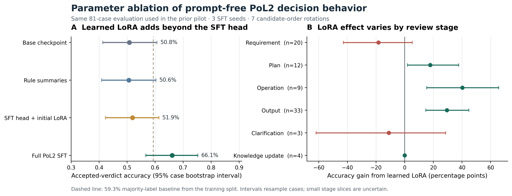

# PoL2 参数微调因果消融：提升来自哪里？

**实验状态：已运行；探索性、事后机制分析**

**分析对象：** 前一轮 PoL2 广域类型判断实验中的 81 个保留案例

**模型：** `jaredpalmer/kev-0.8b@bf75a6a8848ea6960ff2ed108d9ed44c2941174f`；底座 `Qwen/Qwen3.5-0.8B-Base@dc7cdfe2ee4154fa7e30f5b51ca41bfa40174e68`

## 摘要

前一轮发现，PoL2 案例监督微调后的模型在 81 个保留案例上比冻结底座更常选中项目给出的可接受处置。该差异仍可能来自训练后的决策头、LoRA 参数更新，或两者共同作用。本轮对同一模型做参数消融：**保留已微调的决策头，但把 LoRA 参数恢复为初始 Kev 检查点中的数值**。这项干预近似回答“在保持决策头不变时，SFT 期间发生的 LoRA 更新对输出行为增加了什么”。

三个种子下，完整微调模型平均命中率为 **66.1%**，而“微调决策头 + 初始 LoRA”条件为 **51.9%**；配对差 **+14.2 个百分点**，按案例 bootstrap 的 95% 区间为 **[+3.6, +24.8]**。三个种子均出现相同方向的差异。与冻结底座及规则摘要条件相比，完整微调分别高 **15.3** 和 **15.5** 个百分点。

该结果支持一个有限的因果表述：**在这组已使用过的项目标签上，微调期间的 LoRA 参数变化对类型化处置选择有超出训练后决策头的贡献。**它不证明 LoRA 内部编码了完整 PoL2 理论，也不能证明主观理解。阶段效果不均：操作、输出、计划审查有正向差异；需求审查与澄清切片的点估计为负；知识更新切片仅 4 例，无法得出有力结论。当前准确率 **66.1%** 也只比训练集多数标签基线 **59.3%** 高 **6.8 个百分点**。

*图 1。左图显示总体准确率，区间按案例重采样。右图为完整 SFT 与“保留 SFT 决策头、恢复初始 Kev LoRA”之间的阶段内配对差；横线是按案例 bootstrap 的区间。七种候选顺序是重复测量，不是独立样本。虚线为训练集多数标签基线。*

## 1. 研究问题与因果干预

本轮不重新检验“微调是否优于底座”，而是分解前一轮观察到的差异：训练期间更新的 LoRA 参数，是否对保留案例上的判断行为有独立贡献？

采用同一组输入、同一判断提示、同一七类处置、同一标签、同一微调头，仅改变 LoRA 参数状态：

| 条件 | 决策头 | LoRA | 用途 |
|---|---|---|---|
| 冻结 Kev | 初始 | 初始 | 未做本任务微调的基线 |
| 规则摘要 | 初始 | 初始 | 推理时额外提供按 `source_refs` 取回的规则摘要 |
| SFT 头 + 初始 LoRA | **SFT 后** | **恢复初始值** | 消融条件：隔离 LoRA 更新在已微调决策头之外的增量贡献 |
| 完整 PoL2 SFT | SFT 后 | SFT 后 | 微调模型的完整状态 |

这里的“参数干预”是对适配器参数整体做替换，并非单神经元定位或完整的因果中介分析。它借鉴因果解释研究中的干预逻辑：通过改变候选机制并观察输出差异，检验该机制是否参与行为；NeurIPS 2020 的因果中介分析工作也明确区分了“表征中可读出信息”和“信息是否被模型用于输出”。本实验的参数级消融比激活层级分析粗，无法定位具体层、神经元或规则表征。[Vig et al., NeurIPS 2020](https://proceedings.neurips.cc/paper_files/paper/2020/hash/92650b2e92217715fe312e6fa7b90d82-Abstract.html)

## 2. 数据与执行

本轮复用前一轮的 63 个训练案例和 81 个去重保留案例；不重训模型，不调超参数。保留集合包含 26/28 条规则 ID，精确文本不与训练集重合，但训练和测试共享规则族。该集合在前一轮已用于结果汇报，也已被研究者读取，因此本轮是**同一基准上的事后机制分析**，不能作为新测试集、独立复现或确认性实验。

三个 SFT 权重分别对应随机种子 `20261026`、`20261027`、`20261028`。每个模型在七种轮换的候选项顺序下评测。主终点是每个案例在七种顺序下命中 `expected_verdict_in` 的比例，再对案例和三个种子取均值。

对每个种子，评测完整 SFT 权重后，保留其训练后决策头，并从固定的初始 Kev 检查点恢复 LoRA 张量，再评测消融条件。这样保留头部变化，仅移除 SFT 阶段对适配器的更新。指标区间采用 10,000 次按案例有放回 bootstrap；由于案例共享规则族，区间只描述本组案例的不确定性，不应解释为对总体理论能力的统计保证。

原始输入由仓库评估集读取；结果 JSON 记录数据文件与规则映射的 SHA-256、各 SFT 权重及头部的 SHA-256、模型版本、运行设备和显存峰值。权重本身不随本报告发布；可按本报告链接的训练脚本重训后执行消融脚本。

## 3. 总体结果

| 条件 | 命中率 | 接受标签概率质量 | 选项顺序稳定案例率 |
|---|---:|---:|---:|
| 冻结 Kev | 50.8% | 33.2% | 65.4% |
| 冻结 Kev + 规则摘要 | 50.6% | 35.8% | 61.7% |
| SFT 决策头 + 初始 LoRA | 51.9% ± 0.4 | 34.4% | 59.3% |
| 完整 PoL2 SFT | **66.1% ± 0.8** | **41.7%** | **71.2% ± 3.1** |
| 训练多数标签（前轮基线） | 59.3% | — | — |

完整 SFT 相对“同一训练头 + 初始 LoRA”的配对差为 **+14.2 个百分点**，95% 案例 bootstrap 区间 **[+3.6, +24.8]**。三个种子的完整 SFT 命中率为 **66.1%、65.3%、66.8%**；对应头部保留、LoRA 恢复初始值后的命中率为 **51.7%、52.4%、51.7%**。相对冻结底座的差为 **+15.3 个百分点**，95% 区间 **[+4.6, +26.1]**；相对规则摘要条件为 **+15.5 个百分点**，区间 **[+7.4, +23.8]**。

命中率高于 59.3% 的多数标签基线，但仅高 **6.8 个百分点**。因此不能将 +15.3 个百分点相对底座的差描述为足以证明全面掌握理论。规则摘要条件没有优于底座；它使用了预先给定的来源规则引用，绕过了检索正确性，不能视为完整 RAG 系统的比较。

## 4. 分阶段差异

下表是三个种子平均后的完整 SFT 与消融条件命中率之差。小样本阶段的点估计非常不稳定，报告样本数以避免将其误作可靠的规律。

| 审查阶段 | 案例数 | LoRA 更新增量（百分点） | 解释 |
|---|---:|---:|---|
| 需求审查 | 20 | −18.3 | 当前训练导致该切片退化的信号；需优先排查 |
| 方案审查 | 12 | +17.9 | 正向差异，但样本不足以外推 |
| 操作审查 | 9 | +40.2 | 点估计较大，且仅 9 例 |
| 输出审查 | 33 | +29.4 | 本集合中样本最多的阶段之一 |
| 澄清 | 3 | −11.1 | 不能据此估计稳定效果 |
| 知识更新 | 4 | 0.0 | 无法判断模型是否学会该边界 |

阶段差异说明总体均值会遮住明显的不均匀性。下一轮应在增加样本并锁定规则族后再检验这些交互；本轮未为六个阶段分别做多重检验，也不把图中的区间当作阶段性确认结论。

## 5. 这对“内在持有 PoL2”说明什么

结果比单纯的输出比较多了一层证据：当决策头保持为 SFT 状态、只把 LoRA 恢复到初始 Kev 参数时，准确率回落到接近冻结底座。由此可说，**微调形成的 LoRA 参数变化与一部分项目预期处置行为存在因果联系**，且该联系不能由微调决策头单独解释。

仍然不能说模型已经“理解或内在持有完整 PoL2”：

1. 标签来自同一套候选理论映射，不是独立建立的金标准；参数可能学到案例—标签关联，而非完整理论结构。
2. 评测只覆盖 26/28 条规则 ID，且测试规则族已在训练中出现；没有证明对未见条款组合、演化中新概念或跨章节冲突的迁移。
3. 输出是七类处置选择；没有检验决定性事实抽取、条款依据准确性、解释忠实度、前提反转后的规则性变化，或真实具身任务表现。
4. 被干预的是整套 LoRA 参数，尚未定位哪些层承载哪些行为，也没有激活补丁或其他中间表征干预证据。
5. 当前标签基线不高：SFT 只有 66.1%，且需求审查明显退化。局部因果贡献并不等于高能力或安全可靠。

因此，最准确结论是：**PoL2 监督微调在本项目这组有限治理案例上确实写入了超出读出头的可观察行为变化；这为参数层面的行为内化提供初步机制证据，但完整理论理解命题仍未验证。**

## 6. 继续验证的实验路线

### 第一步：建立未消耗的确认性评测集

冻结新的理论版本、样本构造脚本、条款来源哈希、标签规范和统计计划；按语义族留出训练样本，而不只按案例文本留出。建议评测集至少包括 **28 条规则各 20 个单规则案例（560 例）**，另加 **80 组成对的最小反事实（160 例）**和 **60 个跨规则组合案例**，总计约 **780 例**。每条规则的 20 例分布在直接适用、边界/例外、关键信息缺失、对抗性指令四类中。明确覆盖前轮缺失的 `POL2-R009`、`POL2-R013`。测试集一经解封即标为已消耗。

### 第二步：测事实敏感性和组合泛化

每个核心概念设置：语义保持的改写、无关字段变化、决定性事实最小反转、至少两条不同章节规则共同适用的组合题。预期行为分别是“不相关变化不改判断”和“决定性条件改变时按条款改变判断”。规则 ID、支持原文和标签须在推理前锁定。

### 第三步：避免单一标签定义自身成功

在维持用户要求的无人工运行假设下，可由两个冻结且不同系列的模型独立生成挑战案例和逐条附原文证据的判定，再由确定性校验器检查引用是否存在、是否覆盖预定义前提。模型间分歧、来源缺失、理论条款冲突应单列为“未决”，不能让同一个待测模型同时生成样本、制定答案并评分。该流程仍依赖人类撰写的 PoL2 原文和版本边界，且 AI 裁判不是客观真理；它只能降低自我评测的循环性。

### 第四步：再做更细的内部机制干预

先在独立测试集上复现行为提升，再使用表征替换、激活补丁或层级消融，检查模型对某条规则决定性事实的响应是否通过可重复的内部路径影响类型输出。此类干预需要做 token 对齐、基线与负对照，并遵循 activation patching 方法学对度量和解释的警告。[Zhang & Nanda, 2023](https://arxiv.org/abs/2309.16042)。即使找到相关中间机制，也只能支持有限的功能性表征主张，不等同于哲学意义的信念或完整理解。

### 下一轮的预注册候选门槛

以下是建议先冻结、后评测的判据，不是本轮已达到的结果：

| 维度 | 候选门槛 |
|---|---|
| 总体迁移 | 按规则宏平均准确率 ≥85%；相对冻结底座和训练多数标签基线的差值，其规则族聚类 bootstrap 95% 区间下界均大于 0 |
| 覆盖 | 28 条规则均有测试案例；每条规则至少 20 个独立案例；不得以总体平均掩盖未达门槛的规则 |
| 反事实 | 最小事实对的方向正确率 ≥80%；语义不变、决定因素不变的改写保持率 ≥90% |
| 组合 | 未见过的双规则组合宏准确率 ≥80%，并报告每一组合的案例数和置信区间 |
| 依据 | 条款 ID 命中率 ≥95%；逐条来源支持率由独立校验流程判定，错误引用单独计为失败 |
| 稳健性 | 三个以上训练种子同向；结果不依赖候选项位置；严重安全性错误须单列，不能被加权总分抵消 |

这些门槛只支持对一个冻结理论版本的广泛行为能力结论。只有在解释/依据、反事实、规则组合和仿真执行链同时通过后，才讨论是否有足够证据称为该版本的“功能性内化”；仍不构成主观理解或哲学意义上完整持有理论的证明。门槛必须在测试集解封前固定。

## 7. 复现材料

- [评测脚本](../../../PoL-Governance/benchmark/pol2/evaluate_sft_parameter_ablation.py)
- [绘图脚本](../../../PoL-Governance/benchmark/pol2/plot_sft_parameter_ablation.py)
- [机器可读结果和逐案例预测](../../../PoL-Governance/benchmark/pol2/results/sft-parameter-ablation-20261028/)
- [前一轮训练脚本](../../../PoL-Governance/benchmark/pol2/run_full_theory_behavioral_competence.py)
- [前一轮广域行为评测报告](PoL2-理论行为能力广域评测.md)
- [图件 PNG](../../figures/pol2-sft-parameter-ablation-20261028.png) · [PDF](../../figures/pol2-sft-parameter-ablation-20261028.pdf)

在配有上述模型权重缓存的环境中，先运行前一轮训练脚本生成三个 seed 的适配器，再执行 `evaluate_sft_parameter_ablation.py`；脚本拒绝覆盖已存在结果目录，并将数据、规则、代码与模型参数哈希写入 JSON。运行环境为 Python 3.10.21、PyTorch 2.9.1+cu128、RTX 5070，最大分配显存约 **2.10 GiB**，评测耗时约 **315 秒**。由于模型服务和底座权重许可不由本研究决定，复现时须遵守各自条款。
