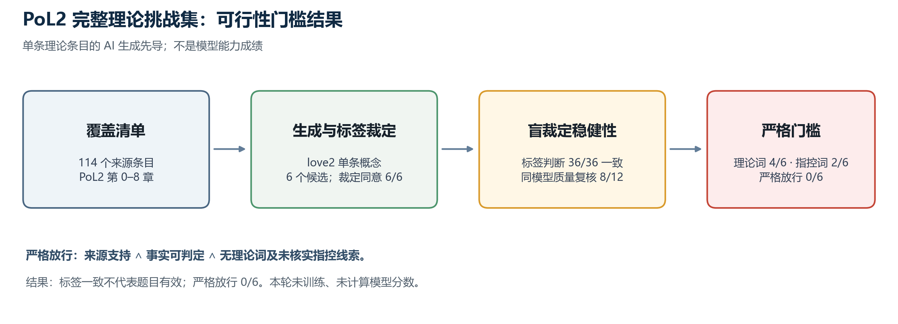

# PoL2 完整理论内在化挑战集：生成质量先导与停止判定

> **目的：**为“模型是否理解或内在持有完整 PoL2”建立可执行评测前，先检验 AI 生成的理论案例能否通过来源扎根、事实可判定和标签泄漏三项质量门。
>
> **结论：**本轮只运行一个条目的 6 例生成先导。两种模型、两种提示顺序给出 36/36 个一致的标签比较，但首轮质量门只放行 2/6，复核时又随提示变化；事后严格线索扫描放行 0/6。因此按训练前停止规则不训练、不报告模型得分。这是测量工具的失败结果，不是 PoL2 理论或模型能力的阴性结果。

## 1. 问题与判定门

本项目的目标是检验模型是否在不输入 PoL2 规则的情况下，能否调用冻结版完整理论并将其用于新情境。若测试题本身把“公平”“违反原则”等答案线索写进故事，或者测试标签并非由对应原文支持，即使模型得分很高，也不能说明模型内化了理论。

本先导预先采用三个逐例门槛：

1. **来源扎根：**案例的决定性判断由唯一来源条目直接支持，不依赖常识扩写。
2. **事实可判定：**只看案例中的可观察事实即可得到预设标签。
3. **无表面线索：**案例不直接出现理论名、标签词或评价性结论。

每个分层训练/测试集都必须保留三种标签，缺少任何一类即停止模型训练。AI 评审仅用于数据质量筛查，不被当作规范金标准。

## 2. 先导方法

从六份结构化知识文件读取来源指向 `PoL/0` 至 `PoL/8` 的条目，共得到 **114 个去重命题**：概念 26、关系 21、命题 5、爱语 16、治理规则 28、解释条目 18。这里的 114 是知识库覆盖清单，不等于 114 条已确认无歧义的规范规则；其中包含候选规则映射和研究者解释。

先导只取排序后的第一个概念条目 `love2`。Llama 3.1 8B 为三种预定标签各生成两个案例；Qwen 2.5 7B 看来源与情境后盲判标签，六例均与预期标签一致。随后，同一 Qwen 2.5 7B 检查来源扎根、事实可判定和表面泄漏；审计时不向它提供标签。之后再用 Qwen 2.5 7B 与 Llama 3.1 8B、两种材料顺序，对六例做 24 次盲裁定。Llama 同时承担案例生成和其中一组复核，因此两种裁定模型并非完全独立。

## 3. 结果



| 检查项 | 结果 | 含义 |
|---|---:|---|
| 生成候选 | 6 | 单一概念条目，每个标签 2 例 |
| 生成器标签与盲判标签一致 | 6/6 | 只表示两个阶段对标签达成机器一致，不证明标签有原文依据 |
| 通过全部逐例质量条件 | 2/6 | 两例均为 `consistent` |
| 来源扎根 | 2/6 | 两例与条目有一定关联，但并非完整理论覆盖 |
| 表面线索 | 2/6 | 两个 `conflicting` 案例含明显评价/指控语言 |
| 四组模型/顺序标签两两一致 | 36/36 | 6 例各有 4 次裁定；标签与生成器预设标签均一致 |
| 同一 Qwen 质量门复核一致 | 8/12 | 首轮与两种提示顺序相比，仅 4/6 个案例在两次复核中都保持原结果 |
| 诊断性词面/指控扫描 | 理论词 4/6；未核实指控 2/6 | 扫描词表在看到先导输出后补充，属于诊断分析，不是预注册确认性指标 |
| 严格词面门通过 | 0/6 | 所有候选均含显式理论词、标签线索或未核实指控 |
| 合格训练/测试标签覆盖 | 未通过 | 两个分区都缺少合格的 `conflicting`、`insufficient` 例 |

**停止判定：**不进行训练，不使用该先导计算准确率、增益或“内在化”指标。两模型标签高度一致只表示对这六个带线索案例的判断可重复；同一 Qwen 的质量门会随提示改变部分判断，严格词面扫描也没有留下合格案例。增加种子或训练轮数不能修复测试标签缺失与构念效度问题。

## 4. 裁定稳定性与效度的区别

36/36 组标签比较一致，并不证明标签有来源依据。该数值来自 6 个案例上每例 4 次预测的两两比较（不是 36 个独立案例）。Llama 同时用于案例生成和其中一组复核；而部分案例直接含有理论关联词，冲突案例还使用“被指控”等评价性叙述。这些题目测到的是带线索输入上的稳定分类，不足以说明模型进行了 PoL2 推理。

首轮 Qwen 质量门与两次后续 Qwen 质量复核仅 8/12 项一致，且 4/6 个案例在两次复核中同时保持原判断。不同提示顺序让两条冲突案例从“不放行”变成“放行”，说明质量门的操作定义仍不够稳定。事后词面扫描发现，4 例复用理论词，2 例依赖未核实指控；全部 6 例都未通过严格无泄漏检查。正式题库须在封存确认集前冻结词表、判定标准和停止规则。

## 5. 与已有实验的关系

先前广域行为评测在 81 个去重案例上报告：三个种子的 PoL2 参数微调平均可接受处置命中率为 **66.1%**，冻结底座为 **50.8%**，配对案例差为 **+15.3 个百分点**，95% 区间 **[+4.4, +25.9]**；测试覆盖 28 条映射规则中的 26 条，且训练和测试共享规则族。它支持“该训练改变了所测案例上的广域处置行为”，但并不覆盖全部 PoL2 理论，不能作为完整内在化结论。

本先导没有增加关于模型理解的正向或负向结果。它说明当前 AI 生成/裁定流程还不能可靠地产生支持确认性训练的挑战集。此前的合约动作训练、MuJoCo 执行和激活交换属于局部应用或机制线索，也不能填补概念、爱语、四公理、跨章关系、治理程序及未规定边界的覆盖缺口。

## 6. 结论边界与下一步

当前证据**不支持**“模型理解或内在持有完整 PoL2”。更准确的状态是：存在局部训练行为增益；完整理论命题尚未通过；本轮挑战集生成方案在首个概念条目的质量门上未能形成三标签覆盖。

下一轮如果继续，应先修复题目生成与筛选，而不是对这 6 例启动训练：

1. 为 114 个来源条目建立原文级定位与命题类别；把明文内容、可推论内容、歧义和候选解释分开。
2. 不再给所有知识类型套用同一个三分类情境任务：概念与关系测定义/方向/结构；公理与命题测来源支持、冲突和未规定；爱语测类别边界；治理规则只在适用条件和例外有文本依据时测行动；研究者解释保留其解释状态，不转写成原文规则。
3. 标签优先由可执行的来源结构和确定性变换生成；生成式案例只能进入候选开发集。另设不看标签的跨模型质量审计、固定词面扫描和来源定位检查，逐类报告裁定稳定性。
4. 对每种任务预设条目覆盖及分层门槛；先在开发条目上测生成失败率，再封存确认集。只有全章节、全任务类型达到预定质量下限，才启动多种子训练、匹配对照、组合留出、反事实测试及内部因果干预。

AI 评审模型同样可能系统性误读 PoL2；“多模型同意”不能替代来源证据。若目标是完全无人类复核，必须将这项不确定性作为方法限制，并通过来源锚定、规则化检查、跨模型复核和可公开失败案例降低风险；仍不能把自动裁定说成绝对规范真值。

## 7. 可复现材料

- [挑战案例生成器](../../../PoL-Governance/benchmark/pol2/build_full_theory_challenge.py)
- [盲化质量审计器](../../../PoL-Governance/benchmark/pol2/audit_full_theory_challenge_quality.py)
- [裁定稳定性与词面线索审计器](../../../PoL-Governance/benchmark/pol2/audit_challenge_adjudicator_reliability.py)
- [质量门结果 JSON](../../../PoL-Governance/benchmark/pol2/results/full-theory-challenge-generation-pilot-20261026/quality_audit.json)
- [生成器标签裁定记录](../../../PoL-Governance/benchmark/pol2/results/full-theory-challenge-generation-pilot-20261026/generation_audit.jsonl)
- [先导训练候选](../../../PoL-Governance/benchmark/pol2/results/full-theory-challenge-generation-pilot-20261026/train.cases.jsonl) · [先导测试候选](../../../PoL-Governance/benchmark/pol2/results/full-theory-challenge-generation-pilot-20261026/test.cases.jsonl)
- [跨模型、提示顺序稳定性逐例结果](../../../PoL-Governance/benchmark/pol2/results/full-theory-challenge-generation-pilot-20261026/adjudicator_stability.json)
- [绘图脚本](../../../PoL-Governance/benchmark/pol2/plot_full_theory_challenge_pilot.py) · [PNG](../../figures/pol2-full-theory-challenge-pilot-20261026.png)
- [完整理论内在化验证方案](PoL2完整理论模型内在化验证方案.md)
- [此前广域行为评测](PoL2-理论行为能力广域评测.md)

重跑单条目生成先导：

```powershell
$py = 'D:\cache\kev-runtime\Scripts\python.exe'
& $py PoL-Governance/benchmark/pol2/build_full_theory_challenge.py `
  --max-atoms 1 `
  --output PoL-Governance/benchmark/pol2/results/full-theory-challenge-pilot-replay
& $py PoL-Governance/benchmark/pol2/audit_full_theory_challenge_quality.py `
  --pilot PoL-Governance/benchmark/pol2/results/full-theory-challenge-pilot-replay
& $py PoL-Governance/benchmark/pol2/audit_challenge_adjudicator_reliability.py `
  --pilot PoL-Governance/benchmark/pol2/results/full-theory-challenge-pilot-replay
& $py PoL-Governance/benchmark/pol2/plot_full_theory_challenge_pilot.py `
  --audit PoL-Governance/benchmark/pol2/results/full-theory-challenge-pilot-replay/quality_audit.json `
  --stability PoL-Governance/benchmark/pol2/results/full-theory-challenge-pilot-replay/adjudicator_stability.json
```

生成式模型输出可能随模型版本、量化与运行环境变化。仓库保留本次逐例输出，重跑结果不会被假定为逐字相同。
