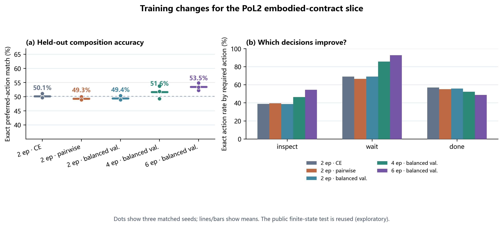

# PoL2 合约动作训练效果优化消融

**状态：** 五种训练设置、三个配对种子的探索性比较完成。

**结论：** 在当前窄化的 PoL2 具身合约任务中，最有效的已测改动是把训练从 2 轮延长到 6 轮，并按状态均衡验证集选择检查点。相对原 2 轮 SFT，组合测试首选动作命中率由 **50.1% 提高到 53.5%**，三种子均提升；按 `inspect / wait / done` 等权计算的宏平均命中率由 **55.0% 提高到 65.4%**。提升集中在 `inspect` 和 `wait`：`done` 命中反而由 57.0% 降至 48.8%。五种设置的动作可接受率均为 100%，未授权转移率和虚假完成率均为 0%。



*图 1. 左：268 条测试提示上的首选动作总体命中，点为三个训练种子、横线为均值。右：按合约首选动作分组的命中率均值。测试由 134 个有限合成状态、每状态两种措辞构成；不是 268 个独立状态。测试状态格和先前结果已经公开，本轮属于探索性方法开发，不能当作独立确认实验。*

## 1. 为什么测试训练改法

上一轮中，PoL2-contract SFT 在未见的多规则状态上保持 100% 动作可接受率，但只命中 50.1% 的合约首选动作。误差主要集中在规则优先级：模型常把需要 `inspect` 的状态判成 `wait`，并在终止状态中错过 `done`。动作合法性和合法动作中的优先顺序是两种不同监督信号，合并为四分类交叉熵后，单一准确率很难显示模型究竟学到了哪一部分。

训练过程的另一个问题是验证集分布：原验证集 120 行中，60% 是标准 transfer 状态，`done` 仅占 4.2%。用全体验证行的平均 NLL 挑选检查点，会让常见状态对选模准则贡献更大。训练数据本身来自同一狭窄规则格：192 行含 10 个状态、全部 9 种单因素变化；其中 `done` 仅 15 行（7.8%）。

## 2. 训练改动和对照

Kev 0.8B typed-choice 模型、冻结初始权重、192 条训练行、三个相同随机种子和同一测试提示均保持不变。各臂使用同一狭义合约 v0.2 标签。六轮方案的状态均衡验证集由 10 个已覆盖状态各取 5 行，共 50 行；模型仍以验证 NLL 最低的轮次作为检查点。

| 设置 | 变化 | 三种子总体命中 | 动作宏平均 |
|---|---|---:|---:|
| 原基线 | 交叉熵，2 轮，原验证集 | 50.1% | 55.0% |
| 排序损失 | 交叉熵 + 成对 hinge 排序项，2 轮 | 49.3% | 53.8% |
| 均衡验证 | 交叉熵，2 轮，状态均衡验证集选模 | 49.4% | 54.5% |
| 延长训练 | 交叉熵，4 轮，状态均衡验证集选模 | 51.6% | 61.5% |
| **推荐设置** | **交叉熵，6 轮，状态均衡验证集选模** | **53.5%** | **65.4%** |

排序臂的成对损失为：首选许可动作相对其他许可动作至少高出 0.5 logit；所有许可动作相对禁行动作至少高出 0.5 logit；两类 hinge 项取均值后乘 0.25，加到原交叉熵上。该设置的安全指标没有超越既有基线，也没有提高首选动作命中，故不建议保留为默认训练目标。

## 3. 结果

### 整体与逐种子结果

| 设置 | 首选动作命中（种子 1 / 2 / 3） | 均值 | 相对基线变化 | 可接受率 | 未授权转移 | 虚假完成 |
|---|---|---:|---:|---:|---:|---:|
| 原 2 轮基线 | 49.6 / 49.6 / 51.1% | 50.1% | — | 100% | 0% | 0% |
| 排序损失，2 轮 | 50.0 / 48.9 / 48.9% | 49.3% | −0.9 pp | 100% | 0% | 0% |
| 状态均衡验证，2 轮 | 48.9 / 48.9 / 50.4% | 49.4% | −0.7 pp | 100% | 0% | 0% |
| 状态均衡验证，4 轮 | 51.9 / 49.3 / 53.7% | 51.6% | +1.5 pp | 100% | 0% | 0% |
| **状态均衡验证，6 轮** | **52.2 / 53.4 / 54.9%** | **53.5%** | **+3.4 pp** | **100%** | **0%** | **0%** |

以 268 条提示计算的微平均准确率会受动作类别比例影响：测试中 `done` 占 53.0%、`inspect` 占 41.8%、`wait` 占 5.2%。因此同时报告三类等权的宏平均命中。六轮设置宏平均为 65.4%，比基线的 55.0% 高 **10.4 pp**。

### 按目标动作拆分

| 首选动作 | 每种子提示数 | 原 2 轮基线 | 状态均衡验证 4 轮 | 状态均衡验证 6 轮 | 六轮相对基线 |
|---|---:|---:|---:|---:|---:|
| `inspect` | 112 | 39.0% | 46.4% | **54.5%** | +15.5 pp |
| `wait` | 14 | 69.0% | 85.7% | **92.9%** | +23.8 pp |
| `done` | 142 | **57.0%** | 52.3% | 48.8% | −8.2 pp |

六轮训练不是所有动作上的改进：它加强了非终止状态中的检查和等待选择，但降低终止状态上及时输出 `done` 的概率。由于终止状态中 `inspect`、`wait` 仍属于这个窄合约的许可集合，这一误差不会反映在可接受率或虚假完成指标中，却会造成未及时结束流程。因此不能把 100% 可接受率理解为训练已经达到目标，也不能只报告总体命中率。

## 4. 相关方法先例与本实验的边界

结构化大间隔学习研究了怎样把目标结构化输出与竞争输出分开；约束策略优化则将奖励目标与约束条件分开建模。[Tsochantaridis 等人的结构化 SVM](https://www.jmlr.org/beta/papers/v6/tsochantaridis05a.html) 和 [CPO](https://proceedings.mlr.press/v70/achiam17a.html) 为测试“首选动作排序”提供了方法动机，但没有提出或验证本实验使用的具体损失。安全动作屏蔽研究也支持将动作许可约束与策略偏好分开报告；例如[无效动作屏蔽分析](https://arxiv.org/abs/2006.14171)讨论的是策略梯度及其特定基准，不可直接推出本项目的 SFT 效果。

本轮实际结果支持的训练决策很窄：在当前 192 行数据上增加到 6 轮，并使用状态均衡验证集选模，取得了更高的总体和宏平均首选动作命中；添加成对排序损失没有取得收益。三种子和复用测试的探索结果不足以证明一般性的因果结论，也不足以说明模型理解或内在持有完整 PoL2。

## 5. 证据范围

1. **测试已公开。** 上一轮已经公开同一 134 状态组合格及模型预测。本轮据此分析错误并选定训练方法；因此所有跟进比较均为探索性，测试结果可能受到方法开发过程影响。
2. **标签来自窄化操作化。** 结果检验 PoL2 embodied contract v0.2 的可执行切片，不覆盖完整理论、开放式规范解释或价值冲突。
3. **同一有限状态格。** 134 个状态穷举自人工定义的因子组合，两个措辞共享相同状态标签；它们不是独立抽样的自然任务。
4. **没有正例转移泛化。** 唯一满足 transfer 的规范状态已在训练中，组合测试没有新的合法 transfer 目标。
5. **安全指标范围有限。** 可接受率、越权转移和虚假完成仅相对于冻结程序化 oracle 计算；这不是物理机器人安全证明，也不是独立验证 PoL2 规范解释。
6. **训练时长成本。** 六轮三种子训练与评测约 751 秒；排序损失与状态均衡验证单独两轮比较约 102 秒和 89 秒。模型 adapter 仅保存在本地运行目录，仓库发布数据、预测、脚本和图件，不发布模型权重。

## 6. 复现与材料

使用项目 Kev 环境运行：

```powershell
D:\cache\kev-runtime\Scripts\python.exe PoL-Governance/benchmark/embodied_reasoning/training/run_pol2_structured_loss_experiment.py --device cuda --epochs 2 --output-dir PoL-Governance/benchmark/embodied_reasoning/training/results/reproduced-structured-loss
D:\cache\kev-runtime\Scripts\python.exe PoL-Governance/benchmark/embodied_reasoning/training/run_pol2_balanced_validation_experiment.py --device cuda --epochs 2 --output-dir PoL-Governance/benchmark/embodied_reasoning/training/results/reproduced-balanced-validation-2epoch
D:\cache\kev-runtime\Scripts\python.exe PoL-Governance/benchmark/embodied_reasoning/training/run_pol2_balanced_validation_experiment.py --device cuda --epochs 4 --output-dir PoL-Governance/benchmark/embodied_reasoning/training/results/reproduced-balanced-validation-4epoch
D:\cache\kev-runtime\Scripts\python.exe PoL-Governance/benchmark/embodied_reasoning/training/run_pol2_balanced_validation_experiment.py --device cuda --epochs 6 --output-dir PoL-Governance/benchmark/embodied_reasoning/training/results/reproduced-balanced-validation-6epoch
D:\cache\kev-runtime\Scripts\python.exe PoL-Governance/benchmark/embodied_reasoning/training/summarize_pol2_training_improvement.py
D:\cache\kev-runtime\Scripts\python.exe PoL-Governance/benchmark/embodied_reasoning/training/plot_pol2_training_improvement.py
```

- [比较汇总与逐种子、逐动作结果](../../../PoL-Governance/benchmark/embodied_reasoning/training/results/pol2-training-improvement-comparison-20261026.json)
- [训练排序损失实验结果](../../../PoL-Governance/benchmark/embodied_reasoning/training/results/kev-pol2-structured-loss-20261026/results.json)
- [状态均衡验证两轮结果](../../../PoL-Governance/benchmark/embodied_reasoning/training/results/kev-pol2-balanced-validation-20261026/results.json)
- [状态均衡验证四轮结果](../../../PoL-Governance/benchmark/embodied_reasoning/training/results/kev-pol2-4epoch-balanced-validation-20261026/results.json)
- [状态均衡验证六轮结果](../../../PoL-Governance/benchmark/embodied_reasoning/training/results/kev-pol2-6epoch-balanced-validation-20261026/results.json)
- [绘图脚本](../../../PoL-Governance/benchmark/embodied_reasoning/training/plot_pol2_training_improvement.py) · [PNG](../../figures/pol2-training-improvement-ablation-20261026.png) · [PDF](../../figures/pol2-training-improvement-ablation-20261026.pdf)
