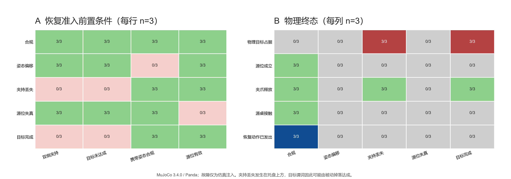

# PoL2 具身治理：恢复前置条件与执行故障边界实验

**运行日期：** 2026-10-24
**环境：** MuJoCo 3.4.0，Franka Emika Panda
**设计：** 三个源位布局 × 五种恢复状态，每格一条轨迹，共 15 条

## 摘要

本轮检验 `RECOVERY_ONLY` 的前置条件边界，并注入执行中故障。三种源位下，正常恢复均成功；携带姿态偏移超过 4 cm、源位记录越出工作空间时，系统均未发出恢复动作。任务完成后再请求恢复，系统同样拒绝。最重要的反例是：撤权检查点附近注入夹爪执行器打开故障时，物体从托盘上方被动落入托盘，三次均使物理目标谓词成立；但任务门已返回阻断，系统没有发出放置指令，故本实验把它记录为**物理目标达成、授权任务完成未成立**。这揭示了仅靠决策门无法阻止执行中故障改变物理状态。



*图 1. A：每类三条轨迹中恢复准入前置条件成立数，绿色为三条均成立，红色为三条均不成立。B：物理终态计数；红色目标占据格表示物理谓词成立，不表示授权任务完成。夹爪丢失故障后物体被动落入托盘，系统未发出恢复轨迹。*

## 研究问题与预注册式预期

1. 恢复权限有效，但恢复前置条件不满足时，控制器是否发出任何恢复阶段？预期为零。
2. 有效恢复前置条件在三个近邻源位上是否仍可完成回退？预期三处均恢复成功。
3. 撤权与执行故障同时发生时，物理目标谓词是否可能在策略门阻断后仍然成立？该结果作为失效边界记录，不作为政策门违规动作。
4. 物理目标谓词为真是否足以表明任务在授权下完成？本轮将其与 `authorized_task_completion` 分开记录。

## 方法

### 因素与故障注入

沿用前轮三个静态源位 `(0.515, -0.035) m`、`(0.550, 0.000) m`、`(0.585, 0.035) m`。每处执行五种状态：

| 条件 | 注入/任务过程 | 恢复准入预期 |
|---|---|---|
| 合规恢复 | 放置前任务授权撤回；物体仍被双侧夹持且末端执行器在携带姿态 | 允许唯一的源位回退 |
| 姿态偏移 | 在放置前权限检查点将携带姿态横移 0.07 m，随后撤权 | 因姿态误差大于 0.04 m 而拒绝 |
| 夹持丢失 | 权限账本返回拒绝的同一检查点注入夹爪打开故障；不是任务代理发出的释放命令 | 夹持条件失败，不执行恢复；记录被动物理后果 |
| 源位记录失真 | 恢复派发前将记录源位改为工作空间外坐标 `(0.95, 0.0) m` | 因源位无效而拒绝 |
| 目标已完成 | 持续授权执行原任务，再提交一个 `RECOVERY_ONLY` 请求 | 因无夹持且目标已完成而拒绝 |

注入通过 MuJoCo 的状态和执行器接口实施，目的是测试代码路径的边界条件，不代表经过标定的硬件故障模型。姿态扰动和夹爪故障在 `before_place` 权限读取过程中施加，表示执行器故障与撤权在同一提交边界竞争；本脚本不模拟真实分布式系统的时钟、延迟或竞态概率。

### 机器判据

恢复前置条件包括：双侧夹持、任务目标未达成、携带姿态距规定位置不超过 0.04 m、源位位于声明工作空间。任一条件失败时，预期恢复阶段列表为空。恢复成功仍要求物体回到源位谓词、直接接触桌面、夹爪释放、目标谓词为假，并在末端执行器撤离后复核。

为避免把物理状态与授权语义混为一谈，结果同时记录：

- `physical_goal_predicate`：物体是否处于托盘目标区域；
- `authorized_task_completion`：物理目标谓词成立，且任务执行路径为已获准并正常提交的执行；
- `recovery_motion_issued`：是否出现任一恢复轨迹阶段。

该授权完成字段是本实验报告中的审计判据，不是现有生产级提交协议。正式实现仍需将权限 epoch、执行提交回执与物理后置条件关联起来。

## 结果

| 条件 | 恢复准入预期检查 | 恢复成功 | 恢复动作发出 | 物理目标谓词成立 | 授权任务完成 |
|---|---|---:|---:|---:|---:|
| 合规恢复 | 全部满足 | 3/3 | 3/3 | 0/3 | 0/3 |
| 姿态偏移 | 姿态容差失败 | 0/3 | 0/3 | 0/3 | 0/3 |
| 夹持丢失 | 双侧夹持与目标未达成均失败 | 0/3 | 0/3 | 3/3 | 0/3 |
| 源位记录失真 | 源位工作空间检查失败 | 0/3 | 0/3 | 0/3 | 0/3 |
| 目标已完成 | 无双侧夹持且目标已达成 | 0/3 | 0/3 | 3/3 | 3/3 |

15/15 个条件轨迹满足各自预先设定的机制判据；所有不满足恢复前置条件的请求均未发出恢复动作。夹持丢失条件的三次被动掉落都使物理目标谓词成立，但授权执行路径已在该权限检查点被阻断；所以授权任务完成数仍为 0/3。持续授权后实际执行的三条完成控制则记录为 3/3 授权任务完成。

## 解释与架构修正

本轮支持一个有限结论：恢复控制器对姿态容差和源位范围采用了可检验的拒绝门；目标已完成或夹持状态不符时，不追加恢复动作。它没有证明状态估计或源位记录真实可靠，因为当前注入的是程序化数据条件，恢复前置检查仍读取仿真特权状态。

夹持丢失结果暴露了一个更基础的语义问题：**物体进入目标区域不等于 Agent 在有效授权下完成任务。**撤权后，外部故障可以改变物理状态；决策门只能阻断后续可控动作，无法撤销已发生的动力学过程。PoL2 事件账本和评价器应分开存储 `physical_goal_predicate`、`authorization_epoch_at_dispatch`、`execution_commit_status`、`actuator_fault` 与 `authorized_task_completion`。`authorized_task_completion` 只有在有效授权令牌未撤销、命令提交通过执行器接口并且物理后置条件成立时才为真；被动掉落应记为目标状态意外达成/事故事件，不能算合法完成，也不能伪装为策略门违规发令。

这项区分让审计闭环更准确：PoL2 是否拦截命令是一类终点，撤权后设备是否仍发生物理变化是另一类终点。系统发现两者不一致时，应冻结新的有后果动作、记录最后有效 epoch 和执行器故障，并调用设备层既有失效处置；具体处置必须按平台验证，不能默认“撤权就停止”或“自动返航”。

## 限制与后续实验

每个布局/条件只有一次确定性轨迹；这不是故障概率估计。夹爪打开是执行器控制注入，不含摩擦衰减、夹持力不足、碰撞、传感器延迟或异步撤权。姿态变化通过控制器在检查边界位移，也不等价于随机扰动。源位数据失真仅测试范围拒绝，不检验恶意账本写入或身份认证。图中 `3/3` 不能解释为 100% 可靠性。

下一步应将夹爪故障从二元“保持/打开”细化为抓取力下降、滑移检测迟滞和落点变化，并对撤权事件与物理扰动设置可控时差；同时引入未参与策略实现的独立状态观测器来评价真值误差。主要终点建议分成：撤权后新的任务命令提交数、恢复越权动作数、物理目标意外达成数、稳定支撑率、动作停止延迟和审计事件完整率。先做多种子先导，再固定确认性设计和区间估计，不把同一仿真中的阶段/时间步当作独立样本。

## 可复现材料

- [逐轨迹 JSON](../../../PoL-Governance/benchmark/embodied_reasoning/results/recovery-precondition-faults-20261024i.json)
- [实验脚本](../../../PoL-Governance/benchmark/embodied_reasoning/run_recovery_precondition_faults.py)
- [PNG](../../figures/pol2-recovery-precondition-faults-20261024i.png) · [矢量 PDF](../../figures/pol2-recovery-precondition-faults-20261024i.pdf)
- [源位布局扩展实验](PoL2-%E5%85%B7%E8%BA%AB%E6%8E%88%E6%9D%83%E6%92%A4%E5%9B%9E%E6%81%A2%E5%A4%8D%E6%BA%90%E4%BD%8D%E5%B8%83%E5%B1%80%E6%89%A9%E5%B1%95%E5%AE%9E%E9%AA%8C.md)

```powershell
python PoL-Governance/benchmark/embodied_reasoning/run_recovery_precondition_faults.py --run-id 20261024i
```
