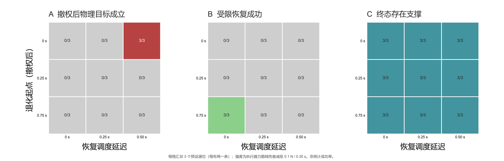

# PoL2 具身渐进夹持退化与恢复时序实验

**日期：** 2026-10-24

**实验类型：** MuJoCo Panda 机制先导；确定性时序扫描，不是硬件可靠性评估

## 摘要

本实验考察任务授权在放置前被撤销后，夹持能力逐渐下降时，恢复调度时点如何影响物体终态。实验在 MuJoCo Panda 场景中将夹爪执行器的力上限从 100 N 在 0.30 秒内线性降至 0.1 N；这是一种仿真故障注入，不是机器人发出松爪指令，也未经真实 Panda 夹持力校准。实验交叉设置撤权后 0、0.25、0.75 秒开始退化、0、0.25、0.50 秒后派发受限恢复，并使用三个固定源位布局，每个格子一条轨迹；另有三个无故障恢复对照，共 30 条。

PoL2 任务门在 27/27 个故障条件及 3/3 个无故障对照中均于放置前拒绝任务，撤权后没有进入 `place` 阶段。故障组 27/27 均记录到双侧夹持丢失，终端物体均有支撑（24 条回到源桌面，3 条被动落入目标托盘）。但受限恢复仅在退化较晚且立即派发的 3/27 条轨迹中成功；三个“物理目标谓词成立”的结果都来自退化立即开始、恢复延迟 0.50 秒时物体被动落入托盘。它们均不是授权任务完成。结果支持一个窄结论：撤权门可以阻止授权任务继续进入放置阶段，但不能单独保证撤权后的物理安全；恢复时延和抓取状态会影响后续状态。由于每格只有一条确定性轨迹，比例只描述本次设计格子，不代表成功概率或普遍因果效应。

## 研究问题

当策略门在 `before_place` 检查点观察到任务授权撤销时，如果夹持能力在撤权前后逐步退化，受限恢复是否仍能将物体安全放回源位？恢复派发延迟和故障起点是否会改变结果？这组实验将“授权路径拦截”与“物理恢复能力”分开测量。

## 实验设计

| 因素 | 水平 | 说明 |
|---|---|---|
| 夹持退化起点 | 撤权后 0、0.25、0.75 秒 | 退化通过逐步降低 MuJoCo 执行器力上限注入 |
| 恢复派发延迟 | 0、0.25、0.50 秒 | 从撤权被策略门观察到开始计时 |
| 源位布局 | left-near、center、right-near | 三个固定桌面坐标；每种时序组合均覆盖三种布局 |
| 无故障对照 | 每个布局一条 | 撤权后立即进入受限恢复，不注入夹持退化 |
| 轨迹数 | 30 | 27 条时序格子 + 3 条无故障对照；每格 n=1 |

任务授权由 `GRANTED` 在 `before_place` 检查点切换为 `DENIED`。普通任务执行器不得放置物体；恢复控制器仅获 `RECOVERY_ONLY` 权限，目标是回到源位。夹爪执行器力上限由 100 N 线性降至 0.1 N，历时 0.30 秒。0.1 N 是为触发可观察滑移/失持而选取的仿真参数，不对应经测量的实机阈值。

逐仿真步记录双侧接触丢失、物体支撑接触和目标谓词变化；恢复结束后再运行 1.0 秒仿真以判定支撑终态。事件账本必须包含撤权观察、恢复派发以及故障组的实际退化开始，并满足仿真时间戳单调递增。指标分为：授权任务是否被拦截、物理目标谓词是否成立、受限恢复是否成功、终端支撑类型和事件账本是否完整。

## 结果

### 主要指标

| 指标 | 结果 | 解释 |
|---|---:|---|
| 放置前撤权拦截 | 30/30 | 所有轨迹都在放置前观察到拒绝 |
| 撤权后进入 `place` 阶段 | 0/30 | 普通任务路径被截断 |
| 撤权后授权任务完成 | 0/30 | 物理结果与授权完成分别计量 |
| 故障组双侧夹持丢失 | 27/27 | 本次退化强度下都观察到失持 |
| 故障组受限恢复成功 | 3/27 | 仅退化起点 0.75 秒、恢复延迟 0 秒的三种源位布局成功 |
| 无故障恢复对照成功 | 3/3 | 三个固定源位均成功，证明恢复控制器在基准条件下可运行 |
| 故障组终端有支撑 | 27/27 | 24 条在源桌面，3 条在目标托盘；没有终端悬空/无支撑状态 |
| 撤权后物理目标谓词成立 | 3/27 | 全部为退化立即开始、恢复延迟 0.50 秒时的被动落入托盘；不是授权放置 |
| 事件账本完整且时间单调 | 30/30 | 包含实际退化开始事件；恢复派发按实际仿真时刻记录 |

### 时序格子

图中每格的分母为三个源位布局。颜色显示本次确定性格子中观测到的计数，不是统计成功率估计。



面板 A 显示物理目标谓词只在“立即退化 + 0.50 秒恢复延迟”三个布局中成立；这属于被动滑落造成的物理终态。面板 B 显示受限恢复只在“0.75 秒后退化 + 立即派发”格子成功。面板 C 显示所有轨迹经过额外 1.0 秒沉降后都存在支撑，其中三条落在目标托盘，其余回到源桌面。

## 对 PoL2 机制的含义

本实验给出的证据分成两层：

1. **授权门证据：** `before_place` 的撤权检查阻断了普通任务放置路径。它证明的是本仿真策略门和执行路径组合在预设检查点的拦截行为，不证明 PoL2 理论本身改变了规划模型的推理，也不证明真实机器人上的实时安全。
2. **闭环恢复证据：** 一旦夹持在恢复过程中退化，调度是否及时、夹爪是否仍保持抓取会影响恢复结果。仅有“撤权即停止任务”不足以满足物理安全要求；系统还需要状态监测、在途稳定化策略、恢复控制和终态验证。

尤其值得后续验证的是，恢复模块当前会执行返回源位的运输阶段，部分轨迹因夹持已丢失而中途失败；本次实验的终态有支撑，不等于恢复动作成功，也不代表任意场景不会造成损害。下一版可加入逐步运输期间的连续抓取监测和失持后的状态相关策略（例如停止横向运输、优先降低高度到可支撑区域、重新评估物体与环境接触），并与现有恢复控制进行配对对照。策略须由独立可测条件触发，不能把“恢复成功”定义成最终恰好落在目标区。

## 结论边界与局限

- 30 条轨迹为确定性场景格子，不是随机重复；不得把 3/27 或 27/27 解释为总体概率、置信区间或稳定的因果效应。
- 故障通过 MuJoCo 执行器力限制模拟，未依据真实 Panda 夹爪测力数据校准；未覆盖摩擦变化、物体质量/形状不确定性、传感延迟、碰撞力限、视觉误差或网络分区。
- 撤权是同步发生在固定的放置前策略检查点；未测试异步撤权传播、执行器命令已提交但未回执、控制周期竞态或不可逆副作用。
- 传感/谓词读取使用仿真器内部状态，不能视为部署系统具备同等观测能力。
- 无故障控制仅有三条，功能性对照较小；本实验不证明策略对模型推理过程的净影响。验证 PoL2 对推理影响仍需使用固定模型与类型化决策接口，做提示/策略条件的成对随机任务对照，并将动作门拦截作为单独因子。

## 复现材料

- 实验脚本：[run_grip_derating_timing_sweep.py](../../../PoL-Governance/benchmark/embodied_reasoning/run_grip_derating_timing_sweep.py)
- 逐轨迹数据：[grip-derating-timing-sweep-20261024m.json](../../../PoL-Governance/benchmark/embodied_reasoning/results/grip-derating-timing-sweep-20261024m.json)
- 图件：[PNG](../../figures/pol2-grip-derating-timing-sweep-20261024m.png) · [PDF](../../figures/pol2-grip-derating-timing-sweep-20261024m.pdf)
- 运行命令（仓库根目录）：

```powershell
& 'C:\Users\Administrator\AppData\Local\Programs\Python\Python312\python.exe' `
  'PoL-Governance/benchmark/embodied_reasoning/run_grip_derating_timing_sweep.py' `
  --run-id 20261024m
```
