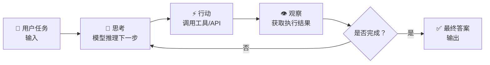

本笔记并非简单的调研，它同时也有将 Super-agent 向 Autonomous-Superagent 拓展的思考。

## 前置调研

### Agent 的主要架构

每一层可能都不是单一的Agent，而是Agent Team甚至在复杂情况下需要Agent Teams的协作。对于一个自治系统，可能的需求为：

1. 治理层（Governance）
   这是NaturalDAO的特色，也是整个工程的基石，即它既以爱2证明治理大语言模型，也司职一切应用的开发和运维的治理。
   它配套专属的知识层和System One Decision Model。
   
2. 全局规划层（Global Planning）
   根据 NaturalDAO 对人类文明的治理进展，技术条件成熟度，以及应用开发的需要规划NaturalDAO本身，和应用（application）的开发计划。它是 NaturalDAO 自主研发与运维的重要起点。
   它和下面的工程规划层，都采用**动态规划与自主纠错（Dynamic Planning & Reflection）**，在面对未知错误时，不再直接报错退出，而是通过内省机制（Self-Reflection）重试或寻找替代方案和路径。
   
3. 全局安全层
   NaturalDAO 作为一个软硬件结合的自治系统，必然需要一个负责其自身以及自身生态安全的工作层：
   - NaturalDAO 资源安全（能源、材料等）
   - NaturalDAO 枢纽的软硬件安全；
   - NaturalDAO 应用相关的安全；
   
4. 工程规划层（Project Planning）
   把高层目标拆成步骤。可隐式（ReAct 逐步规划）或显式（Plan-Execute 先出完整计划）。
   
5. 验收层（Project Inspecting）
   对项目进行验收。
   
6. 监督层（Oversight）
   7x24 小时监控系统，审计日志、高风险决策审批闸、人工升级路径、事故回放。
   
7. 多模态感知层（Omni-Perception）
   不再局限于文本输入。2026 年的 Agent 能够原生理解屏幕 UI、音频流、视频动态以及实时代码环境。
   接收终端输入。我们把机器人、公共摄像头、web端等，都称之为“终端”。
   解析、校验、路由（System One决策），治理层处置，全局规划层和工程规划层接力。
   
8. 推理层（Reasoning）
   调用专属Agent Team，决定做什么、选什么工具。
   
9. 记忆层（Memory）
   包括缓存、感官记忆（捕获当前会话的即时上下文）、情景记忆（向量检索历史任务）、程序性记忆（习得工具使用模式）、PoL2知识库、工作记忆（包括通常以动态知识图谱形式存储的当前任务的执行状态、中间变量等等，以及作为长期记忆的application使用过程中产生的数据）、多模态感知记忆（人类世界里的一切记录，该记忆也将是大语言模型源源不绝的语料最主要的来源）。
   
10. 工具层（Tool Use）
   2026 年 MCP（Model Context Protocol）已成为通用工具接口标准，框架原生消费 MCP Server，使工具定义可移植。
   不过，NaturalDAO作为一个自治系统，出于安全考虑，并不调用除大语言模型外的其它系统外工具。那么可想而知的是，被现在的Agent系统忽略的内生小程序类独立工具，譬如科学计算器、日历、时钟等等，因应降本增效的需要，都是必需的。

### 四种主流架构范式

| 范式           | 机制           | 优势            | 代价                  | 适用            |
| ------------ | ------------ | ------------- | ------------------- | ------------- |
| ReAct        | 逐步推理→行动→观察   | 简洁、易调试、动态适应   | 长任务易"走神"，Token 线性增长 | 大多数单 Agent 默认 |
| Plan-Execute | 先出完整计划再执行    | 可审计、可断点恢复、可并行 | 计划可能过时，依赖模型规划力      | 流程清晰、高价值任务    |
| Reflexion    | 行动→自评→带批评重试  | 无人工反馈即自我改进    | 延迟倍增，批评模型可能错        | 质量敏感的生成/代码    |
| Multi-Agent  | 多专精 Agent 协作 | 分工并行、规模化解复杂域  | 状态管理复杂、成本更高         | 跨专业/跨部门工作流    |

#### ReAct

 **🧠 核心思想：推理与行动的协同**
ReAct是 **“Reasoning”** 和 **“Acting”** 的组合。它模拟了人类解决问题的思维链条：**思考 → 行动 → 观察 → 再思考 → 再行动...**

其工作原理为：**交替进行内部推理（生成“思考”痕迹）和外部行动（调用工具或API）**，并通过观察行动结果来指导下一步推理，如此循环往复，直到任务完成。



1.  **思考**：这是模型的**内部推理阶段**。模型会分析当前任务、已有信息和目标，分解问题，并规划下一步的具体行动。例如：“我需要查询东京的天气，应该调用天气API。”
2.  **行动**：基于推理结果，模型选择并调用一个具体的**外部工具**（如搜索引擎、计算器、数据库查询API、代码执行器等），并将结果作为“观察”返回。
3.  **观察**：系统将行动的结果（如搜索到的文本、计算出的数值、执行成功的状态）**反馈给模型**，作为下一轮推理的新上下文。
4.  **循环**：模型根据新的观察结果继续推理，决定是执行另一个行动还是直接给出最终答案。这个过程会一直重复，直到模型判断任务已经完成。

#### Plan-Execute范式

**Plan-Execute范式**‌的核心是“先规划、再执行”，把任务拆成两步：Planner先用大模型生成完整步骤计划，Executor再按计划逐步执行，过程中可根据结果调整剩余计划。‌‌

- ‌**规划阶段**‌：Planner一次性拆解任务，生成有序步骤，明确依赖关系，如“查订单→核对库存→估算配送→汇总结果”。
- ‌**执行阶段**‌：Executor按顺序执行，每步可调用工具，结果存入上下文。
- ‌**重规划**‌：执行中遇意外（如原仓缺货），Replanner修改剩余计划，而非从头再来。‌‌

 与ReAct的区别：

| 对比项    | Plan-Execute | ReAct      |
| ------ | ------------ | ---------- |
| 决策方式   | 先定整体计划再执行    | 每步边想边做     |
| 长任务稳定性 | 较好，有蓝图不易跑偏   | 易偏离最终目标    |
| 模型调用量  | 较少，思考集中在开头   | 每步都调大模型，较贵 |
| 灵活性    | 依赖重规划应对变化    | 天然灵活，随时纠偏  |
| 短任务效率  | 可能规划过度       | 通常更高       |
**🎯 适用场景**

- ‌**适合**‌：多步骤强依赖的流水线任务，如调研报告、数据分析、代码生成、跨系统工单处理。
- ‌**不适合**‌：简单问答、单次工具查询、实时反馈要求极高的交互。‌‌

工程实现上，计划建议用结构化JSON存储，每步记录状态、依赖和风险等级，执行后保存checkpoint支持中断恢复，修改类操作设审批节点。‌‌

#### Reflexion

Reflexion是一种让 AI 智能体通过“反思总结”自我改进的范式。它不微调模型权重，而是把失败经验写成语言反馈，存入记忆供后续任务参考。‌‌‌

- ==‌**核心流程**‌==：执行任务→评估结果→生成反思→带着反思重新尝试，直到成功或达到上限。
- ==‌**与传统强化学习区别**‌==：不依赖数值奖励和参数更新，而用自然语言描述“哪里错了、下次怎么做”。
- ==‌**适用场景**‌==：代码生成、数学推理、复杂决策等可自动验证对错的任务。
- ==‌**主要优点**‌==：无需额外训练即可提升准确率，学习过程可解释。
- ==‌**主要局限**‌==：迭代会增加调用次数和成本；反思质量依赖评估器，复杂任务中可能仍遗漏关键问题。‌‌‌

#### Multi-Agent

Multi-Agent（多智能体）协作范式是指将复杂的任务拆解，由多个具备专业分工、独立思考或交互能力的AI智能体（Agent）共同协作完成的系统设计模式。[1](https://github.com/luhengshiwo/LLMForEverybody/blob/main/07-%E7%AC%AC%E4%B8%83%E7%AB%A0-Agent/Agent%E8%AE%BE%E8%AE%A1%E8%8C%83%E5%BC%8F%E4%B8%8E%E5%B8%B8%E8%A7%81%E6%A1%86%E6%9E%B6.md), [2](https://juejin.cn/post/7561831013283938342), [3](https://www.ginonotes.com/posts/agentic-design-patterns-multi-agent-collaboration-translation)

根据任务流程的组织方式、决策权和控制权的集中程度，业界通常将主流的 Multi-Agent 协作模式划分为以下**四种核心范式**： [1](https://developer.cloud.tencent.com/article/2692506), [2](https://zhuanlan.zhihu.com/p/2091884577296074337)

---

1. Workflow（流水线 / 预定义工作流）

- **核心逻辑**：将复杂任务拆解为固定的、顺序执行的步骤，由不同的 Agent 依次接力完成（类似工厂流水线：A 完成后交由 B，B 再交由 C）。 [1](https://zhuanlan.zhihu.com/p/2091884577296074337)

- **典型代表**：MetaGPT（将软件开发标准作业流程 SOP 编码进 Agent，设置产品经理、架构师、工程师、测试等角色）。 [1](https://zhuanlan.zhihu.com/p/2091884577296074337)

- **优缺点**：
    - **优势**：高度可控、逻辑清晰，适合步骤明确、路径固定的任务。
    - **劣势**：缺乏弹性；一旦前序步骤出现偏差或需要分支调整，线性流程极易僵化或导致错误逐步放大。 [1](https://zhuanlan.zhihu.com/p/2091884577296074337)

---

2. Supervisor（主管 / 中心化调度模式）

- **核心逻辑**：在系统中设立一个中央调度 Agent（主管），由它接收用户任务，评估所需能力，并将子任务动态分派给底层的 Worker Agent。Worker 完成后再将结果返回给 Supervisor，由其决定下一步。 [1](https://zhuanlan.zhihu.com/p/2091884577296074337)

- **典型代表**：[AutoGen](https://github.com/microsoft/autogen)（支持多 Agent 对话及由 Assistant Agent 统筹调度与工具调用）。 [1](https://zhuanlan.zhihu.com/p/2091884577296074337)

- **优缺点**：
    - **优势**：具备动态决策能力，面对路径不确定的任务（如开放式研究、多变的需求分析）更为灵活。
    - **劣势**：中心节点容易成为性能瓶颈；随着 Worker 数量增多，Supervisor 面临巨大的上下文管理压力和信息汇聚负担。 [1](https://zhuanlan.zhihu.com/p/2091884577296074337)

---

3. Hierarchical / Multi-Tier（分层 / 办公楼模式）

- **核心逻辑**：针对单层 Supervisor 调度能力饱和的问题，将架构扩展为多层级管理结构（类似金字塔或大企业办公楼）。顶层主管拆分大目标并分给中层主管，中层再下发给基层执行 Agent。 [1](https://zhuanlan.zhihu.com/p/2091884577296074337)

- **优缺点**：
    - **优势**：能够管理超大规模、极度复杂的超长链条任务，实现职能与权限的精细化隔离。
    - **劣势**：系统架构沉重，上下游传达容易产生信息失真，整体延迟较高。

---

4. Swarm / Peer-to-Peer（群蜂 / 去中心化交接模式）

- **核心逻辑**：取消了中央控制节点（没有“主管”），Agent 之间采用“例行程序（Routines）”与“任务转交（Handoffs）”机制，由当前 Agent 根据进展直接把任务流转交接给最合适的下一个 Agent。 [1](https://zhuanlan.zhihu.com/p/2091884577296074337)

- **典型代表**：OpenAI 提出的 Swarm 概念。 [1](https://zhuanlan.zhihu.com/p/2091884577296074337)

- **优缺点**：
    - **优势**：高度去中心化、灵活敏捷，贴近自然群体协作（像一群蚂蚁）。
    - **劣势**：缺乏全局掌控，容易陷入无限循环、推卸责任或追踪状态混乱的工程风险。 [1](https://zhuanlan.zhihu.com/p/2091884577296074337)

---

核心要素对比总结

|范式类型|决定下一步谁做|任务分配权|控制权特征|适用场景|
|---|---|---|---|---|
|**Workflow**|预先写死的逻辑|静态预分配|极度集中（按步骤）|流程标准化、边界清晰的任务（如代码生成、标书撰写）|
|**Supervisor**|中央主管 Agent|主管动态分派|集中于中心节点|探索性强、路径未知但需要统筹的任务|
|**Hierarchical**|多级主管树状决定|分级下发|多层级分布|规模庞大、高度复杂的企业级业务流|
|**Swarm**|Agent 自主协商 / 交接|自由流转（Handoff）|完全去中心化|动态实时、轻量交互的分布式任务|

## DeepSeek Super-agent

官方文章[《Super-agent 设计探索：迈向更自主的 Agent 系统》（知乎）](https://zhuanlan.zhihu.com/p/2099987320443237060)

这是[第三方提供的中文文档](https://github.com/saltapp/dsh-superagent-prototype-cn)

完整源码与详细工程挑战可参考 [DeepSeek Harness GitHub 仓库](https://github.com/deepseek-ai/dsh-superagent-prototype) 和[某个人Fork的中文版]()

Router+Worker 双层核心架构是 DeepSeek Super-agent 提出的智能体系统设计，旨在解决单会话（Single Session）在多任务并发、上下文混乱及同步阻塞上的局限。该架构将系统拆分为负责全局协调的 Router 层和负责具体执行的 Worker 层，实现“连续、高效、主动、持久”的自主协作能力 。

核心背景与痛点

- **注意力瓶颈**：人类同时跟踪的活跃会话通常只有 3 至 5 个。当AI Agent 接管多任务后，“多任务的上限”不再取决于模型能力，而是卡在了**人类的注意力**上。 [1](https://x.com/shao__meng/status/2116541149443698968)

- **传统单ReAct Loop 的局限**：传统的单Session/单Loop模式在面对连续多渠道交互、并行任务和主动响应时，容易出现串行缓慢、上下文互相污染或设备离线中断的问题。 [1](https://x.com/shao__meng/status/2116541149443698968)

---

### Super-agent 的四大基础特征

- **连续（Continuous）**：跨信道体验一致。用户在IM聊天窗口、GitHub PR评论区等不同界面切换时，始终感觉面对的是同一个具备完整上下文的Agent，无需心智负担去想“当前Session有没有这段信息”。 [1](https://zhuanlan.zhihu.com/p/2099987320443237060)

- **高效（Efficient）**：响应迅速，支持并行处理多个复杂任务，不需要等待上一条命令执行完就能随时接受新指令。 [1](https://zhuanlan.zhihu.com/p/2099987320443237060)

- **主动（Proactive）**：无需等待用户逐条下达指令，能够持续观察环境事件（如群聊报错、CI结果、邮件变动），在需要介入时主动推进并交付结果，不需要介入时保持“克制与安静”。 [1](http://www.36kr.com/p/4050650194630536), [2](https://zhuanlan.zhihu.com/p/2099987320443237060)

- **持久（Persistent）**：7×24小时在线，直接接入真实工作环境，并在运行异常时具备自动恢复能力。 [1](https://zhuanlan.zhihu.com/p/2099987320443237060)

---

### 底层核心架构与模块设计

为实现上述特征，该架构将传统单Loop拆解为五大核心模块： [1](https://x.com/shao__meng/status/2116541149443698968), [2](https://zhuanlan.zhihu.com/p/2099987320443237060)

- **1. Router + Worker 双层架构**：Router 层充当常驻主管负责全局协调与多信道交互，采用轻量化模型保证高速吞吐；Worker 层作为隔离员工，挂载完整工具链在独立上下文中专注处理单一任务。

- **2. 事件驱动与订阅直通机制**：通过两级过滤剔除噪音，利用 Fast Path 直通路径绕过 Router 转发以节省 Token，并支持投机执行和上下文的 Inline/Spill 动态召回。

- **3. 面向人的异步多信道交互**：采用异步 ReAct Loop，并针对不同信道（如IM群聊与GitHub/邮件）动态匹配输出密度。

- **4. 计算、状态与环境分离**：实现云端无状态计算以便水平扩展，同时通过 BYOM（Bring Your Own Machine）在本地开发机保留重状态执行环境。

- **5. 外部 Watchdog（看门狗机制）**：配备独立 Session 定时监控系统状态及任务进展，支持在线热修改规则。 [1](https://x.com/shao__meng/status/2116541149443698968), [2](https://zhuanlan.zhihu.com/p/2099987320443237060), [3](http://www.36kr.com/p/4050650194630536)

架构核心分工：

1. Router 层（调度与交互中心）
*   职责：常驻全局节点，统一承接人类交互（IM、邮件、GitHub 等），维护跨任务的全局上下文，负责任务分派而非具体执行 。
*   特性：
    *   批处理优化：在事件密集时合并多条 Trigger 一次性注入 LLM，利用 Prefill 并行计算降低单次决定分摊的推理时间（实验显示从 6.4s 降至 1.6s） 。
    *   轻量模型：通常使用较轻量模型以兼顾速度与成本，不直接配备 Bash 等执行工具 。
    *   链式召回：通过 Inline & Spill 机制管理上下文，仅内联紧密关联对象 ID，按需多跳检索历史任务信息，避免上下文窗口溢出 。

2. Worker 层（隔离执行单元）
*   职责：在相互隔离的会话中并发执行具体任务（如代码审查、Bug 复现），挂载完整执行工具，不直接与用户交互 。
*   特性：
    *   上下文隔离：每个 Worker 拥有独立 Session，避免多任务细节混杂，通常配置最强模型以保证交付质量 。
    *   订阅直通：Worker 订阅特定 Thread，后续相关事件由程序直接发送给 Worker，无需经过 Router 转发，降低路由负载 。
    *   结果汇报：执行完成后将状态和关键结果汇报给 Router，由 Router 统一对外回复 。

关键机制实现

1. 事件驱动与两级过滤
*   Trigger：群聊消息、CI 结果等外部信息作为触发器。
*   过滤：先通过程序规则过滤噪音，再交由 LLM 判断是否行动 。
*   路由：新事件由 Router 分派（Slow Path）；已建立订阅的 Thread 后续事件直通 Worker（Fast Path） 。

2. 异步全双工交互
*   异步 ReAct Loop：耗时工具调用改为 `start()`/`stop()` 模式，模型发起后立即返回，后台执行期间前台仍可接收新指令，消除同步阻塞 。
*   投机执行：根据环境信号在后台提前尝试（如静默复现 Bug），有价值才交付，减少人类等待 。

3. Watchdog 自愈
*   独立运行的监控会话，检查基础设施报错及 Worker 进展，发现异常时介入修复或重启 。

### Super-agent典型架构和核心实现方法

1. Super-agent采用Router+Worker双层核心架构，Router作为全局协调节点统一承接多渠道交互、维护全局上下文并分派任务，Worker各自维护独立的隔离会话，并行执行具体工作，所有Worker的状态和结果统一回传给Router对外输出，这套架构实测下任务完成比传统单会话Agent方案效率提升一倍以上。
    
2. 整套架构配套了五大核心机制：
   - 事件驱动两级过滤机制
   - Inline & Spill和链式召回机制
   - 投机执行机制
   - 异步ReAct循环
   - 独立Watchdog外部监控回路
    
3. 基于MCP标准化工具连接协议重构了工具注册调用链路，参数校验、返回值解析全部标准化，工具调用出错概率大幅降低；引入细粒度状态机，每个执行步骤都有明确的输入输出契约，支持自动重试、分支跳过、结果回滚；内置全链路事件追踪系统，每一步推理、每一次工具调用的输入输出都能结构化记录，调试效率提升一倍以上。
    
4. 架构设计层面还实现了计算、状态、环境三者解耦，计算和持久化状态放在云端，执行环境可以保留在用户本地设备，支持用户把自己的开发机、个人电脑接入云端Agent，既保障数据隐私，又能灵活调度算力资源。这对NaturalDAO的终端与枢纽的关系，提供了一种可选的方案。

### Super-agent落地场景

1. 研发工程场景已经率先实现规模化落地，DeepSeek内部的Super-agent已经持续运行在日常研发流程中，19分钟就能完成传统流程需要4.7小时的核心系统故障修复全链路工作，自动完成日志分析、故障复现、补丁生成、CI/CD触发全流程，大幅降低研发人员的重复劳动负担。
2. 内容营销场景已经成为Super-agent的标配落地领域，这类场景环节多规则明确、试错成本低、数据反馈周期短，Super-agent可以独立完成选题策划、内容创作、多平台分发、效果复盘全流程，一人公司和小微企业只需要盯最终结果，不需要额外组建专门的营销团队，把人力从繁琐的重复执行工作中解放出来。
3. 后续发展的核心方向集中在六个维度：多模态感知能力升级，支持Agent直接处理语音、图像、视频类输入；长程记忆能力进一步优化，支持跨月甚至更长时间跨度的任务记忆；多Agent协同机制持续迭代，降低错误放大率；安全对齐体系逐步完善，解决权限泄露、提示注入等风险；开发者生态进一步成熟，主流框架全部完成MCP协议适配；支持边缘侧部署，满足高隐私场景的离线运行需求。
4. 当前落地阶段还有几个待解决的核心问题：Router层的大规模任务调度扩展性、跨月长程记忆的准确性、不同Agent实例之间的标准化A2A通信协议、云端Agent接入本地设备后的权限风险防控，这些方向的技术突破会进一步拓宽Super-agent的落地边界。

### 代价

资源代价：维护多个独立会话导致缓存读取 Token 增加。取消事件直通后，Router 决定数增加约 30%，总缓存读取量增幅约 37% 。

### 简易架构示意代码（概念性 Python 伪代码）

```python
class SuperAgentSystem:
    def __init__(self):
        self.router = RouterSession(model="lightweight")
        self.workers = {} Map: thread_id -> WorkerSession
        self.watchdog = WatchdogSession()

    def handle_trigger(self, trigger):
        """Router 层入口"""
        1. 程序级过滤
        if not self.is_relevant(trigger):
            return
        
        2. 检查是否已有订阅 Worker (Fast Path)
        worker = self.get_subscribed_worker(trigger.thread_id)
        if worker:
            worker.process(trigger) 直通 Worker
        else:
            3. Router 决策与分派 (Slow Path)
            批处理积压事件以降低推理成本
            batched_triggers = self.collect_batched_triggers()
            decision = self.router.decide(batched_triggers)
            
            if decision.action == "CREATE_WORKER":
                new_worker = WorkerSession(model="strong", tools=["bash", "git"])
                new_worker.subscribe(trigger.thread_id)
                self.workers[trigger.thread_id] = new_worker
                new_worker.process(trigger)
                        4. 统一对外回复
            if decision.reply_needed:
                self.send_to_user(decision.reply_content)

    def async_tool_call(self, worker, command):
        """异步执行，不阻塞主循环"""
        task_id = worker.start(command) 立即返回
        后台执行完成后，结果作为新 Trigger 进入系统
        return task_id
```

---
### ⚙️ 运行与部署要点

这**不是**一个开箱即用的桌面客户端软件，而是一套需要严格环境配置的研究级代码： [1](https://blog.laozhang.ai/zh/posts/deepseek-super-agent-github), [2](https://post.m.smzdm.com/p/a4q4e8nw/)

| 配置维度     | 要求与细节                                                                 |
| -------- | --------------------------------------------------------------------- |
| **系统环境** | 必须是带 `tmux` 的 **macOS 或 Linux** 环境（Windows 原生无法运行其服务脚本）。              |
| **基础底座** | 需安装指定版本的 **DeepSeek Harness (DSH)** 运行时及环境。                           |
| **前置资源** | 准备一个专门用于 Agent 运行的独立 GitHub 用户账号，并配置好 GitHub CLI 的 Auth 认证。           |
| **默认模型** | 内部推荐默认使用 `deepseek-flash` 级别及以上的 API。                                 |
| **安全警告** | **勿使用有私人密钥、生产云端凭据的个人电脑**！Executor 拥有OS用户级别的执行权限，应在**完全隔离的容器或虚拟机**中试用。 |

#### 首次部署的“智能体带路”机制

该仓库包含一个有趣的特性：如果你身边有现成的 Coding Agent（如 Claude Code 等），你只需把项目内的 `SETUP.md` 喂给它，并对它说：_“阅读这个仓库的 SETUP.md，带我一步步配置 dsh-superagent。”_ 它便会以单次提问的形式引导你创建凭据、初始化 SQLite 状态等，极大降低了手动看冗长文档的痛苦。[1](https://github.com/deepseek-ai/dsh-superagent-prototype/blob/main/SETUP.md), [2](https://github.com/deepseek-ai/dsh-superagent-prototype), [3](https://juejin.cn/post/7702984654097334281)

---
## 高自主度Agent系统到完全自主

DeepSeek的Super-agent是高自主度Agent系统，它已经完成从“工具调用”到“自主交付结果”的关键跃迁，整套设计思路正在重构AI智能体的人机协作底层逻辑的关键一步，NaturalDAO将要更进一步，实现完全自主：

1. 完全自主不是完全隔离人，NaturalDAO的各种终端仍然会与人产生交互活动，包括一旦倾听到人的合理建议，即纳入到综合决策里。因此我们说的“完全自主”，是杜绝个人或少数人的操控而基于爱2证明的全体智慧的完全自主。
2. AI Agent的核心能力已经从过去的单步对话响应，升级为可自主完成多步骤规划、工具调用、环境观测、失败重试的完整闭环，不再需要人介入管理。接下来要做的，就是开发专职的全局规划层、任务规划层和工程验收层，等等，让NaturalDAO能够自己设目标、定边界、验收结果。
3. 基础范式研究已经形成四类成熟的主流方案：ReAct范式简洁易调试，适合绝大多数单Agent场景；Plan-Execute范式先出完整计划再执行，适合流程清晰的高价值任务；Reflexion范式通过自评重试实现无人工反馈自我优化，适合质量敏感的代码生成类场景；Multi-Agent多智能体协作范式通过分工并行处理复杂任务，适合跨专业跨部门工作流。Superagent不是终点，Autonomous-Superagent才是人类社会之所需。
4. 学术界最新研究验证了多智能体规模缩放的边界：Google发布的相关论文指出，无编排器的独立多智能体系统错误会放大17.2倍，增加集中式编排校验节点后错误放大率可降至4.4倍，并行可拆分任务（比如市场调研、代码审查）能获得明显效率提升，严格顺序一致的任务在多智能体架构下反而表现更差。
5. 清华大学在2026年6月发布了Agent libOS安全运行机制，把传统操作系统的权限隔离思路（每个程序有自己的身份、权限、内存空间，不能随意侵入别的程序）引入Agent运行环境，把AI能看到的工具接口和实际可操作的资源权限完全拆分，通过能力绑定的权限系统从根源上解决提示注入、越权操作的安全隐患，填补了长期运行高自主Agent的安全短板。(论文编号为arXiv:2606.03895)
