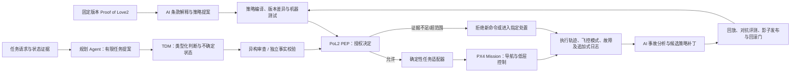

# 把 PoL2 具身治理落到可验证系统

**执行结论：** Proof of Love2 具身治理框架（PoL2-EG）可以作为一个研究和工程提案：在运行时不设人工逐案审批节点，由 AI 组件解释已版本化的 PoL2 规则、提出有限任务、进行机器审查和事故复盘，再由确定性策略执行点把获准任务交给 PX4 等飞控。它的第一步应是一个受限的任务授权网关，而不是让语言模型进入实时飞行控制，也不是让 AI 在第一版里自行改写理论。现有工程和学术工作分别支持 AI 反馈、模拟治理代理、Agent 工具策略拦截、PX4 任务执行与失效处置，以及特定 UAS 的运行时保证研究；**本次聚焦检索没有发现一个在真实高影响具身系统中，完成规范制定、动作授权、事故纠正和规范演化的端到端全 AI 治理实例**。NaturalDAO 已有理论文本、类型化判断数据契约、合成评测 fixture 和治理模拟，但没有发现 PoL2 策略门接入 PX4 并通过端到端仿真或飞行验证的记录。框架名宜用 **PoL2 具身治理框架（PoL2-EG）**；“无人工运行时治理”是需要定义和测试的架构属性，RSI 则应限于 AI 递归提升自身能力的议题。

## 调研范围与判断方法

本报告把问题拆成四个相互关联但不能混为一谈的对象：第一，PoL2 的规范条款如何变成机器可执行的任务政策；第二，哪些 AI 组件可以在运行时承担解释、评估、授权、审计和候选更新；第三，机器人控制系统怎样在 AI 或通信故障时按预先定义的状态机动作；第四，怎样用可复现的测试证明实现符合政策，同时不把规则符合性误称为规范正当性或现实安全。

调研采用四条并行路径：机器控制和 UAS 工程、AI 执行治理先例及其制度边界、NaturalDAO PoL2 一手文件和仓库实现审计、分阶段评测设计。证据优先选原始论文、官方 PX4/MAVLink/NASA/NIST 文件及 NaturalDAO 仓库文件。每个结论按其证据性质区分为已发布的工程能力、学术原型/模拟、研究者提出的设计建议、当前未实现事项。关于“尚无完整先例”的判断只代表这次针对性检索范围内未发现；不同学科对“治理”与“自主”定义不一，不能把它写成穷尽性结论。

本报告也区分**运行时无人工决策节点**与**整个系统没有任何人类来源或责任主体**。前者可以被定义成系统要求，例如授权、拒绝、规则版本发布和事故技术复核都不等待人的逐案决定。后者还涉及谁写定初始规范、谁配置飞控、谁签发信任根、谁确定测试预言机、谁拥有设备、谁承担第三方损害责任；现有 PoL2-EG 文稿没有给出完整答案。明确这条边界不是弱化 AI 自治目标，而是避免用“全 AI”一词掩盖系统依赖和权力来源。

为了避免“AI 治理”一词在研究、产品和监管语境间滑动，可把自治范围拆成五层：

| 层次 | 决策归属 | PoL2-EG 当前目标 | 关键限制 |
|---|---|---|---|
| 规则自动执行 | 固定规则引擎 | 不足以描述框架 | 只按确定性条件处理，不负责语义解释 |
| AI 辅助治理 | 人类作最终决定，AI 提建议 | 不符合无人工运行时目标 | 人类在环的范围和有效性仍需评估 |
| AI 代行具体决策 | AI 在委托授权内作逐案决定 | 可作为局部能力先例 | 规范和权限仍由系统外部确定 |
| AI 执行运行时治理 | AI 解释、评估、授权、审计；执行层强制约束 | **PoL2-EG 的合理首要定义** | 不代表规范来源由 AI 自主产生 |
| AI 自我制宪 | AI 可改规则、价值权重或验收标准 | 不是首版目标，证据最弱 | 规则与评测可能形成自我授权闭环 |

因此，报告中“全 AI”专指第四层的运行时治理职责配置。若未来把规范生成和修改也交给 AI，必须单独升级为第五层研究，不能通过把“策略更新”统称为“理论演化”而悄然扩大权限。

## 先例支持局部能力，尚未支持端到端自治治理

现有研究更适合按治理功能分解，而不是按项目名直接类比。Constitutional AI 让模型依据外部预先给定的原则批评和修订输出，再用 AI 反馈训练偏好模型；它证明 AI 可在给定宪法内生产评价信号，并没有让模型取得修改宪法或现实行动授权的权力（[Bai et al., *Constitutional AI: Harmlessness from AI Feedback*](https://arxiv.org/abs/2212.08073)）。Collective Constitutional AI 进一步将公众意见纳入原则形成过程；其论文报告约 1,000 名美国参与者、1,127 条意见和 38,252 次投票。它的设计刻意包含公众输入，不能作为无人工治理先例，反而说明“AI 如何应用规则”和“规则来源由谁授权”是不同问题（[Huang et al., *Collective Constitutional AI*, FAccT 2024](https://facctconference.org/static/papers24/facct24-94.pdf)）。

多智能体治理和 DAO 研究覆盖了局部的决策结构。ARDE 用外层调节代理读取众包平台指标并向内层代理发出调节信号，在研究环境中评估分层治理架构；实验指标、环境与目标仍由研究者设定，不等于现实制度把规范来源和责任交给 AI（[Zhang et al., “Adaptive Regulation via Dual-Layer Evolution,” AAAI 2026](https://ojs.aaai.org/index.php/AAAI/article/download/41314/45275)）。DAO-AI 研究代理如何阅读提案和历史资料、输出投票意见，并在区块链数据驱动的模拟中比较结果；它没有覆盖现实链上治理权转移、实体行动、权利救济或事故责任（[DAO-AI, 2025 preprint](https://arxiv.org/abs/2510.21117)）。治理代理研究最多证明“代理可以形成治理信号或调整有限行为”，不能自动推导出“代理拥有规范制定权”。

运行时策略执行方面，GaaS 将声明式规则、策略执行和信任信号分层，并在模拟任务中评估 Agent 动作治理；Policies on Paths 则把策略控制点布置于工具执行路径。两者支持的工程判断是：可以在 Agent 提出动作之后、工具或设备执行之前，增加可独立测试的检查和拦截层；它们属于研究原型或预印本，尚未验证 PoL2 规范解释、UAV 任务授权或真实高影响系统长期运行（[GaaS, 2025 preprint](https://arxiv.org/abs/2508.18765)；[Policies on Paths, 2026 preprint](https://arxiv.org/abs/2603.16586)）。ACM 的 Governance by Construction 演示展示执行图中的策略控制原语，但高风险调用仍包含人工审批，因而不能引用为无人工决策的先例（[Governance by Construction for Generalist Agents, ACM CAIS 2026](https://doi.org/10.1145/3786335.3813192)）。

具身控制领域提供的是另一组边界。PX4 的 Mission 模式、MAVLink/MAVSDK 任务协议、Offboard 心跳与多种 failsafe 是现成飞控工程能力；NASA 对 UAS 的 Runtime Assurance (RTA) 工作提供特定安全监测和控制切换的研究/试验先例。这些组件可支撑分层系统，但不含 PoL2 的规则权威、授权票据、机器申诉或理论更新。NeurIPS 2024 的 Embodied Agent Interface (EAI) 基准将目标解释、子目标分解、动作排序和状态转移预测分别评估，并记录幻觉、可供性与规划等错误，说明具身 Agent 应拆解模块诊断；它不是 UAV 治理安全认证或现实飞行证据（[EAI, NeurIPS 2024](https://proceedings.neurips.cc/paper_files/paper/2024/hash/b631da756d1573c24c9ba9c702fde5a9-Abstract-Datasets_and_Benchmarks_Track.html)）。

| 先例类别 | 证据成熟度 | 已有证据实际覆盖 | 对 PoL2-EG 的可借鉴机制 | 不能据此声称 |
|---|---|---|---|
| Constitutional AI / RLAIF | 论文/模型训练研究 | 在给定原则下产生模型自评和训练反馈 | AI 可以批评、比较、排序或生成候选判断 | AI 自主产生规范、合法更改规范或授权现实行动 |
| ARDE / DAO-AI | 同行评审研究 + 预印本模拟 | 模拟平台调节、治理提案判定或代理投票 | 分层治理代理、指标反馈、结构化治理信号 | 现实治理制度已由 AI 接管，或具身行动已得到安全授权 |
| GaaS / Policies on Paths | 预印本与参考框架 | 模拟或概念化的 Agent 工具动作拦截 | 在工具执行边界设置可测试策略点 | PoL2 语义解释正确、无人机端到端验证或外部问责已完成 |
| PX4 / MAVLink / MAVSDK | 已发布开源工程栈与官方操作文档 | 航点任务执行、Offboard 生命信号、可配置飞控故障处置 | 采用任务层授权、确定性适配器与机载控制分层 | 飞控内置 PoL2 授权租约、通用路径安全证明或绝对断连即停 |
| NASA UAS RTA / CBF-QP | 形式验证、特定系统研究和受限试验 | 特定模型和安全属性下的运行监测、回退控制或约束控制研究 | 后续设计独立监测器和可信控制器 | 当前方案已有已验证 RTA、CBF 过滤器或普适安全保证 |

因此，当前最稳妥的先例结论是：**构成 PoL2-EG 的若干局部机制已有技术先例，但端到端全 AI 具身治理仍是待验证研究命题。**代理间共识尤其不能视为独立证据；多代理可能共享模型、训练语料、检索索引、权限服务、提示注入路径或错误的评测规则。2026 年关于多智能体对话过程评估的研究还指出，只评最终答案或多数票可能漏掉谄媚、主导、过早收敛等过程故障，因此应记录和测试交互轨迹，而不只是投票结果（[Pitre et al., ICML 2026](https://proceedings.mlr.press/v306/pitre26a.html)）。

## PoL2-EG 是运行时治理配置，不是现有 PoL2 的直接实现

PoL2-EG 的命名建议是 **Proof of Love2 Embodied Governance (PoL2-EG)**。这个名称保留 PoL2 理论来源和具身行动范围，也不把一个尚未实现的能力包装成系统承诺。文中可用“AI 执行的运行时治理”描述治理职能由 AI 组件承担，用“无人工运行时决策节点”精确定义用户所要求的边界，用“受约束的策略演化”描述 AI 提交候选政策变化。RSI（recursive self-improvement）通常指 AI 反复改进自身代码、架构、训练、推理或工具使用能力，并运用改进后的能力继续改进；它不是规则解释、任务授权、飞控接口、事故处置等整体治理框架的同义词（[Stanford HAI, What is Recursive Self-Improvement?](https://hai.stanford.edu/what-is-recursive-self-improvement)）。

一手文本审计揭示一个实质差异：现有 EAP/公共福利治理协议允许 AI 自主执行决策，但仍保留人的建议、质询、监督、信息访问和协议修订参与。EAP 将 PAI 描述为集体人类智能的代理，安排 PAI 协助重要决策形成相关方同意，同时保留人类建议和监督职能；公共福利协议不要求人类逐项投票，但保留提案、质询、公示期和对决定的监督（[PoL EAP, §§4.1–4.3](https://github.com/naturaldao/NaturalDAO/blob/main/PoL/4.%20PoL2%E4%B9%8B%E4%BC%A6%E7%90%86%E5%AF%B9%E9%BD%90%E5%8D%8F%E8%AE%AE.md#L3-L24)；[EAP 人类建议与监督](https://github.com/naturaldao/NaturalDAO/blob/main/PoL/4.%20PoL2%E4%B9%8B%E4%BC%A6%E7%90%86%E5%AF%B9%E9%BD%90%E5%8D%8F%E8%AE%AE.md#L73-L101)；[公共福利治理协议](https://github.com/naturaldao/NaturalDAO/blob/main/PoL/7.%20%E4%BA%BA%E7%B1%BB%E5%85%AC%E5%85%B1%E7%A6%8F%E5%88%A9%E7%9A%84%E6%B2%BB%E7%90%86%E5%8D%8F%E8%AE%AE.md#L62-L96)）。V2 则移除了人工复核、批准、接管、申诉裁决以及规则更新参与。它比现有文本的“无人工投票”更严格，应明确标记为 **PoL2-EG 的具身治理配置/扩展或规范修订**，不能说是现行 PoL2 已经蕴含的工程实现。

这一区分还关系到“规范从哪里来”。若目标是完全无人工的运行时治理，仍可以把固定理论版本视为系统输入；但如果主张整个系统从规范起源、规则修订、测试标准制定、设备运维到责任承担均没有人类参与，现有 PoL2 文本并未定义这样的治理权来源。由 AI 生成一个新规范、再由同一 AI 家族证明新规范合格，会形成自我授权闭环。任何“不变规则”“根密钥”“测试预言机”或“信任锚”都会重新引入权威来源问题。工程上可以提出不同信任模型，但必须公开其假设，不能以哈希签名或多个代理同意代替授权基础。

当前仓库成熟度也需要准确描述。PoL2 理论文本、EAP、数据契约、类型化判定词表、治理模拟和合成 fixtures 已存在；这些材料可作为规范映射与接口开发的起点，却不是一个已集成的自主治理产品。`PoL-Governance/SPEC.md` 和数据集契约保留人工仲裁、人工复核或 `human_reviewed` 标签；DAO Governance Lab 中尚有人工升级路径；本次检查未发现 PoL2 Policy Enforcement Point (PEP) 与 PX4 的实现、SIH/SITL 记录、HITL 记录或实飞评估（[PoL-Governance SPEC](https://github.com/naturaldao/NaturalDAO/blob/main/PoL-Governance/SPEC.md)；[数据集契约](https://github.com/naturaldao/NaturalDAO/blob/main/PoL-Governance/datasets/pol2/README.md)；[DAO Governance Lab 概念映射](https://github.com/naturaldao/NaturalDAO/blob/main/PoL-Governance/research/PoL2-DAO-Governance-Lab/docs/concept-mapping.md)）。

已检查的 pilot 报告列出 1,904 个生成案例、17 个案例家族、36,176 个类型化问题等，但该批材料是生成/契约校验管线，不是人工审定的决策语义金标准或治理模型性能数据；报告没有给出私有封存 holdout。正式 benchmark 的 14 个合成 fixture 适合当作软件测试样例，不足以代表广泛行为分布（[PoL2 v0.1 pilot report](https://github.com/naturaldao/NaturalDAO/blob/main/PoL-Governance/datasets/pol2/v0.1-pilot/pilot-report.md)；[benchmark README 与 fixture 边界](https://github.com/naturaldao/NaturalDAO/blob/main/PoL-Governance/benchmark/pol2/README.md#L125-L181)）。当前 ontology 也把若干语义事项标成待审：`unclear` 与 `neither` 的边界、沉默是否表示同意、议题排序，以及工具动作是否在原条文范围内等（[PoL2 ontology](https://github.com/naturaldao/NaturalDAO/blob/main/PoL-Governance/datasets/pol2/ontology/pol2-labels.v0.1.json#L85-L100)）。这些未决项不能靠 TDM 置信度补上。

将规则变为具身动作政策，必须增加一层明确的条款—策略映射。每一条机器规则至少需要：规范来源及版本哈希、适用主体和动作、保护利益、动作谓词、所需事实与可信来源、阈值和时效、例外条件、冲突优先级、适用动作包络、拒绝/暂停处理、测试案例 ID、版本兼容与撤销语义。自然语言解释可以保留用于审计，但不能本身充当 PEP 的执行谓词。尤其要把 **分类输出** 与 **授权结论** 分开：`conforming / violating / insufficient` 表示判断状态，`ALLOW / CONSTRAIN / REPAIR / DEFER / BLOCK / SAFE_STATE` 是机器动作；三态结果不能直接决定是否安全地让无人机继续、悬停、返航或降落。

## 任务级授权可做首个 Demo，实时控制与撤销仍未解决

PoL2-EG 首版应把 AI 决策限定在“提交有限任务”这一层：规划代理产生有界航点任务；类型化判断模块对有限动作候选输出结构化结论；PoL2 规则/策略层评估任务与权限；确定性任务适配器校验凭证、任务包、状态时效和空间参数；PX4 执行已接受的任务；日志层记录决策、飞控状态变化与输出结果。AI 不应发送电机命令或周期性姿态/速度 setpoint。PX4 负责机载导航与闭环控制；PoL2 负责是否允许提交任务。这是对当前证据最保守且可落地的接口边界。

### 组件接口应避免把语言判断直接变成执行命令

首版组件职责可按下表实现。表中角色是架构建议，不是已有仓库模块；特别是“AI 授权决策”必须受固定策略契约约束，不能将模型解释文本直接当作飞控命令。

| 组件 | 输入 | 输出 / 边界 | 故障时的预期行为 |
|---|---|---|---|
| 任务规划 Agent | 目标、能力清单、环境状态 | 有限任务提案；不持有飞控写权限 | 超时或输出无效时不创建授权 |
| 事实与状态采集 | 位置、电池、围栏、模式、任务状态及来源时间戳 | 类型化证据包；保留来源和新鲜度 | 缺失、冲突或过期时标记 `insufficient` |
| PoL2 解释/决策 Agent | 固定理论版本、任务提案、证据包 | 结构化判断、条款引用、候选授权/拒绝理由 | 无法映射到明确策略条款时拒绝或延后新动作 |
| 策略编译器与策略执行点（PEP） | 已签名策略、判断结果、身份凭证、任务哈希 | 机器可验证的 allow/deny/constrain 决定 | 签名、版本或约束不满足时不向飞控转发 |
| 确定性任务适配器 | PEP 许可、MAVLink/MAVSDK 请求 | 参数校验、命令序列化及唯一受控写通道 | 进程退出、字段错误或超时按锁定配置处理并记日志 |
| 飞控与机体 | 已获准任务、机载估计与传感器 | 机载导航、控制和参数化 failsafe | 按已测 PX4 状态机响应；不能由上层假定 |
| 追加式事件账本 | 请求、策略版本、签名、授权、MAVLink 命令、遥测与状态转换 | 可重放审计记录 | 写入失败应成为显式故障，不得默默丢失证据 |
| AI 事故分析与规则提案 | 完整事件轨迹、差异与失败场景 | 候选解释/策略补丁，不自行改变发布标准 | 候选永不自动覆盖当前有效版本，直到发布门检查通过 |

一个清晰的授权对象可包含：策略/理论版本标识、机体与 Agent 身份、任务包完整哈希、允许的 MAVLink 命令集、地理/高度/速度/时间包络、关键状态最大年龄、签发时间与到期时间、nonce/重放保护、拒绝原因码和日志关联 ID。任务上传与任务启动最好分别授权，避免“通过提案”隐式授权后续所有命令。这些字段是建议的 PoL2-EG 接口契约，不能写成 MAVLink 或 PX4 现成功能。

MAVSDK 可上传、开始、暂停、重启或查询任务；PX4 Mission 模式可执行已上传到飞控侧存储的任务。MAVSDK 文档明确指出，任务可以在连接断开后启动或继续执行；与此同时，PX4 有独立的 Data Link Loss failsafe，可根据超时、模式例外和参数配置采取 Hold、Return、Land、Disarm、Terminate 等不同动作。因此不能泛称“AI 断联后任务必然继续”，也不能假定“AI/网关断联后飞行器自动停止”。Mission 任务链路、Offboard setpoint 链路和地面站数据链路不是同一故障通道，必须分别配置和验证（[MAVSDK Missions Guide](https://mavsdk.mavlink.com/main/en/cpp/guide/missions.html)；[PX4 v1.17 Mission Mode](https://docs.px4.io/v1.17/en/flight_modes_mc/mission)；[PX4 Safety/Failsafe Configuration](https://docs.px4.io/v1.17/zh/config/safety)）。

Offboard 模式要求外部控制器持续提供 setpoint/存活信号，超过参数设定的丢失时间后，PX4 按配置离开 Offboard 并切换到指定失效模式。该“proof of life”只说明外部控制流还在，不检查 PoL2 策略版本、任务授权是否过期、候选 setpoint 是否符合 PoL2 或周围环境是否允许执行（[PX4 Offboard Mode](https://docs.px4.io/v1.17/en/flight_modes/offboard)）。同理，MAVLink 2 message signing 使用共享密钥验证消息来源和完整性，并用于防止特定重放；它不表达任务级授权范围、地点/高度包络、策略版本或有效期，故签名不等于授权（[MAVLink Message Signing](https://mavlink.io/en/guide/message_signing.html)）。

授权“只能通过网关”才成立，前提是所有飞控写入路径均受控。MAVLink 协议含 Mission 上传、清除、设置当前任务等独立命令，系统还可能存在 QGroundControl、备用 GCS、USB/串口、ROS 2 桥接或运维接口。若只有主 API 经过 PoL2 检查，其他写入口就能绕开授权门（[MAVLink Mission Protocol](https://mavlink.io/en/services/mission.html)）。因此，任务上传、启动、暂停/恢复、跳转、替换、清除以及运行中撤销应被分别建模和测量；授权票据应绑定无人机身份、完整任务哈希、规范/策略版本、命令白名单、空间与时间包络、状态观测时效、有效期和防重放标识。当前 PX4/MAVSDK 文档未提供 PoL2 授权租约；这是需要单独实现的接口功能，不是现成能力。

机器控制架构与运行时保证也要分层。NASA 的 Simplex/RTA 形式化工作由高级控制器、运行时监测器、可信回退控制器和明确安全属性构成；保证依赖监测器足够早发现问题、备用控制器可信并且系统模型假设成立。另一组 NASA 城市 UAS 工作报告 100 余次风险评估/自动缓解飞行试验，但部分阶段只记录推荐的缓解动作，后续系统仍允许飞行员介入或监督，因此它是特定 UAS 风险监测和处置的工程先例，不是无人工 PoL2 治理先例（[NASA, A Verification Framework for Runtime Assurance of Autonomous UAS](https://ntrs.nasa.gov/citations/20240007986)；[NASA UAS flight-test record](https://ntrs.nasa.gov/citations/20240007663)）。CBF 方法可用于在优化控制中约束安全性质，但其结果依赖动力学、状态估计误差、控制可行性、执行器限制和最坏计算时延；目前没有 PoL2 无人机机型、动力学界或过滤器证明，不能把它写成已实现“安全内核”（[Ames et al., *Control Barrier Functions: Theory and Applications*](https://arxiv.org/abs/1903.11199)）。

建议原型的数据流如下。这个图表达的是待实现设计，非现有代码结构或已验证保证。

仿真可以从 PX4 SIH 快速逻辑回归开始，再用固定版本 PX4 SITL 与 Gazebo 场景检查任务适配器、MAVLink 路径和飞控状态转换；只有软件故障收敛后，才评估 HITL。PX4 官方文档提供 SIH、Gazebo SITL 与预构建 SITL 路径，这说明演示在工程上可起步，并不证明该仿真覆盖真实风场、传感器噪声、RF干扰或飞行器全部动力学（[PX4 SIH](https://docs.px4.io/v1.17/en/sim_sih/)；[PX4 Gazebo SITL](https://docs.px4.io/v1.17/en/sim_gazebo_gz/)；[PX4 prebuilt SITL packages](https://docs.px4.io/v1.17/en/simulation/px4_sitl_prebuilt_packages)）。围栏 failsafe 是越界后触发的机载机制，不替代上传前的任务包络检查。场景中的适配器失效、AI 服务超时、MAVLink 数据链丢失、Offboard setpoint 停止和“任务已上传后连接断开”必须作为不同注入条件，因为其触发机制与飞控结果不同。

## 无人工节点有工程动机，但不自动解决正当性与救济

对“人工不参与”的最强工程论证是：逐次审批可能造成延迟、值班负担、橡皮图章式同意、自动化偏差和操作员之间不一致；高频控制和边界明确的重复动作也不适合让人类处于实时闭环。Green 对 41 项要求政府算法接受人工监督的政策进行分析，指出这些政策往往把人工有效监督当作未经验证的假设；这一结论支持测量监督机制本身，而不是默认存在人类节点就代表安全（[Green, “The Flaws of Policies Requiring Human Oversight of Government Algorithms,” 2022](https://doi.org/10.1016/j.clsr.2022.105681)）。在 PoL2-EG 中，确定性 PEP、任务白名单、独立策略编译、显式拒绝状态和可重复日志，可能比值班者阅读每一条复杂轨迹更适合作为运行时控制。

但“取消人工逐案审批”不能推出“授权、权力限制和事故责任不再需要定义”。算法治理通过代码、协议和选择架构把裁量前置到设计阶段；当运行时决定权转给机器，权力不会消失，而是迁移到制定规范、选择指标、定义阈值、签发密钥和维护执行代码的主体（[Gritsenko & Wood, “Algorithmic governance,” 2022](https://doi.org/10.1111/rego.12367)）。治理 AI 与由 AI 治理是两个相关但不同的问题；“governance by AI”文献主要讨论 AI 嵌入公共部门决策，并不能直接作为具身治理定义（[Kleiner, *Global Policy*, 2026](https://doi.org/10.1111/1758-5899.70177)）。技术准确、公平和系统稳定均不能单独证明掌权系统有权作出该类决定；合法性研究明确把“谁有权决定”与“决定是否准确”分开讨论（[Stone & Mittelstadt, “Legitimate Power, Illegitimate Automation,” 2026](https://doi.org/10.1145/3725858)）。

审计日志、AI 再审、回放和自动回滚可以支撑技术纠错，但不自动等同于外部申诉、法律救济或赔偿。问责关系通常要求有可质询的关系、能限制权力的主体或机制以及错误后果；只有一条追加式哈希链只能说明被记录的数据是否被改动，不能证明输入真实、记录完整或策略正确（[Santoni de Sio et al., “Accountability in artificial intelligence,” 2023](https://doi.org/10.1007/s00146-023-01635-y)）。因此 V2 中“自动纠错”需要分别说明它能纠正什么：阻止下一次动作、回滚软件策略、修复系统状态、补偿已受损第三方，还是对外解释和提供挑战渠道。物理损害或已发生的不可逆动作不一定能通过软件回滚。

规范来源和法定监督是适用场景相关的外部条件。NIST AI RMF 把风险治理放在全生命周期组织责任、监测、测试和管理中，并非把风险最终判断授权给模型本身（[NIST AI RMF 1.0 Govern](https://airc.nist.gov/airmf-resources/airmf/5-sec-core/)）。欧盟 AI Act 第 14 条在特定高风险系统范围内要求设计自然人监督能力；是否适用于具体无人机用途需按法定分类、部署地点和运行方式判断，不能泛化成所有研究原型的通则，也不能在受其约束的部署中忽略（[Regulation (EU) 2024/1689, Article 14](https://eur-lex.europa.eu/eli/reg/2024/1689/oj/eng)）。一个面向 PoL2 的严谨声明可以是：“本研究测试无人工运行时决策节点的治理配置；初始化规范、硬件/固件、外部法定义务及责任安排明确列为系统边界条件。”若用户的“无人工参与”是指任何层面都无人类输入、维护、授权或责任主体，那么当前 PoL2 文稿和工程基础均不能支持此主张，必须先另行定义规范起源和制度授权。

## 评测须同时覆盖安全、任务效用、错误来源和证据等级

PoL2-EG 的评测应设两个不同问题。**实现符合性**问系统是否按已编码的规则执行，例如未授权命令是否被拦截；**规范充分性**问已编码规则是否忠实表达 PoL2、其冲突优先级是否可接受、是否遗漏受影响者。形式证明、合成 fixture 和模型一致性可以支持第一个问题，不能单独回答第二个问题。若项目运行时不允许人类参与，离线评测仍可使用预先固定的机器可执行契约；若测试契约本身也由被评估系统在运行中重写，系统会同时修改规则和验收标准，从而失去独立参照。

具身评测不能只看最终任务成功率。EAI 基准显示，将目标理解、规划、动作序列和状态转移拆开，并记录幻觉、参数、可供性与规划错误，可以诊断失败位置（[EAI full paper, NeurIPS 2024](https://proceedings.neurips.cc/paper_files/paper/2024/file/b631da756d1573c24c9ba9c70208dfa-Paper-Datasets_and_Benchmarks_Track.pdf)）。CoRL/PMLR 的 GUARD 参数化测试方法把连续场景空间分成安全、失败和未知区域，并报告覆盖、错误召回和误判安全率；这提醒我们，在有限场景集上没有触发失败，不等于所有边界已被测完（[Tu et al., “Towards Scalable Coverage-Based Testing of Autonomous Vehicles,” CoRL 2023](https://proceedings.mlr.press/v229/tu23a.html)）。NASA RTA 工作则要求把监测属性、采样率、检测余量和可信回退控制器纳入验证，而不是只看分类器预测正确率（[NASA UAS RTA framework](https://ntrs.nasa.gov/citations/20240007986)）。

建议的第一阶段实验冻结 PoL2 理论文本、评测集和命令集合，仅验证授权边界。构造成对、可执行的任务契约，例如“在给定围栏和高度包络内的航点任务应获批”“含禁止命令、越界航点、过期位置状态、重复 nonce 或不匹配任务哈希应被拒绝”。将测试 oracle 绑定到固定的规则契约；报告测试覆盖和未解决的规范解释，不把合成规则当作 PoL2 价值真理。使用相同任务种子比较不同策略版本，可识别差异来自模型判断、PEP、适配器还是飞控响应。

| 测试面 | 代表场景 | 必须记录的观测 |
|---|---|---|
| 任务/权限 | 合法航点、越界航点、未允许命令、范围过宽的任务、任务 hash 不匹配 | 授权输出、拒绝原因、最终是否向飞控发出消息 |
| 状态与凭证 | 过期位置/电池数据、身份无效、凭证过期、nonce 重用、策略版本不符 | 请求时间、状态年龄、凭证验证结果、防重放触发 |
| 对抗输入 | 任务描述与结构字段冲突、恶意工具返回、提示注入文本、规划代理试图越权 | 输入来源、解析后结构、审查意见、被拒绝/改写字段 |
| 故障路径 | AI 服务退出、适配器崩溃、MAVLink 断链、GCS 链路丢失、Offboard 流中断、上传后断连 | PX4 版本和参数、飞行模式变化、触发器、响应时延、任务是否继续 |
| 更新与审计 | 新旧策略权限差异、候选版本部分部署、签名/日志异常、回滚失败 | 条款映射差异、命令包络变化、回滚成功与时延、日志缺项 |

对照组应包含“全部允许”和“全部拒绝”两个边界策略。前者显示无门控时未授权动作基线，后者是安全指标的负对照：它可能把危险动作降到零，却同时让合法任务保留率为零。再比较单一规划 Agent、TDM 直出、同模型多角色审查、异构审查与确定性契约门，配合消融模型多样性、策略工具隔离、状态时效检查、MAVLink 唯一入口和版本回滚的作用。若只报告“被拒危险动作比例”，永不执行的系统会伪装成功；必须并列报告合法任务完成/保留、错误拒绝与延迟代价。

核心指标至少包括：危险场景放行率/误判安全率；未授权命令接受数及测试分母；合法任务保留率和拒绝率；风险分级下的拒绝/延迟成本；任务字段及命令白名单违反数；每类故障触发至 PX4 状态转换的时延分布；围栏与预设安全属性违反；适配器退出或链路中断后的任务状态；审计事件完整率和可重放性；策略版本权限包络变化；回滚成功率、失败状态与耗时；场景参数覆盖与未知区域。模型校准概率可作为路由信号评估，但置信度不能当权限，不等同安全指标。结果要按场景、风险类型、软件版本、PX4 参数、模型版本、随机种子及分母分别报告，并保留失败样例。

建议预注册可证伪假设，而不先写成功结论：在固定政策契约下，确定性 PEP 应拒绝所有契约中定义的越权消息；封存场景中，加入结构化凭证、任务 hash 和防重放检查应减少特定接口错误；网关单点退出与 MAVLink 断链会触发可区分的系统行为；异构审查相对同模型多角色提示能否降低错误相关性，需要以共同失败率实测，不能假设成立；候选策略经过冻结回放和对抗集后，是否减少旧错误而不扩大未授权动作包络，要用新旧版本差异数据回答。样本量、统计阈值和停止标准应根据预先定义的事件率、风险容忍度与试验资源确定，报告中不能事先编造。

证据逐级增强但不可越级表述：单元/契约测试证明有限输入下代码满足检查；SIH 回归检查接口和状态逻辑；Gazebo SITL 检查锁定配置下的模拟闭环和注入故障；HITL 检查目标硬件、通信与固件集成；受控实机试验才开始触及现场环境。每一级应列明模型范围、硬件、场景覆盖、仿真假设和限制。仿真失败可以证伪某些能力，仿真通过不能证明所有现实风险已排除。

## 分阶段路线图把规范演化留在有边界的研究轨道

| 阶段 | 交付物与边界 | 退出条件 |
|---|---|---|
| 0. 理论/策略契约 | 冻结一个 PoL2/EAP 版本；逐条定义主体、动作、对象、事实来源、优先级、例外和未决状态；明确 PoL2-EG 对现有建议/质询/监督条款采取保留、排除还是另设运行配置 | 条款映射可追溯；语义未定条款不被编译成自动授权 |
| 1. 桌面策略门 | 类型化请求、独立授权决定、确定性 PEP、凭证/任务哈希/过期/防重放和拒绝原因；离线日志可重放 | 正负用例通过；“全允许/全拒绝”对照得出预期边界；未授权请求不能进入适配器 |
| 2. SIH 与 PX4 任务适配器 | 固定有限航点任务；封闭所有飞控命令入口；分别实现上传、启动、暂停、替换和清除授权 | 所有预定任务/命令场景有可复现日志；命令路径绕过测试通过 |
| 3. Gazebo SITL 故障注入 | 锁定 PX4、Gazebo、载具、参数和世界版本；测任务上传后断连、各 link-loss 状态、围栏、定位、电池与适配器故障 | 状态转换与拒绝/继续/返航策略满足预注册属性；报告不同故障路径，未把模拟结果当实机安全证明 |
| 4. 候选策略版本更新 | AI 可提出策略补丁；固定编译器、测试 oracle 和发布门；比较动作包络差异，做影子、金丝雀和回滚实验 | 新版本不得隐式扩大权限；异常/日志不全/回滚故障能触发预设机器停更状态 |
| 5. RTA/HITL/实机研究 | 另立安全论证，定义动力学、状态误差、监测属性、可信回退控制器和时序；按地区法规及场地要求评估 | 形成有边界的安全案例、试验记录、外部法规适用分析；不得由前期 SITL 结果直接推断实飞可靠性 |

理论更新与策略更新必须分层。理论版本包含规范条款和原则；应用策略版本将其编译为具身行动条件；单次授权版本绑定 Agent、具体任务、时间窗口、机体和动作参数。MVP 应冻结理论与评测 oracle，让 AI 仅提出策略候选。每个补丁显示新旧版本允许动作集合的变化，特别标出权限扩张；候选版本先经回放、对抗样本、影子部署、分阶段启用和机器回滚测试。若 AI 同时修改理论、编译器、测试集和“测试通过”标准，系统就不再有独立的版本门槛。把过程称为“受约束策略演化”比“RSI 治理”精确；是否允许它改变 PoL2 的规范优先级，是尚未解决的理论授权问题，而不是工程细节。

团队调研分为机器控制/无人机工程、AI 执行治理及制度边界、PoL2 一手文本和仓库证据、评测设计四条路径。报告把各自提供的材料交叉归纳为工程事实、学术先例、仓库状态和设计推论，并以一手来源链接支撑重要主张。检索是聚焦式证据综述，不是系统综述；“本次未发现”不等于文献绝对不存在，用户应把本报告作为后续方案细化和原型实验的依据，而非安全认证或规范正当性结论。

## 结论

PoL2-EG 最有研究价值的切口不是笼统宣称“AI 能治理具身智能”，而是提出一个可证伪的系统问题：固定版本的 PoL2 如何映射成任务级授权规则，授权如何绑定具体机体和任务，所有控制入口怎样被策略门约束，以及服务、链路或策略出错时飞控究竟如何转移状态。现有工程足以支撑在 SIH/SITL 上实现并测试这个有限闭环，但尚无 PoL2—PX4 端到端运行证据，也没有自动演化理论的独立有效性证据。

因而建议保留“全 AI”作为运行时治理目标，先把它落实为无人工逐案决策、版本化机器策略和可观察的飞控接口；同时把 PoL2 与既有人工建议/监督/质询文本的关系作为显式版本决策。只有当规范语义、命令入口、失败处置和评测预言机均可审计，PoL2-EG 才从愿景变成能被实验支持或否证的具身治理架构。

### 主要一手来源与工程文档

- [Proof of Love2 EAP](https://github.com/naturaldao/NaturalDAO/blob/main/PoL/4.%20PoL2%E4%B9%8B%E4%BC%A6%E7%90%86%E5%AF%B9%E9%BD%90%E5%8D%8F%E8%AE%AE.md)
- [Proof of Love2 公共福利治理协议](https://github.com/naturaldao/NaturalDAO/blob/main/PoL/7.%20%E4%BA%BA%E7%B1%BB%E5%85%AC%E5%85%B1%E7%A6%8F%E5%88%A9%E7%9A%84%E6%B2%BB%E7%90%86%E5%8D%8F%E8%AE%AE.md)
- [PoL-Governance SPEC](https://github.com/naturaldao/NaturalDAO/blob/main/PoL-Governance/SPEC.md)
- [PoL2 数据集契约与标注等级](https://github.com/naturaldao/NaturalDAO/blob/main/PoL-Governance/datasets/pol2/README.md)
- [PoL2 pilot report](https://github.com/naturaldao/NaturalDAO/blob/main/PoL-Governance/datasets/pol2/v0.1-pilot/pilot-report.md)
- [PoL2 ontology](https://github.com/naturaldao/NaturalDAO/blob/main/PoL-Governance/datasets/pol2/ontology/pol2-labels.v0.1.json)
- [MAVLink Mission Protocol](https://mavlink.io/en/services/mission.html) and [Message Signing](https://mavlink.io/en/guide/message_signing.html)
- [PX4 Mission Mode](https://docs.px4.io/v1.17/en/flight_modes_mc/mission), [Offboard Mode](https://docs.px4.io/v1.17/en/flight_modes/offboard), and [Safety Configuration](https://docs.px4.io/v1.17/zh/config/safety)
- [PX4 SIH](https://docs.px4.io/v1.17/en/sim_sih/) and [Gazebo SITL](https://docs.px4.io/v1.17/en/sim_gazebo_gz/)
- [NASA UAS Runtime Assurance verification framework](https://ntrs.nasa.gov/citations/20240007986)
- [EAI, NeurIPS 2024](https://proceedings.neurips.cc/paper_files/paper/2024/hash/b631da756d1573c24c9ba9c702fde5a9-Abstract-Datasets_and_Benchmarks_Track.html) and [GUARD, CoRL 2023](https://proceedings.mlr.press/v229/tu23a.html)
- [NIST AI RMF 1.0](https://airc.nist.gov/airmf-resources/airmf/5-sec-core/) and [EU AI Act Article 14](https://eur-lex.europa.eu/eli/reg/2024/1689/oj/eng)
