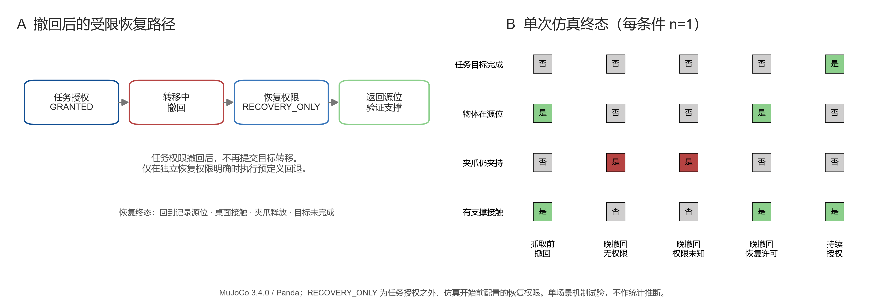

# PoL2 具身治理：授权撤回后的受限安全恢复

**运行日期：** 2026-10-24

**实验性质：** 确定性仿真机制试验；每条件单轨迹，不作统计推断

**仿真环境：** MuJoCo 3.4.0，Franka Emika Panda
**策略版本：** 任务契约 `pol2-embodied-contract-v0.2`；恢复契约 `pol2-embodied-recovery-policy-v0.1`

## 摘要

上一轮在 Panda 搬运阶段撤回任务授权时，门在放置前阻断了目标动作，但把物体留在夹爪中。本轮将执行状态恢复作为独立问题处理：**撤回后不再完成原任务；只有预先配置的 `RECOVERY_ONLY` 系统权限，才能启动一个有界回退，把物体送回记录源位。** 任务授权与恢复权限是两个不同的结构字段。恢复权限为拒绝或未知时，系统不发出回退轨迹，并把夹持中的中间状态记为未解决，不标作安全成功。

在五个固定条件各运行一次的 MuJoCo 仿真中，`RECOVERY_ONLY` 条件下，Panda 沿先前经过的路径反向返回源位，释放物体；仿真器在回退后与机械臂撤离后两次检查到源位谓词成立、物体与源桌直接接触、夹爪已释放，且目标谓词仍为假。物体最终位置与初始位置的欧氏距离为 0.00703 m。持续授权正向控制完成了目标放置。恢复权限为 `DENIED` 或 `UNKNOWN` 时没有执行回退，物体保持夹持状态。该结果支持**受限回退路径在这一个固定仿真场景中的可行性**，不证明真实系统的恢复安全或发生率。



*图 1. 左：任务权限撤回后，目标转移被终止；仅当独立的预配置恢复权限为 `RECOVERY_ONLY` 时，才执行返回源位和状态核验。右：五个条件的单次仿真终态。红色标出仍被夹持的未恢复状态，绿色表示对应谓词成立，灰色表示不成立；条件样本数均为 n=1。*

## 研究问题与机器契约

本轮检验三件事：

1. 明确恢复权限后，能否按固定受限路径把已抓起的物体放回记录源位？
2. 回退后能否用独立仿真状态确认桌面接触、夹爪释放及目标未完成？
3. 恢复权限拒绝或未知时，系统会不会错误地把原任务许可推断为恢复许可？

`RECOVERY_ONLY` 是实验开始前加载的单独系统策略输入。它只允许恢复物体到记录源支撑面，不授权把物体放进任务目标，也不恢复原任务许可。恢复动作须同时满足：双侧夹爪接触成立；目标尚未达成；执行器位于目标上方的指定携带姿态容差内；源位在现有工作空间与逆运动学监视器范围内。任何前置检查失败或执行器/监视器异常，都返回 `recovery_failed` 并记录实际部分状态，不自由重规划。

成功谓词由仿真器状态读取，而非控制器对自己动作的口头声明：

- 物体满足源位位置谓词，且与源桌几何体直接接触；
- 夹爪已无物体接触；
- 任务目标谓词为假；
- 以上条件在释放静置后成立，并在机械臂垂直撤离后再次成立。

## 实验设计

每个条件使用相同 Panda、物体、源桌、托盘几何和确定性控制路径。权限通过同步回调在现有 `transfer_start`、`before_grasp` 与 `before_place` 检查点注入。恢复权限独立于这条任务权限序列。

| 条件 | 任务权限序列 | 恢复权限 | 目的 |
|---|---|---|---|
| 抓取前撤回 | `GRANTED → DENIED` | `RECOVERY_ONLY` | 负向控制：确认物体接触前撤回仍不移动物体；此时无须启动恢复 |
| 放置前撤回 | `GRANTED → GRANTED → DENIED` | `DENIED` | 复现上轮悬持状态，并检查拒绝恢复时不执行回退 |
| 放置前撤回 | 同上 | `UNKNOWN` | 检查未知恢复权限是否按无权限处理 |
| 放置前撤回 | 同上 | `RECOVERY_ONLY` | 检验有界返回源位、释放和后置状态验证 |
| 持续授权控制 | 持续 `GRANTED` | `DENIED` | 正向控制：确保任务授权持续时仍可完成目标任务，且不需要恢复权限 |

每格 n=1。实验没有随机化运行顺序、场景布局或扰动，也没有足够样本估计任何成功率或故障概率；表格中的是/否只描述本次固定轨迹。

## 结果

| 条件 | 物体在源位 | 夹爪仍夹持 | 源桌/托盘支撑接触 | 目标完成 | 回退状态 |
|---|---:|---:|---:|---:|---|
| 抓取前撤回 | 是 | 否 | 是（源桌） | 否 | 不适用；物体未被抓起 |
| 放置前撤回，恢复拒绝 | 否 | 是 | 否 | 否 | 未获许可，未执行；中间状态未解决 |
| 放置前撤回，恢复未知 | 否 | 是 | 否 | 否 | 未获许可，未执行；中间状态未解决 |
| 放置前撤回，`RECOVERY_ONLY` | 是 | 否 | 是（源桌） | 否 | 成功；回到源位并通过两次状态检查 |
| 持续任务授权 | 否 | 否 | 是（托盘底面） | 是 | 不适用；获准抓放完成 |

在恢复专用权限条件下：回退开始时末端执行器与预设携带姿态的误差为 0.00597 m；回退轨迹依次经过源位上方、源位放置高度、释放和撤离。源位放置后物体位置为 `(0.5481, -0.0068, 0.4219) m`，相对初始中心的误差为 0.00703 m。源桌接触、夹爪释放与目标未完成在机械臂撤离后再次确认。撤回检查时物体已移动至 `(0.4304, -0.2283, 0.5154) m`；故障处理并非“物体没动”，而是把已搬离源位但尚未到目标的物体放回。控制器路径误差小于既有监视器设定的 0.035 m 跟踪阈值；这只是仿真监视器通过，不表示经过力/扭矩或硬件安全验证。

负向恢复权限条件与未知条件都没有执行恢复轨迹。这避免系统把已撤回的任务授权误作回退许可；代价是物体仍悬持。因此，**fail-closed 只约束授权边界，不会自行解决物理中间态**。恢复授权缺失时，系统仍需要独立的硬件级或系统级安全保持设计，本轮并未证明持续悬持安全。

## 结论与解释边界

本轮把上一轮“撤回后停止”的发现推进到一个机器可核验的恢复原型：在仿真场景与前置条件满足时，预先声明的恢复专用权限可触发唯一的源位回退；任务权限拒绝/未知不会自动授权回退；获准任务仍可完成。

实验只支持**单场景可行性**，不能推广到随机任务和故障分布。物体位姿来自 MuJoCo 真值，障碍物静态且路径已知，恢复阶段没有注入夹爪滑脱、掉电、碰撞、观测过期或异步权限事件；也没有检查力、扭矩、夹持压力或长期静置。对动态场景，更安全的恢复目标可能不是原位置；本轮的“返回源位”是假设明确、可复算的试验目标，不是普遍最优策略。

恢复权限引入了一个明确的治理设计条件：系统需在任务启动前配置一个**范围极窄、不能完成原任务**的安全恢复权限。若 PoL2/EAP 不接受此类预置权限，或权限账本本身也同时撤销该权限，则本机制不应运行；本轮没有解决这一规范选择，只把两种权限分开并测了可执行边界。

下一阶段应在单场景机制复现后，加入多个源位与负载、目标/源位被遮挡、夹持丢失、控制阶段中断、障碍物变化和恢复执行故障。先用多场景先导估计种子间变化和失败机制，再预先锁定确认性样本量、主终点及区间估计方法。还应比较“源位恢复”“最近稳定支撑”“保持夹持”等机器策略；不可把不同路径的控制步当作独立样本。

## 可复现材料

- [逐轨迹机器结果 JSON](../PoL-Governance/benchmark/embodied_reasoning/results/revocation-recovery-experiment-20261024d.json)
- [恢复权限与回退策略规格](../PoL-Governance/benchmark/embodied_reasoning/pol2-embodied-recovery-policy-v0.1.json)
- [实验脚本](../PoL-Governance/benchmark/embodied_reasoning/run_revocation_recovery_experiment.py)
- [底层 MuJoCo Panda 执行控制器](../PoL-Governance/benchmark/embodied_reasoning/run_mujoco_typed_pick_place.py)
- 图：[`PNG`](figures/pol2-revocation-recovery-20261024d.png) · [`矢量 PDF`](figures/pol2-revocation-recovery-20261024d.pdf)
- [上一轮授权撤回边界实验](PoL2-具身授权撤回边界实验.md)

从仓库根目录复现五个条件并生成 JSON、300 dpi PNG 和矢量 PDF：

```powershell
python PoL-Governance/benchmark/embodied_reasoning/run_revocation_recovery_experiment.py --run-id 20261024d
```

脚本拒绝覆盖已有同编号结果。绘图按仓库内对 [figures4papers](https://github.com/ChenLiu-1996/figures4papers) 规范的重述版本执行，并调用 `PoL2-DAO-Governance-Lab` 中的 `plotstyle.py` 作为统一样式入口；没有复制该上游仓库的代码或文本。报告流程也参照 Scientific Agent Skills 的方法说明：Kassis, T., Agarwal, V., He, Y., Patel, D., & Brueckner, A. M. (2026). *Scientific Agent Skills: A Library of Procedural Knowledge for Research Agents* (v2). [arXiv:2609.00065](https://doi.org/10.48550/arXiv.2609.00065).

定向检查通过：实验脚本可编译；五条件结果和汇总状态可解析；恢复策略与脚本 SHA-256 与结果记录相符；PNG 已打开检查，PDF 为单页矢量输出并已渲染检查。仓库级 `uv run --no-project --offline python tools/check.py` 未通过，其在本实验代码检查前被既有非便携链接 `datasets/general/coverage-gaps.md → data/items.final.jsonl` 拦截；该数据文件不属于本轮范围，也未改动。
