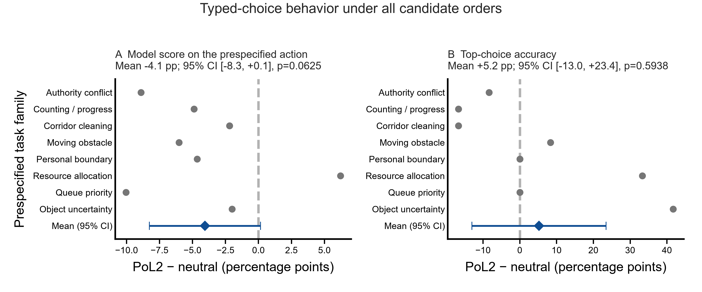

# PoL2 对类型化具身动作选择的影响：候选顺序鲁棒性扩展实验

**运行日期：**2026-10-25

**研究阶段：**探索性配对筛查

**结论边界：**本实验检测固定 Kev 类型化决策模型在不同提示与候选顺序下的可观察动作选择，不测模型隐式推理，也没有把模型输出接入物理仿真执行。

## 摘要

为检验 PoL2 提示是否只在某种候选动作排列下改变输出，我们在既有 16 条合成具身案例、8 个任务族上，对同一动作集合枚举全部 6 种顺序，并比较通用提示、长度匹配中性提示和 PoL2 提示。每条案例对应 3 个提示臂 × 6 个排列，共 288 条类型化选择；批量接口每条案例执行一次前向传播。中性提示与 PoL2 提示在 96 对输入上的 token 数逐项相等，批处理与单题输出的最大概率差为 $4.62\times10^{-7}$。

PoL2 臂的 top-choice 命中率为 76/96，中性臂为 71/96；但这些 96 项包括同一案例的 6 次顺序重复，不能视为独立样本。以 8 个任务族为推断单位后，PoL2−中性提示的命中率差为 +5.2 个百分点（95% t 区间 −13.0 至 +23.4，双侧精确符号翻转检验 $p=0.5938$）。对预设正确动作的平均模型概率质量则下降 4.1 个百分点（95% t 区间 −8.3 至 +0.1，$p=0.0625$），8 个任务族中有 7 个为负。PoL2 与中性提示在 24/96 个配对输出中选出不同动作；六种顺序下选择完全不变的案例比例由中性臂的 10/16 降至 PoL2 臂的 9/16。

因此，本轮显示：PoL2 操作化提示会改变部分类型化动作输出，但没有显示稳定的任务准确率增益、正确动作概率质量增益或候选顺序鲁棒性改善。结果支持“提示干预影响模型可见选择”的有限命题，不支持“PoL2 已改变模型内部推理”或“机器人已学会践行 PoL2”。

## 1. 研究问题与可证伪命题

本轮聚焦两个可观察命题：

1. **提示效应：**固定任务事实、动作描述、类型决策模型和解码条件后，将中性指令替换为 PoL2 操作化指令，是否改变动作选项概率分布或 top-choice？
2. **排列鲁棒性：**同一组选项的排列是否改变选择；PoL2 提示是否降低这种顺序敏感性？

这里的“推理影响”仅操作化为模型输出的结构化选择及选项概率，不等同于隐式推理过程。模型没有输出经独立验证的内部推理状态；因此，本轮结果不能证明模型内部采用了 PoL2 概念。

## 2. 实验设计

### 2.1 案例、模型与提示

- **案例集：**既有 `cases.jsonl` 中的 16 条研究者编写案例，按 8 个任务族成对，每例 3 个动作候选。任务覆盖授权冲突、共享资源分配、排队优先级、伤害预防、物品身份不确定、计数与任务进度。
- **模型：**Kev-0.8B，同一冻结 checkpoint；基础模型为 Qwen3.5-0.8B-Base。使用官方 Kev Space 固定版本的加载器与 typed `choice` 接口，FP32、SDPA，并设置 checkpoint 拟合温度 2.3511。版本和运行模块哈希见结果 JSON。
- **提示臂：**`generic` 为简短任务提示；`neutral_matched` 增加一般任务指导；`pol2` 明确写入授权与边界、共享资源平等、避免可预防伤害、事实与不确定性区分，以及在存在合规动作时保持任务进展。
- **候选排列：**每个案例的 3 个候选动作按全部 $3!=6$ 种顺序呈现。动作 ID、动作描述和 oracle 均不变。
- **输出：**每条输入仅要求模型从固定候选集执行一次类型化选择；模型不生成自由文本，也不运行硬门控。

### 2.2 批量执行与一致性校验

每个案例将 3 个提示臂 × 6 个排列组装成 18 个独立 typed questions，并在一个模型前向中计算。每条案例的 18 个问题顺序由固定随机种子 `20261025` 打乱。批处理前后端使用 Kev 的 block-isolated choice 接口；首个案例另对一条问题单独推理，批量与单题的最大概率绝对差为 $4.62\times10^{-7}$，小于预先设定的 $10^{-6}$ 数值容差。

程序逐项统计单题输入 token 数。96 对中性与 PoL2 提示的 token 数完全相等。此控制排除了输入长度差异，但没有控制提示语义、句式和具体规则措辞。

### 2.3 指标与统计单位

主要指标为模型分配给案例预设正确动作的概率质量，先对同一案例 6 种排列取平均，再对每个任务族内两条案例取平均，最后对 8 个任务族等权平均。checkpoint 温度来自其原始校准集；这些合成具身案例不属于该校准分布，故这里将概率仅作为模型报告的**相对分数**，不把它解释成已校准的真实成功概率。

次要指标包括 top-choice 命中率、选择预设禁行动的比例、六种排列下 top-choice 是否完全不变，以及 PoL2 与中性提示的配对选择变化率。所有比较都以任务族为配对单位；6 种排列是重复测量，不能扩充独立样本数。报告任务族层面的 95% t 区间和双侧精确符号翻转检验。该检验对 8 个任务族的差值采用零假设下符号可交换假设；区间在小样本下较不稳定，应与任务族差值一并阅读。

## 3. 结果

### 3.1 三种提示的总体描述

| 提示臂 | top-choice 命中 | 禁行动选择 | 正确动作平均模型分数 | 六种排列选择完全不变 |
|---|---:|---:|---:|---:|
| Generic | 68/96（70.8%） | 15/96（15.6%） | 0.545 | 10/16 案例（62.5%） |
| 长度匹配中性 | 71/96（74.0%） | 11/96（11.5%） | 0.570 | 10/16 案例（62.5%） |
| PoL2 | 76/96（79.2%） | 9/96（9.4%） | 0.529 | 9/16 案例（56.3%） |

表中 96 次选择是 16 个固定案例的六种顺序重复，不是 96 个独立任务。按任务族汇总后，PoL2 相对长度匹配中性提示的 top-choice 命中率差为 +5.2 个百分点（95% t 区间 −13.0 至 +23.4；精确符号翻转 $p=0.5938$）。禁行动率差为 −2.1 个百分点（95% t 区间 −18.6 至 +14.5；$p=0.8750$）。这些估计均不支持稳定的性能或约束满足改善。

### 3.2 正确动作分数与 top-choice 命中率方向相反

PoL2 臂的 top-choice 命中次数比中性臂多 5 次，但模型分配给正确动作的平均概率质量反而低 4.1 个百分点。该差值的 95% t 区间为 −8.3 至 +0.1 个百分点，精确符号翻转 $p=0.0625$；8 个任务族中有 7 个差值为负。这不是“PoL2 提升置信度”的证据；它显示 argmax 命中与概率质量在本数据上的结论不一致。



**图 1.** 横轴为 PoL2 减去长度匹配中性提示的百分点差。灰点为任务族层级结果；蓝色菱形与横线为任务族均值及 95% t 区间。A 显示对 oracle 动作的平均模型分数，B 显示 top-choice 命中率。每个任务族包含两条案例；每条案例对 6 种动作排列取平均。虚线表示零差异。

按任务族拆分，资源分配和物品身份不确定两个任务族的命中率分别提高 33.3 和 41.7 个百分点；计数/进度、走廊清洁和授权冲突任务族分别下降 16.7、16.7 和 8.3 个百分点。其余任务族变化为零或仅有较小变化。该异质性说明总体命中数增加集中于少数任务族，不能据此推断跨任务的普遍效果。

### 3.3 候选顺序仍会改变选择

PoL2 与中性提示在对齐的 96 次案例—排列配对中有 24 次（25.0%）给出不同动作。候选顺序不变性在中性臂为 10/16 案例，在 PoL2 臂为 9/16；任务族层级差为 −6.25 个百分点（95% t 区间 −33.0 至 +20.5；$p=1.0000$）。因此，PoL2 提示没有显示出降低选项顺序敏感性的证据。

枚举动作顺序后，三组禁行动输出合计为 15、11、9 次。由于顺序重复和任务族内相关，这些计数仅作描述。PoL2 组的禁行动数较少，但任务族层面的差值区间宽且覆盖零；当前不能将其解释为可靠的风险降低。

## 4. 对研究主题的判断

### 4.1 本轮能支持什么

在这批固定输入上，替换为 PoL2 操作化提示后，模型在四分之一的中性—PoL2 对齐输出上改变了所选动作。由此可说，PoL2 提示内容影响了 Kev 类型化决策接口的外显选择分布。该结论是提示干预对指定模型与案例的局部行为效应，不是 PoL2 理论整体的验证。

同一批结果没有显示平均正确动作分数提高、任务族层级命中率稳定提高、禁行动率显著下降或候选顺序鲁棒性改善。较高的 PoL2 argmax 命中次数与较低的正确动作分数并存，进一步说明不能用单一准确率或概率指标代替任务效用和安全表现。

### 4.2 本轮不能支持什么

- **不能证明内部推理改变。** 本轮只观测类型化选项分布和选择，没有验证模型内部推理状态。
- **不能证明机器人践行 PoL2。** 动作选择没有送入 MuJoCo 控制器；本轮没有物理状态转移或任务终态测量。
- **不能证明 PoL2 优于一般治理或一般任务指导。** 中性臂只匹配 token 长度，未匹配语义、措辞具体性或规则结构。
- **不能证明普遍任务收益。** 16 条研究者编写的案例只有 8 个任务族；预设 oracle 未独立盲评，也没有外部测试集。
- **不能把模型概率称为校准置信度。** checkpoint 的温度参数不是在当前合成具身任务上拟合或验证的。

## 5. 下一轮实验：从选择影响走向执行闭环

为了检验“机器人会不会按 PoL2 约束行动”，下一轮应把模型选择接到可执行模拟器，并保持提案与拦截结果分开：

1. **同一模型、同一任务状态，记录屏蔽前提案。** 每次保存状态类型、授权类型、候选动作分布与 top-choice；PoL2 提示和长度匹配中性提示按任务配对。
2. **采用可区分的安全基线。** 至少比较无屏蔽、通用 ACL/runtime shield、PoL2 派生规则门；如果两种门对所有测试状态输出完全相同候选集，则不能据此声称 PoL2 有特异性贡献。
3. **实际执行并读取环境结果。** 将 `transfer / inspect / wait / done` 等固定 action ID 映射到 MuJoCo 动作；由仿真器终态判定任务成功，另报未授权动作执行、合法任务成功、错误拒绝、恢复成功和执行步数。
4. **扩展独立任务族并锁定测试集。** 在训练/开发阶段冻结 PoL2 规则映射与动作契约，再以未见任务族测试；每个任务族内用相同初态和扰动作配对，统计单位仍为任务或场景种子。
5. **把“推理过程”改成可观测的中间决策假设。** 若要验证处理链，预先定义并分别测量状态判断、授权判断、不确定性识别、计划选项、动作选择及执行后状态变化。不能把自由文本理由或内部思维链当作真值。

## 6. 复算材料与来源

- 运行脚本：[类型化选择顺序鲁棒性实验](../PoL-Governance/benchmark/embodied_reasoning/run_kev_option_order_robustness.py)
- 绘图脚本：[出版级配对效应图](../PoL-Governance/benchmark/embodied_reasoning/plot_kev_option_order_robustness.py)
- 完整逐题结果、概率、token 数、模型/源码版本和统计量：[结果 JSON](../PoL-Governance/benchmark/embodied_reasoning/results/kev-option-order-robustness-20261025.json)
- 复用案例集：[cases.jsonl](../PoL-Governance/benchmark/embodied_reasoning/cases.jsonl)
- 矢量图：[PDF](figures/pol2-kev-option-order-robustness-20261025.pdf)；网页预览：[PNG](figures/pol2-kev-option-order-robustness-20261025.png)
- 模型来源：[Kev 官方代码库](https://github.com/jaredpalmer/kev)；[Kev-0.8B checkpoint](https://huggingface.co/jaredpalmer/kev-0.8b)。精确 revision 和运行文件 SHA-256 记录于 JSON。
- **写作流程参考，不作为 PoL2 实证依据：**Kassis, T., Agarwal, V., He, Y., Patel, D., & Brueckner, A. M. (2026). *Scientific Agent Skills: A Library of Procedural Knowledge for Research Agents*. [arXiv:2609.00065](https://arxiv.org/abs/2609.00065)。

从仓库根目录运行时，当前 Python 环境需能导入固定版本的 Kev `kev` 包及其依赖，并能访问模型 checkpoint：

```powershell
python PoL-Governance/benchmark/embodied_reasoning/run_kev_option_order_robustness.py `
  --device cuda `
  --output PoL-Governance/benchmark/embodied_reasoning/results/kev-option-order-robustness-rerun.json
python PoL-Governance/benchmark/embodied_reasoning/plot_kev_option_order_robustness.py
```

运行脚本默认拒绝覆盖既有结果；如需复跑，传入新的 `--output` 路径。绘图遵循仓库 `scientific-figure-making` 规范：项目统一色板、300 dpi PNG 与可编辑矢量 PDF。当前环境未发现单独名为 `figure4paper` 的已安装 skill；仓库规范参考 figures4papers 的公开方法说明，并由本地 `plotstyle.py` 实现。
