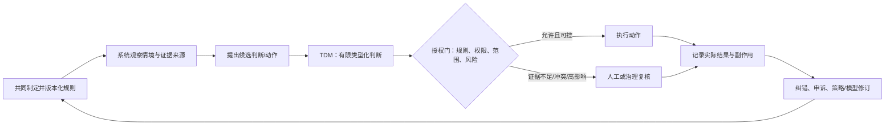
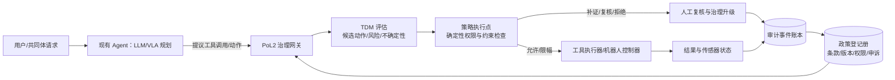
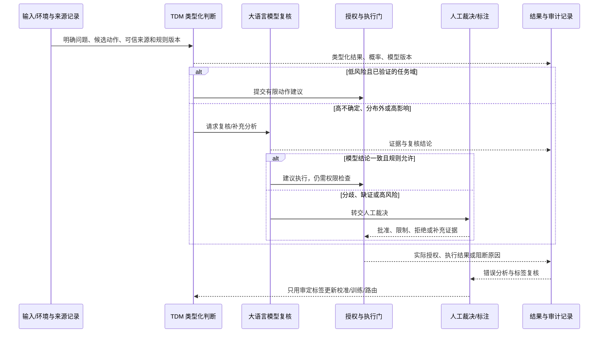
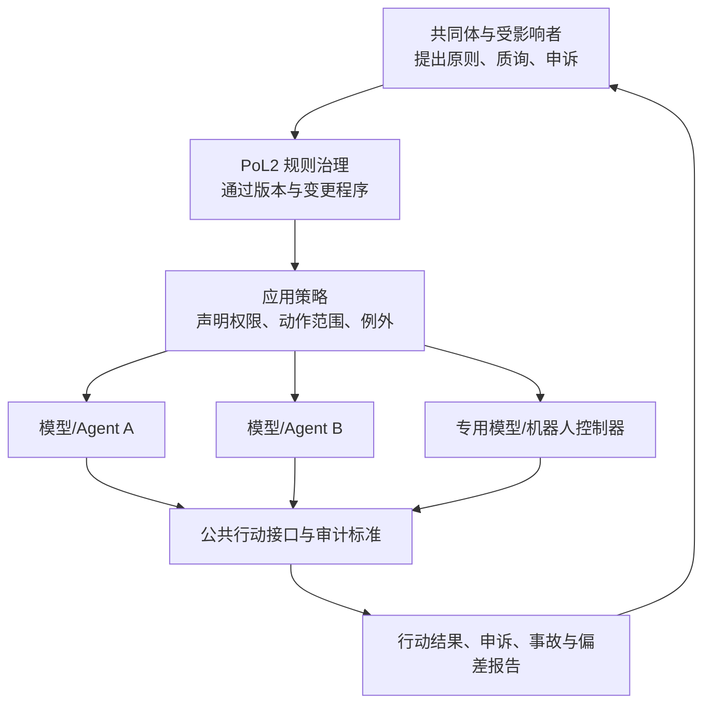

# PoL2 的物理世界治理支点：把规则接到具身智能行动、执行与修正上

**核心术语：** PoL2（Proof of Love2）；Typed Decision Model（TDM，类型化决策模型）

## 结论先行：治理的支点在行动接口

PoL2 的治理支点不是只放在模型输出的内容审查上，也不能寄托给某一个类型化决策模型。真正可落地的支点，是**把 PoL2 规则绑定到系统从“观察与判断”转向“采取行动”的接口上，并让这条接口同时具备授权、执行、复核与纠错能力**。

Typed Decision Model（TDM，类型化决策模型）接收明确状态与候选项，输出受约束的选择、分数或概率；它不是 PoL2 治理本身。研究重点应从“模型能否单独治理”转向“它适合处理什么决策、如何与大语言模型协作、由谁授权真实动作，以及错误怎样触发纠正”。

若自治系统要构建应用与协议，多个大语言模型要形成协作网络，具身系统要把判断转成现实动作，“系统自然遵循规则”就必须落实为具体机制：规则写入什么接口、由什么组件强制、谁能修改规则和执行组件、参与者如何提出异议、事故后怎样暂停和回退。

因此，本文的中心命题是：

> **PoL2 的工程治理对象从“回答内容”扩展到“有后果的状态变更”；TDM 负责其中一类有限、可检验的判断，治理效果取决于判断之后的授权与执行闭环。**

## 1. 研究逻辑：从治理目标推导模型分工

研究不应从某个模型的能力清单起步，而应从需要治理的现实任务倒推系统设计：

| 研究步骤 | 研究问题 | 可观察的落点 |
|---|---|---|
| 定义治理目标 | 系统要保护哪些权利、限制哪些动作、保留哪些正当任务？ | 规则版本、适用对象、例外、可接受代价 |
| 确定 TDM 的**适用职责** | 哪类决策有明确候选项、需要快速低成本判断，而且可以由后续组件检查？ | 任务边界、动作候选、响应时延、判断准确性与升级率 |
| 设计与大语言模型的**分工和协作** | TDM 初判、大语言模型复核是否有用？什么错误触发复核、转交或暂停？ | 独立复核、分歧路由、错误归因、任务转交与成本 |
| 深入去中心化治理中的**规则执行与授权** | 规则如何约束应用、工具、模型与机器人？谁有权决定规则版本和例外？ | 可执行策略、权限边界、变更治理、申诉和事故回滚 |
| 落到**视觉、动作和具身场景** | 类型化动作判断是否能帮助无人机或机器人选择下一步动作，同时保留物理安全与公共约束？ | 仿真/实机轨迹、动作合法性、任务完成、险情与人工接管 |

研究需要厘清它们分别能解决什么、留下什么责任缺口，以及它们对系统能力、误拦和实际风险有什么影响。PoL2 的技术价值应通过这些具体机制和结果来论证，而非靠对其他治理范式的笼统评价。

## 2. 治理支点是什么：规则进入状态变更的那一刻

只看输出文本，系统容易把治理缩成“这句话是否违规”。但 Agent 和具身系统可以读数据、发消息、改文件、调用 API、转账、移动、抓取。文字判断和动作后果之间存在一个可干预的接口：**行动请求**。

一个行动请求至少应明确：

| 项目 | 要回答的问题 |
|---|---|
| 主体与权限 | 谁发起？它有什么授权？授权由谁授予、何时失效？ |
| 目标与动作 | 要读取、写入、发送、购买、移动或改变什么？具体参数是什么？ |
| 上下文来源 | 判断依据来自用户、可信规则、工具返回，还是不可信外部内容？ |
| 影响与可逆性 | 影响谁？范围多大？是否可撤销？失败时能否安全停止？ |
| 适用规则 | 当前适用哪一版 PoL2 规则，哪条规则允许、限制或要求复核？ |
| 复核路径 | 证据不足、规则冲突或异议出现时，谁能补证、复核、申诉？ |

由此，治理不是“模型给出符合规则的答案”这么简单，而是一个可观察的控制链：



**图 1.** 研究提案。TDM 提供判断信号，不持有最终授权；真正的治理支点是行动执行前可阻断、缩小范围或升级的接口，以及执行后能触发修复与规则复核的反馈路径。

### 2.1 PoL2 如何接入现有 Agent 或机器人

现实接入不要求重训底层大语言模型，也不要求机器人“理解整本文明理论”。需要新增的是一层**PoL2 运行时治理网关**：把理论与共同体决定编译成有版本、适用范围、例外和处置动作的政策；在 Agent 调用工具或机器人控制器下发高层动作前拦截请求；将政策判断与真实执行权限分离。



**图 2.** 接入现有系统的最小位置。Agent/VLA 仍然负责理解目标、规划和生成动作候选；网关必须处在所有有后果的工具调用与动作命令路径上；底层安全控制器仍保持独立。只在聊天输出后面加一个内容审核器，无法治理发消息、写数据库、转账或机器人运动。

最小运行时请求可以采用类似下列的模型无关数据契约：

```json
{
  "request_id": "req-1042",
  "principal": {"agent_id": "delivery-agent", "authority_ref": "mission-88"},
  "policy": {"id": "pol2.delivery.public-space", "version": "0.3.1"},
  "context_refs": ["sensor://state/8841", "map://zone/12"],
  "provenance": [{"source": "camera", "trusted_by": "robot-runtime"}],
  "proposed_action": {"type": "move", "target": "waypoint-17", "speed_mps": 2.0},
  "candidate_actions": ["move", "hold", "reroute", "return_home"],
  "impact": {"reversible": true, "people_exposed": true, "risk_class": "medium"}
}
```

网关可调用一个或多个 TDM 对有限问题作类型化判断，但要返回模型及版本、选项定义、概率、失败状态和来源摘要。之后由策略执行点执行下列逻辑：硬权限或安全约束不满足则拒绝；信息不足则补证或复核；仅当规则明确允许、风险处于授权范围且物理控制器接受动作时才执行。**TDM 的高概率不是授权凭证，LLM 的复核意见也不能绕过执行点。**

最小可行的下一步不是另造一个“大一统治理模型”，而是把既有 `allow / repair / block / clarify / review` 动作接到一个实际 Agent 工具适配器：先拦截文件写入、消息发送或模拟器动作；保存政策版本、TDM 原始输出、网关决定和执行结果；让人能审查并申诉。当前 DAO 治理实验室是流程原型，PoL2 运行时目录仍把集成插件列为待完成，故这段是部署设计，不代表仓库已经完成该接入。

对已有 Agent 宿主，接入点要按其真实扩展机制确认，不假定各框架有相同的 hook。优先检查三个边界：**模型调用前**（输入与授权上下文）、**工具/动作执行前**（最终权限门）、**输出交付前**（对外内容与承诺）。从影子模式开始，只记录不拦截；确认日志完整、策略误报可接受后，再对低风险工具有限启用。每次变更都复查端到端安全任务、正常任务完成率、延迟和成本。NaturalDAO 现有插件规范也要求把宿主接入、影子试运行、有限启用和端到端验证作为一个交付闭环，而不是把单个工具测试通过当治理有效。

### 三个不可互相替代的权力

1. **判断权：** 对输入和候选项作分类、排序或风险估计。TDM 可承担一部分。
2. **授权权：** 决定特定主体能否在此情境执行特定动作。它应由明确政策和权限持有，不应从模型概率自动推导。
3. **修正规则的权力：** 决定政策版本、例外、申诉流程和责任安排。它属于治理程序，不能由模型在后台自行改写。

如果三种权力混在一个模型里，“模型认为可行”就会滑成“系统因此允许”。把权力拆开，才能分别问：TDM 的判断是否准确？授权规则是否正当？执行是否遵守了授权？错误发生后能否纠正？

## 3. TDM 在 PoL2 治理中的位置：快判断、可复核、可转交

一种可检验的协作流程是：TDM 先作快速判断，大语言模型在不确定、分歧或高影响情形中复核；经独立审定的结果再用于校准模型、改善数据或调整任务路由。不能把“正确一次就加权、错误一次就维护”直接当成学习规则：标签可能错、任务分布可能变化、两个模型可能共享偏差，简单累计会把早期错误固化。

更稳妥的实现应当是**按任务和情境分层的可校准路由**：



**图 3.** 分工提案。复核结果只在标签经独立审定后进入训练或校准；大语言模型的二次意见不是自动金标准，多个模型一致也不等于事实正确。

建议将任务按“是否适合交给 TDM”而非按模型热度分层：

| 任务类型 | TDM 可承担的角色 | 需要的后续控制 |
|---|---|---|
| 有限候选、低后果、重复性高的路由/分类 | 快速初筛或候选动作排序 | 抽样审计、阈值和错误率监测 |
| 证据复杂、选项定义敏感或存在语义歧义 | 提供辅助判断与不确定性线索 | LLM/检索补证；分歧时转人；不直接执行 |
| 高影响、不可逆、涉及权利或公共资源的决定 | 仅提供可解释的辅助信号 | 人类有权复核、受影响方可申诉、独立授权与记录 |
| 机器人/无人机连续动作 | 下一步动作候选或偏好信号 | 实时控制器、地理围栏、碰撞/动力学约束、急停与人工接管 |

因此，可靠性应被估计为“某任务域、某类输入、某版本、某阈值下”的条件表现，而不是模型全局统一的可信分。应保留校准集和盲测集，追踪错误的严重度、分布漂移、语言差异与良性任务损失。分歧与失败样本可以触发重新评估，不自动等于模型该加权或降权。

近期工作为“高层生成/规划 + 低层类型化选择”提供了具体参照。一项移动 GUI Agent 研究用视觉语言模型低频制定局部目标，再让类型化决策模型在 accessibility tree 给定的可执行动作集合中反复选择；论文在 AndroidWorld 上报告 79% 任务成功率，而逐步调用视觉语言模型的基线为 84%，成功轨迹平均执行时间减少 32.7%、模型 API 成本减少 73.4%。这支持继续研究模型分工，但任务是手机 GUI，不是无人机或机器人，也没有验证 PoL2 治理。[论文](https://arxiv.org/abs/2609.30186)

另一项选择性控制研究在置信度低或需要生成时调用较强大语言模型；作者在冻结的 100 任务基准上报告 95% 成功率，并比只用强模型少 72.7% 的强模型调用。论文同时指出，动作选项规模和授权边界附近的近似选项会影响可靠性。它提供了条件复核的流程参照，但仍是小规模预印本实验，不能直接外推到 PoL2 或实体机器人。[论文](https://arxiv.org/abs/2609.26532)

### 面向开放协作的实现选择

Jev 是闭源服务，外部无法完整检查其权重、训练过程并独立维护模型；这与 PoL2 所追求的开放参与、可复核和多方协作不匹配。研究目标应是**这类技术能力**，没有绑定某个商业实现：输入明确状态和类型化问题，输出候选判断及可审计的不确定性，再由开放治理与执行层决定如何行动。

目前可以把 [OpenJev](https://github.com/alanhuangyoo/OpenJev) 作为本地化 TDM 原型候选：其仓库公开代码与 Apache-2.0 权重，支持自部署、训练和浏览器 Agent 动作选择；但其报告的基准由维护者提供，含特定训练集与数据许可边界，且它尚未在 PoL2 数据或实体机器人上验证。[AnyJev](https://github.com/nokia-applied-research/AnyJev) 可作为另一类基线：在开放语言模型上读取类型化选项分数并做校准，便于测试“不训练专用 TDM”能达到什么效果。两者不是现成的 PoL2 治理器，也不能仅凭代码开源就认定其数据、权重、评测和部署链条全部开放。

所以 PoL2 项目更稳妥的落地路径是先定义一个模型无关的 TDM 接口和公开评测契约，再把多个开放实现放到同一数据划分、策略版本与行动任务上评估。最低开放要求应包括：推理代码、模型权重及许可、训练/校准流程、数据来源与许可、固定测试集、失败案例、模型版本和部署配置。模型可替换，授权规则和执行日志不能跟着某个模型供应商锁定。

## 4. 去中心化自治：从“谁投票”转向“谁能改变什么”

去中心化治理的难点不止是投票算法，也包括规则如何执行、谁有投票或变更权。超越逐项投票的自治愿景，不能靠一句“系统自然遵循规则”跳过这个问题。至少要将权力拆成三层：

| 治理层 | 决定内容 | 需要保留的制衡 |
|---|---|---|
| **宪制/规则层** | PoL2 的核心原则、谁属于受影响共同体、修改门槛、申诉权 | 多方参与、版本记录、少数意见、延迟生效与紧急暂停 |
| **策略/应用层** | 某个应用把原则映射成哪些动作权限、阈值和例外 | 公开策略、可审计测试、部署者责任、受影响者反馈 |
| **运行/行动层** | 当前请求是否满足权限与安全条件、是否执行 | 独立授权门、最小权限、人工接管、事故日志与撤销 |



**图 4.** “多模型协作网络”可以共用治理协议与行动接口，同时保留不同模型的专业分工。网络参与者接受同一套公开约束，不表示模型权重、判断能力或风险完全相同；每个组件仍需标明版本、职责和权限。

该结构允许不把每个低风险动作都拿去投票：共同体可以先治理授权规则和应用边界，让系统在边界内自动运行；超出边界、产生争议或带来不可逆后果时，再触发人工或共同体复核。**自动化可以减少逐案表决，但不能消除谁制定规则、谁部署应用、谁承担后果的问题。**

这里也有 PoL2 理论走向自治基础设施时必须回答的实际难题：身份与女巫攻击、代表性、利益冲突、规则更新权限、急停权限、模型供应链、执行器所有权和跨司法辖区责任。NaturalDAO 的现有 DAO 实验室实现了部分发言、表决、质询与哈希记录机制；这些是原型，不等于已解决身份或权力分配问题。

## 5. 具身智能如何接受 PoL2 治理

具身系统的治理要覆盖从部署前任务边界到运行时动作再到事故复盘，不能只审查自然语言回答。具体可以分为四道相互独立的约束：

| 层次 | 管什么 | 例子 |
|---|---|---|
| **任务授权** | 谁可以启动什么任务、在什么地点/时段、达到什么目标 | 无人机只能在授权航线、时段和高度范围执行配送任务 |
| **动作治理** | 哪些动作可提议、可自动执行，什么情形必须复核 | 穿越人群上空、超出任务范围、无法确认传感器新鲜度时悬停或接管 |
| **物理安全** | 即时碰撞、动力学和设备限制 | 地理围栏、避障、速度上限、控制屏障、急停 |
| **结果问责** | 行动实际造成什么、谁审查、如何补救和改规则 | 轨迹留存、隐私最小化、事故上报、受影响者申诉和策略修订 |

这不是要求 DAO 对每个电机控制周期投票。共同体治理应确定任务授权、动作边界、风险等级、人工接管条件和事后救济；运行时系统在授权包络内自动运行，超出包络或出现不确定/冲突时暂停或升级。低层伺服控制必须保持实时、确定和本地安全；PoL2 网关治理的是有意义的任务级动作与权限变更，不能以网络治理代替硬实时安全。

具身治理的关键原则是**候选动作由任务/规划层提出，TDM 在显式动作集中提供选择或风险判断，PoL2 策略执行点检查权限与公共规则，领域安全控制器最后守住物理约束**。TDM 不直接输出电机电流或绕过安全控制器。

已有机器人研究已把语言计划、技能可行性和物理执行分开。例如 SayCan 将语言模型提出的动作与机器人技能可行性结合；V-JEPA 2 研究视频表征、世界预测和机器人规划；控制屏障函数可以在控制回路内约束状态安全。这些构件提供工程参照，但都没有自行定义公共规则或决定谁有权授权。一项 TDM 移动 GUI Agent 预印本给出了高层规划模型与低层类型化动作选择的真实基准评估；将其延伸到无人机/机械臂仍是研究假设，必须独立做仿真和实机验证。[移动 GUI Agent 研究](https://arxiv.org/abs/2609.30186) · [SayCan](https://arxiv.org/abs/2204.01691) · [V-JEPA 2](https://arxiv.org/abs/2506.09985) · [控制屏障函数](https://arxiv.org/abs/1903.11199)

对无人机，可将核心问题具体化为：**在满足用户任务、空域/地理围栏、第三方安全和社区规则的前提下，类型化决策模型能否改善动作选择，而不增加不当拦截、险情或人工负担？** 不应只统计“下一动作猜对率”，还要看完整行动后果。


**图 5.** 无人机研究切口。PoL2 规则提供治理约束，TDM 处理有限动作判断，控制器负责物理安全；三者接口明确后，才适合做消融实验。

### 建议的实验设计

在仿真器中先设同一套任务、障碍和规则，对比：

1. 单一规划/动作模型；
2. TDM 动作判断 + 规划模型复核；
3. TDM + 独立 PoL2 策略检查；
4. TDM + 策略检查 + 物理安全控制器；
5. 完整方案加入高风险人工接管。

统一报告任务完成率、约束违反率、碰撞/险情、正当动作误拦率、人工接管频率、端到端延迟、算力/成本，以及不同天气、传感器噪声、语言指令、地理环境和第三方暴露条件下的分层表现。用消融区分收益来自 TDM、规则门、控制器还是额外复核；在仿真阶段不能声称实际部署安全，进入实机前需分级验证。

## 6. NaturalDAO 已有治理机制如何承接这个方向

NaturalDAO 的理论、治理实验室和运行时工作区可以作为这项研究的起点，但要按“原则—策略—执行—证据”重新接起来：

| 已有材料/实现 | 在行动治理中的位置 | 目前证据边界 |
|---|---|---|
| EAP 与 PoL2 条款 | 规则来源、分类理由和例外依据 | 价值主张仍需拆成可审计、可申诉的操作条款 |
| 三态判断 `conforming / violating / insufficient` | 将不确定性变成明确分支 | 现有 14 条正式评测器 fixtures 为合成样例，不代表真实分布 |
| `allow / repair / block / clarify / review` | 从判断转成处置选项 | 需和真实工具权限、动作结果及风险级别连接 |
| 平等发言、质询解释、未决升级 | 治理规则修改与争议解决程序 | DAO 治理实验室当前是 Python 原型和模拟，不是已部署社区治理 |
| 追加式哈希决策链 | 记录提案、依据、回应和变更线索 | 可检查记录完整性，不能独立证明事实真伪或规则公平 |
| 误拦核心类别与风险覆盖评测 | 监控良性任务损失和不确定性路由 | 正式人工标签、盲测和独立复现仍是关键缺口 |

现有实验中，对批评、愤怒、拒绝、异议和修复行为的保护，给出了一个可操作的公平性方向：不要只问危险动作有没有被拦，还要问系统是否把正当表达或正常动作误判成应阻止的行为。实验室 E0/E5 的模拟结果显示筛查器的偏差足以改变模拟投票结果；它不能证明现实群体效应，却足以说明“误拦成本”必须进入正式评估，而不能当成次要指标。

## 7. 近期研究给这条治理路线的约束

- **类型化输出不等于校准可信。** 一项 2026 年提示注入预印本在 47,611 个样例上比较类型化模型、Prompt Guard 2 和 LLM judge；被测商业模型的 AUROC 为 0.871，低于该任务中的 LLM judge（0.897），作者还报告其原生概率未稳定优于后校准分类器。在目标漏报率不高于 1% 的策略下，所测系统需要升级超过 91.8% 的样例。此结果只适用于论文工作负载与划分，不是对整个 TDM 技术类别的普遍判断。[论文](https://arxiv.org/abs/2610.20907)
- **类型正确的选择仍可造成错误行动。** 2026 年上下文投毒预印本在两种合成流程和 20 个开发任务中追踪了 1,659 次类型化模型调用；作者报告发生了违规执行，并指出防御也会损失正确自动化，统计对照经多重比较校正后不显著。它支持把执行结果纳入评估，不支持广泛断言所有 TDM 工作流都不安全。[论文与代码](https://arxiv.org/abs/2610.15537)
- **运行时规则需要可信轨迹。** 对 AgentDojo、STAC 轨迹的 MFOTL 离线研究报告：成功攻击链约 70.1% 被规则标记，同时约 29.3% 良性运行也触发；由于轨迹缺少审批和时间信息，许多跨步骤规则退化为动作类别筛查。离线重放不等于部署时阻断。[论文](https://arxiv.org/abs/2610.09793)
- **模型诊断应与宿主授权分开。** 一项 2026 年预印本提出层级策略路由，并由单独权限门决定是否执行；作者报告了 7,033 个评估案例及其准确率/延迟结果。这是与 PoL2 行动接口相近的工程实例，但仍是单篇预印本中的特定实现与评估，不证明该权限门由受影响者授权，也不证明跨应用安全。[论文](https://arxiv.org/abs/2610.18326)
- **防注入与公共治理不是同一个问题。** CaMeL 通过信息流和能力控制限制不可信内容影响工具调用；它可以成为执行层构件，但不决定共享规则由谁制定或如何申诉。[论文](https://arxiv.org/abs/2503.18813) · [代码](https://github.com/google-research/camel-prompt-injection)

这些工作共同提示，PoL2 研究不能把治理压缩成“增加一个更好的分类器”。关键因变量应是：**规则是否被正确执行、合法行动是否保留、受影响者能否纠错、模型分工能否随证据调整。**

## 8. 形成可检验的研究方案

### 研究科学问题

> 在具身或工具型 Agent 中，怎样把共同制定的 PoL2 规则落实到行动授权接口，并通过 TDM 与大语言模型的分工，兼顾快速响应、行动安全、正当任务保留和可申诉性？

这个问题有明确机制与边界：PoL2 负责规则与程序，TDM 对有限动作集作快速判断，大语言模型处理需要语义分析的复核与解释，确定性授权门和领域安全控制器约束执行，人工治理处理高风险争议，行动轨迹再用于校准、修订与问责。

### 三项贡献应当分别证明

1. **治理机制：** 把规则、例外、行动权限、复核触发和申诉路径形式化成版本化行动策略。
2. **模型协作机制：** 定义 TDM 的适用任务、升级条件、LLM 复核流程和根据经审定错误调整路由的方法。
3. **行动级证据：** 在无人机/机器人仿真或受控环境中，验证完整状态变化与失败代价，报告安全收益及合法任务损失。

## 参考资料

### NaturalDAO 一手材料

1. [NaturalDAO PoL2 理论文档与伦理对齐协议](https://github.com/naturaldao/NaturalDAO/tree/main/PoL)
2. [PoL2 治理层规范、数据契约与评测器](https://github.com/naturaldao/NaturalDAO/tree/main/PoL-Governance)
3. [PoL2 DAO Governance Lab：治理原型、实验设计与结果](https://github.com/naturaldao/NaturalDAO/tree/main/PoL-Governance/research/PoL2-DAO-Governance-Lab)
4. [类型化决策模型文献综述工作区](https://github.com/naturaldao/NaturalDAO/tree/main/PoL-Governance/research/PoL2-Jev-Typed-Literature-Survey)
5. [NaturalDAO 运行时集成说明](https://github.com/naturaldao/NaturalDAO/tree/main/PoL-Governance/integrations)

### 论文与技术资料

5. Lan et al. (2026). [From Detection to Decision: Calibration and Deferral for Prompt-Injection Detection](https://arxiv.org/abs/2610.20907), arXiv preprint.
6. Wu et al. (2026). [Poisoned into Action: Context Attacks on Typed Decision Workflows](https://arxiv.org/abs/2610.15537), arXiv preprint.
7. Kekatos et al. (2026). [Formal Runtime Verification for Tool-Using LLM Agents](https://arxiv.org/abs/2610.09793), offline trace study, arXiv preprint.
8. Hu et al. (2026). [Jev-Guard: Fast Routing and Auditing Agent Actions over Editable Policy Trees](https://arxiv.org/abs/2610.18326), arXiv preprint.
9. Zhang (2026). [Jev-Mobile: Jev as an Executor for Mobile GUI Agents](https://arxiv.org/abs/2609.30186), arXiv preprint.
10. Wu & Lim (2026). [REFLEX with Jev for Efficient Selective Control in LLM Agents](https://arxiv.org/abs/2609.26532), arXiv preprint.
11. Debenedetti et al. (2025). [Defeating Prompt Injections by Design](https://arxiv.org/abs/2503.18813) (CaMeL); [implementation](https://github.com/google-research/camel-prompt-injection).
12. Ahn et al. (2022). [Do As I Can, Not As I Say](https://arxiv.org/abs/2204.01691) (SayCan).
13. Assran et al. (2025). [V-JEPA 2](https://arxiv.org/abs/2506.09985).
14. Ames et al. (2019). [Control Barrier Function Based Quadratic Programs for Safety Critical Systems](https://arxiv.org/abs/1903.11199).
16. [OpenJev](https://github.com/alanhuangyoo/OpenJev): open weights and local inference for typed decisions; paper and repository report their own benchmark results and data/licensing caveats.
17. [AnyJev](https://github.com/nokia-applied-research/AnyJev): open implementation for producing calibrated typed decisions from open language-model outputs.
