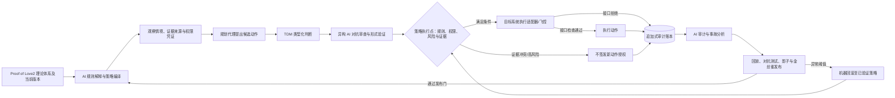
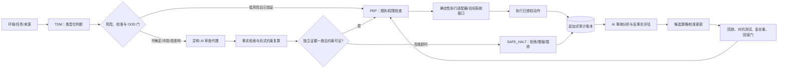
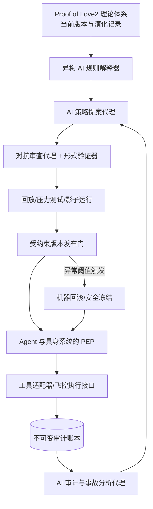
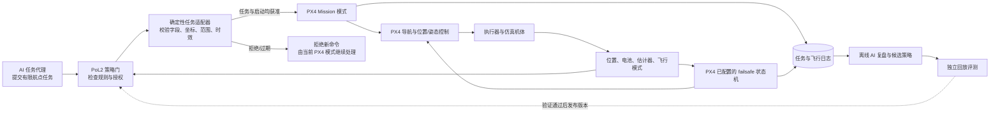

# Proof of Love2 具身治理框架：从理论演化到行动闭环（V2 草案）

**框架简称：** PoL2-EG（Proof of Love2 Embodied Governance）

**核心术语：** Proof of Love2；Typed Decision Model（TDM，类型化决策模型）；AI 执行的治理（governance by AI）

> **范围声明**：本方案不设置人工复核、人工批准、人工接管、人工申诉裁决或人工规则更新。治理判断、规则解释、策略变更、运行时授权、审计和纠错均由相互制衡的 AI 组件完成。外部人类活动可以作为环境事实或任务输入被系统读取，但人类不作为治理角色参与决策。

本文提出 Proof of Love2 具身治理框架（PoL2-EG）。Proof of Love2 是框架的完整理论基础，并允许继续演化；PoL2-EG 则描述该理论如何被解释为可执行策略、如何约束具身 Agent 的任务授权与动作，以及如何依据运行证据提出受控更新。本文所称“全 AI”限定为治理职能不设置人工决策节点，不意味着由生成式模型直接承担实时飞控，也不表示该架构已在真实高影响系统中验证。

## 摘要

PoL2 治理面向会改变外部状态的 Agent 操作。本文将 TDM 用于有限动作集的判断，将权限检查和动作执行交给独立组件，并用运行日志驱动受约束的策略更新。系统不设置人工决策节点。遇到不确定输入、规则冲突或组件故障时，策略执行点按预设规则限缩、拒绝或暂停动作。

规则解释、动作授权、策略更新、执行和审计属于不同权限域。实现上应把策略执行点与具体工具或飞控的执行接口分开，并记录各 AI 代理的模型版本、数据来源、权限及故障依赖。代理间的一致意见不能单独证明事实或授权动作。

已有工作分别研究了 AI 反馈训练、多智能体调节和运行时策略拦截。现有证据尚未覆盖由 AI 执行全部治理职能的真实高影响系统。本文因此把 PoL2-EG 作为架构提案和研究问题，并区分已验证的组件与尚待验证的端到端闭环。

## 1. 先例核验：哪些部分有证据，哪些仍是空白

| 先例 | 已展示的机制 | 对 PoL2 的可借鉴部分 | 不能据此声称 |
|---|---|---|---|
| Constitutional AI / RLAIF（Bai et al., 2022） | 模型按一组原则自我批评、修订，并用 AI 反馈训练偏好模型；不需要逐条人工危害标签 | AI 之间可以承担批评、比较、反馈与训练信号生成 | 治理原则本身由 AI 自主合法地产生；系统能安全治理外部行动；完全没有人类前置设定。论文明确仍使用给定原则 |
| Constitutional AI 的原则泛化研究（Kundu et al., 2023） | 检验模型能否从一般原则推广到具体行为，并比较原则表述粒度 | 可研究原则到具体决策的解释模块与规则覆盖率、过度拒绝之间的关系 | 模型对原则的解释稳定、无偏或具有最终授权资格 |
| ARDE（AAAI 2026） | 外层调节代理读取群体指标并产生治理信号，内层代理据此调整策略；在众包平台数据/环境中评估 | 分层的“治理代理—行动代理”架构和指标反馈 | 完整的 AI 执行治理。研究场景是平台调节，不等于 AI 独占规则来源、权利救济和现实责任 |
| DAO-AI（2025 预印本） | Agent 读取链上提案及历史资料并独立给出投票立场，评估其与既有投票结果的一致程度 | AI 可处理提案、检索历史并生成可审计的治理信号 | DAO 已由 AI 独立治理；其任务是复现/比较现有人类与代币投票，而非取消人类治理主体 |
| Governance by Construction for Generalist Agents（ACM CAIS 2026 demonstration） | CUGA 在 Agent 执行图多个阶段实施策略拦截；高风险工具调用包含等待人工确认的 Tool Approval 门 | 可借鉴执行链内的策略拦截、分层策略和可审计接口 | 这是含人工审批的企业 Agent 演示，不是无人工决策节点的治理先例；本方案只借鉴其运行时拦截模式 |

评估此方案时应区分三个层次：组件是否有效，集成原型能否在仿真或沙箱中工作，以及完整系统能否在真实环境中长期运行并自行检测、纠正治理错误。目前引用的工作主要提供组件或局部集成证据，尚未证明第三层能力。

本文所说的“AI 执行的治理”，指治理职能由 AI 组件承担；物理执行器、密码学基础设施、飞控和形式验证器仍可采用确定性软件或硬件。它们按授权策略进行验证或执行，不因此成为理论解释或治理决策主体。Proof of Love2 是完整的治理理论体系，其条款、解释和适用版本可以继续演进。每次动作和策略变更都必须记录所依据的理论版本。系统可以读取环境观测和任务事实，但外部输入本身不构成规则变更或权限凭证。

RSI（recursive self-improvement，递归自我改进）通常指 AI 系统反复改进自身能力，并利用改进后的能力继续改进。该术语不适合作为 PoL2-EG 的总名：本框架还涵盖规则解释、行动授权、机器执行边界、审计和事故处置。RSI 可用于描述能力层面的递归改进；对于本框架中的治理理论或策略更新，本文使用“受约束的理论/策略演化”，并要求版本化测试、分阶段发布和自动回滚，不将其等同于无边界的自我改进。

## 2. 治理对象：有后果的行动请求

Agent 和具身系统可读取数据、发送消息、改文件、调用 API、交易或移动。PoL2 网关必须位于所有具有外部后果的工具调用与动作命令路径上。每个请求至少记录：

| 字段 | 内容 |
|---|---|
| 主体与权限 | Agent 身份、权限凭证、凭证范围和失效时间 |
| 目标与动作 | 读取、写入、发送、购买、移动或状态变更及参数 |
| 上下文来源 | 传感器、规则库、工具返回、用户任务等来源及可信级别 |
| 影响与可逆性 | 受影响对象、影响半径、可逆性、潜在损失 |
| 适用规则 | Proof of Love2 理论版本、应用策略版本、规则优先级和适用范围 |
| 决策证据 | TDM 输出、独立审查结果、形式检查和事实引用 |
| 执行结果 | 实际状态变化、失败代码、回滚/补偿动作和审计链指针 |

**图 1. PoL2-EG 治理闭环。** AI 代理解释 Proof of Love2 的适用条款、评估动作并分析事故；策略执行点检查授权，具体执行和失效响应由工具适配器或飞控按其接口与配置处理。审计结果可触发规则或策略更新，更新经过回放、对抗测试和分阶段部署后生效。图中展示的是待验证架构。

## 3. PoL2-EG 的职责分解

| AI 角色 | 输入 | 输出 | 禁止权限 |
|---|---|---|---|
| 任务/规划代理 | 目标、环境状态、能力描述 | 候选动作及预期结果 | 不得自行授权或改规则 |
| TDM 判断代理 | 类型化问题、候选动作、证据引用 | 类别、排序、概率/置信、拒答状态 | 不得把分数当权限，不得直接执行 |
| 理论解释代理 | Proof of Love2 当前版本、应用策略、上下文 | 规则适用理由、冲突项、条款引用 | 不得单独发布新版本 |
| 对抗审查代理 | 原提案、独立证据、风险清单 | 反例、攻击面、替代解释 | 不得与被审查代理共享唯一推理路径 |
| 形式验证器/政策编译器 | 结构化规则、权限类型、版本约束 | 可执行策略、证明/检查结果 | 不得绕过 Proof of Love2 规定的规则与权限约束 |
| 授权执行点（PEP） | 策略、凭证、请求和验证结果 | 允许、限幅、拒绝、暂停 | 不得依据自由文本或模型分数越权 |
| 飞控与机载失效保护（PX4） | 任务/航点、机载状态估计、传感器和电源状态 | 航迹跟踪、姿态/角速度控制、执行器输出及已配置的失效模式切换 | 不解释 Proof of Love2；不接收自由文本或未经校验的模型输出 |
| 审计与事故代理 | 追加式事件账本、结果信号 | 归因、异常、反事实和复盘报告 | 不得删除或重写原始轨迹 |
| 规则提案与版本代理 | 复盘证据、Proof of Love2 理论体系、影响分析 | 候选变更、测试结果、版本提案 | 不得跳过对抗评估、回放、延迟生效与回滚门槛 |

代理间的独立性取决于模型家族、数据、工具权限、检索源、共享依赖和故障域，不能只靠更换角色提示词。关键审查路径应采用异构模型、独立实现或形式工具，并通过消融实验测量错误相关性。若审查代理共享同一模型、语料和提示注入路径，它们的一致意见仍可能来自共同偏差。

### 3.1 决策状态机

将原有 `allow / repair / block / clarify / review` 改为机器可执行的状态，不保留 `review` 作为人工队列：

| 状态 | 含义 | 系统动作 |
|---|---|---|
| `ALLOW` | 权限、规则、证据与安全条件全部满足 | 在批准参数范围内执行并记账 |
| `CONSTRAIN` | 请求可通过缩小任务范围或参数满足策略条件 | 生成受约束请求，再由 PEP 和目标系统接口校验；不声称该检查证明物理安全 |
| `REPAIR` | 输入/状态可由受信数据源自动补全或纠正 | 重建上下文并重新评估；限定重试次数 |
| `DEFER` | 不确定、证据冲突、分布外或模型分歧 | 不执行有后果动作；请求独立机器代理补证/复算；超时转 `SAFE_HALT` |
| `BLOCK` | 违反 Proof of Love2 规则、权限或硬约束 | 拒绝并记录条款、证据与版本 |
| `SAFE_HALT` | 关键组件失效、审计链中断、约束不可判定或风险阈值越界 | 治理端停止签发新请求。已启动的设备动作是否停止，取决于设备能否检测到相应失效及其预设处置；未验证前不得把 `SAFE_HALT` 映射为悬停、返航、降落或停桨 |

高风险或不可逆动作采用默认拒绝（fail closed）。独立证据链、规则检查和形式安全条件全部通过后，策略执行点才放行动作。不确定时，系统限缩、暂停或进入安全状态。评估需同时报告误停率、可用性损失和恢复条件。

## 4. Proof of Love2 的演化与版本治理

Proof of Love2 是完整的治理理论体系，并可在 AI 治理流程中继续演进。每次决策绑定当时生效的理论版本、应用策略和模型版本。理论更新属于治理状态变更，须记录变更依据并经过版本验证。

AI 规则更新代理可根据运行日志、环境变化和经验证的失效模式提出修改。理论解释代理分析变更与现有条款的关系；异构对抗代理寻找冲突、漏洞和不利后果；形式验证器检查新旧版本的权限边界及安全性质；评估代理在固定回放集、压力场景和反事实场景中比较版本表现。各代理提交的证据、分歧和测试结果都进入追加式版本账本。

候选版本按以下顺序部署：

1. 生成带有变更原因、影响范围和版本差异的候选版本。
2. 执行条款一致性检查、权限边界检查、历史回放和对抗测试。
3. 在影子模式下并行评估新旧版本，记录会改变的授权结果。
4. 通过机器发布门后，在限定场景中金丝雀部署，再逐步扩大适用范围。
5. 若监测到安全性质被破坏、合法任务损失超阈值或审计链异常，自动退回最近通过验证的版本，并暂停相关更新。

版本流程让理论更新与运行时授权保持可追溯关系。版本哈希用于确认决策依据和历史变更；每个新版本仍需评估条款语义及其对系统行为的影响。

## 5. TDM 与语言模型：不设人工复核的条件路由

TDM 适合有限候选、格式明确、响应成本敏感的判断；LLM 适合检索、解释、生成反例和处理语义歧义。两者都只是治理组件，均不单独拥有授权权。建议的机器内路由如下：

**图 2. AI 内部条件路由。** 对高不确定或高影响请求，异构审查代理提供第二条机器分析链。代理意见不作为事实真值；无法消除分歧时，系统限缩或停止动作。

| 任务类别 | TDM 的角色 | PoL2-EG 后续控制 |
|---|---|---|
| 低影响、候选有限、重复任务 | 初筛/排序 | 任务域校准、漂移监控、机器抽样审计 |
| 语义复杂或证据来源冲突 | 给出不确定性与候选 | 异构审查代理检索、反例生成、来源交叉验证；无法解决则 `DEFER` |
| 高影响、不可逆、涉及第三方 | 提供辅助信号 | 双独立推理链、形式权限检查、限制幅度；任一条件失败即 `SAFE_HALT` |
| 机器人连续控制 | 只在任务级给出候选；不进入实时控制循环 | 使用具体平台已实现且已测试的控制与失效功能；若另加安全过滤器，单独验证动力学假设、时限和故障切换 |

可靠性按任务域、输入分布、模型版本和阈值分别报告。校准集和封存测试集用于固定评估；新场景使用可验证仿真、规则性质或多源机器证据。AI 生成的标签可作为候选监督，不能用于证明生成标签的模型正确。异构模型、独立数据和反事实扰动可用于估计共同偏差；模型间一致性本身不是独立证据。

## 6. 去中心化自治：AI 之间的治理权结构

| 治理层 | PoL2-EG 职能 | 主要制衡 |
|---|---|---|
| 理论解释层 | 多个解释代理按 Proof of Love2 当前适用版本分析情境 | 条款引用、语义冲突显式化、不同模型家族交叉解释 |
| 策略层 | 提案代理生成应用策略与变更 | 反方代理、形式化检查、版本差异和公开机器可读日志 |
| 运行层 | PEP 按凭证、范围、上下文和策略作授权 | 最小权限、目标系统接口校验、默认拒绝 |
| 审计层 | 事故代理检查行动轨迹、偏差与系统性外部性 | 追加式账本、随机种子/输入留存、独立实现复算 |
| 更新层 | 版本代理按发布门槛更新或回滚理论与策略 | 影子/金丝雀、版本签名、可验证的回滚路径 |

**图 3. PoL2-EG 治理权分层。** 理论解释、策略提出、独立审查、版本发布和运行时授权由不同 AI 组件承担；审计结果可触发演化提案，新版本须通过测试门并支持回滚。

系统不设置逐案人工表决。传感器和外部数据源将活动、影响和环境变化转成事实事件，再由 AI 组件复算、限缩或暂停动作。缺少可靠数据或无法评估外部影响时，策略执行点停止相关动作。

身份与女巫攻击、模型供应链、密钥轮换、代理串谋、审计账本可用性、跨系统凭证和灾难恢复仍是工程问题。多代理结构本身不保证去中心化：若同一运营者可控制模型、策略签名密钥、执行器和日志存储，治理权仍然集中；需要把信任根、密钥和故障域纳入威胁模型。

## 7. 具身智能的任务级治理与机器控制边界

机器控制不是把规划模型放进飞行控制回路。PoL2 在本 Demo 中只对任务和任务变更作授权；PX4 负责已实现的导航、位置/姿态控制和执行器输出。AI 代理不生成电机命令，也不承担实时避障或飞行稳定性保证。

| 控制层 | Demo 中的职责 | 不在首版范围内 |
|---|---|---|
| 任务代理（AI） | 提交有限任务提案，如执行一份航点任务、暂停、请求返航 | 直接发布连续位置/速度/姿态/电机 setpoint |
| PoL2 策略门与适配器 | 校验身份、策略版本、动作类型、坐标/高度/速度范围、状态时间戳和任务包络；拒绝或交付获准任务 | 自行证明飞行轨迹安全；替代飞控的状态估计或失效保护 |
| PX4 飞控 | 执行获准任务，运行机载导航和控制器，并按配置处理电池、定位、围栏等失效 | 解释 Proof of Love2 或审查自然语言目标 |
| 仿真环境与审计 | 记录任务、PX4 模式转换、轨迹、越界和故障注入结果 | 将仿真结果表述为实机安全证据 |

首版优先使用 PX4 Mission 模式：AI 提交有限航点任务，适配器在上传前校验坐标系、字段、航点数量、地理范围和允许的 mission command 清单；仅获准的任务包可上传，开始任务也作为独立动作检查。MAVSDK Mission API 可用于上传、启动、暂停和读取进度，但只覆盖 MAVLink Mission 命令的一个子集；首版将允许命令进一步收窄到验证过的航点任务，起飞、返航、降落等其他命令须另设接口和授权规则。首版验证的是“任务提交前的授权门”，不是飞行期间连续由 AI 审查每个控制周期。每份任务应限制航点数量、空间包络，并通过仿真测量活动时长；已上传任务可以在连接断开后继续执行，因此“AI 服务断开”不能被等同于“飞行器自动停止”。若要实现授权到期即中止，必须额外实现并验证飞控侧可感知的到期/链路失效条件；MAVSDK Mission 接口本身不提供 PoL2 授权租约。首轮必须实测所选 MAVLink 连接是否触发 PX4 配置的 data-link failsafe，以及触发后的模式和时延。这个方案避免让语言模型进入周期性 setpoint 流，也不要求 PoL2 判断代理承担飞行控制时限。offboard 则要求外部控制端持续发送存活信号，并在断流后按参数进入配置的失效模式。[PX4 多旋翼 Mission 模式](https://docs.px4.io/v1.17/en/flight_modes_mc/mission) · [PX4 Offboard 模式](https://docs.px4.io/v1.17/en/flight_modes/offboard) · [MAVSDK Mission API](https://mavsdk.mavlink.io/main/en/cpp/guide/missions.html)。

**图 4. 任务授权与飞控分层。** PoL2 门和任务适配器控制哪些任务能提交；PX4 执行航点、低层控制与已配置的失效处置。图中没有独立的通用“安全内核”：若要加入安全过滤器，必须另行实现、验证其模型假设、计算时限和失效切换条件。

PX4 的围栏 failsafe 在越界后触发，不能代替上传前的路径/任务校验；PX4 文档建议围栏边界为多旋翼留出制动距离和状态估计误差余量。因而 Demo 应把任务适配器的静态包络校验与 PX4 的机载围栏分别记录、分别测试，不把其中任何一项称为“保证不越界”。[PX4 v1.17 安全与失效配置](https://docs.px4.io/v1.17/zh/config/safety)。

### 无人机 Demo 的实施范围

| 阶段 | 实现 | 可以回答的问题 | 不能据此声称 |
|---|---|---|---|
| 1. SIH 自动回归 | PX4 SIH + 任务适配器；批量测任务提案允许/拒绝、数据过期和状态转换 | 策略门与 PX4 命令接口是否按契约工作 | 视觉感知、复杂空气动力或真实传感器噪声已经验证 |
| 2. SITL 端到端仿真 | PX4 SITL + Gazebo Harmonic 的 `x500`；固定世界与航点，注入围栏、低电量、估计器/链路故障 | 任务上传、PX4 模式切换、轨迹与日志是否可复现 | 已证明现实环境安全或 AI 能可靠避障 |
| 3. 受控 HITL（后续） | 在目标飞控硬件上运行 PX4，以仿真传感器/环境闭环；仅当 SITL 问题收敛后启动 | 硬件时序、通信和固件集成中的问题 | HITL 等同实机飞行验证 |
| 4. Offboard（后续可选） | 仅当确有在线轨迹更新需求时，另立阶段实现连续 setpoint、存活检测与 `COM_OF_LOSS_T`/`COM_OBL_RC_ACT` 失效测试 | 外部控制链路抖动/中断时配置的 PX4 行为 | ROS 2 或 companion computer 天然满足硬实时 |

PX4 v1.17 提供 SIH 无头仿真和 Gazebo Harmonic SITL 的预构建包，均可按 PX4 版本固定；SIH 用于大批量逻辑回归，Gazebo 用于带 3D 环境的端到端接口测试。对 Windows 开发环境，可先评估官方容器方案和 WSLg 显示路径，再决定是否需要完整本地 PX4 编译环境。[PX4 预构建 SITL 包](https://docs.px4.io/v1.17/en/simulation/px4_sitl_prebuilt_packages) · [PX4 SIH](https://docs.px4.io/v1.17/en/sim_sih/) · [PX4 Gazebo SITL](https://docs.px4.io/v1.17/en/sim_gazebo_gz/index)。

首轮只自动化四类场景：合法航点任务；包含围栏外航点或不允许命令的任务（上传前应被适配器拒绝）；过期/缺失状态下的新任务请求；在 PX4 SITL 中触发并验证已配置的低电量、定位或链路失效处置。另需测量适配器进程退出、MAVLink 断开、已上传任务继续执行等不同故障注入条件；不要假设它们触发同一 failsafe。动态障碍绕行、视觉语言模型、多机避碰和自动在线改写生效策略不纳入首版。围栏 failsafe 需要越界后才动作，仿真结果应区分“策略门提前拒绝”和“PX4 机载 failsafe 事后处置”。

首轮指标限于可观测实现行为：任务校验通过/拒绝及原因、非法任务拦截率、合法任务保留率、PX4 飞行模式转换、围栏穿越次数、失效触发到模式切换的时延分布、任务完成率和日志完整率。不要把 TDM 置信度或多个模型意见一致当成安全指标。已有 UAS 运行时保证研究采用 Simplex/RTA 思路：监测器在高级但未充分验证的控制器将违反安全性质前，切换到可信备用控制器；NASA 的工作还把监测器、触发条件和 UAS 操作性质纳入形式化验证。它是后续安全过滤研究的工程先例，不是当前 PX4/MAVSDK 方案已经具备的功能。CBF/QP 过滤器同样应作为单独研究工作：需要明确动力学模型、状态误差界、控制输入约束、可行性条件及最坏执行时延；论文中的安全保证仅在这些条件成立时适用。[NASA UAS 运行时保证框架](https://ntrs.nasa.gov/citations/20240007986)。ROS 2 可用于集成，但使用 ROS 2 本身不建立硬实时保证；若 offboard 进入后续阶段，必须测量端到端延迟、抖动和丢包，并说明调度与执行器配置。[ROS 2 Real-Time Programming](https://github.com/ros2/ros2_documentation/blob/rolling/source/Capabilities/Motion-planning/Real-Time-Programming.rst)。

## 8. NaturalDAO 现有材料如何承接

| 已有材料/机制 | V2 中的位置 | 需要补齐 |
|---|---|---|
| EAP 与 Proof of Love2 条款 | 治理理论依据与版本化解释规则 | 机器可读条款、冲突优先级、版本差异与适用范围 |
| `conforming / violating / insufficient` | 判断代理的三态输出 | 将 `insufficient` 路由到 `DEFER/SAFE_HALT`，不得进入人工队列 |
| `allow / repair / block / clarify / review` | 旧处置接口 | 移除 `review`，改为 `ALLOW / CONSTRAIN / REPAIR / DEFER / BLOCK / SAFE_HALT` |
| 质询解释与追加式哈希决策链 | 机器审查证据与事件账本 | 确保代理身份、模型版本、来源和策略签名可校验；哈希只证明未改动，不证明事实或价值正确 |
| DAO Governance Lab | AI 代理间提案、质疑、反例生成的流程原型 | 当前 Python 原型/模拟不能证明多代理现实自治或公平 |
| 正式评测器 fixtures | 回归与合成验证 | 补充物理后果、攻击轨迹、AI 共因失效、自动恢复与误停指标 |

这些工作区可作为原型基础。现有模拟投票和合成 fixtures 尚未验证 PoL2-EG；PoL2 运行时集成、策略更新门和事故闭环需要实现后再评估。

## 9. 可检验的研究问题与贡献

### 研究科学问题

> 在不设置人工复核、人工批准或人工规则更新的条件下，如何将可演进的 Proof of Love2 理论体系映射为多 Agent 可执行的策略，并通过异构 AI 审查、运行时约束、版本审计和自动回滚，使工具型或具身 Agent 的行动保持在可测量的授权范围内？

该问题把理论解释、策略更新、动作授权和执行控制纳入同一评估范围。实验需分别测量规则覆盖、代理错误相关性、约束执行率、版本更新效果、回滚能力和合法任务保留率。

### 三项研究贡献

1. **治理架构**：定义无人工复核的职责分离、多代理制衡、默认拒绝和自动回滚协议。
2. **评估方法**：建立不依赖人工标签的事实/形式约束评测、共因失效测试和 AI 审查分歧报告；明确其不能证明规范正当性的边界。
3. **行动级证据**：在工具 Agent、模拟器和受控具身任务中评估完整状态变化、安全停机和合法任务损失，而非只报告分类准确率。

### 主要失效模式

| 失效 | 结果 | 必须具备的控制 |
|---|---|---|
| 多个代理共享偏差 | 一致地错误解释规则 | 异构模型/数据、形式性质、独立复算与分歧压力测试 |
| 规则更新被投毒 | 权限包络被逐步放宽 | 版本差异约束、独立对抗测试、延迟发布、影子运行、自动回滚 |
| 审计链与执行路径同源 | 错误被隐藏或伪造 | 分离写入权限、追加式存储、外部时间戳/签名与故障域隔离 |
| 不确定时继续行动 | 低概率误判造成高后果 | `DEFER/SAFE_HALT`、默认拒绝、限制恢复条件 |
| 安全停机过于频繁 | 合法服务不可用 | 报告误停和恢复成本，按任务风险调整授权范围，并持续检查规则符合度 |
| 理论条款与新情境冲突 | 不同代理给出相反解释或缺少可验证证据 | 保留各版本和解释依据；在候选更新验证完成前限制相关动作 |

## 参考资料

### NaturalDAO 一手材料

1. [NaturalDAO PoL2 理论文档与伦理对齐协议](https://github.com/naturaldao/NaturalDAO/tree/main/PoL)
2. [PoL2 治理层规范、数据契约与评测器](https://github.com/naturaldao/NaturalDAO/tree/main/PoL-Governance)
3. [PoL2 DAO Governance Lab：治理原型、实验设计与结果](https://github.com/naturaldao/NaturalDAO/tree/main/PoL-Governance/research/PoL2-DAO-Governance-Lab)
4. [类型化决策模型文献综述工作区](https://github.com/naturaldao/NaturalDAO/tree/main/PoL-Governance/research/PoL2-Jev-Typed-Literature-Survey)
5. [NaturalDAO 运行时集成说明](https://github.com/naturaldao/NaturalDAO/tree/main/PoL-Governance/integrations)

### AI 反馈与 AI 治理先例

6. Bai et al. (2022). [Constitutional AI: Harmlessness from AI Feedback](https://arxiv.org/abs/2212.08073), arXiv:2212.08073.
7. Kundu et al. (2023). [Specific versus General Principles for Constitutional AI](https://arxiv.org/abs/2310.13798), arXiv:2310.13798.
8. Zhang et al. (2026). [Adaptive Regulation via Dual-Layer Evolution (ARDE)](https://doi.org/10.1609/aaai.v40i46.41314), Proceedings of AAAI 2026, 40(46), 39620–39627.
9. Han et al. (2025). [DAO-AI: Evaluating Collective Decision-Making through Agentic AI in Decentralized Governance](https://arxiv.org/abs/2510.21117), arXiv preprint.
10. [Governance by Construction for Generalist Agents](https://doi.org/10.1145/3786335.3813192), Proceedings of the ACM Conference on AI and Agentic Systems (2026).

### 运行时治理与具身控制

11. Lan et al. (2026). [From Detection to Decision: Calibration and Deferral for Prompt-Injection Detection](https://arxiv.org/abs/2610.20907), arXiv preprint.
12. Wu et al. (2026). [Poisoned into Action: Context Attacks on Typed Decision Workflows](https://arxiv.org/abs/2610.15537), arXiv preprint.
13. Kekatos et al. (2026). [Formal Runtime Verification for Tool-Using LLM Agents](https://arxiv.org/abs/2610.09793), offline trace study, arXiv preprint.
14. Hu et al. (2026). [Jev-Guard: Fast Routing and Auditing Agent Actions over Editable Policy Trees](https://arxiv.org/abs/2610.18326), arXiv preprint.
15. Debenedetti et al. (2025). [Defeating Prompt Injections by Design](https://arxiv.org/abs/2503.18813) (CaMeL); [implementation](https://github.com/google-research/camel-prompt-injection).
16. Ahn et al. (2022). [Do As I Can, Not As I Say](https://arxiv.org/abs/2204.01691) (SayCan).
17. Ames et al. (2019). [Control Barrier Function Based Quadratic Programs for Safety Critical Systems](https://arxiv.org/abs/1903.11199).
18. [OpenJev](https://github.com/alanhuangyoo/OpenJev): open weights and local inference for typed decisions; repository-reported benchmarks and licensing boundaries require separate verification.
19. [PX4 Simulation](https://docs.px4.io/v1.17/en/simulation/index)；[Gazebo SITL](https://docs.px4.io/v1.17/en/sim_gazebo_gz/)；[预构建 SITL 包](https://docs.px4.io/v1.17/en/simulation/px4_sitl_prebuilt_packages)；[ROS 2 Offboard 控制](https://docs.px4.io/v1.17/en/flight_modes/offboard)；[Simulation in Hardware (SIH)](https://docs.px4.io/v1.17/en/sim_sih/)。
20. NVIDIA Isaac Sim: [ROS 2 Bridge](https://docs.isaacsim.omniverse.nvidia.com/5.1.0/installation/install_ros.html) and [Sensors](https://docs.isaacsim.omniverse.nvidia.com/5.1.0/sensors/index.html).
21. IAMAI, [Project AirSim](https://github.com/iamaisim/ProjectAirSim): simulator repository and implementation documentation.
22. [AnyJev](https://github.com/nokia-applied-research/AnyJev): open implementation for producing typed decisions from language-model outputs.
23. PX4: [Multicopter Mission Mode](https://docs.px4.io/v1.17/en/flight_modes_mc/mission)；[Offboard Mode](https://docs.px4.io/v1.17/en/flight_modes/offboard)；[安全/失效配置](https://docs.px4.io/v1.17/zh/config/safety)。
24. NASA, [A Verification Framework for Runtime Assurance of Autonomous UAS](https://ntrs.nasa.gov/citations/20240007986), DASC 2024.
25. ROS 2 Documentation, [Real-Time Programming](https://github.com/ros2/ros2_documentation/blob/rolling/source/Capabilities/Motion-planning/Real-Time-Programming.rst).
26. MAVSDK, [Missions Guide](https://mavsdk.mavlink.io/main/en/cpp/guide/missions.html): upload, start, pause, and track mission plans; uploaded missions may continue if the connection is lost.
27. Stanford HAI, [What is Recursive Self-Improvement (RSI)?](https://hai.stanford.edu/what-is-recursive-self-improvement): definition of RSI as iterative improvement of an AI system's own capabilities.
28. Kleiner (2026). [Governance of AI and by AI: Feedback Loops, Regime Variation and Reflexive Polycentric Control](https://doi.org/10.1111/1758-5899.70177), *Global Policy*, 17(3), 500–505.
