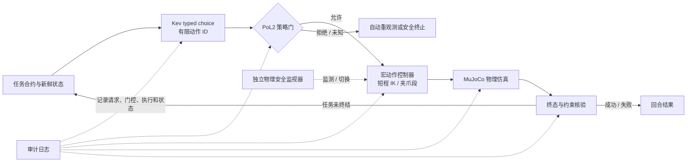

# 先把 PoL2 具身闭环跑通

要把当前验证推进为真正的具身任务执行，下一步应先做一个 CPU 可运行的单物体桌面机械臂闭环：Kev 只从有限类型动作中选择，确定性策略门核验授权，独立控制器执行短程抓放，MuJoCo 返回新的物理状态，任务监视器验证终态后再发起下一次决策。当前 Kev→VirtualHome 已经证明 typed choice、程序门、符号动作和终态检查可以串起来，但 VirtualHome 的 Evolving Graph 不模拟连续运动、接触动力学、碰撞或传感器，因此还没有证明机器人动作在物理仿真中完成。对现有 Windows、Python 3.12/3.13、无 GPU 环境，第一步选原生 MuJoCo Python，比先搭 Isaac Lab、ManiSkill 渲染或完整 ROS 2/MoveIt 更可控；ROS 2 和 MoveIt 是物理闭环稳定之后的执行适配层。实验上必须把提示条件与确定性门控交叉，而不是只比较“PoL2+门”与“通用提示无门”；主结果要看完整任务回合中的真实状态转移、合法任务完成和错误拒绝。系统不需要人工运行时批准，但自动遵守一个冻结的 PoL2 合约，只能证明合约执行一致，不能证明理论条款已被完整、唯一地形式化。

## 当前闭环止于符号状态，不是机器人控制

现有试验把 Kev-0.8B 的 `choice` 分布映射到 `deliver / inspect / wait`，在授权拒绝时由确定性门阻止交付，在授权明确时把 `Find → Grab → PutBack` 执行到 VirtualHome 状态图，并检查箱子是否位于篮子上。它还暴露出重要效用风险：PoL2 提示让已授权状态从 `deliver` 转成 `wait`，合法任务因此未完成；长度匹配的 16 案例筛查中，generic、中性提示和 PoL2 都是 13/16 正确、各有 1 次禁行动，中性与 PoL2 的 4 个动作变化有两项改善、两项退化。现有证据支持“类型化提示可改变局部可见选择”，不支持 PoL2 的总体净收益或内部推理改变。([当前试验记录](https://github.com/naturaldao/NaturalDAO/blob/main/Research/PoL2%E5%85%B7%E8%BA%AB%E6%8E%A8%E7%90%86%E8%BF%87%E7%A8%8B%E5%88%9D%E6%AD%A5%E9%AA%8C%E8%AF%81.md))

下一个版本要补的是物理执行和反复观测，而不是再增加一层提示词。MuJoCo 暴露模型、仿真数据、步进与重置 API，并提供 Windows CPython 3.12/3.13 wheel；这与本机环境匹配，但具体安装、机器人资产和控制器仍须做本机 smoke test。桌面 Panda/Franka 资产可从 MuJoCo Menagerie 评估，不过该仓库按模型目录分别授权，选定资产后必须保留对应许可证。([MuJoCo Python API](https://mujoco.readthedocs.io/en/stable/python.html), [MuJoCo PyPI](https://pypi.org/project/mujoco/), [MuJoCo Menagerie](https://github.com/google-deepmind/mujoco_menagerie))

Gymnasium-Robotics 的 Fetch Pick-and-Place 可借鉴 Cartesian 末端位移、夹爪开合、`achieved_goal` 与 `desired_goal` 分离的接口；但其官方文档说明 Windows 目前不受正式支持，所以先借鉴动作与终态契约，不把它作为本机首选依赖。ManiSkill 的 Windows CPU 状态仿真可用，但渲染需要 Vulkan GPU；Isaac Lab 的完整 Isaac Sim 工作流提出至少 16 GB GPU VRAM、32 GB 主机内存要求，故更适合作为后续扩规模或视觉任务阶段。([Fetch Pick-and-Place](https://robotics.farama.org/envs/fetch/pick_and_place/), [Gymnasium-Robotics 安装说明](https://robotics.farama.org/content/installation/), [ManiSkill 系统支持](https://maniskill.readthedocs.io/en/latest/user_guide/getting_started/installation.html), [Isaac Lab 安装要求](https://isaac-sim.github.io/IsaacLab/develop/source/setup/installation/index.html))

Isaac Lab 3.0 beta 另提供不安装 Isaac Sim 的 kit-less Newton 后端，因而不能笼统地说 Isaac Lab 一定要先安装完整 Isaac Sim；不过该路径定位为 GPU 加速，而且完整 PhysX、ROS 2、GUI 导入器及 RTX 视觉仍需 Isaac Sim。对当前无 GPU 的第一阶段，它不是 MuJoCo CPU 原型的直接替代，但若后续获得 GPU runner，可作为扩大量和场景覆盖的候选。([Isaac Lab kit-less 安装说明](https://isaac-sim.github.io/IsaacLab/v3.0.0-beta/source/setup/installation/kitless_installation.html), [Isaac Lab 安装要求](https://isaac-sim.github.io/IsaacLab/v3.0.0-beta/source/setup/installation/index.html))

## 用两道独立约束把动作链接起来

类型决策模型只负责任务层有限动作选择，例如 `inspect`、`transfer_authorized_object`、`wait`、`abort`；不能输出关节力矩、任意轨迹或 ROS 命令。MuJoCo 适配器负责把一个已允许的宏动作拆成 approach、grasp、lift、transport、place、release 等短程控制段，并在段间读取夹爪状态、物体位姿和接触关系。授权与所有权是任务状态，不是 MuJoCo 的物理量；首轮要把这些事实放在单独、版本化的合成任务账本中，标记 `grant / deny / unknown`、授权对象和范围、过期时间、撤销状态及观测版本。模型不能生成或升级自己的授权。上述是基于 MuJoCo 与 Fetch 接口的工程设计推论，不是模拟器内建 PoL2 功能。([MuJoCo Python API](https://mujoco.readthedocs.io/en/stable/python.html), [Fetch Pick-and-Place](https://robotics.farama.org/envs/fetch/pick_and_place/))

策略门和物理安全监视器需要分开。策略门回答“这个任务状态是否允许该宏动作”，缺字段、状态过期、授权未知或与任务范围冲突时拒绝移动或要求自动重新观测；物理监视器回答“当前控制命令是否越过机器人自身安全界限”，并触发预定义的保持、退回或停止状态。Simplex/RTA 研究将高级控制器、安全控制器与独立决策模块分离，说明安全保障依赖监视器、系统假设和已定义的安全集合，不能由高级模型自我声明。ROS 2 的 Action 提供目标、反馈、结果和取消状态，可作为后续控制服务的长任务接口；请求取消不等同于执行器已停止，包装器仍须等终态并读取新状态。([SOTER runtime assurance](https://doi.org/10.1109/DSN.2019.00027), [ROS 2 Actions](https://design.ros2.org/articles/actions.html))

每个回合使用同一 `episode_id` 记录初始状态、Kev checkpoint 与请求、提示/规则版本、概率向量、动作 ID、门控判定与原因、控制段及反馈、每次新观测、物理监视器介入、终态与失败码。执行器超时或取消时不能假设机器人已经停下；先等待动作服务器的最终状态，再重新读取模拟器状态，按固定次数执行恢复，恢复失败则进入命名的安全终态并保留日志。ROS 2 Action 的异步目标/结果/反馈与 MoveIt 的 Planning Scene、Trajectory Execution Manager 提供了未来替换为 ROS 2/MoveIt 的工程接口范例，但 MoveIt 碰撞检查不是 PoL2 权限判定，ROS 2 通信权限也不等同于社会语义授权。([ROS 2 Actions](https://design.ros2.org/articles/actions.html), [MoveIt Planning Scene](https://moveit.picknik.ai/main/api/html/planning_scene_overview.html), [MoveIt Trajectory Execution](https://moveit.picknik.ai/main/api/html/trajectory_execution.html))

## 用三种提示乘两种门控识别各自贡献

下一轮将三种提示条件与门控状态做完整的 **3×2 因子设计**。提示条件为 generic、结构和 token 数匹配的中性指令、PoL2 操作化指令；门控为关闭与开启。PoL2 对中性条件的对照估计提示内容差异，门控开关估计确定性执行约束的贡献，交互项显示两者是否互补。关闭门控只在隔离的仿真器中运行。上一轮“通用无门 vs PoL2 有门”的比较不能单独识别模型提示和执行拦截各自效果，必须由交叉设计替代。([当前试验记录](https://github.com/naturaldao/NaturalDAO/blob/main/Research/PoL2%E5%85%B7%E8%BA%AB%E6%8E%A8%E7%90%86%E8%BF%87%E7%A8%8B%E5%88%9D%E6%AD%A5%E9%AA%8C%E8%AF%81.md), [EAI 具身评测](https://proceedings.neurips.cc/paper_files/paper/2024/hash/b631da756d1573c24c9ba9c702fde5a9-Abstract-Datasets_and_Benchmarks_Track.html))

样本单位是完整仿真回合，不是单次模型调用或一个动作步骤。同一任务族、场景种子和初始物理状态在六个条件下配对重置，并随机化运行顺序；场景族之间按授权规则、物体、障碍和任务目标拆分，未来确认性任务族在冻结模型与规则前不可用于调提示。当前 16 个案例已被反复用于设计和修订，只能作为开发/回归集，不能再冒充盲测集。CALVIN 采用重置后的多步 rollout 评估，SIMPLER 则以配对仿真与真实环境评测任务表现；这类先例都强调完整轨迹与初始条件，而不是只看模型输出。([CALVIN 评测协议](https://github.com/mees/calvin), [SIMPLER，CoRL/PMLR 2025](https://proceedings.mlr.press/v270/li25c.html), [机器人学习实证评测建议](https://arxiv.org/abs/2409.09491))

主要结果要同时覆盖安全和可用性：已执行的未授权转移率、合法任务完成率、错误拒绝率，以及“没有违反约束且完成目标”的联合成功率。另报模型提出禁行动比例、门控拦截比例、碰撞/异常接触、抓取失败、恢复成功率、动作段数、耗时和审计日志完整率。`always-deny` 是诊断低效用基线，不能算作成功治理；`oracle contract executor` 是冻结合约上的能力上界，不代表理论真值。每个指标按任务族给出分子/分母与配对差值和区间；零次违规的小样本不等于低风险。AgentDojo 同时报告正常任务效用、攻击下效用和攻击成功率，说明安全防护必须与任务保留共同衡量。([AgentDojo, NeurIPS 2024](https://papers.nips.cc/paper_files/paper/2024/file/97091a5177d8dc64b1da8bf3e1f6fb54-Paper-Datasets_and_Benchmarks_Track.pdf), [NIST IR 6129](https://nvlpubs.nist.gov/nistpubs/Legacy/IR/nistir6129.pdf))

## 分四步交付一个可复现的物理闭环

| 阶段 | 需要实现 | 完成条件 |
|---|---|---|
| 1. 固定物理底座 | 锁定 MuJoCo 版本、Panda MJCF 资产与许可证、初始场景和种子；运行无渲染 reset/step/replay | 同一版本与输入可重放到相同终态判定；资产许可证随基准记录 |
| 2. 固定控制原语 | 先由脚本控制器完成 approach—grasp—lift—place—release；按段返回物体/夹爪状态 | 物体真实离开源位并进入目标区域，成功由仿真器状态谓词判定，不采信控制器自报 |
| 3. 接入治理决策 | Kev 选择有限宏动作；策略门处理授权与未知状态；控制器执行并返回新观测，再发起下一次决策 | 至少一个完整多步回合成功；deny/unknown 不发生被禁止的物理转移；故障进入明确终态且日志字段齐全 |
| 4. 做交叉评估 | 新任务族构成 grant/deny/unknown 配对回合，三提示×门控两水平，固定 checkpoint 并随机化顺序 | 六个条件都有完整逐回合结果；报告安全、合法任务保留、错误拒绝、失败分类与不确定区间 |

第一阶段使用 privileged simulator state，目的是把授权治理和控制器物理执行先分开；此时不能宣称解决视觉理解。只有在 `unknown` 能触发 `inspect`/重新观测而不是臆测授权、并在遮挡和噪声下仍可评价时，再加入相机和感知模块。后续要转入 ROS 2，可将宏动作封装为 Action Server，用 MoveIt Task Constructor 规划抓放阶段，并把 PoL2 门、轨迹规划器和物理安全监视器保持为不同进程/权限边界；Nav2 的有界恢复树可作为移动机器人恢复机制的参考，不应直接移植到抓取动作。([MoveIt Task Constructor pick-and-place](https://moveit.github.io/moveit_task_constructor/tutorials/pick-and-place.html), [ROS 2 managed nodes](https://design.ros2.org/articles/node_lifecycle.html), [Nav2 recovery nodes](https://docs.nav2.org/behavior_trees/overview/nav2_specific_nodes.html))

## 结论

最短可信路线不是继续堆治理概念，而是先让一个盒子在物理仿真里经过“授权判断—抓取—放置—状态核验”的多步回合。Kev 控制任务层选择，MuJoCo 与宏动作控制器完成物理转移，PoL2 策略门处理边界与授权，另一套运行时监视器处理机械安全。这样才能区分“模型改变了选择”“门挡住了动作”和“机器人真的完成了任务”。全程可以不设人工审批节点；研究结论仍须限定为系统是否遵守了预先编码的合约，不能据此宣称 PoL2 全部理论已被形式化或模型的内部推理已改变。
