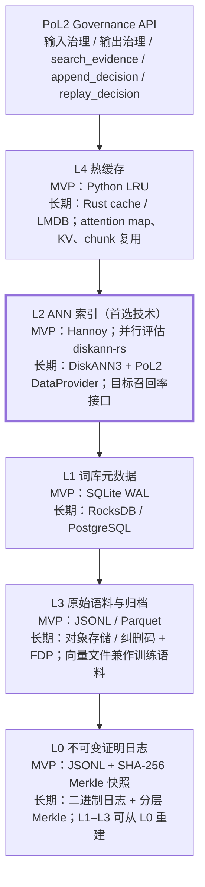

# PoL2 存储技术方案（Proposal）

2026-10-17

> 许可声明于 2026-10-20 统一更新为 Proof of Love2；下文 2026-10-17 的实测表格保留当时快照，不代表当前许可标识。此前已授予的 CC0 权限不因本次更新而撤销。

| 项 | 内容 |
| --- | --- |
| 文档类型 | 技术方案（Proposal）：含架构决策记录 ADR-001 与实施规格 |
| 状态 | Proposed |
| 决策人 | NaturalDAO / PoL2 存储工作流负责人 |
| 适用范围 | PoL2 Agent 层的理论库与知识词库存储；地面 MVP 与长期轨道部署两条线 |
| 引用约定 | 正文用 \[n\] 指向文末参考文献；\[1\]–\[12\] 为 GitHub 仓库，\[13\]–\[50\] 为 arXiv 论文。所有仓库事实和论文标题均于 2026-10-17 实测，核对记录见附录 A；论文正文中的实验数字未逐一复核，正文引用时标“摘要自述” |

## 1. 背景与目标

PoL2（Proof of Love 2）是大语言模型的治理层，对每次输入做需求/意图判定、对每次输出做幻觉/错误/仇恨言论拦截。它依赖一个维基百秋量级的理论库，以及由专门 Agent 在应用开发与使用过程中持续细化出的知识词库。本文档决定这个存储库的技术选型和第一版实施方案。

运行环境的约束：系统长期部署在地球轨道，自治运行，人类无物理接入；散热只能靠辐射，功耗预算紧；辐射导致位翻转与介质退化；该系统产生的数据将成为模型训练语料的主要来源。

这些需求落到存储系统上是六条可测的约束：

| # | 约束 | 含义 | 关键指标 |
| --- | --- | --- | --- |
| C1 | 读路径在每请求关键路径上 | 每次 LLM 调用背后 k 次语义检索（k 通常 3–30）+ 1 次判定，延迟直接叠加进 TTFT | 检索 P99、元数据路径 P99 |
| C2 | 写路径持续、增量、不可停机 | 词条由 Agent 持续生成，没有“重建索引窗口” | 并发插查下的 QPS 退化与 P99 |
| C3 | 判定可复算 | 任一拒绝/放行必须能重放为判定 = f(证据集, 词库版本, 规则版本, 模型版本) | 重放一致率 |
| C4 | 双用途语料 | 同一份字节既要顺序大带宽扫描（训练）又要随机低延迟查找（检索） | 向量文件与边表是否物理分离 |
| C5 | 轨道约束 | 每 GB 静态功耗、每瓦检索吞吐、写放大系数（WAF）直接等于寿命 | WAF、BER、常驻内存占比 |
| C6 | 威胁模型按设定 | 不引入加密、多租户隔离、TEE；真正要防的是介质损坏、判定不可复算、多 Agent 写入导致词库自相矛盾 | 词库自洽性 |

本文档不覆盖 PoL2 规则引擎本身、多模型仲裁算法和训练系统。

## 2. 决策

以 SSD 驻留、支持并发增量更新的图向量索引作为 PoL2 存储的检索内核，配声明式目标召回率接口；不自研向量索引算法，也不让向量索引承担证明日志职责。工程上分两条线：

- **MVP（地面原型）**：Hannoy \[3\]（LMDB HNSW，Python 绑定）作索引后端，SQLite WAL 作元数据，JSONL 追加日志 + SHA-256 Merkle 快照作证明日志；FreshDiskANN baseline \[2\] 作增量写入与 WAF 基线；diskann-rs \[4\] 与 Hannoy 并行评估。
- **长期（轨道部署）**：Microsoft DiskANN3 \[1\] disk provider + 自定义 PoL2 `DataProvider`，RocksDB/PostgreSQL 元数据，二进制追加日志 + 对象归档，Parquet/纠删码语料层。

核心工程价值放在“检索引擎 + 词库治理 + 不可变判定记录”三者的结合上；第一项工程任务是定义 `IndexBackend`、`MetadataStore`、`EvidenceLog` 三个抽象，使治理协议不被任何一个 ANN 实现锁死。

## 3. 高层设计

存储分五层，每层单独演进；第 1 节的六条约束分别由不同的层承接。



### 3.1 各层职责

| 层 | 职责 | 承接约束 | 依据 |
| --- | --- | --- | --- |
| L0 不可变证明日志 | 理论原文、词条版本、判定记录、快照指纹；L1–L3 的派生物全部可从 L0 重放重建 | C3、C6 | — |
| L1 词库元数据 | entry\_id → 版本、状态、标签、链接、时效；同时支持 range query 与随机 get | C1、C6 | KV cache 元数据访问模式分析 \[18\] |
| L2 ANN 索引（首选技术） | SSD 驻留图索引；向量文件与边表文件物理分离；目标召回率接口；标签/多向量/时新性过滤 | C1、C2、C3、C4 | FreshDiskANN \[13\]、NAVIS \[14\]、VADER \[15\]、FCVI \[20\]、MV-HNSW \[21\]、TANGO \[22\] |
| L3 原始语料与归档 | 理论原文、词条内容、原始向量；向量文件兼作训练语料；长期用纠删码 + FDP 放置提示 | C4、C5 | TSUE \[32\]、FDP \[33\]、PDA-LSTM \[34\]、OmniTable \[36\] |
| L4 热缓存 | 治理路径热点请求的结果/证据集缓存；长期扩展到 attention map / KV / chunk 复用 | C1 | AttnCache \[27\]、KVShare \[28\]、KEEP \[29\]、Cache-Craft \[30\]、TokenCake \[31\] |

### 3.2 数据流

查询：API → L4 命中则返回 → L2 按目标召回率取 top-k（粗过滤：label/bitmap）→ L1 做 version/status/valid\_at/snapshot 精过滤 → 必要时扩大 search budget → rerank → L3 取原文 → 返回证据集并写 DecisionRecord 到 L0。

写入：`stage_write`（配额内、不进正式词库）→ `commit`（先落 L0，再更新 L1，再调度 L2 插入，生成新快照）→ `evolve`（新版本 + 链接重写）→ `arbitrate`（多模型投票，保存全部候选）。分阶段准入的依据是 MemGauge 的阶段性风险实验 \[41\]，链接与演化来自 A-MEM \[42\]，多 Agent 仲裁与拓扑控制来自 \[43\]\[44\]。

逻辑状态（staged / committed / frozen / revoked / superseded）与物理状态（inserted / merged / tombstoned / compacted）分开；“从索引删除”不是撤销机制，历史事实永远保留在 L0。

## 4. 方案比较与取舍

### 4.1 检索内核候选

七个候选按 PoL2 关心的维度评估；事实列（语言、许可证、规模）为 2026-10-17 实测。

| 候选 | 语言 / 许可证 | Star | 磁盘驻留 | 增量增删 | 过滤 | Python | 复杂度 | 结论 |
| --- | --- | --- | --- | --- | --- | --- | --- | --- |
| Microsoft DiskANN3 \[1\] | Rust / MIT | 1.9k | 是（disk provider） | 是，实时更新模型 | label filter crate + predicate hook | 非主路径，需 PyO3 | 高：provider API 需自己适配，版本 0.55.0 仍在演进 | **长期主内核** |
| FreshDiskANN baseline \[2\] | C++ / MIT（LICENSE 文件含合并冲突标记） | 18 | 是 | 强，有并发 merge/insert 测试 | tag 机制，弱 | 否 | 中：CMake + MKL + liburing + tcmalloc | **增量/WAF 基线**，只作 benchmark 容器 |
| Hannoy \[3\] | Rust + Python / MIT | 87 | 是（LMDB） | 是，无需全量重建 | README 未提 | 是（maturin） | 低 | **MVP 默认后端** |
| diskann-rs \[4\] | Rust / MIT | 43 | 是（mmap） | README 声称支持 | 谓词过滤（README 声称） | 否 | 低；75 次提交，成熟度待验 | **与 Hannoy 并行评估** |
| arroy \[5\] | Rust / MIT | 309 | 是（LMDB） | 是 | 查询过滤 | 否（README 明确） | 低 | LMDB 设计参考 |
| Knowhere \[6\] | C++ / Apache-2.0 | 372 | 取决于后端 | 取决于后端 | 由 Milvus 层提供 | Python wheel | 高 | 索引抽象参考 |
| pgvectorscale \[7\] | Rust pgrx / PostgreSQL | 3.1k | 是（StreamingDiskANN） | PostgreSQL 行模型 | label `&&` 过滤 + WHERE 后过滤 | 通过 PG 客户端 | 中：依赖 PG 运行时 | 事务/过滤对照 |
| Milvus \[8\] | Go, C++ / Apache-2.0 | 46k | 取决于索引 | 是 | 强 | 多语言 SDK | 高：云原生多组件 | 系统级对照，不进 MVP |

为什么 MVP 不直接用 DiskANN3：Rust–Python FFI 成本、provider API 需适配、索引生命周期要自己封装、过滤与元数据一致性不是现成 API。先用 Hannoy 验证协议、日志、快照和重放，再换内核。

排除的仓库：jjordanoc/fresh-disk-ann \[10\] 无许可证，只能阅读不能复用；ShuiXianhua/FreshDISKANN \[11\] 仅 2 次提交且 README 为普通 DiskANN 构建说明，看不出 Fresh 特性；weingmj/odinann-gc-writeamp \[9\] 仅 1 次提交，不作依赖，但其 nvmevirt 测 WAF 的方法和数据（GC 预热后直接插入 WAF 8.4–8.5、缓冲插入 2.2–3.5）值得复用。

### 4.2 首选技术的依据

| 约束 | 为什么 SSD 驻留图索引满足 | 摘要自述的关键数字 |
| --- | --- | --- |
| C5 容量与功耗 | 元索引极小、主体在下层的非对称拆分已被验证 | d-HNSW \[16\]：延迟最高降 117×，SIFT1M 召回 0.87；Nox \[26\]：缓存只装索引足迹 30% 时 B+-tree 仍保持 CXL 92% / RDMA 83% 吞吐 |
| C2 持续增量 | 磁盘图索引的“插入杀死查询”问题已有布局解耦等对策 | NAVIS \[14\]：相对 FreshDiskANN/OdinANN 插入吞吐最高 2.74×、同负载搜索 QPS 最高 1.37×、P99 最高 −92.22% |
| C3 可辩护 | 把“证据强度”从 ef\_search 调参变成显式的目标召回率参数 | VADER \[15\]：相对逐查询调参 SOTA 质量好 12–28%、快 32–53%，距 oracle 最优终止点 4.1% |
| C4 双用途 | 向量文件/边表文件分离，向量文件天然是顺序可扫描的语料 | NAVIS-Reader 布局 \[14\]；分层演进路线 \[17\] |
| C1 延迟 | 元数据路径必须单独设计 | \[18\]：Redis 元数据延迟 > 0.1 ms，而最小 TTFT 仅 0.44–0.56 ms |

### 4.3 否决的架构

| 候选 | 否决理由 | 依据 |
| --- | --- | --- |
| CXL 内存池化 / 内存机架 | 效果好（同 DRAM 预算下 3.0×、DRAM 用量 1/16），但价值来自可维护的机械与互连基础设施，在轨不可插拔不可扩容 | \[45\] |
| HBM / GPU 显存为中心 | 静态功耗与热密度不划算，容量密度远低于 NAND | — |
| 模拟存内计算 | 介质非理想性直接转化为模型质量损失，辐射会放大；定制芯片在轨无法迭代 | \[46\] |
| 计算存储 / 智能 SSD 做检索加速 | 只在“高频小向量查表”形态下成立，理论库检索是低并发高语义图遍历 | RecFlash \[47\]、SCRec \[48\] |
| 学习型索引（PGM / RMI / FITing-Tree） | 10% 对抗键即可让分段数膨胀最多 120×，无人干预的自治系统不可接受 | \[49\] |
| 纯内存向量索引 | 容量与功耗；失去向量文件即训练语料的双用途 | — |
| 纯对象存储直查 | 毫秒→秒级差距，元数据路径成为 TTFT 瓶颈 | \[17\]\[18\] |
| 纯稀疏 / 倒排索引 | 可作低成本档，不能承担语义近似检索；与向量索引组成混合检索 | \[24\] |

## 5. 后果

变得容易的：

- 治理协议（写入四步、判定记录、快照）不依赖具体 ANN 实现，内核可从 Hannoy 换到 DiskANN3 而不动协议。
- 所有派生物（边表、量化码、元数据）都是 L0 的纯函数，容灾和证明链是同一套机制。
- 向量文件即训练语料，训练/检索模式切换不需要数据搬迁。

变得困难的：

- 每次 commit 多一次 L0 写入和一次快照计算，写路径延迟高于普通向量数据库。
- 两级过滤（ANN 粗过滤 + 元数据精过滤）在低选择率下会膨胀 search budget，需要 benchmark 定阈值。
- Rust–Python 桥接（PyO3）是 M3 的主要工程量。

需要重访的：

- DiskANN3 每次大版本更新后重新评估 provider API。
- 若“训练瓶颈点”被证实存在，L3 的归档策略和 L2 边表密度需要调整。
- 辐照试验结果可能改变 L3 的介质选择（TLC vs QLC）和纠删码参数。

## 6. 实施规格

### 6.1 MVP 目标与非目标

MVP 验证五个假设：百万级词条可在 SSD 驻留索引上检索；持续插入不让查询停顿；标签与版本过滤不破坏召回；历史判定可完整重放；索引损坏后可从日志重建。

第一版不做：分布式多节点、纠删码、CXL/HBM、GPU ANN、轨道辐射模拟、多租户权限、自动模型仲裁算法、完整 PoL2 规则引擎、自研 ANN 算法、训练系统。

### 6.2 技术组合

| 层 | MVP | 长期 | 备注 |
| --- | --- | --- | --- |
| ANN 主索引 | Hannoy \[3\] | DiskANN3 \[1\] | diskann-rs \[4\] 并行评估 |
| 增量性能基线 | FreshDiskANN baseline \[2\] | DiskANN3 streaming update | 基线仅作 benchmark 容器 |
| 元数据 | SQLite WAL | RocksDB / PostgreSQL | — |
| 证明日志 | JSONL append-only | 二进制日志 + 对象归档 | — |
| 快照 | SHA-256 Merkle | 分层 Merkle tree | — |
| Python 集成 | Hannoy binding | PyO3 DiskANN bridge | — |
| 热缓存 | Python LRU | Rust cache / LMDB | — |
| 过滤 | metadata post-filter | DiskANN label/predicate filter | DiskANN3 有 `diskann-label-filter` crate |
| 归档 | 本地 Parquet | 对象存储 / 纠删码 FS | — |
| 工具链 | Python 3.11+、Rust、NumPy/PyArrow、Docker、pytest + criterion | — | — |

### 6.3 数据模型

| 类型 | 字段 | 约束 |
| --- | --- | --- |
| LexiconEntry | entry\_id、version、content、embedding\_ref、status、labels\[\]、source\_ids\[\]、linked\_entry\_ids\[\]、created\_by、created\_at、valid\_from、valid\_until、content\_hash、embedding\_model、policy\_version | 不可变；新版本记录父版本 |
| DecisionRecord | decision\_id、request\_hash、request\_context\_hash、evidence\[\]{entry\_id, version, distance, retrieval\_rank, retrieval\_backend, index\_version}、lexicon\_snapshot、policy\_version、models\[\]{name, version}、candidates\[\]、verdicts\[\]、selected、created\_at | append-only；判定的每个输入都记录 |
| SnapshotManifest | snapshot\_id、lexicon\_root、decision\_log\_root、index\_manifest\_hash、metadata\_db\_hash、embedding\_model、policy\_version、created\_at | 证明“当时的词库” |

### 6.4 API

写入生命周期：

1. `stage_write(entry: LexiconEntryDraft) -> StageReceipt`：不进正式词库；检查内容哈希、embedding 维度、写入配额；生成 staging ID。
2. `commit(staging_id, approver) -> CommitReceipt`：分配版本；写 L0；更新 L1；调度 L2 插入；生成新快照。
3. `evolve(entry_id, links, patch) -> EvolutionReceipt`：不覆盖历史；新版本 + 父版本；更新链接；重新生成 embedding。
4. `arbitrate(candidate_ids, model_votes) -> ArbitrationReceipt`：保存全部候选、模型版本、投票规则。

查询：

```python
search_evidence(
    query_vector: list[float],
    top_k: int = 20,
    target_recall: float = 0.95,
    labels: list[str] | None = None,
    snapshot_id: str | None = None,
    policy_version: str | None = None,
    valid_at: datetime | None = None,
) -> SearchResult  # items, target_recall, estimated_recall, search_budget,
                   # index_version, lexicon_snapshot, backend, latency_ms
```

`estimated_recall` 是系统内部估计，不是数学证明，需用离线 ground truth 校验。

判定日志：`append_decision(record) -> str`、`replay_decision(decision_id) -> ReplayResult`；要求 verdict 与 evidence\_ids 与原记录一致；模型不可复现时至少复现证据集、规则版本、词库快照和决策输入。

### 6.5 后端抽象

```python
class IndexBackend(Protocol):
    def create(self, config: IndexConfig) -> None: ...
    def open(self, index_path: str) -> None: ...
    def insert(self, external_id: str, vector: list[float], labels: list[int]) -> None: ...
    def replace(self, external_id: str, vector: list[float], labels: list[int]) -> None: ...
    def delete(self, external_id: str) -> None: ...
    def search(self, vector: list[float], k: int, search_budget: int,
               labels: list[int] | None = None) -> list[IndexHit]: ...
    def flush(self) -> None: ...
    def snapshot(self, destination: str) -> SnapshotManifest: ...
    def rebuild(self, source_log: str, destination: str) -> None: ...
```

实现：HannoyBackend（MVP 默认）、DiskAnnRsBackend（对照）、FreshDiskANNBackend（subprocess/ctypes，仅 benchmark）、DiskANNBackend（PyO3，目标生产）、FallbackBackend（NumPy 暴力搜索，正确性对照）。

### 6.6 目录

在 naturaldao/NaturalDAO \[12\] 下新建：

```text
storage/pol2_storage/
├── migrations/        001_lexicon.sql · 002_decision_log.sql · 003_snapshots.sql
├── schemas/           lexicon_entry · decision_record · search_request (JSON Schema)
├── src/
│   ├── api/           models · service · errors
│   ├── metadata/      store · sqlite_store · snapshot
│   ├── evidence/      append_log · merkle · replay
│   ├── index/         base · hannoy_backend · diskann_backend · fallback_backend
│   ├── ingestion/     stage_write · commit · evolve · arbitrate
│   └── cli.py
├── rust/pol2-index-bridge/
├── tests/             unit · integration · replay · crash_recovery · benchmark
├── benchmarks/        datasets · workloads · run_benchmark.py · report.py
└── docker/
```

仓库当前统一使用 Proof of Love2 许可声明；新增代码目录也沿用该声明。此前版本已授予的 CC0 权限不因本次更新而撤销。

### 6.7 里程碑

| 里程碑 | 交付 | 验收 |
| --- | --- | --- |
| M0 接口与数据模型 | 三个记录类型、IndexBackend / MetadataStore / EvidenceLog 协议 | pytest、schema 校验、round-trip 序列化 |
| M1 Hannoy/LMDB 原型 | stage\_write、commit、search、delete、snapshot、replay | 10 万向量、单节点、可重启、重放一致 |
| M2 FreshDiskANN benchmark adapter | 数据转换、建索引、查询、插查并发 workload、WAF 采集 | 10 万 / 100 万向量，P99 与 recall 报告 |
| M3 DiskANN3 Rust adapter | DataProvider adapter、PyO3 bridge、索引生命周期、filter hook、snapshot manifest | 与 brute-force / Hannoy / FreshDiskANN 对比 |
| M4 重放与恢复 | append-only log、Merkle 快照、崩溃恢复、索引重建、判定重放 | 1000 条随机历史判定 100% 重放一致 |

## 7. 验证计划

方法论沿用 PRISM \[50\]：执行真实负载而非模拟，以延迟分位数而非峰值吞吐为主指标。MVP 阈值用于地面原型验收，发射前阈值为长期目标。

| # | 验证项 | MVP 阈值 | 发射前阈值 | 参考值（摘要自述） |
| --- | --- | --- | --- | --- |
| V1 | 并发插查退化 | 写入负载下 QPS 降 < 30%、P99 增 < 3×、Recall@10 降 < 0.05；正式 < 20% / < 2× / < 0.03 | QPS 降 < 10% | NAVIS \[14\]：QPS 1.37×、P99 −92.22% |
| V2 | 元数据路径延迟 | 记录 P99 | P99 < 0.05 ms | \[18\]：Redis > 0.1 ms vs TTFT 0.44–0.56 ms |
| V3 | 声明式召回稳定性 | 记录 estimated vs 离线 ground truth | 偏差 < 0.05、过冲 < 35% | VADER \[15\]：偏差 0.04 |
| V4 | 索引内存占比 | 记录 RSS / index size | 常驻 ≤ 30% 时吞吐 ≥ 85% | Nox \[26\]：30% 缓存下 92% / 83% |
| V5 | WAF 与寿命 | 采集 WAF（nvmevirt 方法 \[9\]） | 混合负载 WAF ≤ 1.3 | FDP \[33\]：顺序写 ≈1 vs 3；\[9\]：直接插入 8.4–8.5、缓冲插入 2.2–3.5 |
| V6 | 保持性 | 不做 | BER 相对基线 ≥ −50% | PDA-LSTM \[34\]：−80.4% |
| V7 | 热层命中率 | 记录 | 稳态 ≥ 85% | \[45\]：多轮近 90% |
| V8 | 无 checkpoint 恢复 | 不做 | 单 stage < 60 s，10 次连续故障全部原位修复 | CheckFree \[38\]、AccelPact \[37\] |
| V9 | 词库自洽性 | 相同输入 10⁴ 次判定证据集 Jaccard ≥ 0.95 | 同左 | — |
| V10 | 重放一致性 | 1000 条随机历史判定：record、snapshot、policy version、verdict、证据 ID 集合 100% 一致 | 任意历史判定 24 h 内完整重放 | — |
| V11 | 崩溃恢复 | 7 个注入点（stage\_write、commit 前、metadata 后 index 前、index insert、snapshot、merge、search 中）：已提交不丢、未提交不伪装 committed、索引可重建、snapshot hash 可重算 | 同左 | — |
| V12 | 过滤正确性 | 选择率 0.1%–50%，单/多 label、status、version、valid\_at；比较 ANN 内过滤 / 后过滤 / 扩 top-k / 粗+精 | 同左 | FCVI \[20\]、pgvectorscale \[7\] |

Benchmark 分层：

- 正确性：top-k、label filter、删除后不返回、snapshot 查询稳定、replay 一致、重建后结果可接受。
- 静态检索：10⁴–10⁷ 向量；Recall@1/10/50/100、P50/P95/P99、QPS、RSS、index size、disk read bytes/query。
- 动态更新：search/insert/delete/replace 配比 90/10、80/20、70/20/10、50/25/25；重点看查询退化、插入吞吐、P99、merge 时间、WAF、磁盘增长、删除可见性延迟。
- 并发插查：writer 1/2/4/8 × reader 1/4/16/32 × batch 1/16/128/1024 × search budget 32–512。
- 数据集：第一阶段自生成（384/768/1536 维，10K–1M，float32/int8/uint8）；第二阶段 SIFT、DEEP、GIST、LAION 子集；另生成带 labels、snapshot、target\_recall、risk\_class、links 的 PoL2 事件流。
- 文件格式：FreshDiskANN `.bin`（uint32 num\_points、uint32 dim、raw）与 ground truth（uint32 num\_queries、uint32 k、ids）。

## 8. 风险与未决问题

| 风险 | 等级 | 说明 | 处理 |
| --- | --- | --- | --- |
| FreshDiskANN baseline \[2\] 许可证文件含 `<<<<<<< HEAD` 合并冲突标记 | 中 | 正文是 Microsoft MIT，GitHub 识别为 Other；`third_party/liburing` 为 LGPL/MIT 双许可，`dependencies/` 未查 | 只作 benchmark 容器依赖；向作者提 issue |
| NaturalDAO \[12\] 的当前许可声明为 Proof of Love2 | 低 | 新增代码目录沿用仓库统一的 Proof of Love2 许可声明 | 使用同一许可声明 |
| DiskANN3 \[1\] 仍在快速演进（0.55.0，335 次提交） | 中 | provider API 可能变动；Python 非主路径 | M3 前锁定 tag；协议层不依赖具体实现 |
| 核心论点依赖 2026 年预印本 | 中 | NAVIS \[14\]、VADER \[15\]、FDP \[33\]、Nox \[26\]、AccelPact \[37\]、PGM 投毒 \[49\] 均无同行评审记录 | 用自己的 benchmark 复现，不直接引用其数字 |
| diskann-rs \[4\] 成熟度未知 | 低 | 43 Star、75 次提交，功能均为 README 声称 | 逐文件检查后再定是否进入 M1 |
| \[9\] 的 WAF 数据来自单次个人实验 | 低 | nvmevirt 模拟，1 次提交 | 只作方法参考，WAF 自己测 |

现有证据回答不了的三个问题：

1. 理论库的“知识密度”未知。向量检索文献均假设“语义近邻 = 相关证据”，治理判定需要的是规范性强、边界清晰的知识。需单独做“判定召回率”离线评测。
2. 辐射对 NAND 与索引结构的影响没有直接证据，只能靠实机辐照试验。
3. “训练瓶颈点是否存在”尚无定论，架构上假设检索/训练两种模式随时切换。

## 9. 行动项

- [ ] M0：定义 `IndexBackend`、`MetadataStore`、`EvidenceLog` 三个协议和三个记录类型的 JSON Schema
- [ ] 确定 `storage/pol2_storage/` 的代码许可证，并统一仓库 About（Proof-of-Khoy）与 README（Proof-of-Love）的共识名称
- [ ] 向 g4197/FreshDiskANN-baseline 提 issue，请求清理 `LICENSE` 中的合并冲突标记
- [ ] 逐文件检查 lukaesch/diskann-rs 的增删、过滤、量化实现，决定是否进入 M1
- [ ] 建立 benchmark 容器（FreshDiskANN baseline + nvmevirt），跑通 V1 和 V5
- [ ] 对照论文正文核对正文中标“摘要自述”的数字

## 参考文献

GitHub 仓库（均于 2026-10-17 打开）：

1. [microsoft/DiskANN](https://github.com/microsoft/DiskANN) — DiskANN3: A Composable Vector Indexing Library（Rust，MIT）
2. [g4197/FreshDiskANN-baseline](https://github.com/g4197/FreshDiskANN-baseline) — OdinANN \[FAST '26\] 评测用 FreshDiskANN 基线（C++，MIT）
3. [nnethercott/hannoy](https://github.com/nnethercott/hannoy) — KV-backed HNSW in Rust using LMDB（MIT）
4. [lukaesch/diskann-rs](https://github.com/lukaesch/diskann-rs) — DiskANN 的 Rust 实现（MIT）
5. [meilisearch/arroy](https://github.com/meilisearch/arroy) — Rust ANN 库，LMDB（MIT）
6. [zilliztech/knowhere](https://github.com/zilliztech/knowhere) — Milvus 的向量搜索引擎（C++，Apache-2.0）
7. [timescale/pgvectorscale](https://github.com/timescale/pgvectorscale) — PostgreSQL StreamingDiskANN 扩展（Rust，PostgreSQL License）
8. [milvus-io/milvus](https://github.com/milvus-io/milvus) — 云原生向量数据库（Go/C++，Apache-2.0）
9. [weingmj/odinann-gc-writeamp](https://github.com/weingmj/odinann-gc-writeamp) — OdinANN/FreshDiskANN 物理 GC 写放大实验
10. [jjordanoc/fresh-disk-ann](https://github.com/jjordanoc/fresh-disk-ann) — FreshDiskANN 教学性实现（无许可证）
11. [ShuiXianhua/FreshDISKANN](https://github.com/ShuiXianhua/FreshDISKANN) — DiskANN 构建说明（MIT）
12. [naturaldao/NaturalDAO](https://github.com/naturaldao/NaturalDAO) — PoL2 所属仓库（CC0-1.0）

arXiv 论文（按正文首次引用顺序）：

13. Singh et al. FreshDiskANN: A Fast and Accurate Graph-Based ANN Index for Streaming Similarity Search. [arXiv:2105.09613](https://arxiv.org/abs/2105.09613), 2021.
14. Song, Jang et al. NAVIS: Concurrent Search and Update with Low Position-Seeking Overhead in On-SSD Graph-Based Vector Search. [arXiv:2605.11523](https://arxiv.org/abs/2605.11523), 2026.
15. Chatzakis, Lu et al. VADER: Filtered Vector Search with Declarative Recall. [arXiv:2609.38053](https://arxiv.org/abs/2609.38053), 2026.
16. Liu, Fang et al. Efficient Vector Search on Disaggregated Memory with d-HNSW. [arXiv:2505.11783](https://arxiv.org/abs/2505.11783), 2025.
17. Song, Zhou et al. Vector Search for the Future: From Memory-Resident, Static Heterogeneous Storage, to Cloud-Native Architectures. [arXiv:2601.01937](https://arxiv.org/abs/2601.01937), 2026.
18. Zhu, Yu et al. Towards Efficient Key-Value Cache Management for Prefix Prefilling in LLM Inference. [arXiv:2505.21919](https://arxiv.org/abs/2505.21919), 2025.
19. Kuffo, Krippner et al. PDX: A Data Layout for Vector Similarity Search. [arXiv:2503.04422](https://arxiv.org/abs/2503.04422), 2025.
20. Filter-Centric Vector Indexing (FCVI). [arXiv:2506.15987](https://arxiv.org/abs/2506.15987), 2025.
21. Yang et al. Unified and Efficient Approach for Multi-Vector Similarity Search (MV-HNSW). [arXiv:2604.02815](https://arxiv.org/abs/2604.02815), 2026.
22. Wei et al. Time-Decayed Vector Search in the Rhythm of TANGO. [arXiv:2609.00548](https://arxiv.org/abs/2609.00548), 2026.
23. Gou et al. CARVQ: Corrective Adaptor with Group Residual Vector Quantization for LLM Embedding Compression. [arXiv:2510.12721](https://arxiv.org/abs/2510.12721), 2025.
24. Nardini et al. Compact and Efficient Indexes for Learned Sparse Retrieval. [arXiv:2610.12300](https://arxiv.org/abs/2610.12300), 2026.
25. Inami et al. Fast Construction of Learned Count-Min Sketch via Ternary Search. [arXiv:2608.08615](https://arxiv.org/abs/2608.08615), 2026.（仅列出以记录原引用；与稀疏检索索引无关，正文未采用）
26. Zhao et al. Decoupling Disaggregated Memory Optimizations from Indexing: A Compiler-Runtime Approach (Nox). [arXiv:2609.02669](https://arxiv.org/abs/2609.02669), 2026.
27. Song, Feng et al. AttnCache: Accelerating Self-Attention Inference for LLM Prefill via Attention Cache. [arXiv:2510.25979](https://arxiv.org/abs/2510.25979), 2025.
28. Yang et al. KVShare: An LLM Service System with Efficient and Effective Multi-Tenant KV Cache Reuse. [arXiv:2503.16525](https://arxiv.org/abs/2503.16525), 2025.
29. Yang et al. KEEP: A KV-Cache-Centric Memory Management System for Efficient Embodied Planning. [arXiv:2602.23592](https://arxiv.org/abs/2602.23592), 2026.
30. Agarwal et al. Cache-Craft: Managing Chunk-Caches for Efficient Retrieval-Augmented Generation. [arXiv:2502.15734](https://arxiv.org/abs/2502.15734), 2025.
31. Bian et al. TokenCake: A KV-Cache-centric Serving Framework for LLM-based Multi-Agent Applications. [arXiv:2510.18586](https://arxiv.org/abs/2510.18586), 2025.
32. Wei et al. TSUE: A Two-Stage Data Update Method for an Erasure Coded Cluster File System. [arXiv:2504.17598](https://arxiv.org/abs/2504.17598), 2025.
33. Lan, Qi et al. FDP: The Data Placement Promise of Modern NVMe SSDs. [arXiv:2610.02676](https://arxiv.org/abs/2610.02676), 2026.
34. Li et al. PDA-LSTM: Knowledge-driven page data arrangement based on LSTM for LCM suppression in QLC 3D NAND flash memories. [arXiv:2511.00075](https://arxiv.org/abs/2511.00075), 2025.
35. Liu et al. SkyStore: Cost-Optimized Object Storage Across Regions and Clouds. [arXiv:2502.20818](https://arxiv.org/abs/2502.20818), 2025.
36. Fu et al. OmniTable: A Unified Wide-Table System for Petabyte-Scale LLM Data Curation and Exploration. [arXiv:2609.11148](https://arxiv.org/abs/2609.11148), 2026.
37. Chen, Zhu et al. Zero-I/O Fault Recovery for Sharded Deep Learning via Dynamic Framework Dependency Rebinding (AccelPact). [arXiv:2609.18178](https://arxiv.org/abs/2609.18178), 2026.
38. Blagoev, Ersoy et al. All is Not Lost: LLM Recovery without Checkpoints (CheckFree). [arXiv:2506.15461](https://arxiv.org/abs/2506.15461), 2025.
39. Joshi et al. FTHP-MPI: Towards Providing Replication-based Fault Tolerance in a Fault-Intolerant Native MPI Library. [arXiv:2504.09989](https://arxiv.org/abs/2504.09989), 2025.
40. Shi et al. Revisiting Computational Storage for Data Integrity and Security. [arXiv:2504.15293](https://arxiv.org/abs/2504.15293), 2025.
41. Zang, Cao et al. Understanding Stage-Wise Utility-Risk Trade-offs in LLM Agent Memory (MemGauge). [arXiv:2608.30177](https://arxiv.org/abs/2608.30177), 2026.
42. Xu, Liang et al. A-MEM: Agentic Memory for LLM Agents. [arXiv:2502.12110](https://arxiv.org/abs/2502.12110), 2025.
43. Bach. PBFT-Backed Semantic Voting for Multi-Agent Memory Pruning. [arXiv:2506.17338](https://arxiv.org/abs/2506.17338), 2025.
44. Liu, Cao et al. Topology Matters: Measuring Memory Leakage in Multi-Agent LLMs. [arXiv:2512.04668](https://arxiv.org/abs/2512.04668), 2025.
45. Jang, Song et al. A CXL Memory Rack for Multi-Turn LLM Serving (HyMCache). [arXiv:2607.18141](https://arxiv.org/abs/2607.18141), 2026.
46. Feng et al. Selective KV Cache Protection for Noise-Resilient LLM Inference on Analog Compute-In-Memory Systems. [arXiv:2607.29076](https://arxiv.org/abs/2607.29076), 2026.
47. Baik et al. RecFlash: Fast Recommendation System on In-Storage Computing with Frequency-Based Data Mapping. [arXiv:2604.25338](https://arxiv.org/abs/2604.25338), 2026.
48. SCRec: 多 SmartSSD 计算存储推荐系统. [arXiv:2504.00520](https://arxiv.org/abs/2504.00520), 2025.
49. Sato, Aumüller et al. Poisoning Attacks on the PGM-index. [arXiv:2609.02328](https://arxiv.org/abs/2609.02328), 2026.
50. Kumar et al. PRISM: Evaluating POSIX Storage Systems for AI Research Workflows. [arXiv:2607.21746](https://arxiv.org/abs/2607.21746), 2026.

## 附录 A：核验记录

核验方式：GitHub 仓库页面、`raw.githubusercontent.com` 上的 `Cargo.toml` / `LICENSE`、arXiv 摘要页，均于 2026-10-17 打开。Star/Fork 为页面显示的约数；最后提交日期页面未渲染，未核。

### A.1 仓库

| 仓库 | 实测事实 | 与原调查的差异 |
| --- | --- | --- |
| \[1\] microsoft/DiskANN | Rust，MIT，1.9k / 454；`Cargo.toml` workspace 版本 0.55.0，edition 2021，18 个 crate | 原调查写 0.60.0；漏列 `diskann-utils`、`diskann-wide` |
| \[2\] g4197/FreshDiskANN-baseline | C++，18 / 5；`LICENSE` 正文为 MIT（Copyright Microsoft），首行残留 `<<<<<<< HEAD`；自述 OdinANN \[FAST '26\] 基线，默认 io\_uring | 原调查称“GitHub 标为 Other”，成因是冲突标记 |
| \[3\] nnethercott/hannoy | Rust + Python，MIT，87 / 13；有 `pyproject.toml`、`hannoy.pyi`、`CHANGELOG.md`；动态增删属实；README 未提过滤 | 一致 |
| \[4\] lukaesch/diskann-rs | Rust，MIT，43 / 4，75 次提交；README 声称增量增删、谓词过滤、PQ/SQ、mmap、SIMD | 原调查未评估，本文升为候选 |
| \[5\] meilisearch/arroy | Rust，MIT，309 / 17；README 明确“No Python support” | 一致 |
| \[6\] zilliztech/knowhere | C++ 87.5%，Apache-2.0，372 / 157；v2.6.16（2026-06-17） | 一致 |
| \[7\] timescale/pgvectorscale | Rust pgrx，PostgreSQL License，3.1k / 148；`cargo pgrx init --pg18`；macOS Intel 不支持 | 一致 |
| \[8\] milvus-io/milvus | Go/C++，Apache-2.0，46k / 4.2k | 一致 |
| \[9\] weingmj/odinann-gc-writeamp | 0 Star，1 次提交；nvmevirt 测物理 GC WAF；新盘 ≈1.00，GC 预热后 PipeANN 直接插入 8.42–8.54、FreshDiskANN 缓冲插入 2.18–3.47，OP 翻倍后 WAF 降 37–51% | 原调查未说明规模 |
| \[10\] jjordanoc/fresh-disk-ann | C++，3 / 0，47 次提交；页面未显示许可证 | 原调查未提许可证问题 |
| \[11\] ShuiXianhua/FreshDISKANN | MIT，4 / 4，2 次提交；README 为普通 DiskANN 构建说明 | 原调查称“另一个 FreshDiskANN 实现”，未见 Fresh 特性 |
| \[12\] naturaldao/NaturalDAO | CC0-1.0，4 Star，268 次提交；目录 `PoK`、`PoL`、`PoLEn`、`image`；无 `storage/`；About 写 Proof-of-Khoy，README 写 Proof-of-Love | — |

### A.2 文献

38 篇全部存在且主题与引用处对应；以下是有出入或需补核的条目，其余 32 篇标题与摘要均与引用处一致。

| 文献 | 问题 | 处理 |
| --- | --- | --- |
| \[25\] 2608.08615 | 论文是 Learned Count-Min Sketch（频率估计）的快速构造；216–740× 属实但与稀疏检索索引构建无关 | 正文不再引用 |
| \[24\] 2610.12300 | 摘要未出现“Vectorium”名称，主题相符 | 按实题引用 |
| \[46\] 2607.29076 | 摘要未出现“GoS”；摘要数字为困惑度 33.91→11.95，原引用的分模型数字需查正文 | 正文只引用结论不引数字 |
| \[40\] 2504.15293 | 摘要未出现“CSDGuard”、纠删码、勒索软件字样 | 未在正文依赖 |
| \[29\] 2602.23592 | 摘要给 ALFRED 上 2.68×，原引用的 TTFT 1.74–1.91× 需查正文 | 正文只引用结论 |
| \[34\] 2511.00075 | 摘要：对 WBVM/DVDS −18.4%/−15.2%，原引用写 21.4%–18.4% | 正文只用 −80.4% |
| \[16\] 2505.11783 | 摘要写召回 0.87，原引用写约 0.86 | 按摘要 |
| \[18\] 2505.21919 | 摘要称“公开 trace”而非“生产 trace” | 按摘要 |
| \[48\] 2504.00520 | 页面未返回完整标题，主题相符 | 参考文献中标注 |
