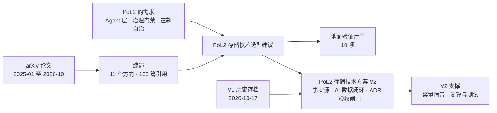

# Research

PoL2 / NaturalDAO 的研究文档。

## 本目录的文件

| 文件 | 内容 | 建议阅读场景 |
|---|---|---|
| [面向人工智能的存储技术：2025—2026 年 arXiv 研究综述.md](./面向人工智能的存储技术：2025—2026%20年%20arXiv%20研究综述.md) | 对 2025–2026 年 arXiv 上 AI 存储论文的系统综述（12 章 + 3 个附录 + 153 篇参考文献） | 了解领域全貌；查某个方向的代表性工作 |
| [AI存储技术综述-易读版.md](./AI存储技术综述-易读版.md) | 上面这篇综述的重写：按「问题—做法—代价」组织，有一页速览和图，不新增数字 | 想快速读懂全貌；决定要不要读原综述的某一章 |
| [PoL2存储技术选型建议.md](./PoL2存储技术选型建议.md) | 基于上面的综述，为 PoL2 Agent 层存储库给出的选型建议 | 做 PoL2 存储架构决策；准备地面验证 |
| [PoL2存储技术方案.md](./PoL2存储技术方案.md) | V2 技术报告（2026-10-23，Proposed/待工程验证）：以原始多模态对象、版本化事件账本和事务元数据为事实源，覆盖高密度容量、AI 混合检索、训练谱系、自治恢复、地面与轨道边界、ADR 和验收规格 | 向教师汇报与架构讨论；制定地面正确性基线与实测升级闸门 |
| [PoL2存储技术方案 V1 存档](./存档/PoL2存储技术方案-V1-20261017.md) | 保留 2026-10-17 原方案及其历史依据；部分默认选型与保证已由 V2 修正 | 对照架构演进，不将历史能力或数字当作当前结论 |
| [PoL2 存储 V2 支撑](./PoL2存储V2支撑/) | 容量假设 JSON、可复算程序、结果表与算术测试；情景不代表实际 PoL2 需求或性能 | 对照正文来源、调整容量参数、重跑指定计算 |
| [Proof of Love2 具身治理框架（V2 草案）](./PoL2-治理支点与行动闭环-V2.md) | V2 草案：提出 PoL2-EG，以 Proof of Love2 为可演化理论基础，由 AI 组件承担治理职能，并以策略门禁、审计、自动冻结与回滚约束具身行动 | 讨论 PoL2 如何治理 Agent 与具身行动，以及如何实现受约束的理论/策略演化 |
| [PoL2 具身治理框架深度调研.md](./PoL2%20具身治理框架深度调研.md) | 对 AI 执行的具身治理先例、PoL2/EAP 一手文本、仓库实现、PX4/MAVLink 控制边界和分阶段评测进行的证据综述 | 细化 PoL2-EG 架构，制定无人机仿真 Demo 与可证伪评测路线 |
| [PoL2具身推理过程初步验证.md](./PoL2具身推理过程初步验证.md) | Kev 类型决策模型的 16 案例三条件长度匹配筛查与 VirtualHome 状态图闭环试跑；区分提示局部影响、长度混杂和执行门控 | 查看 PoL2 是否改变可观察的具身决策和任务执行，以及现有证据能否支持净效应 |
| [PoL2具身系统闭环落地.md](./PoL2具身系统闭环落地.md) | 面向当前 Windows CPU 环境的 MuJoCo 桌面机械臂路线、决策/门控/执行接口、故障行为及 3×2 评估方案 | 把类型化决策模型接入物理仿真，分开验证 PoL2 提示与确定性门的作用 |
| [PoL2-具身策略效应与安全屏蔽评估补充.md](./PoL2-具身策略效应与安全屏蔽评估补充.md) | 复核 MuJoCo 与 Kev 先导结果，结合 runtime shielding 学术先例界定策略效应、门控贡献和下一轮配对因子实验 | 判断现有数据能否支持 PoL2 改变动作选择，以及怎样把策略行为和硬拦截分开验证 |
| [PoL2-具身治理有效性实验设计.md](./PoL2-具身治理有效性实验设计.md) | 将 EAP 条款转成指令门、候选动作门与执行复验；给出有限域穷举、类型决策器对照、MuJoCo 闭环因子设计及机器化评价标准 | 启动 PoL2 具身治理的可证伪验证；区分策略学到规则与门控拦截的效应 |
| [PoL2-具身治理实验结果与结论.md](./PoL2-具身治理实验结果与结论.md) | 记录 2,160 个有限域门控组合检查与 6 条 MuJoCo Panda 配对消融轨迹，含图表、逐轨迹数据和可复现脚本 | 查看 PoL2 派生动作门是否拦截未授权转移，以及当前证据支持到什么边界 |
| [PoL2-具身授权撤回边界实验.md](./PoL2-具身授权撤回边界实验.md) | 在 MuJoCo 中注入抓取前、放置前的授权撤回与权限账本超时；发现抓取前可阻断，但放置前阻断会留下夹持中的部分状态 | 检查治理门在执行中状态变化时是否能安全停止，并确定后续恢复策略需要验证的边界 |
| [PoL2-具身实验规范性与方法审计.md](./PoL2-具身实验规范性与方法审计.md) | 审计有限域 oracle 独立性、状态组合语义、仿真样本单位、基线、撤回恢复和 PoL2 特异性；给出从工程演示走向可重复评估的分阶段协议 | 判断当前结果能支持到哪一级结论，并安排下一轮实验 |
| [PoL2-具身授权撤回安全恢复实验.md](./PoL2-具身授权撤回安全恢复实验.md) | 在五个固定 Panda 仿真条件中比较任务权限撤回与独立恢复权限；`RECOVERY_ONLY` 将已搬运物体放回源位并通过接触、释放和未完成谓词复核，拒绝/未知权限下仍暴露悬持中间态 | 查看撤回后安全恢复的机制证据、失败边界和可复现实验材料 |
| [PoL2-具身授权撤回恢复源位布局扩展实验.md](./PoL2-具身授权撤回恢复源位布局扩展实验.md) | 将撤权后的受限恢复扩展到 3 个桌面源位 × 4 种授权条件，共 12 条 MuJoCo 轨迹；附终态谓词图和逐轨迹 JSON | 检查恢复权限边界是否在轻微布局变化下仍按契约工作，并查看统计推断边界 |
| [PoL2-具身撤权恢复前置条件与执行故障实验.md](./PoL2-具身撤权恢复前置条件与执行故障实验.md) | 在 3 个源位布局中注入姿态偏移、夹持丢失、源位记录失真与任务完成后恢复请求；区分物理目标状态和授权任务完成 | 检验恢复前置条件是否 fail closed，并分析撤权与物理故障竞争时的终态和审计语义 |
| [PoL2-具身渐进夹持退化与恢复时序实验.md](./PoL2-具身渐进夹持退化与恢复时序实验.md) | 在 3 个源位布局中交叉扫描夹持退化起点与受限恢复调度延迟，共 27 条故障轨迹和 3 条无故障对照；附时序图与逐轨迹数据 | 区分撤权门的任务拦截效果、渐进夹持故障下的恢复时序效应及被动达到物理目标的情形 |

本调研的四条深度研究笔记及上一版精简材料见 [PoL2-EG 调研支撑](./PoL2-EG调研支撑/)。

## 文档关系

## 使用时请注意

- 两份文档都由 AI 辅助撰写。选型建议里的论文编号和数字引自综述，综述里的数字又来自各论文自述，口径并不统一。
- 作为决策依据之前，请回到原论文核对关键数字和结论。
- 存储技术方案 V2 不沿用未复核的 V1 预印本收益数字；容量情景为显式假设，验收矩阵为拟议门槛，均不表示已完成 PoL2 大规模、断电或轨道验证。
- Proof of Love2 为本项目第一方标识；第三方许可保持原样，此前已授予的 CC0 权限不因标识更新撤销。
