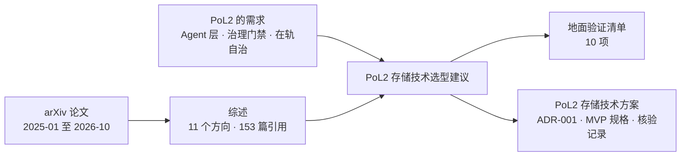

# Research

PoL2 / NaturalDAO 的研究文档。

## 本目录的文件

| 文件 | 内容 | 建议阅读场景 |
|---|---|---|
| [面向人工智能的存储技术：2025—2026 年 arXiv 研究综述.md](./面向人工智能的存储技术：2025—2026%20年%20arXiv%20研究综述.md) | 对 2025–2026 年 arXiv 上 AI 存储论文的系统综述（12 章 + 3 个附录 + 153 篇参考文献） | 了解领域全貌；查某个方向的代表性工作 |
| [AI存储技术综述-易读版.md](./AI存储技术综述-易读版.md) | 上面这篇综述的重写：按「问题—做法—代价」组织，有一页速览和图，不新增数字 | 想快速读懂全貌；决定要不要读原综述的某一章 |
| [PoL2存储技术选型建议.md](./PoL2存储技术选型建议.md) | 基于上面的综述，为 PoL2 Agent 层存储库给出的选型建议 | 做 PoL2 存储架构决策；准备地面验证 |
| [PoL2存储技术方案.md](./PoL2存储技术方案.md) | 技术方案（Proposal，含 ADR-001）：在选型建议基础上核验 GitHub 仓库与 38 篇 arXiv 文献，给出检索内核选择、五层架构、MVP 规格与验证计划 | 启动 PoL2 存储 MVP；查某个依据的出处与核验结果 |
| [PoL2 的治理支点：把规则接到行动、执行与修正上（V1）](./PoL2-治理支点与行动闭环-V1.md) | V1：梳理 PoL2 的规则执行、类型化决策模型与大语言模型协作、去中心化自治和具身行动闭环 | 讨论 PoL2 如何接入现实系统，以及具身智能如何接受治理 |

## 文档关系

## 使用时请注意

- 两份文档都由 AI 辅助撰写。选型建议里的论文编号和数字引自综述，综述里的数字又来自各论文自述，口径并不统一。
- 作为决策依据之前，请回到原论文核对关键数字和结论。
