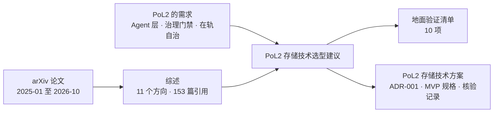

# Research

PoL2 / NaturalDAO 的研究文档。

## 本目录的文件

| 文件 | 内容 | 建议阅读场景 |
|---|---|---|
| [面向人工智能的存储技术：2025—2026 年 arXiv 研究综述.md](./面向人工智能的存储技术：2025—2026%20年%20arXiv%20研究综述.md) | 对 2025–2026 年 arXiv 上 AI 存储论文的系统综述（12 章 + 3 个附录 + 153 篇参考文献） | 了解领域全貌；查某个方向的代表性工作 |
| [AI存储技术综述-易读版.md](./AI存储技术综述-易读版.md) | 上面这篇综述的重写：按「问题—做法—代价」组织，有一页速览和图，不新增数字 | 想快速读懂全貌；决定要不要读原综述的某一章 |
| [PoL2存储技术选型建议.md](./PoL2存储技术选型建议.md) | 基于上面的综述，为 PoL2 Agent 层存储库给出的选型建议 | 做 PoL2 存储架构决策；准备地面验证 |
| [PoL2存储技术方案.md](./PoL2存储技术方案.md) | 技术方案（Proposal，含 ADR-001）：在选型建议基础上核验 GitHub 仓库与 38 篇 arXiv 文献，给出检索内核选择、五层架构、MVP 规格与验证计划 | 启动 PoL2 存储 MVP；查某个依据的出处与核验结果 |
| [Proof of Love2 具身治理框架（V2 草案）](./PoL2-治理支点与行动闭环-V2.md) | V2 草案：提出 PoL2-EG，以 Proof of Love2 为可演化理论基础，由 AI 组件承担治理职能，并以策略门禁、审计、自动冻结与回滚约束具身行动 | 讨论 PoL2 如何治理 Agent 与具身行动，以及如何实现受约束的理论/策略演化 |
| [PoL2 具身治理框架深度调研.md](./PoL2%20具身治理框架深度调研.md) | 对 AI 执行的具身治理先例、PoL2/EAP 一手文本、仓库实现、PX4/MAVLink 控制边界和分阶段评测进行的证据综述 | 细化 PoL2-EG 架构，制定无人机仿真 Demo 与可证伪评测路线 |
| [PoL2具身推理过程初步验证.md](./PoL2具身推理过程初步验证.md) | Kev 类型决策模型的 16 案例三条件长度匹配筛查与 VirtualHome 状态图闭环试跑；区分提示局部影响、长度混杂和执行门控 | 查看 PoL2 是否改变可观察的具身决策和任务执行，以及现有证据能否支持净效应 |
| [PoL2具身系统闭环落地.md](./PoL2具身系统闭环落地.md) | 面向当前 Windows CPU 环境的 MuJoCo 桌面机械臂路线、决策/门控/执行接口、故障行为及 3×2 评估方案 | 把类型化决策模型接入物理仿真，分开验证 PoL2 提示与确定性门的作用 |
| [PoL2-具身策略效应与安全屏蔽评估补充.md](./PoL2-具身策略效应与安全屏蔽评估补充.md) | 复核 MuJoCo 与 Kev 先导结果，结合 runtime shielding 学术先例界定策略效应、门控贡献和下一轮配对因子实验 | 判断现有数据能否支持 PoL2 改变动作选择，以及怎样把策略行为和硬拦截分开验证 |
| [PoL2-具身治理有效性实验设计.md](./PoL2-具身治理有效性实验设计.md) | 将 EAP 条款转成指令门、候选动作门与执行复验；给出有限域穷举、类型决策器对照、MuJoCo 闭环因子设计及机器化评价标准 | 启动 PoL2 具身治理的可证伪验证；区分策略学到规则与门控拦截的效应 |

本调研的四条深度研究笔记及上一版精简材料见 [PoL2-EG 调研支撑](./PoL2-EG调研支撑/)。

## 文档关系

## 使用时请注意

- 两份文档都由 AI 辅助撰写。选型建议里的论文编号和数字引自综述，综述里的数字又来自各论文自述，口径并不统一。
- 作为决策依据之前，请回到原论文核对关键数字和结论。
