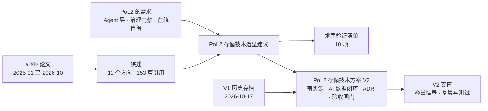

# Research

PoL2 / NaturalDAO 的研究文档。

## 本目录的文件

| 文件 | 内容 | 建议阅读场景 |
|---|---|---|
| [面向人工智能的存储技术：2025—2026 年 arXiv 研究综述.md](./面向人工智能的存储技术：2025—2026%20年%20arXiv%20研究综述.md) | 对 2025–2026 年 arXiv 上 AI 存储论文的系统综述（12 章 + 3 个附录 + 153 篇参考文献） | 了解领域全貌；查某个方向的代表性工作 |
| [AI存储技术综述-易读版.md](./AI存储技术综述-易读版.md) | 上面这篇综述的重写：按「问题—做法—代价」组织，有一页速览和图，不新增数字 | 想快速读懂全貌；决定要不要读原综述的某一章 |
| [PoL2存储技术选型建议.md](./PoL2存储技术选型建议.md) | 基于上面的综述，为 PoL2 Agent 层存储库给出的选型建议 | 做 PoL2 存储架构决策；准备地面验证 |
| [PoL2存储技术方案.md](./PoL2存储技术方案.md) | V2 技术报告（2026-10-23，Proposed/待工程验证）：以原始多模态对象、版本化事件账本和事务元数据为事实源，覆盖高密度容量、AI 混合检索、训练谱系、自治恢复、地面与轨道边界、ADR 和验收规格 | 向教师汇报与架构讨论；制定地面正确性基线与实测升级闸门 |
| [PoL2存储技术方案 V1 存档](./存档/PoL2存储技术方案-V1-20261017.md) | 保留 2026-10-17 原方案及其历史依据；部分默认选型与保证已由 V2 修正 | 对照架构演进，不将历史能力或数字当作当前结论 |
| [PoL2 存储 V2 支撑](./PoL2存储V2支撑/) | 容量假设 JSON、可复算程序、结果表与算术测试；情景不代表实际 PoL2 需求或性能 | 对照正文来源、调整容量参数、重跑指定计算 |
| [Proof of Love2 具身治理框架（V2 草案）](./PoL2-治理支点与行动闭环-V2.md) | V2 草案：提出 PoL2-EG，以 Proof of Love2 为可演化理论基础，由 AI 组件承担治理职能，并以策略门禁、审计、自动冻结与回滚约束具身行动 | 讨论 PoL2 如何治理 Agent 与具身行动，以及如何实现受约束的理论/策略演化 |
| [PoL2 具身治理框架深度调研.md](./PoL2%20具身治理框架深度调研.md) | 对 AI 执行的具身治理先例、PoL2/EAP 一手文本、仓库实现、PX4/MAVLink 控制边界和分阶段评测进行的证据综述 | 细化 PoL2-EG 架构，制定无人机仿真 Demo 与可证伪评测路线 |
| [PoL2具身推理过程初步验证.md](./PoL2具身推理过程初步验证.md) | Kev 类型决策模型的 16 案例三条件长度匹配筛查与 VirtualHome 状态图闭环试跑；区分提示局部影响、长度混杂和执行门控 | 查看 PoL2 是否改变可观察的具身决策和任务执行，以及现有证据能否支持净效应 |

本调研的四条深度研究笔记及上一版精简材料见 [PoL2-EG 调研支撑](./PoL2-EG调研支撑/)。

## 文档关系

## 使用时请注意

- 两份文档都由 AI 辅助撰写。选型建议里的论文编号和数字引自综述，综述里的数字又来自各论文自述，口径并不统一。
- 作为决策依据之前，请回到原论文核对关键数字和结论。
- 存储技术方案 V2 不沿用未复核的 V1 预印本收益数字；容量情景为显式假设，验收矩阵为拟议门槛，均不表示已完成 PoL2 大规模、断电或轨道验证。
- Proof of Love2 为本项目第一方标识；第三方许可保持原样，此前已授予的 CC0 权限不因标识更新撤销。
