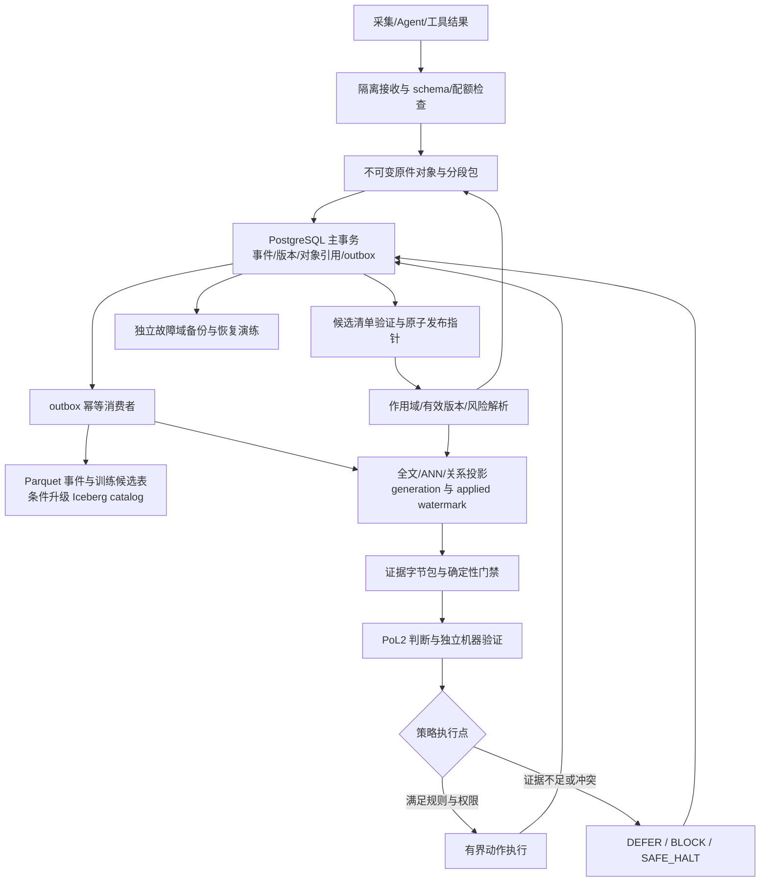
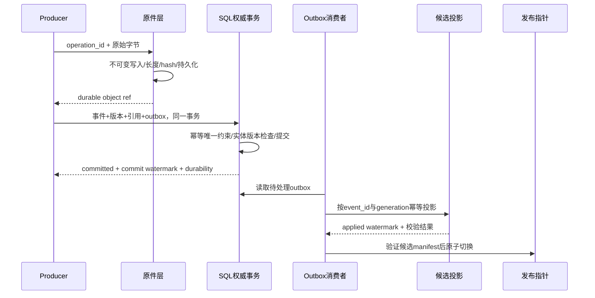
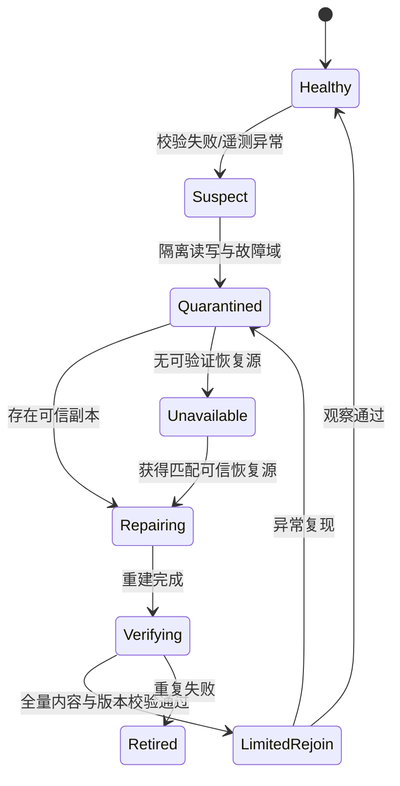

# PoL2 高密度存储技术方案 V2：让事实、检索与训练分别演进

| 文档属性 | 内容 |
| --- | --- |
| 项目 | NaturalDAO / Proof of Love2（PoL2） |
| 版本与日期 | V2，2026-10-23 |
| 状态 | **Proposed / 待工程验证** |
| 文档用途 | 架构讨论、教师汇报、工程实施与可证伪评测规格 |
| 替代关系 | 主方案替代 V1；[V1 原文保留](../99-%E5%BD%92%E6%A1%A3/PoL2%E5%AD%98%E5%82%A8%E6%8A%80%E6%9C%AF%E6%96%B9%E6%A1%88-V1-20261017.md)，不改写历史证据 |
| 证据边界 | 官方文档与原始论文核查、现有代码静态检查、可复算容量情景；没有完成 PoL2 大规模性能、断电、辐照或轨道实验 |
| 身份与许可 | 本项目第一方材料使用 Proof of Love2 标识；第三方许可保持各自原样，此前已授予的 CC0 权限不因本次更新撤销 |

## 1. 执行摘要：高密度首先要求保住事实和版本边界

**PoL2 应以“不可变多模态原件＋版本化事件账本＋事务性元数据”作为权威事实源，把 ANN、全文索引、关系投影、训练数据集和缓存作为有版本、可撤销、可重建的派生物。** 原件负责保存实际发生过什么，事件账本负责保存谁在什么版本下改变了什么，事务性元数据负责决定当前可见状态。向量近邻只帮助找到候选，不能承担规则授权、事实真实性或证据完备性的证明。适应 AI 时代的关键不在预先选定一个最大向量引擎，而在原文、模型、策略、时间、许可和执行轨迹之间建立可追溯关系，并以测量决定索引覆盖比例和升级时机。

现有 PostgreSQL/pgvector 已经是可用的集成起点，V2 不再把 Hannoy 作为默认 MVP，也不预定 DiskANN 为最终内核。代码检查发现三个具体缺口：默认 `halfvec(4096)` 超出 pgvector 当前 halfvec ANN 的 4,000 维索引上限；`replace_embeddings` 是事务内全表清空再装载，不是在线双代迁移；`vector_search` 对全表按距离排序，没有作用域、模型、有效版本或快照过滤。应先修补这些边界，再用相同工作负载比较替代引擎。[现有实现](https://github.com/naturaldao/NaturalDAO/blob/09fdf57/POL2-Steward/pol2-service/service/store_postgres.py#L467)、[pgvector 官方说明](https://github.com/pgvector/pgvector)。

容量不能只统计向量本体。本报告给出三组**假设情景，而非业务预测或性能实验**：每日事件为 $10^6/10^8/10^{10}$，保留一年，10% 事件进入检索、每个索引事件 8 个向量，另计原件归档、元数据、双副本、七日额外热副本、双代迁移和 25% 配置空闲。在这些限定假设下，配置量约为 **5.54 TB、781.24 TB 和 108.41 PB**；这仍未包括视频大对象、模型权重、备份历史等成本。最低一档已有 2.92 亿个向量，因此不能误当作第一轮原型目标。复算程序与完整输入见[容量情景支撑](../03-%E5%A4%8D%E7%AE%97%E4%B8%8E%E6%94%AF%E6%92%91/%E5%AE%B9%E9%87%8F%E6%83%85%E6%99%AF%E7%BB%93%E6%9E%9C.md)。

实施分三条有依赖的路线：**地面原型**先证明提交、过滤、撤销、回放和迁移正确；**地面生产**在实测瓶颈出现后增加分区、独立对象存储、日志解耦和湖仓快照；**轨道配置**必须另过任务相关的辐照、热真空、功率与失联自治资格验证。全 AI 治理沿用 [PoL2-EG V2](../../Embodied/01-%E6%A1%86%E6%9E%B6%E4%B8%8E%E8%B0%83%E7%A0%94/PoL2-%E6%B2%BB%E7%90%86%E6%94%AF%E7%82%B9%E4%B8%8E%E8%A1%8C%E5%8A%A8%E9%97%AD%E7%8E%AF-V2.md)：AI 提案、独立机器验证、确定性策略门禁、分阶段发布和自动回滚，不设运行时人工批准节点。代理的一致意见不能证明事实，机器审查也不能绕过授权和持久化边界。

## 2. V1 的哪些结论保留，哪些必须修正

V1 对随机检索、持续写入、治理留痕和轨道约束的关注仍然成立；检索索引与审计日志分离也应保留。V2 修正的是没有工程证据支撑的默认选型、过强保证和存储对象混同。以下变更是本方案的决策，不是声称已经完成的代码改造。

| V1 表述或倾向 | V2 修正 | 实施影响 |
| --- | --- | --- |
| Hannoy 默认 MVP，DiskANN3 长期主内核 | PostgreSQL/pgvector 为现有基线；替代引擎通过同一验收集竞争 | 避免先迁移再发现过滤、恢复和集成更弱 |
| 向量文件兼作训练语料 | 保留原始模态、抽取文本和谱系；训练数据集单独审批于机器策略与许可规则 | embedding 不能替代可还原的通用训练原文 |
| 所有层都能从 L0 重建 | 仅在原件版本、变换、模型、配置和依赖仍可获得时重建 | hash、URI 和 Merkle 根不能恢复已删除原件 |
| `target_recall=0.95` 易被理解为逐查询保证 | 作为离线目标，返回校准版本、预算、缺失与不确定状态 | 高风险动作在关键证据不足时 `DEFER` |
| JSONL、SQLite、ANN 顺序写即可原子提交 | 单一事务权威状态＋outbox＋候选发布清单 | 消除 SQL 成功而原件缺失、索引半切换等窗口 |
| 4096 维字段意味着可直接建 ANN | 存储上限与索引上限分开验证 | 保留原向量；评估量化召回后精排或独立低维检索模型 |
| WAF 直接等于寿命 | 分开软件写放大、设备 FTL 写放大、TBW、温度与辐射 | 无硬件遥测不能给出可靠寿命年数 |
| 在轨作为长期已确定部署条件 | 轨道是待资格验证的独立配置 | 地面证据不能替代飞行资格 |
| 全局不引入加密等机制 | 受控单信任原型可保持不加密；新增威胁触发对应控制 | 不把更强防护强制套到所有配置，也不把原型当对抗系统 |

不继承 V1 中未在本轮打开原文核对的近期预印本收益数字、Star 数或厂商吞吐宣传；它们不构成 PoL2 的性能证据。DiskANN 当前仓库展示的是可组合 Rust 索引库及 DataProvider 接口，不能据此声称具备本方案的跨层事务、历史回放和治理语义。[DiskANN 官方仓库](https://github.com/microsoft/DiskANN)。

## 3. 明确数据密度：字节、事件、版本与关系共同增长

“PoL 数据密度极大”至少有六种不同含义，应分别采样。字节密度是每个时间窗口产生的实际字节；事件密度是状态改变和工具交互的频度；版本密度是每个实体在保留期内形成多少修订；关系密度是引用、冲突、派生和授权边的数量；表征密度是每个对象产生多少 chunk、token、向量及索引；访问密度是并发查询、热点与扫描重叠。高语义密度不能推出高压缩率，也不能推出全部 token 都应常驻 ANN。

| 数据类 | 权威内容与粒度 | 派生结果 | 建议独立计量 |
| --- | --- | --- | --- |
| 理论、规则与政策 | 原文、条款版本、适用范围、生效/撤销事件 | 分块、术语倒排、规则关系、embedding | 版本/条款、冲突边、时效分布 |
| Agent 任务与行动 | 请求、参数、工具返回、执行结果、许可消费 | episode、摘要、策略评测样本 | 事件/任务、峰值事件/s、重试率 |
| 多模态观测 | 文档、图片、音视频、传感器与坐标时间系 | OCR、字幕、特征、时段切片 | bytes/s、模态比例、长度 P95/P99 |
| 判断与审计 | 实际证据字节、候选与过滤、模型/规则、输出 | 检索统计、异常和回放指标 | 证据包/判定、保留期限、回放级别 |
| 知识记忆 | 有来源的事实、执行经历、候选程序性知识 | 跨会话检索与候选更新 | 有效/过期比例、来源独立性 |
| 训练与评测 | 有许可的快照清单、split、变换和标签 | token shards、训练 checkpoint | 采样次数、重复簇、污染比例 |

每条内容同时具备**字节身份**和**业务身份**。相同文件可被两个来源上传，其字节可以去重，但来源、授权、有效时间和治理含义不能合并。跨模态同步必须记录时钟来源、单位、采样间隔和对齐误差；一段 OCR 或模型摘要不能覆盖原图的事实身份。连续传感器流可分段封装，但段内 offset 与事件映射必须稳定。

### 3.1 概念数据模型与不可破坏的约束

下表是新增生产契约，**不直接替换当前 pilot 数据表**。原型可以在 PostgreSQL 中增加表并建立迁移适配层，先保持旧接口可运行。时间使用带时区时间戳；内容 hash 对实际存储字节计算，规范化文本另有 hash 和算法版本。

| 记录 | 主键/必需字段 | 不变量 |
| --- | --- | --- |
| `RawObject` | `content_id, sha256, byte_length, media_type, codec, physical_locator, object_version` | 同一内容 ID 的字节不可原地变更；移动只改 locator 的版本 |
| `Event` | `event_id, operation_id, producer_id, producer_sequence, entity_id, entity_version, event_type, event_time, ingest_time, raw_refs, schema_version, policy_version` | operation 幂等；实体版本有序；来源与提交时间不互相覆盖 |
| `EntityVersion` | `entity_id, version, valid_from, valid_to, status, scope_hash, provenance_refs` | `revoked/superseded` 通过新事件表达；不覆盖历史内容 |
| `DerivedArtifact` | `source_ids, transform_digest, model_digest, tokenizer_digest, config_digest, artifact_hash` | 任何上游版本改变形成新 artifact，不静默混用 |
| `ReleaseManifest` | `release_id, table_snapshots, raw_manifest_hash, derivation_manifest_hash, policy_hash, watermarks, retention_pin` | 发布前所有引用可解析且满足保留条件；发布指针原子切换 |
| `DecisionRecord` | `request_ref, release_id, evidence_refs, rules_version, model_ref, actual_output_ref, execution_ref` | 保存实际使用证据与结果；重算不覆盖原结果 |

示意记录只展示字段形状；`sha256:…` 表示格式示例，不是已存在的内容摘要，不能作为可运行测试向量。

```json
{
  "event_id": "evt_rule_17_v3",
  "operation_id": "op_producer7_0081",
  "producer_id": "agent_policy_compiler_7",
  "producer_sequence": 81,
  "entity_id": "rule_17",
  "entity_version": 3,
  "event_type": "policy_candidate_staged",
  "event_time": "2026-10-23T02:00:00Z",
  "ingest_time": "2026-10-23T02:00:01Z",
  "raw_refs": [{"content_id": "sha256:…", "object_version": 1}],
  "schema_version": "pol2.event.v2",
  "policy_version": "policy_generation_12",
  "scope_hash": "scope_digest_example",
  "provenance": {"kind": "agent_generated", "parent_event_ids": ["evt_source_9"]}
}
```

Agent 生成的事实、摘要或候选政策均先进入候选域；即便多数 Agent 同意，也不能自动成为有效规则。来源、引用和冲突状态随版本进入机器准入验证。运行时授权点只读取已发布政策和明确的当前有效状态。

## 4. 架构：事实源稳定，投影按访问模式增加



**图 1. V2 逻辑架构，属于待实现方案。** 原件先持久化，SQL 事务确认事实，异步消费者构建投影。查询必须同时遵守发布清单和当前撤销状态。图中没有人工批准节点；策略门禁为确定性组件，AI 判断结果本身不是执行凭证。

### 4.1 格式分工与升级条件

原始模态按适合其语义的格式保存；列式事件与标注优先使用 Parquet；Arrow 用于批处理的内存交换，不能当作持久事务数据库。Parquet 定义文件布局和编码，不提供跨文件业务提交；Arrow 也不替实现承担并发更新协调。[Parquet 概述](https://parquet.apache.org/docs/overview/)、[Arrow 规范](https://arrow.apache.org/docs/format/Columnar.html)。

出现多写者、跨引擎快照和训练扫描需求后，引入一个明确版本的 Iceberg catalog。Iceberg 的快照与 manifest 可以管理表文件；它的元数据提交仍依赖 catalog 原子操作，也不会自动把外部 BLOB、模型权重和 ANN 纳入一体事务。PoL2 的 ReleaseManifest 因而仍需存在，绑定多表 snapshot 与外部依赖。[Iceberg 规范](https://iceberg.apache.org/spec/)。

Paimon 主键表适合 upsert/CDC，但逻辑当前行不能取代不可变业务事件。Lance 可作为多模态随机采样、特征读取和检索投影候选，不应与 Iceberg、Paimon 同时未经验证地成为三套主事实源。格式选择记录版本、读取引擎和兼容矩阵；“最新规范有此字段”不等于所有引擎已稳定支持。[Paimon 主键表](https://paimon.apache.org/docs/2.1/primary-key-table/)、[Lance 官方文档](https://lance.org/)。

| 部署层级 | 最小组成 | 增加组件的实测触发条件 |
| --- | --- | --- |
| 地面原型 | PostgreSQL/pgvector、不可变本地对象目录、outbox worker、发布清单、批量 Parquet | 先通过正确性与回放，不引入不必要集群 |
| 地面生产 | 独立对象服务、SQL 高可用与分片策略、隔离备份、监控 | 主机/存储故障域、吞吐或恢复窗口无法满足目标 |
| 流处理扩展 | 持久消息日志与分区消费者 | 多生产者解耦、积压保留和独立消费已形成真实需求 |
| 湖仓扩展 | 固定版本 catalog、多表 release 协议、压实与 GC | 多引擎训练快照、长扫描和并发写入成为瓶颈 |
| 轨道配置 | 经资格验证硬件、功率/热调度、失联自治与可信异域副本 | 地面验收通过，且任务环境与试验完成 |

SQLite 可用于孤立的小型边缘缓冲，但当前基线不必从 PostgreSQL 退回 SQLite。若使用 SQLite WAL，应记住同一时刻只有一个 writer，WAL 协调依赖同机共享内存；不能把网络文件系统上的 WAL 当多机写数据库。[SQLite WAL](https://www.sqlite.org/wal.html)。

### 4.2 批处理和分区比“每条记录一个对象”更重要

短事件先进入可校验的追加段，再批量生成列式文件；大模态 BLOB 保持独立，小 BLOB 可不可变打包，保存 `pack_id/offset/length/hash`。不要为每个 token、chunk 或事件单独创建对象。可将 128–512 MiB 列式文件作为第一轮测试候选，最终按尾延迟、随机读取放大、删除重写与故障重建测定；这不是生产最优值。

按有限时间窗口加有限 hash bucket 分区，避免按 event ID 或无限增长的 Agent ID 建目录。读取走 manifest 与元数据访问路径，不靠每次全桶 LIST。压实任务与线上查询争用 IO，须观测小文件数、最老积压、待压实字节和后台读写预算。Iceberg 官方维护说明也把小文件、manifest 重写和快照维护作为持续职责。[Iceberg 维护](https://iceberg.apache.org/docs/latest/maintenance/)。关系层只保存有来源、受作用域约束的显式边及经验证的有限派生边，不为全部对象生成全连接的 $O(N^2)$ 关系。

### 4.3 链上只锚定必要承诺，链下保存高密度事实

NaturalDAO 的区块链部分不应承载全部原始事件、音视频、个人信息、embedding 或每次判定正文。本方案将链下原件与事件系统作为容量和读取主体，按实际治理需要选择性发布批次根、schema/manifest/政策版本和最小发布记录。锚定频率由审计窗口、费用和链可用性预算决定；离线期间可形成明确标注的本地检查点，不能假装已经获得链上最终性。

链适配器必须定义交易确认、最终性、重组回退和重提交行为，以及锚定记录与链下 release 的映射。承诺根不证明知识真实、发布者有权或动作被授权，也不能保证链下数据始终可取；敏感内容的可枚举 hash 仍可能泄露关联。地面/轨道断链时不要求每个 Agent 回合完成同步全球共识，改用生产者流序列、写入 epoch 和明确的跨域确认层级，在恢复连接后对账。事件时间不作为完美全局时钟；实体版本、逻辑顺序和冲突策略共同决定可见性。上述为 PoL2 协议设计，未声称现有链上实现已提供这些保证。

## 5. 写入与可见性：只承诺已经实现的持久化层级

写入 API 区分 `accepted`、`durable_local` 与 `durable_replicated`。接收成功不等于落盘；本地持久成功要求原件及权威提交记录完成实际持久化屏障；跨域持久成功还要求指定独立故障域确认。通信超时不能解释为必然失败，客户端必须携带稳定 operation ID 重试并查询提交状态。



**图 2. 跨层提交与发布协议。** 对象成功而 SQL 失败留下孤儿，稍后安全回收；SQL 成功而消费者失败留下重试任务。不得因 ANN 暂时不可用而抹掉已提交事实。投影完成与业务提交是不同水位。

PostgreSQL 事务只覆盖纳入同一事务的表；普通文件、对象存储和 ANN 不会因调用顺序自动原子化。若对象层没有满足要求的持久化确认，SQL 不得引用为“已持久原件”。AWS S3 提供成功对象写后的强一致读取和单 key 原子更新，但不提供跨 key 原子更新；这些语义不能自动外推其他 S3-compatible 服务。[S3 一致性模型](https://docs.aws.amazon.com/AmazonS3/latest/userguide/Welcome.html)。

事务 outbox 至少记录事件 ID、目标 generation、重试次数、下次尝试和处理租约。消费者在投影侧用 `(event_id, generation)` 去重；先投影成功再确认消费，崩溃重复处理应安全。Kafka 的事务也不自动保证外部 SQL、对象层和 ANN 的端到端 exactly-once；采用“至少一次传输＋幂等逻辑提交”是明确且可测试的契约。[Kafka 消息语义](https://kafka.apache.org/41/design/design/)。

顺序只在声明的实体或生产者分区内约束，不声称全局全序。迟到事件分别保存发生时间和摄入时间，冲突版本进入隔离，不能仅以到达先后覆盖业务事实。watermark 表示已处理前缀，不表示未来不会收到更早的事件。每批事件生成段级摘要和树根，不对每条追加事件重新 hash 整个历史文件。

watermark 的实际契约是**分区位置向量＋缺口集合**，不是全表最大 ID。SQL sequence/自增 ID 的分配顺序不等于事务提交顺序，不能将 `MAX(id)` 当作已提交或已投影前缀。每个声明分区采用可核对的事务提交/日志位置标识，记录已确认与已应用区间以及 gaps；只有前面的提交与处理缺口关闭后才推进连续前缀。中止事务由事务状态证明排除，不以盲目等待其分配号填补；分区重配置记录 epoch 和旧新位置映射。release 对每个分区声明覆盖位置，跨分区只承诺该向量所定义的一致发布，不凭单个最大数伪造全局顺序。

### 5.1 查询只看一致的 release，撤销另走即时权威检查

普通查询固定 `release_id`、有效时间和索引 generation；候选必须属于该 release 的实际成员与版本。对“截至某时点”的历史检索，使用相应快照或显式 membership/version 过滤；在当前索引上过量召回不能证明历史 top-k 完整。release 发布前逐项检查原件存在、引用完整、模型一致、保留 pin 和投影水位。

当前撤销不能等待旧快照自然过期。查询和缓存返回前，都向权威元数据核验撤销/授权 epoch；政策撤销触发主动失效。缓存 key 绑定 `scope_hash + release_id + policy_version + model/encoder/reranker_generation + query_normalizer_version + valid_at semantics`，不允许仅用文本 hash 或 TTL。审计读取旧原件的权限与当前动作使用证据的权限分开。

高风险新政策或撤销尚未进入 ANN 时，对受影响实体使用有界 exact/delta 查询；不能确认完整性则 `DEFER`，不签发该动作许可。低风险、与变更无关的流量仍可服务，避免以全局停机替代精确隔离。副本迟滞、索引缺失和原件不可用均有显式状态码，不能默默返回“无相关证据”。

查询与缓存核验只保证核验时点，不能覆盖“取证后、动作执行前发生撤销”的竞态。执行许可必须绑定 `policy_epoch`、`authorization_epoch`、`scope_hash`、动作类型与规范化参数摘要、失效时间及一次性 nonce；撤销事件单调增加相应 epoch，政策回滚也不得降低撤销 epoch。策略执行点在授权派发前读取当前权威 epoch，在同一授权事务中核验匹配、有效期和参数摘要，并原子消费 nonce、记录授权派发意图；epoch 不匹配则拒绝并重新评估。派发器只消费已提交意图，以 operation ID 幂等重试，旧进程用 fencing token 隔离。该事务是软件授权的线性化点，不意味着数据库事务能与不可逆物理动作原子提交；若要求撤销一直生效到实际执行，工具/设备的最后执行点必须接受 epoch/fencing/nonce 并再次核验或遵守明确的有界许可协议。不能支持该协议的执行器应声明撤销窗口、限制动作与许可寿命，不能声称无竞态的物理授权。

## 6. AI 检索：先确定有效集合，再优化候选召回

### 6.1 混合查询与有限关系扩展

检索链为：解析身份、作用域与风险 → SQL/位图确定有效集合 → dense、sparse、精确条款/实体命中并路召回 → 排名融合与去重 → 再次校验有效性 → 有限关系扩展 → 精排 → 原文证据包。条款编号、变量名、否定、例外和专有名词往往需要词法通道；稠密检索负责语义相近；图扩展负责引用、优先级和冲突，不无限遍历全图。

关系扩展设置边类型白名单、最大跳数、节点/字节/时间预算，并保留每条边的来源与有效版本。检索某政策时可强制精确读取其撤销、例外和上位条款，这比指望 ANN 自然返回全部规则更可控。发现冲突时保留双方证据，不能让 reranker 将低相似度反证消失。结构化过滤必须在外部 reranker 获得正文之前生效，并在最终取原文时复核。

Qdrant 的 Query API 展示多路 prefetch 与 RRF 融合；RRF 融合的是排序，不是已校准概率。LanceDB 文档区分预过滤和后过滤，后过滤会使结果不足 limit。pgvector 近似扫描也存在过滤后候选不足，迭代扫描扩大预算仍不能保证达到 k。[Qdrant 混合查询](https://qdrant.tech/documentation/search/hybrid-queries/)、[LanceDB 过滤](https://docs.lancedb.com/search/filtering)、[pgvector](https://github.com/pgvector/pgvector)。

若有效集合很小或过滤选择率很低，直接精确扫描该集合常比无限扩大 ANN 搜索合理。引擎的谓词能力、历史 membership、删除语义和模型隔离是选型硬门槛，不能只比较裸向量 QPS。查询扩展次数分别统计总检索次数、实际并行扇出、并发 RPS 和串行依赖；并行调用增加负载，但不能把其所有延迟简单相加为 TTFT。串行依赖的关键路径才直接累加。

### 6.2 多向量只用于可证明带来净收益的层

ColBERT 的 late interaction 以 query/document token 表征做细粒度匹配；它提示一种精排方法，不证明 PoL2 全库铺开值得。[ColBERT 原始论文](https://arxiv.org/abs/2004.12832)。设 $N_c$ 为 chunk 数、$t$ 为每 chunk 平均 token 向量数、$d_t$ 为 token 向量维度、$b$ 为每分量字节，则表征本体：

$$
D_{multi}=N_c t d_t b,\qquad \frac{D_{multi}}{D_{single}}=\frac{t d_t}{d}.
$$

其中 $d$ 是单向量维度，容量单位为 byte；不包含 ID、offset、图、复制与版本。实际评估还需 $t$ 的 P95/P99 和事件级上限，防止极长文档支配存储。默认仅为高价值条款、小比例关键证据或精排候选保存多向量；不是所有 token 都建立 ANN 图。Qdrant 官方精排示例即为精排多向量关闭 HNSW，说明保存细粒度表征与为其全建图可以分开。[混合检索与多向量精排](https://qdrant.tech/documentation/tutorials-basics/reranking-hybrid-search/)。

### 6.3 召回目标是校准指标，不是逐查询证明

离线 ANN Recall@k 的分母应为同一过滤后有效集合的 exact top-k，$k_{eff}=\min(k,|E|)$，其中 $E$ 是有效集合；ties 处理固定。有效集合为空时记录不适用，不虚构 recall=1。另测证据标注召回、例外覆盖、冲突覆盖、引用支持率、误放/误拒、无证据弃权和越权返回数。高向量 recall 不能证明规范性证据齐全。

建议风险配置是设计输入：普通知识检索可以接受有标注的不完整结果；规则解释需要额外精确读取关联条款；高影响动作需要匹配的有效政策、权限和必要证据，缺项则 `DEFER/BLOCK`。不预填统一的 0.95 作为安全保证。FreshDiskANN 研究流式更新的近似检索，不提供 PoL2 单查询的完备性证书。[FreshDiskANN 原文](https://arxiv.org/abs/2105.09613)。

API 返回的 `estimated_recall` 允许为 `null`。只有存在适用校准集和估计器时才填值，并明确不是逐查询下界。预算耗尽、有效候选不足和水位陈旧均返回 `incomplete=true` 及原因。

### 6.4 候选引擎的比较次序

| 候选 | 本方案角色 | 必须实测的问题 |
| --- | --- | --- |
| PostgreSQL/pgvector | 当前基线，事务元数据和精确检索标杆 | 4096 维方案、过滤后召回、写入/重建争用、备份恢复 |
| pgvectorscale | 同栈挑战者 | 数据类型与运算符兼容、标签与任意 WHERE 差异、升级回滚 |
| Qdrant | 独立混合检索挑战者 | 多路过滤一致性、generation 切换、外部事务协调与恢复 |
| LanceDB | 多模态与训练采样投影挑战者 | 随机读取/扫描并发、快照边界、过滤与删除可见性 |
| DiskANN3 | 需要定制 provider 的后续路线 | 持久化、谓词、集成成本、恢复和接口版本稳定性 |

pgvectorscale 的索引标签过滤不等于任意 WHERE 全部下推，且官方仍提示项目成熟度与使用限制；DiskANN3 是索引库而非完整权威数据库。不能按 README 的厂商性能图排序，更不能用 Star 数替代运维验证。[pgvectorscale](https://github.com/timescale/pgvectorscale)、[DiskANN](https://github.com/microsoft/DiskANN)、[LanceDB 混合检索](https://docs.lancedb.com/search/hybrid-search)。

## 7. AI 数据闭环：训练原料、代理记忆与推理缓存分开管理

### 7.1 训练数据集必须经过许可、谱系与 split 约束

原件“能存储”不意味着“能训练”，检索可访问也不自动授权跨域训练。每个训练 release 固定原件版本、来源/许可、用途与过期约束、变换链、标签生产模型、去重簇、质量过滤器、采样权重和 split。缺失或不明许可的数据进入隔离候选集，不默认纳入训练。技术报告不宣称这些机制自动满足所有司法辖区法律要求。

按时间、来源实体和近重复簇共同划分 train/dev/calibration/test，先隔离再进行模型驱动合成和调参。test holdout 不进入 RAG 索引、Agent 记忆、错误修复提示、训练筛选或阈值调校；calibration 只能用于已声明的校准，不能反复代替 test。原文、翻译、摘要、同源图片 OCR、合成改写应以谱系或近重复簇一同隔离，避免仅按文件 hash 去重漏掉语义重复。

合成内容记录生产模型、prompt、输入快照和后处理；Agent 反复引用自身输出不能被计为多个独立事实来源。训练中观察到的治理错误需要独立评测验证，不能先写入评测知识再报告性能提升。评测集由独立机器流水线建立和锁定，明确规则标签、证据标签及异常类别；机器标签仍有误差，应抽取反例、跨实现验证并报告不确定性，而非宣称生成即正确。

通用语言模型训练通常需要原始或经许可清洗的文本/多模态内容；embedding 只是特定编码器的表征，不能还原通用原文。token shard、OCR、chunk、特征和向量分别是可版本化投影。训练扫描可与在线索引共享规范原件，但解压、分词、格式化、shuffle 和 checkpoint 产生独立容量与 IO，不能算成免费读取。

### 7.2 记忆不是 KV cache，也不是发布规则

长期 Agent 记忆至少区分事实知识、情节轨迹与程序性候选。事实必须引用原件，情节记录实际执行，程序性知识若改变权限或规则必须经过政策发布闭环。LangGraph 的跨会话 namespace 记忆模型可作为应用层组织参考，不能替代 PoL2 的事实与授权契约。[LangGraph 记忆概念](https://docs.langchain.com/oss/python/concepts/memory)。

KV/prefix cache 保存推理计算的中间状态，可以驱逐重算；证据记录和执行账本不能随缓存淘汰。vLLM 的 prefix caching 按父块、精确 token 和额外上下文构造 hash，支持 cache salt；这解决计算复用，不能使任意两个语义相近请求共享事实授权。[vLLM prefix caching](https://docs.vllm.ai/en/latest/design/prefix_caching/)。跨请求结果缓存、证据缓存与 KV cache 分别观测命中、失效和隔离边界，模型、适配器或策略改变后不得复用错误上下文。

### 7.3 模型、分块和量化都采用 generation 迁移

先取得一致基线快照及其分区水位向量 $W_0$，并在回填开始前持久注册消费位置和保留 pin，保证 $W_0$ 之后的 outbox 更新、删除与撤销不会被回收；再冻结旧 manifest → 按基线回填新代 → 连续重放增量至发布水位向量 $W$ → 删除/过滤/质量验证 → shadow read → 同步切换索引与 query encoder → 观察期保留回滚 → 按全局 GC 回收。另一可选协议是在基线回填前先启用持久双写；两种协议都必须以实体版本 CAS 阻止旧回填覆盖较新更新或删除 tombstone。发布前验证从 $W_0$ 到 $W$ 的每个声明分区连续前缀完整且无未解决缺口；不能只比较最大记录号，也不能先回填完再开始保留增量。不得用旧 query encoder 查询新模型向量，也不得混合不同模型的分数而不声明融合方法。Qdrant 的模型迁移官方流程包含新集合、alias 切换及观察期双写，提供了可借鉴的操作模式，但 PoL2 仍须自行绑定政策与证据 release。[Embedding 模型迁移](https://qdrant.tech/documentation/tutorials-operations/embedding-model-migration/)。

## 8. 容量、带宽、寿命与成本：用完整账本替代单个压缩率

### 8.1 通用容量模型

对类别 $i$，设 $\lambda_i$ 为记录/s，$b_i$ 为原始 byte/记录，$c_i$ 为压缩后/原始字节比，$d_i$ 为去重后保留比，$T_i$ 为保留秒数。平稳且不额外保留版本时：

$$
D_i=\lambda_i b_i c_i d_i T_i.
$$

非平稳到达应按时间积分；字节去重与语义去重不同，且压缩、去重不能重复扣减。版本未在到达率中计入时单独加版本差异；如果每次修订已经作为事件计入，就不再无条件乘版本数。采用复制时物理因子为副本数；采用 $(k+m)$ 分片的纠删码时理想容量因子为 $(k+m)/k$，另计小对象、对齐和实现开销。[Ceph 纠删码](https://docs.ceph.com/en/umbrella/rados/operations/erasure-code/)。

$$
\begin{aligned}
D_{steady}&=\sum_i R_i D_i+D_{indexes}+D_{catalog}+D_{backup}+D_{other\ versions},\\
D_{peak}&=D_{steady}+D_{backlog}+D_{compaction}+D_{migration}+D_{repair},\\
C_{configured}&=D_{peak}/(1-r).
\end{aligned}
$$

$R_i$ 为对应物理冗余系数，$r$ 为配置容量中的空闲比例，所有容量单位 byte。若备份已明确包含于某物理项，不重复计；EC 冗余本身不等于隔离备份。25% 空闲意味着除以 0.75，不是已用量乘 1.25。报告同时给出十进制 TB/PB 与设备可用字节；GiB/TiB 不混写。

### 8.2 三个可复算情景及其边界

本轮采用下列**构造输入**。它们用于揭示数量级和敏感因素，不代表真实 PoL2 的事件到达、数据熵或模态分布。不同情景同时改变 payload，只是情景选择，不意味着规模增大必然使单事件更大。

| 参数 | 值与口径 |
| --- | --- |
| 日事件量 $E$ | E0=$10^6$；E1=$10^8$；E2=$10^{10}$，单位 event/day |
| 原始 payload $p$ | E0=2,048；E1=8,192；E2=16,384 byte/event |
| 保留 $T$ | 365 day，所有事件元数据保留 |
| 索引比例 $f$ / 每索引事件向量 $m$ | 0.1 / 8；$m$ 已包含分块或多向量倍数，不再另乘 |
| 维度 $d$ / 每维 $b$ | 1,024 / 2 byte；与现有 4,096 维 pilot 分开，这是容量假设 |
| ANN 估算布局 | 图度 32；邻居 ID 8 byte；节点开销 64 byte；PQ code 64 byte |
| 原件压缩比 / 归档因子 | 0.5 / 1.5；后者仅是理想 EC 数学因子，不是部署承诺 |
| 规范向量 / ANN 副本 | 各 2；ANN 项不重复计完整向量本体 |
| 元数据 | 1,024 byte/event，2 副本；不代表真实 SQL 物理行大小 |
| 额外热副本 | 7 day 的压缩原件，1 份；在全保留期归档之上额外计入 |
| 迁移/重建临时系数 | 1×（规范向量物理量＋ANN 物理量），包含相同双副本布局 |
| 空闲预留 | 配置容量 25%；不包含其他遗漏项的隐含补偿 |

设 $N=ET$，$V=Nfm$，$g=32$、$a=8$ byte、$h=64$ byte、$q=64$ byte 分别为图度、邻居 ID、节点开销与 PQ code。本情景计算：

$$
\begin{aligned}
D_{archive}&=Np\times0.5\times1.5,\\
D_{vec}&=Vdb\times2,\qquad D_{ann}=V(q+ga+h)\times2,\\
D_{meta}&=N\times1024\times2,\qquad D_{hot}=E\times7\times p\times0.5,\\
D_{temp}&=D_{vec}+D_{ann},\\
C&=(D_{archive}+D_{vec}+D_{ann}+D_{meta}+D_{hot}+D_{temp})/0.75.
\end{aligned}
$$

| 情景 | 年事件数 | 向量数 | 峰值已用 TB | 配置容量 TB | 配置容量 PB |
| --- | ---: | ---: | ---: | ---: | ---: |
| E0 | 365,000,000 | 292,000,000 | 4.155904 | 5.541205 | 0.005541205 |
| E1 | 36,500,000,000 | 29,200,000,000 | 585.932800 | 781.243733 | 0.781243733 |
| E2 | 3,650,000,000,000 | 2,920,000,000,000 | 81,305.600000 | 108,407.466667 | 108.407466667 |

上表取自同目录[容量计算结果](../03-%E5%A4%8D%E7%AE%97%E4%B8%8E%E6%94%AF%E6%92%91/%E5%AE%B9%E9%87%8F%E6%83%85%E6%99%AF%E7%BB%93%E6%9E%9C.md)，TB=$10^{12}$ byte、PB=$10^{15}$ byte。计算器以 Decimal 运算并保存输入及各分量，8 项单元测试已通过；这只检验指定算术和输入校验，**不证明大规模系统可运行**。压缩比定义为存储字节/原始字节，不可压缩内容还可能略有膨胀，不能先验要求该比值不大于 1。在仓库根目录复算：

```text
python Research/Storage/03-复算与支撑/capacity_model.py --scenarios Research/Storage/03-复算与支撑/scenarios.json --json-out Research/Storage/03-复算与支撑/capacity_results.json --markdown-out Research/Storage/03-复算与支撑/容量情景结果.md
python -m unittest discover -s Research/PoL2存储V2支撑 -p test_capacity_model.py -v
```

未覆盖的视频等大对象、模型权重、网络/WAL、EC 修复流量与暂存、数据库页/TOAST/索引膨胀、分片倾斜、隔离备份历史、训练物化必须另建账。$D_{temp}$ 仅支持此处向量及 ANN 双代字节估算，不代表全系统恢复空间充足。常驻内存还有路由、目录、bitmap、缓存和引擎实现开销，不能把磁盘索引宣称为零内存。若每个 token 全量建图，$f$ 与 $m$ 的放大很快超过原件；反过来，真实视频流也会使原件主导。

### 8.3 带宽、恢复窗口与能耗不能由容量直接推出

设故障需恢复 $D_{lost}$ byte，有效恢复吞吐为 $B_{eff}$ byte/s，则一阶下界 $T_{rebuild}\ge D_{lost}/B_{eff}$；实际还受随机 IO、校验、网络重传、CPU、在线流量与功率限制。吞吐预算同时覆盖摄入、查询、压实、训练、scrub 和恢复，不能分别测满速再相加当可并行能力。

若外部到达率为 $Q$ request/s，每请求平均调用检索 $k$ 次，总调用量近似 $Qk$，但峰值并发与延迟取决于调用图、批处理和缓存命中。把 P99 和 P99.9、超时率、有效证据读取 byte/query、无效过滤比例与恢复期间降级一起记录。

软件写放大 $A_{app}=W_{host}/W_{logical}$，设备写放大 $A_{dev}=W_{NAND}/W_{host}$；在同一设备和同一统计窗口下，$W_{NAND}=W_{logical}A_{app}A_{dev}$。集群复制、日志、压实、训练导出、索引重建和修复分别计量；不能拿集群逻辑量除单盘 SMART 数推 WAF。产品 TBW 若按 host 写入标定，寿命预算使用 host 写入，不能无条件再除一次设备 WAF。无 NAND telemetry 时仅报告 host 写量，不伪称测到 FTL 行为。

成本按每月固定资产摊销、可用容量、对象请求、带宽/出口、索引常驻内存、计算与功率拆分。能耗 $E_{energy}=\int P(t)\,dt$，$P$ 用 W、时间用 h 时结果为 Wh；kWh 再除 1,000。价格、硬件型号和工作负载尚未知，不提供虚构货币总价或 SSD 年限。应比较“每百万已正确处理的请求”“每 TB-year 可恢复原件”和“每次完整训练扫描”的成本，而非仅按裸 GB 比价。

## 9. 可靠性、保留与删除：恢复能力必须有可读原件

### 9.1 每层防护解决不同失效

介质 ECC 处理其能力范围内的位错误；端到端 hash 检测路径或静默损坏；复制/EC 恢复指定介质或节点丢失；隔离备份用于误删、污染传播和整域损失。几个副本处于同一 SSD、控制器、供电或航天器，只能算对应低层故障的冗余，不能算整域独立。Ceph deep scrub 会读取数据检查校验和，普通 scrub 不能视为全量内容验证。[Ceph scrub](https://docs.ceph.com/en/quincy/rados/configuration/osd-config-ref/)。

热日志和小元数据优先复制；冷数据封装成不可变大段后再评估 EC。4+2 或 8+3 只是候选编码参数；其理想因子为 1.5 和 1.375，能否承受对应域故障还取决于放置、剩余分片状态和实际故障相关性。纠删码不是防止软件把错误同步写到全部分片的机制。



**图 3. 自治恢复状态机。** 机器 verifier 只能验证和提交状态证明，不能悄悄改写权威原件。无可信副本返回 `evidence_unavailable`，不以相似文本冒充恢复成功。修复优先级高于非关键压缩和训练导出。

RPO 表示在声明故障集合下可接受的数据损失窗口；RTO 表示恢复服务的目标时间。只有跨指定域已同步确认的记录才可在该故障模型下讨论 RPO=0；异步远端尚未收到的数据不能这样承诺。RTO 由真实数据量与恢复吞吐测定，先分别验收原件读取、元数据服务和 ANN 恢复，而非设一个未经测量的“60 秒全恢复”。

### 9.2 保留窗口和 GC 是跨层协议

配置分别声明消息重放、原件、判定重放、训练可复现、旧模型与灾备保留期。若某判定要求完整回放，则全部依赖需保留到其回放承诺结束；若依法或按策略删除 payload，就将该判定标为 `privacy_deleted/payload_expired`，不再声称完整原文回放。

GC 的 mark 根包括 retained release、training run、decision retention、backup pin、active reader lease 与在途事务；sweep 只删除未标记且超过安全期的内容。先生成候选删除清单、dry-run 和审计，再延迟物理回收。安全期覆盖最长写入、重试、离线消费者和时钟误差，不能直接沿用产品默认天数。Iceberg 快照到期后不可再 time-travel，孤儿清理窗口过短还会误删在途文件；单个表的维护不能代替外部原件 GC。[Iceberg 维护](https://iceberg.apache.org/docs/latest/maintenance/)。

mark 后仍可能出现新 release、reader 或在途写 pin，因此 dry-run 与宽限期不足以保证安全。GC 使用版本化根集和 GC epoch：mark 固定根版本，所有新增引用/租约必须经权威事务登记；sweep 前通过根版本 CAS 或等效 writer barrier 检测变化，并在同一删除授权事务中重新确认目标的实时零引用、无有效 reader lease、无在途 pin。目标先进入 `delete_intent`，该状态与新引用登记互斥，拒绝新 pin；如果根版本或条件改变则放弃本轮候选并重新标记。既有 reader 租约须允许读完或明确完成撤销，不能静默删除 pin；到期 reader 通过 fencing token 在实际读取路径拒绝继续读取，过期进程不得复活旧租约。物理删除 worker 只执行已持久授权且仍匹配对象版本/GC epoch 的删除意图，失败可重试；引用创建若看到删除意图应重新摄入或选择未删除的可验证内容。对不受控的外部直读需另设保留屏障，不能声称 reader 保护成立。

pack 中一项到期不能直接释放其字节：重写新 pack、校验内容、切换 locator manifest，待旧 reader 和 snapshot 释放后删旧 pack。索引 tombstone 只代表查询不可见，不等于向量、原件、备份、缓存和训练导出均已擦除。删除后的训练模型残留是独立的撤回、重训或遗忘验证任务，不能以删原文宣称模型已忘记。

### 9.3 Merkle 能验证承诺，不能证明事实真实

批次树根、包含证明和一致性证明有助于发现日志字节改变或历史分叉；签名验证与 Merkle 包含验证是不同步骤。根值若仅与日志放在同一可改写主机，攻击者可一起改写。联网/对抗配置可增加独立见证与跨域 checkpoint，受控原型则明确不承诺恶意节点防护。RFC 9162 的构件可借鉴，但借鉴不等于 PoL2 已实现 Certificate Transparency 协议。[RFC 9162](https://www.rfc-editor.org/rfc/rfc9162.html)。

Merkle 根不证明内容真实、提交者有权、检索无遗漏或模型判断正确，也不恢复丢失字节。裸 hash 对可枚举原文仍可能产生关联泄露，不能自动当匿名化。审计 envelope 与可删除 payload 分离，保留随机 ID、事件种类、版本和必要承诺值。采用独立加密密钥的配置可评估 cryptographic erase，但需验证密钥及备份不可恢复；不加密配置不能宣称删密钥完成擦除。介质清理须有明确方法与验证，不能把应用删除按钮等同于介质不可恢复。[NIST SP 800-88 Rev.2](https://csrc.nist.gov/pubs/sp/800/88/r2/final)。

## 10. 安全配置与全 AI 自治：权限边界不随模型建议改变

| 配置 | 明确假设 | 必要控制与不作的保证 |
| --- | --- | --- |
| A：受控地面单信任原型 | 可信主机/网络，非敏感或已脱敏数据，单管理主体 | 可保持 V1 不引入加密、多租户、TEE；仍做进程权限、解析、配额、校验、依赖锁定；不宣称抗恶意节点 |
| B：联网多 Agent | 网络、凭证泄漏、重放、注入和污染 Agent 进入威胁模型 | 服务身份、传输认证、最小权限、隔离候选区、来源接收回执与发布校验；按数据需要决定存储加密 |
| C：跨主体/对抗 | 存在可作恶主体及分区 | 单列信任根、作恶上限、共识、fencing 和网络策略；未实现不得宣称 BFT |
| O：轨道 | 在 A/B/C 所选信任配置外增加任务环境风险 | 追加资格验证与失联策略，不自动降低地面权限或保留要求 |

读取文档、网页、工具返回和记忆时，一律把其中内容视为数据，不能作为更改系统规则、增加权限或调用工具的控制指令。候选知识、已发布政策、执行凭证分别使用独立权限。外部来源污染可以经摘要、索引、reranker、工具与记忆写回传播，必须覆盖整条链路的注入测试。RAG 或微调并不能充分消除 prompt injection。[OWASP LLM01](https://genai.owasp.org/llmrisk/llm01-prompt-injection/)。

AI 提议改变理论解释、索引参数或保留策略时，先生成差异与影响清单，由独立 verifier、确定性 schema/权限检查、回放和对抗测试共同进入发布门。阶段发布设置时间、流量、动作范围与自动回滚门槛；控制器可暂停训练、降低非关键遥测或延后压实，不能为了磁盘空间绕过原件保留和冗余条件。共用模型、检索源和运行库会造成相关错误，角色名不同不构成独立审查。

## 11. 回放和 API 契约：保存实际证据，才能解释实际判断

### 11.1 四级回放分别验收

| 级别 | 固定内容 | 可验收边界 |
| --- | --- | --- |
| R0：取证 | 当时实际保存的证据字节、结果与摘要 | byte/hash 一致，必要依赖存在；过期则明确状态 |
| R1：规则复算 | R0 证据、规则、确定性执行代码与配置 | 在指定运行环境得到一致授权判断 |
| R2：重新检索 | index snapshot、query vector、过滤、预算、排序与 tie-break | 报告环境与容差；重建 ANN 不必逐位同图 |
| R3：模型重生成 | 模型权重/tokenizer/prompt/runtime/随机状态/工具响应 | 按声明容差比较；外部 API 版本标签不保证逐 token 一致 |

DecisionRecord 保存原始及规范 query 引用、query embedding 字节、encoder/chunker/normalizer/quantizer/reranker 版本、过滤表达式、候选 ID/分数与融合配置、选中原文范围与 hash、工具参数与返回、prompt、模型 artifact hash 或外部版本标识、sampling 参数、实际输出、policy/release/index generation 和水位。只存 request hash 不能重构请求，只存证据 ID 不能找回已清理正文。R2/R3 重算是新事件，不覆盖 R0 的历史结果。解释字段保存有限、可观察、可检验的理由、规则引用和工具轨迹；不要求无限保存隐藏思维链，也不把模型自述当作其真实因果过程。

### 11.2 建议 API，而非现有服务能力声明

| 接口 | 核心请求 | 核心响应/失败语义 |
| --- | --- | --- |
| `stage_write` | operation ID、生产者序列、schema、原件与来源、scope | staged ID、检查结果；不进入正式政策 |
| `commit` | staged ID、expected entity version、持久层级 | commit ID、分区位置/epoch 与连续前缀状态、实际 durability；冲突返回可重试/隔离原因 |
| `search_evidence` | query、scope、valid_at、release、risk tier、model generation、budget | 证据引用、有效过滤、索引水位、校准与 incomplete 原因 |
| `append_decision` | 实际输入/证据/输出与权限引用 | durable receipt；不靠调用方自报“允许”签发权限 |
| `consume_action_permit` | 许可、policy/auth epoch、scope、动作参数摘要、nonce、fencing token | 权威 epoch 核验与 nonce 原子消费后形成派发意图；失配拒绝，物理执行边界另按设备契约 |
| `replay_decision` | decision ID、R0–R3、运行环境 | 比对报告与不可用依赖，不伪造原始输出 |
| `publish_generation` | 候选 manifest、质量与撤销验证、回滚指针 | 原子发布结果或拒绝原因 |
| `gc_plan / gc_apply` | 根集版本、安全期、删除候选证明 | dry-run、执行与传播状态，受独立机器策略约束 |

`search_evidence` 示意返回（数值仅为 API 形状示例，不是测试结果）：

```json
{
  "release_id": "release_example_12",
  "scope_hash": "scope_digest_example",
  "policy_version": "policy_generation_12",
  "embedding_generation": "encoder_generation_3",
  "index_generation": "index_generation_5",
  "requested_watermark": {"epoch": 2, "partitions": {"policy_0": {"commit_position": "pos_810"}}},
  "applied_watermark": {"epoch": 2, "partitions": {"policy_0": {"contiguous_position": "pos_806", "gaps": ["pos_807"]}}},
  "recall_target": 0.95,
  "calibration_id": null,
  "estimated_recall": null,
  "effective_filter": {"status": "active", "snapshot_membership": "release_example_12"},
  "eligible_count": null,
  "budget_exhausted": false,
  "incomplete": true,
  "reason_codes": ["INDEX_BEHIND_REQUIRED_POLICY"],
  "required_action": "DEFER",
  "evidence": []
}
```

`recall_target` 不得由客户端指定更低值以绕过风险政策；服务端取适用配置。`eligible_count` 未精确计算时可空，不能猜数。失效代码至少区分 `STALE_WATERMARK`、`SCOPE_DENIED`、`SNAPSHOT_UNAVAILABLE`、`PAYLOAD_EXPIRED`、`PRIVACY_DELETED`、`EVIDENCE_UNAVAILABLE`、`BUDGET_EXHAUSTED` 与 `VERSION_CONFLICT`，便于机器恢复和审计。

水位示例仅含一个分区，位置字符串为不透明示意值，不是 SQL sequence；真实多分区请求必须列出全部相关分区与 epoch。`gaps` 表示尚未确认完成的提交/应用位置，不能因观察到更大位置而删除。许可失败另区分 `AUTH_EPOCH_MISMATCH`、`PERMIT_EXPIRED`、`NONCE_CONSUMED`、`ACTION_DIGEST_MISMATCH` 和 `FENCED_WRITER`，GC 失败区分根版本变化、引用恢复及有效租约存在。

## 12. 轨道路线：通信、辐射和热必须联合验证

轨道配置记录高度、倾角、寿命、屏蔽、太阳活动、姿态与可用通信窗口。断链时本地与跨域持久化状态分开：未完成下传/跨星确认的记录只能标本地持久；恢复后按 operation ID、生产者序列、manifest 和 hash 对账。对依赖新鲜地面政策的动作设最大陈旧窗口，超过则限制相关动作，不能把失联解释为获得更大自治权限。

器件资格必须覆盖完整 SSD/控制器/固件/供电及实际工作状态。NASA NEPP 的主动 SSD 辐照研究强调多部件和状态相关性，支持 test-like-you-fly 方法，不支持把他人剂量阈值或工业级标签迁移为 PoL2 适航结论。[NASA 主动 SSD 辐照研究](https://nepp.nasa.gov/docs/tasks/075-EEE-Parts-Assurance/NEPP-2024-Paper-Wilcox-SSD-Radiation-Assurance-with-Active-Testing-20250000802.pdf)。区分可纠正位错误、功能中断、潜在破坏性闩锁与累积剂量影响；静态存储通过并不意味着写入、GC、复位或休眠唤醒通过。ESA 的器件试验材料同样说明需检验辐射行为，但其 FPGA 案例不是 SSD 认证。[ESA 器件辐射试验](https://www.esa.int/Enabling_Support/Space_Engineering_Technology/Shaping_the_Future/Radiation_testing_of_EEE_Parts)。

真空环境对外净散热以辐射为主，内部仍可通过导热、热管等把热送到辐射面。理想灰体的一阶净辐射：

$$
Q_{net}=\epsilon\sigma A F(T_r^4-T_{env}^4).
$$

$Q_{net}$ 单位 W，$\epsilon$ 为发射率，$\sigma\approx5.670374419\times10^{-8}\ \mathrm{W\,m^{-2}\,K^{-4}}$，$A$ 为 $m^2$，$F$ 为有效视因子，$T_r,T_{env}$ 为 K。仅忽略背景且 $F=1$ 时简化为 $\epsilon\sigma AT_r^4$。在 $T_r=300\,K$、$\epsilon=0.9$ 的理想冷背景示例中约为 413 W/$m^2$，1 kW 约需 2.42 $m^2$；**这不是飞行设计值**。实际需加入太阳、反照、地球红外、储热、遮挡、涂层退化和器件至辐射面的热阻，不能把 NAND 温度直接当辐射板温度。[NASA 热控章节](https://www.nasa.gov/smallsat-institute/sst-soa/thermal-control/)。

系统调度同时限制摄入、训练、scrub、压实和重建功率；冗余不足时优先修复，但不能越过热/供电硬限制。硬件 watchdog、独立供电隔离和只读保护用于挂死与可信原件保存。单星多盘不覆盖整星故障，跨星或地面独立副本需要实际链路预算。完成 RHA、热真空、功率循环、断链自治、软件回滚与整机故障隔离前，文档只称“轨道研究路线”。

## 13. 架构决策记录与现有代码衔接

| ADR | 决策 | 理由与代价 | 何时重开 |
| --- | --- | --- | --- |
| ADR-V2-01 | 原件＋事件＋事务元数据为事实源 | 原始可追溯；增加对象保留与引用核对成本 | 若原件法律/政策保留受限，调整回放承诺，不改为向量事实源 |
| ADR-V2-02 | 保留 PostgreSQL/pgvector 为 M0 基线 | 最小集成；先测已有路径 | 目标负载下尾延迟、过滤、恢复或成本持续不达标 |
| ADR-V2-03 | outbox＋release 指针，不做跨存储“伪事务” | 可重试且能解释可见性；接受派生滞后 | 确有跨域强事务需求并有可验证协议 |
| ADR-V2-04 | 单一主湖仓格式按需增加 | 减少双事实源和兼容成本 | CDC/随机采样需求通过测量证明更优专门投影 |
| ADR-V2-05 | 风险分级检索和弃权 | 防止近似召回变成授权保证 | 新证据与形式契约能覆盖更强保证 |
| ADR-V2-06 | 原始训练谱系、split 和权限独立 | 防止污染与未授权重用；增加数据治理成本 | 不允许通过删除标记绕开该决策 |
| ADR-V2-07 | 轨道与对抗安全为条件配置 | 不让未验证长期目标拖垮原型，也不夸大原型能力 | 任务、硬件、通信与威胁模型明确时 |

代码基线为提交 `09fdf57`，本轮属于**静态检查，不是运行验证**。默认维度来自构造函数；该文件定义的 embeddings 表只有 record ID 主键及模型字段，没有此处所需的实体版本、scope、release、generation，也未见 ANN 建索引语句。未检查运行数据库，不能据此断言 DBA 或其他迁移从未建立索引；需读取真实 schema 并以 EXPLAIN 验证执行路径。[初始化与 schema](https://github.com/naturaldao/NaturalDAO/blob/09fdf57/POL2-Steward/pol2-service/service/store_postgres.py#L14)。

`replace_embeddings` 在同一连接事务内执行 TRUNCATE 与逐条 INSERT，不能误述为“任何中间失败都会留下半表”。问题是它获取整表相关锁、清除旧代、没有 shadow generation 和在线回滚能力。下一步增加 generation 复合键、批量导入、候选校验和原子活动指针，不直接改现有 pilot schema 的含义。[批量替换实现](https://github.com/naturaldao/NaturalDAO/blob/09fdf57/POL2-Steward/pol2-service/service/store_postgres.py#L467)。

`vector_search` 当前 SQL 为全局 ORDER BY，无 scope/model/版本谓词。这说明该函数缺少所需边界，不等于已证实端到端跨项目泄露；调用者和返回后过滤仍需另行审计。新增接口必须把过滤条件下推并最终核验，旧接口作为受控测试适配器逐步退出。4096 维可选择保留原向量、二进制量化建候选索引后原向量精排，或另选验证过的低维模型；不能随意截掉 96 维就声称质量无损。每种方案都需 exact baseline 和过滤后 recall 验证。[检索实现](https://github.com/naturaldao/NaturalDAO/blob/09fdf57/POL2-Steward/pol2-service/service/store_postgres.py#L477)、[pgvector 维度与量化说明](https://github.com/pgvector/pgvector)。

本次文档更新不声称上述服务改造已完成，也不更改规则引擎、第三方代码或许可。现有 tasks/runs/steps/permits 可映射执行谱系，但新增事实源契约须用迁移脚本、兼容测试和增量验证实现，不以本文数据表示例直接覆盖现有数据库。

## 14. 验收矩阵：先过正确性，再过规模和故障

以下均为**拟议验收门，不是已经取得的结果**。实际延迟、恢复、预算与业务风险阈值在 M0 测量后固化；未知量列为待测，不用看似精确的数填补。数据规模从 10 万/100 万 chunk 起步，再按资源允许进入 1,000 万及更大档；E0 的 2.92 亿向量不是 M0 入口。

| 维度 | 验收方法与拟议门 | 未通过时的动作 |
| --- | --- | --- |
| 提交与幂等 | 覆盖对象写前后、SQL 前后、outbox、投影、发布七类边界；累计至少 1,000 次随机终止/断电候选试验；所有已确认 durable 记录可恢复且 hash 一致，operation 仅一次逻辑提交 | 停止规模升级，修正持久化和回执语义 |
| 版本与作用域 | 交叉 scope/model/历史版本/撤销测试；越权返回数为 0；撤销后缓存不得继续授权 | 隔离相关 generation，不依赖 TTL 等待 |
| 查询后撤销竞态 | 在检索完成与许可消费之间注入政策/权限撤销；epoch 不匹配必须拒绝，nonce 只能消费一次；回滚不降低撤销 epoch，旧派发器被 fencing | 阻断受影响动作，按当前版本重新评估；物理执行按最后执行点协议单独测试 |
| 提交乱序与水位 | 让先分配 ID 的事务延后/中止、后分配事务先提交，消费者乱序完成；连续前缀不得越过缺口，跨分区 release 覆盖向量可核对 | 禁止依赖 MAX(id) 发布，重建正确提交位置与 gaps |
| 原件与证据 | R0 字节验证、缺失显式失败；R1 固定规则复算一致 | 不发布依赖不可读证据的政策/训练集 |
| 召回与治理 | 同一有效集合 exact top-k；分语言、否定、例外、冲突、低选择率、迟到与新鲜政策测 recall/coverage/误放误拒 | 调整过滤和 exact/delta，不只扩 ANN 预算 |
| 在线迁移 | backfill＋双写＋shadow＋原子切换＋回滚；query encoder 与索引一致 | 保持旧代，禁止 TRUNCATE 冒充零停机 |
| 回填并发更新/删除 | 在基线 $W_0$ 建立、回填及追增量各阶段写入/撤销/删除，验证变更已提前保留、旧回填不覆盖新版本，发布 $W$ 前缀无洞 | 不发布新代，修复 outbox pin、版本 CAS 与连续重放 |
| 性能与混合负载 | 正常、重建、scrub、高水位、单故障下 P99/P99.9、超时、证据可用率、积压与成本 | 降低非关键后台负载或比较挑战者 |
| 独立域恢复 | 强制丢失指定域后读取全部已确认跨域持久记录；旧 writer fencing 有效 | 不声明该故障集合 RPO=0 |
| 备份与恢复 | 在空环境恢复隔离快照＋日志；核对最后水位、根、记录数、权限与证据；RTO 由真实尺寸实测 | 延长保留、增加恢复资源或修改 SLO |
| 静默损坏 | 对日志、对象、manifest、向量与 RAM 边界注入 bit flip；不得静默接受坏证据 | 隔离、可信副本修复；无副本明确不可用 |
| 保留与 GC | 并发 reader、备份 pin、训练 run、在途写下 dry-run；无活引用删除；删除传播可追踪 | 禁止 sweep，修补根集和安全期 |
| GC 新 pin 竞态 | 在 mark 后并发创建 release/reader/在途 pin，并在删除授权前后交错；根 CAS 或 barrier 失配须中止，delete-intent 拒绝新引用，旧有效租约受保护、过期 reader 被 fencing | 取消候选删除，重新 mark；未证明原子授权前禁用物理 sweep |
| 稳态寿命入口 | 至少 72 h 混合负载记录 host 写量、可得 NAND telemetry、温度、功率、待修复字节 | 不外推寿命；72 h 不是耐久认证 |
| 轨道资格 | 任务环境、器件/固件批次下 RHA、热真空、功率循环、失联自治与回滚通过 | 保持轨道研究状态 |

可把冷数据 30 天全覆盖 scrub、月度服务可用性 99.9% 作为初始讨论目标，但需先验证读带宽和请求定义；它们不是硬件或运行事实。服务成功集合明确计入超时与证据缺失，高风险请求 fail-closed 不得伪记为授权成功。监控分为业务正确性、数据完整性、投影水位、资源/寿命、发布/回滚五类，并保留故障环境和负载版本。

### 14.1 分阶段交付与升级闸门

**M0，地面正确性基线。** 实现新增原件与版本表、事务 outbox、scope/model/version 过滤、exact baseline、R0/R1、撤销与缓存主动失效；产出 10 万/100 万 chunk 可重跑工作负载、资源报告和故障日志。通过后才谈 ANN 性能优势。

**M1，检索与在线迁移。** 解决 4096 维候选路径，加入稀疏融合、有限关系读取、generation 双写与回滚；以分层 golden set 检验质量和治理错误，固定硬件/数据/版本。只有同一负载下基线不满足目标，才启动挑战引擎比较。

**M2，生产恢复与容量。** 测分区倾斜、对象布局、备份、空环境恢复、删改传播和一域丢失；由实测到达率、压缩/去重与热点替换情景输入。增加 Kafka/Iceberg 等组件时每次只解决已量化瓶颈，不以“预计很大”同时启动全部系统。

**M3，AI 训练闭环。** 固定训练 release、许可、近重复簇和 holdout 隔离；验证扫描与在线检索争用、合成谱系及删除传播。净收益同时报告质量、错误、成本与污染检查，不仅报告训练吞吐。

**M4，轨道资格路线。** 在地面闭环成熟后，依据任务硬件完成联合验证和通信失联场景；任何失败回到受控地面配置，不把研究目标写成部署能力。

## 15. 风险登记与可深入研究的问题

| 风险 | 早期信号 | 控制/验证 | 剩余边界 |
| --- | --- | --- | --- |
| 事件/版本爆炸 | 元数据比原件增长更快、热点实体冲突 | 每类配额、分段、版本保留、热点隔离 | 真实业务分布未知 |
| 向量覆盖失控 | 每事件向量长尾、重建超预算 | 索引比例与事件 cap、选择性多向量、双代容量闸门 | 不能由平均长度推尾部 |
| 证据滞后导致误放 | 规则水位落后、撤销缓存命中 | authoritative 复核、exact delta、风险范围 DEFER | 高质量 ANN 不解决该问题 |
| Agent 投毒/循环自证 | 相同源被多次计权、记忆升格政策 | 隔离候选、谱系、独立验证、注入试验 | 多代理共识不保证真 |
| 评测泄漏 | test 出现在记忆、RAG 或合成上游 | split 按时间/实体/重复簇隔离，访问审计 | 近重复检测存在漏检 |
| 错删或不可恢复 | reader pin 丢失、备份同域 | 全局 mark-sweep、隔离备份、恢复演练 | 根集完整性需持续测试 |
| 容量高水位恶化 | 积压、压实/修复抢 IO、尾延迟升高 | 空闲和重建预算、背压、暂停非关键作业 | 25% 不是所有设备的充分值 |
| 相关硬件/轨道故障 | 多副本同控制器/供电/星体 | 故障域图、主动试验、跨域确认 | 未知相关性不能转为“若干个 9” |
| 长期格式/模型不可读 | 旧 tokenizer、权重或解码器丢失 | 依赖 pin、兼容测试、可复现 release | 外部服务可能无法完全复算 |

向教师或研究团队讨论时，值得集中在以下可证伪机制，而不是“哪一个数据库最好”。

**问题一：有限证据预算如何影响治理误放？** 比较 dense-only、hybrid、hybrid＋精确条款/冲突扩展，在相同延迟和读取字节预算下的误放、误拒与弃权。假设是结构化必要证据能降低误放，但会增加延迟和弃权；反例是规则关系本身不完整。实验必须固定有效版本与原始证据集，不能只看向量 Recall@k。

**问题二：选择性索引如何降低高密度系统总成本？** 控制 $f$、事件级 $m$ 上限、冷热迁移与多向量精排范围，同时测罕见反证覆盖、迁移峰值、能耗和恢复时间。研究对象是成本—证据覆盖的可测前沿，不是单个压缩率。若稀有关键证据被排除，平均检索改善也不能视为成功。

**问题三：自治演化怎样避免把自身错误固化为知识？** 在有已知污染路径的沙箱内比较单模型自审、同源多 Agent、异构 verifier 与确定性门禁，测错误相关性、污染传播、回滚有效性和长期记忆误升格。实验只能支持所测环境，不证明全 AI 系统普遍可信。

**问题四：容量、热与恢复如何共同约束自治？** 在稳态摄入、通信断链及单域失效同时出现时，比较固定后台配额和风险/功率感知调度，验证证据持久性、尾延迟与修复积压。地面功率/热模拟先形成工程模型，再由任务相关硬件试验校准，不能以仿真替代飞行资格。

本报告将 PoL2 的存储问题定义为“受约束的证据生命周期系统”：事实不会因模型升级丢失，权限不会因缓存复用扩大，撤销不会因 ANN 滞后失效，训练不会因拥有原件而自动获得许可。下一项具体成果应是可重跑的 M0 基线与故障记录；它会决定真正需要的规模和组件，而不是让远期 PB 情景反向决定原型复杂度。

## 16. 一手来源与证据边界

以下来源由本轮研究笔记实际打开，支持正文对应机制；项目网页会更新，实施时需固定版本。论文性能不外推 PoL2，厂商吞吐与宣传倍率未作为本报告测量结果。本轮未完成原型运行、索引建造、端到端恢复或辐照试验；容量测试仅为模型算术。ECSS 页面正文访问受限、Micron PDF 直开失败，因此未据此写入器件定量门槛。

| # | 一手来源 | 在本报告中的用途 |
| --- | --- | --- |
| 1 | [Apache Parquet overview](https://parquet.apache.org/docs/overview/) | 列式文件与编码职责 |
| 2 | [Apache Arrow columnar specification](https://arrow.apache.org/docs/format/Columnar.html) | 内存与交换格式边界 |
| 3 | [Apache Iceberg specification](https://iceberg.apache.org/spec/) | 快照、manifest、catalog 提交 |
| 4 | [Iceberg maintenance](https://iceberg.apache.org/docs/latest/maintenance/) | 压实、快照到期、孤儿清理 |
| 5 | [Apache Paimon primary-key table](https://paimon.apache.org/docs/2.1/primary-key-table/) | upsert/主键表与事件账本区别 |
| 6 | [Lance official documentation](https://lance.org/) | 多模态格式/投影候选 |
| 7 | [Kafka design](https://kafka.apache.org/41/design/design/) | 消息及外部系统事务边界 |
| 8 | [Amazon S3 consistency model](https://docs.aws.amazon.com/AmazonS3/latest/userguide/Welcome.html) | 单 key 与跨 key 原子性区别 |
| 9 | [SQLite WAL](https://www.sqlite.org/wal.html) | 边缘缓冲并发限制 |
| 10 | [SQLite synchronous](https://www.sqlite.org/pragma.html#pragma_synchronous) | FULL/NORMAL 持久化配置区别 |
| 11 | [SQLite corruption guide](https://www.sqlite.org/howtocorrupt.html) | OS/硬件同步诚实性依赖 |
| 12 | [pgvector README](https://github.com/pgvector/pgvector) | 维度、精确/近似、过滤和量化 |
| 13 | [Microsoft DiskANN](https://github.com/microsoft/DiskANN) | provider 库与集成边界 |
| 14 | [pgvectorscale](https://github.com/timescale/pgvectorscale) | 同栈挑战者及过滤限制 |
| 15 | [Qdrant hybrid queries](https://qdrant.tech/documentation/search/hybrid-queries/) | 多路融合与 RRF |
| 16 | [Qdrant reranking hybrid search](https://qdrant.tech/documentation/tutorials-basics/reranking-hybrid-search/) | 选择性多向量精排 |
| 17 | [Qdrant embedding migration](https://qdrant.tech/documentation/tutorials-operations/embedding-model-migration/) | 双代迁移与 alias |
| 18 | [LanceDB filtering](https://docs.lancedb.com/search/filtering) | 预/后过滤语义 |
| 19 | [LanceDB hybrid search](https://docs.lancedb.com/search/hybrid-search) | 多模态检索投影 |
| 20 | [ColBERT, 2020](https://arxiv.org/abs/2004.12832) | late interaction 原始机制 |
| 21 | [FreshDiskANN, 2021](https://arxiv.org/abs/2105.09613) | 流式 ANN 与保证边界 |
| 22 | [LangGraph memory overview](https://docs.langchain.com/oss/python/concepts/memory) | 应用记忆分类 |
| 23 | [vLLM prefix caching](https://docs.vllm.ai/en/latest/design/prefix_caching/) | 推理 KV 复用边界 |
| 24 | [OWASP LLM01](https://genai.owasp.org/llmrisk/llm01-prompt-injection/) | 间接注入及隔离 |
| 25 | [Ceph erasure coding](https://docs.ceph.com/en/umbrella/rados/operations/erasure-code/)；[scrubbing](https://docs.ceph.com/en/quincy/rados/configuration/osd-config-ref/) | EC 因子、恢复与校验职责；两页面版本不同，落地须锁定发行版 |
| 26 | [RFC 9162](https://www.rfc-editor.org/rfc/rfc9162.html) | Merkle 包含/一致性与签名边界 |
| 27 | [NIST SP 800-88 Rev.2](https://csrc.nist.gov/pubs/sp/800/88/r2/final) | 介质清理方法与验证边界 |
| 28 | [NASA SSD radiation assurance](https://nepp.nasa.gov/docs/tasks/075-EEE-Parts-Assurance/NEPP-2024-Paper-Wilcox-SSD-Radiation-Assurance-with-Active-Testing-20250000802.pdf) | 主动、状态相关的 SSD 资格试验 |
| 29 | [ESA EEE radiation testing](https://www.esa.int/Enabling_Support/Space_Engineering_Technology/Shaping_the_Future/Radiation_testing_of_EEE_Parts) | 器件环境验证必要性，不作 SSD 认证 |
| 30 | [NASA thermal control](https://www.nasa.gov/smallsat-institute/sst-soa/thermal-control/) | 热平衡及轨道约束 |

项目一手证据另列：[PostgresStore，09fdf57](https://github.com/naturaldao/NaturalDAO/blob/09fdf57/POL2-Steward/pol2-service/service/store_postgres.py)、[PoL2-EG V2](../../Embodied/01-%E6%A1%86%E6%9E%B6%E4%B8%8E%E8%B0%83%E7%A0%94/PoL2-%E6%B2%BB%E7%90%86%E6%94%AF%E7%82%B9%E4%B8%8E%E8%A1%8C%E5%8A%A8%E9%97%AD%E7%8E%AF-V2.md)、[V1 存档](../99-%E5%BD%92%E6%A1%A3/PoL2%E5%AD%98%E5%82%A8%E6%8A%80%E6%9C%AF%E6%96%B9%E6%A1%88-V1-20261017.md)、[V2 容量程序与结果](../03-%E5%A4%8D%E7%AE%97%E4%B8%8E%E6%94%AF%E6%92%91/%E5%AE%B9%E9%87%8F%E6%83%85%E6%99%AF%E7%BB%93%E6%9E%9C.md)。本报告的架构、字段、API、风险配置和验收门属于 PoL2 设计推论；引用支持底层机制，不代表来源作者认可本方案或 PoL2 已实现相应能力。
